# Lecture 1 — Introduction to Robotics

Anirudha Majumdar ("Ani"), Princeton ROB 345/549, Fall 2026 ·
[video](https://www.youtube.com/watch?v=cMhFAq53v1c) (57 min) ·
[slides (PDF, Dropbox)](https://www.dropbox.com/scl/fi/oltefsy9ihq4efgxvtyn9/Lecture1.pdf?rlkey=4kc7a1r2pja5z932phyakcq73&dl=0) ·
[slide-by-slide text](../raw/slides/01-intro-to-robotics.md) ·
[transcript](../raw/transcripts/01-intro-to-robotics.md)

**What this lecture establishes.** The opening lecture has no technical derivations. It
motivates the course with a survey of where robotics stands in 2026, proposes a working
definition of a robot ("an embodied agent that can be programmed to perform physical tasks")
and tests it against edge cases, and introduces the *sense–think–act* loop that every robotic
system shares. It then names **uncertainty** as the single thing that makes robotics hard, and
lays out the course's three technical areas: planning and control, localization and mapping,
and robot learning. The last third is course logistics: the Crazyflie drone hardware, teams,
grading, and the course's generative-AI policy.

Slide numbers below are the numbers printed on the slides. The deck has no slide 2 (a slide
hidden in the source), so slide *N* is PDF page *N*−1 from slide 3 onward. Timestamps (≈M:SS)
point into the video and the [transcript](../raw/transcripts/01-intro-to-robotics.md).

## Contents

1. [A snapshot of robotics today](#a-snapshot-of-robotics-today)
2. [The goal of the course](#the-goal-of-the-course)
3. [What is a robot?](#what-is-a-robot)
4. [Anatomy of a robotic system: sense–think–act](#anatomy-of-a-robotic-system-sensethinkact)
5. [The three technical areas of the course](#the-three-technical-areas-of-the-course)
6. [What makes robotics hard? Uncertainty](#what-makes-robotics-hard-uncertainty)
7. [Hardware: the Crazyflie drone](#hardware-the-crazyflie-drone)
8. [Course logistics](#course-logistics)
9. [Generative AI: the course's position and policy](#generative-ai-the-courses-position-and-policy)
10. [What comes next](#what-comes-next)

## A snapshot of robotics today

Majumdar opens with what he calls "a very biased point of view": his own work. His Princeton
lab is the Intelligent Robot Motion Lab (IRoM Lab), whose stated aim is "generalist robots that
are helpful, safe, and trustworthy", meaning robots with general manipulation capabilities in
particular. The lab did a lot of work with drones in the past, such as collision avoidance
(slide 6, ≈1:42). He also spends about 20% of his time as a research scientist at Google
DeepMind, in its Princeton and New York City offices, working mainly with the robotics team
(slide 4, ≈0:10).

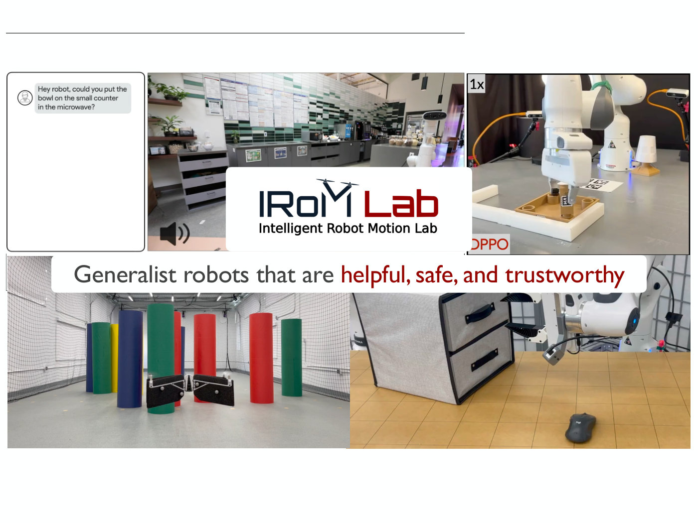

*Slide 6 — IRoM Lab: generalist robots that are helpful, safe, and trustworthy. [Deck](https://www.dropbox.com/scl/fi/oltefsy9ihq4efgxvtyn9/Lecture1.pdf?rlkey=4kc7a1r2pja5z932phyakcq73&dl=0)*

His example of the state of the art in generalist manipulation is **Gemini Robotics 2**, the
Google DeepMind robotics team's flagship project, released a couple of months before the
lecture (slide 7, ≈1:42–2:29). It is a **VLA, a vision–language–action model**. The robot is
given an instruction in natural language ("clean up the mess on the table"). It takes in its
sensor measurements from multiple cameras, processes them through "some gigantic neural network"
fine-tuned from the Gemini VLM (vision–language model), and outputs actions. He points to signs
of "remarkable dexterity" and generalization, which would have been hard to imagine a few years
earlier.

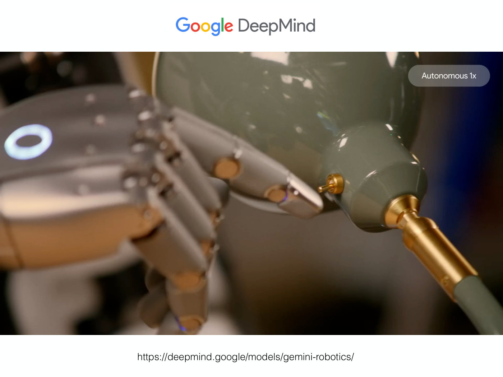

*Slide 7 — a frame from Google DeepMind's Gemini Robotics video: a dexterous robot hand at a desk lamp's switch, the kind of manipulation a vision–language–action model produces from a natural-language instruction. [Deck](https://www.dropbox.com/scl/fi/oltefsy9ihq4efgxvtyn9/Lecture1.pdf?rlkey=4kc7a1r2pja5z932phyakcq73&dl=0)*

What he finds even more remarkable is the money and attention. He names four startups (Physical
Intelligence, Generalist, a third company the captions render as "skilled", and Dyna), each of
which has raised hundreds of millions of dollars to pursue useful manipulation in real-world
environments (slide 8, ≈3:14). The slide shows a demo from each: a two-armed robot in a home
kitchen under the π logo, a gripper folding a box lid captioned "GEN-1.5", a laboratory bench
with test tubes, and a robot labelled "DYNA" chopping celery.

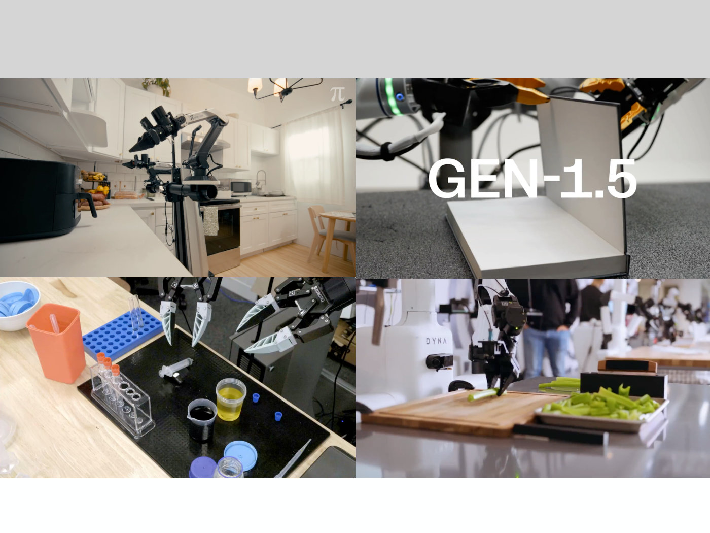

*Slide 8 — demos from four well-funded robot-manipulation startups: a two-armed home robot (π logo), a gripper captioned GEN-1.5, a lab-bench gripper, and a DYNA robot chopping celery. [Deck](https://www.dropbox.com/scl/fi/oltefsy9ihq4efgxvtyn9/Lecture1.pdf?rlkey=4kc7a1r2pja5z932phyakcq73&dl=0)*

Progress is not limited to manipulation. Slide 9 holds an embedded video that does not render in
the PDF (its caption is a YouTube link, www.youtube.com/watch?v=EtRXay2kqtc). The next shows
humanoid robots on a running track at the Beijing Humanoid Robot Games (slide 10, ≈3:14–4:00).
The spoken passage is badly garbled in the captions. What survives is that a robot's sprint was
"better than Usain Bolt's 100 meter sprint record", and the punchline, which the slide's news
caption shares: "lots of progress on running, maybe not as much progress on stopping."

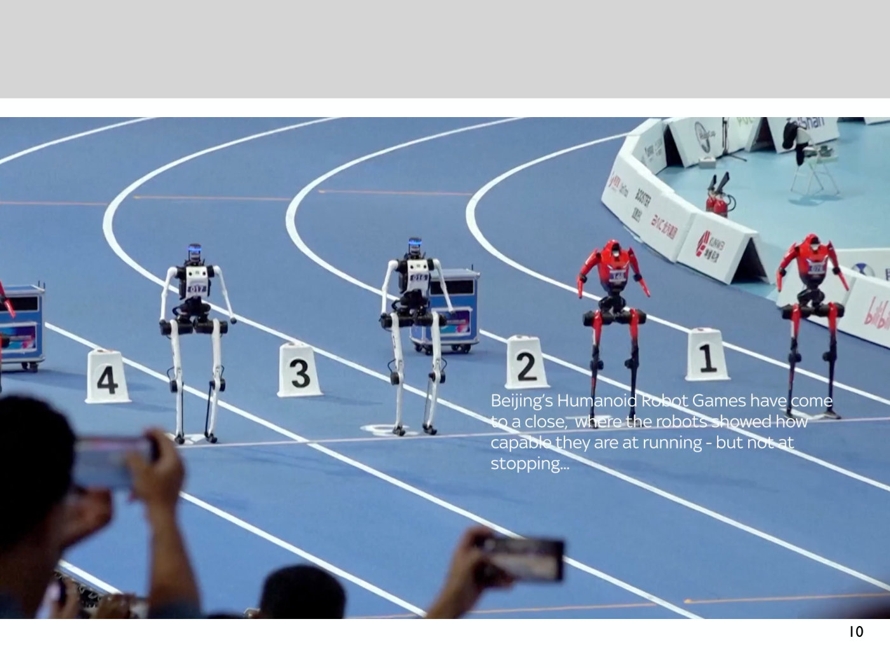

*Slide 10 — humanoid robots on the start line at the Beijing Humanoid Robot Games; the news caption's joke is that they are good at running but not at stopping. [Deck](https://www.dropbox.com/scl/fi/oltefsy9ihq4efgxvtyn9/Lecture1.pdf?rlkey=4kc7a1r2pja5z932phyakcq73&dl=0)*

Autonomous vehicles are the third example (slide 11, ≈4:00–5:32). Majumdar recalls Penn's team
in the DARPA autonomous-driving challenge when he was an undergraduate there, when there were
only "signs of life". In the past couple of years these systems have moved from labs and
controlled environments into the real world. He rode in a Waymo in San Francisco a few months
before the lecture. The experience is remarkable "for about the first minute or so and then
you're like, 'Oh yeah, this is totally normal.'" Waymo is launching across many US cities and beyond.
He thinks London was its second market outside the US, and it has announced Germany for the
following year.

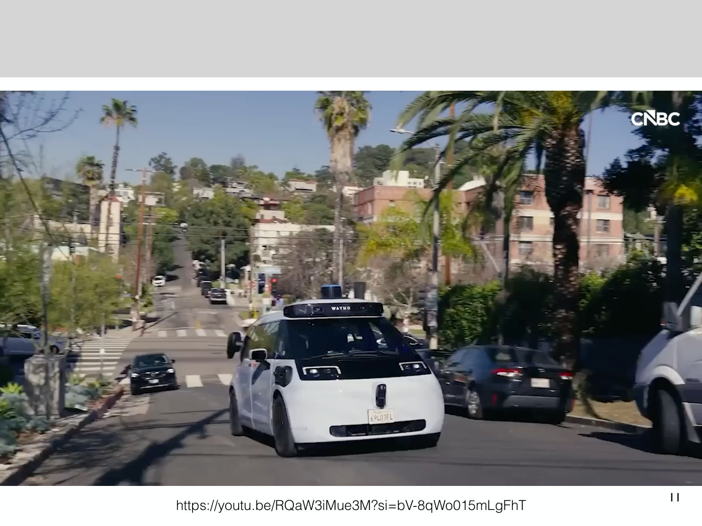

*Slide 11 — Waymo self-driving car (CNBC video). [Deck](https://www.dropbox.com/scl/fi/oltefsy9ihq4efgxvtyn9/Lecture1.pdf?rlkey=4kc7a1r2pja5z932phyakcq73&dl=0)*

### From labs to the real world

A run of news screenshots makes the point that long-dreamt-of technologies are now commercial
(≈5:32–7:06). Slides 12, 13 and 14 build up three headlines: Waymo's German launch, planned for
2027; Amazon Prime Air's autonomous drones reaching 500 US cities, delivering packages "at least
to select cities"; and the 1X Neo humanoid. For about 20,000 dollars you can have the Neo shipped
to your home. It is not fully autonomous: humans teleoperate it from their offices to do cleaning
and other chores.

The stat he found most striking is a chart of estimated market share by gross bookings in San
Francisco, Waymo against Uber and Lyft, from August 2023 to April 2025, per YipitData (slide 15,
≈6:20–7:06). Waymo rises from zero to about 27%. Lyft falls from about 34% to about 18.5%, and
Uber drifts from about 66% to about 54%. Waymo's line first meets Lyft's around November 2024
and is above it for good from early 2025. In his words: "late last year … the share for Waymo
surpassed the share for Lyft. More recently, maybe these have flattened out", but Waymo is at
least competitive with the major ride-sharing operations.

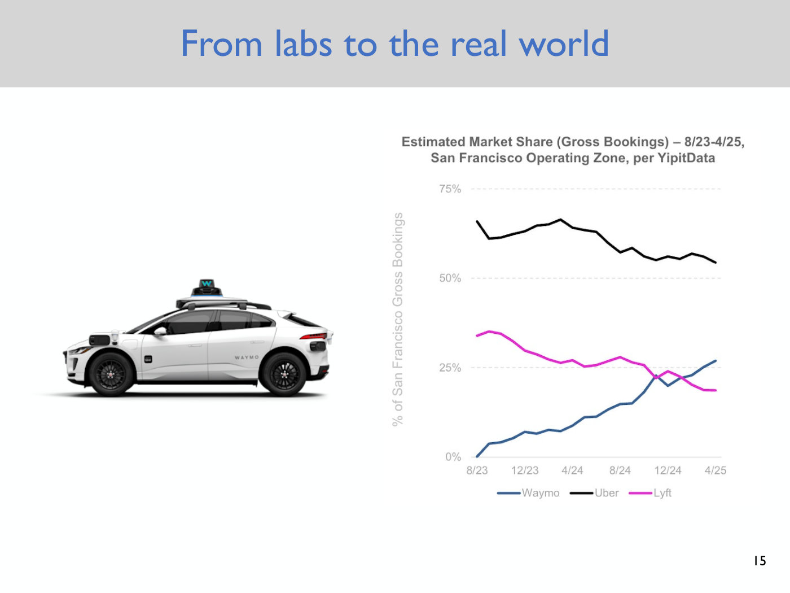

*Slide 15 — San Francisco gross-bookings share, Aug 2023 to Apr 2025 (YipitData): Waymo (blue) climbs from 0 to about 27% and passes Lyft (magenta) for good in early 2025, while Uber (black) stays above 50%. [Deck](https://www.dropbox.com/scl/fi/oltefsy9ihq4efgxvtyn9/Lecture1.pdf?rlkey=4kc7a1r2pja5z932phyakcq73&dl=0)*

With this come large-scale societal challenges, above all "well-founded worries" about these
systems taking human jobs and causing mass layoffs in particular sectors (≈7:06). The slides
here are a Futurism headline, "Uber Drivers Say Waymo Robotaxis Are Driving Down Their Pay"
(slide 16), and a *New York Times* headline, "Amazon Plans to Replace More Than Half a Million
Jobs With Robots", whose subhead reports a plan to automate 75 percent of the company's
operations (slide 17).

## The goal of the course

The overarching goal is to **understand the technical underpinnings of modern robotic systems**
(slide 18, ≈7:06–8:38). Along the way the course explores connections to neighbouring fields:
machine learning, control, optimization, computer vision. It also returns throughout to broader
impacts:

- **Privacy**: what does it mean to have a humanoid in your house that a human is
  teleoperating?
- **Ethics**: for example, the use of robots in warfare.
- **Alignment with human values**: how do we get autonomously operating systems to act in line
  with them?

The bulk of the course is technical, but he intends to touch on these implications as it goes.

## What is a robot?

"Side note: asking this question is a good way to start a fight at a robotics conference"
(slide 19). Majumdar finds it surprising that the most basic question in the field still causes
"really vigorous arguments" among experts (≈8:38).

### A brief (pre-)history

In his view people have been working on robotics for thousands of years (≈9:26–11:45). The
slide's timeline runs: Talos in Greek mythology (~1000 BC), an automaton charged with protecting
Crete; early automata (~300 BC–100 AD), such as machines that played music on their own; the
Banu Musa brothers (~800 AD); Ismail al Jazari (~1100s); Leonardo da Vinci (~1500s); Descartes
(~1600s); more complex automata (~1700s); and Charles Babbage (~1800s). His personal favourite
is the **Mechanical Turk**, a 1700s device that toured the royal courts of Europe as an
autonomous chess-playing machine (slide 20). It was not autonomous: a person hidden inside
worked the mechanical arms. He calls it perhaps "one of the first examples of a teleoperation
device that worked really well."

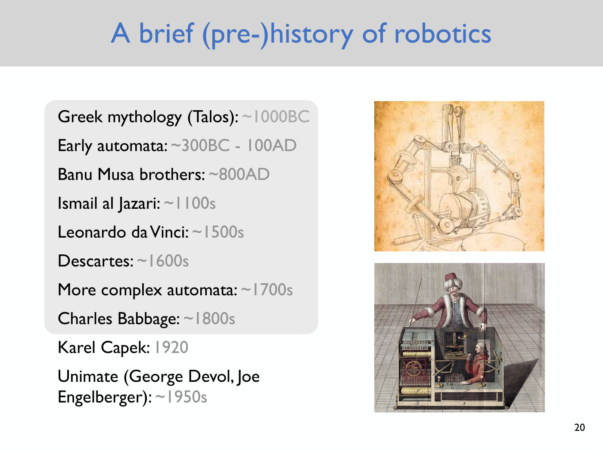

*Slide 20 — the pre-history timeline from Talos to Unimate; the lower image is the 18th-century Mechanical Turk chess automaton, secretly worked by a person hidden in its cabinet. [Deck](https://www.dropbox.com/scl/fi/oltefsy9ihq4efgxvtyn9/Lecture1.pdf?rlkey=4kc7a1r2pja5z932phyakcq73&dl=0)*

The word *robot* comes from **Karel Capek's play *Rossum's Universal Robots*** (1920),
from a Czech word meaning roughly "work" or "labor" (slide 21, ≈10:13–10:58). A student
supplies the Czech, *robota*.

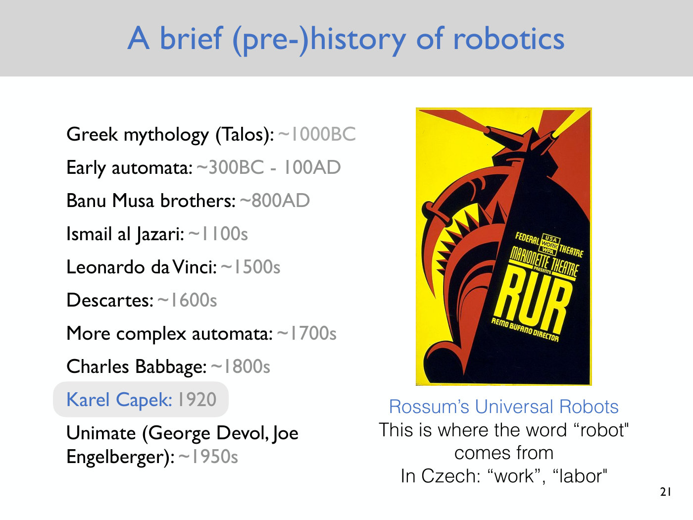

*Slide 21 — a Federal Theatre poster for Rossum's Universal Robots (Karel Capek, 1920), the play that gave us the word robot, from the Czech for work or labor. [Deck](https://www.dropbox.com/scl/fi/oltefsy9ihq4efgxvtyn9/Lecture1.pdf?rlkey=4kc7a1r2pja5z932phyakcq73&dl=0)*

The first system a modern roboticist would recognize as a robot is **Unimate**, a robotic
manipulator developed by George Devol and Joe Engelberger in the 1950s. It "has all the
physical components of a modern robotic system" (slide 22, ≈10:58).

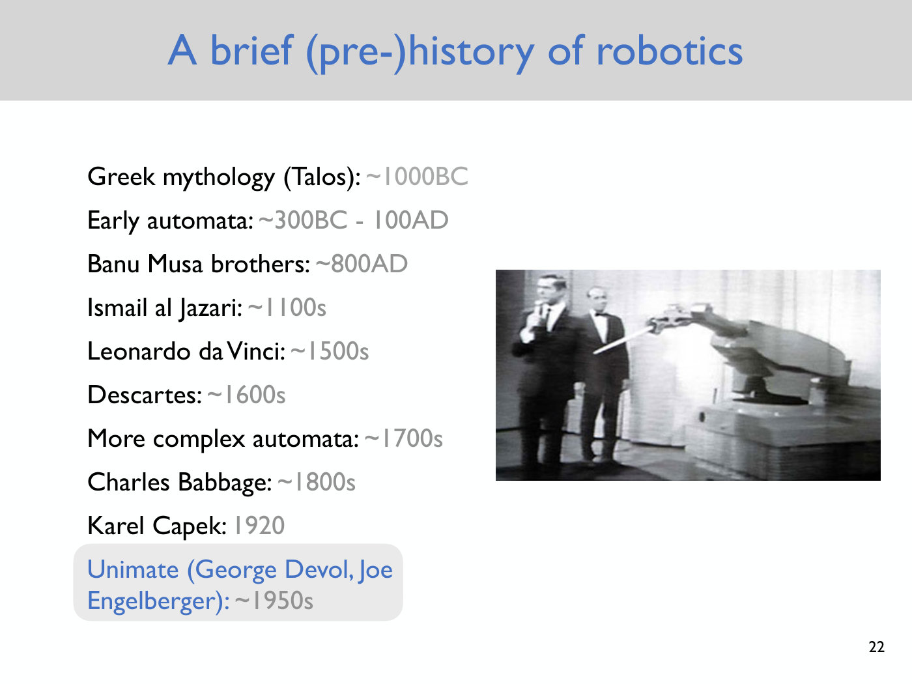

*Slide 22 — Unimate (George Devol and Joe Engelberger, 1950s), the first system a modern roboticist would recognize as a robot. [Deck](https://www.dropbox.com/scl/fi/oltefsy9ihq4efgxvtyn9/Lecture1.pdf?rlkey=4kc7a1r2pja5z932phyakcq73&dl=0)*

### A working definition

Majumdar's synthesis of the definitions he has seen (slide 23, ≈11:45):

> A robot is an **embodied agent** that can be **programmed** to perform **physical tasks**.

The three highlighted phrases are the tests applied to the examples below. He sets three other
"reasonable definitions" beside it (slide 24, ≈11:45–13:15), each with a different emphasis:

- *A machine, especially one programmable by a computer, capable of carrying out a complex
  series of actions automatically* (the Wikipedia/dictionary definition). This adds
  **automatically**, i.e. autonomy, and **complex**, which his own definition leaves out.
- *A reprogrammable, multifunctional manipulator designed to move material, parts, tools or
  specialized devices through variable programmed motions for the performance of a variety of
  tasks* (Robotics Industries Association). It uses many more words, and stresses **a variety
  of tasks**.
- *An autonomous machine capable of sensing its environment, carrying out computations to make
  decisions, and performing actions in the real world* (IEEE). This one says something about
  the **architecture** a system must have to count as a robot, the sense–compute–act structure
  developed [below](#anatomy-of-a-robotic-system-sensethinkact).

### Is this a robot? Six test cases

Disagreement lives at the edges, and the best way to see why is through examples (≈13:15). The
class argued each one, and the point, he says, "is not to come up with the definition … my goal
is just to have you think about these questions" (≈17:53).

**Boston Dynamics' Atlas** is "the canonical example of a robot. Like, if this is not a robot,
there is no robot." It is clearly an embodied agent, programmable, and able to do physical tasks
(slide 25, ≈13:15).

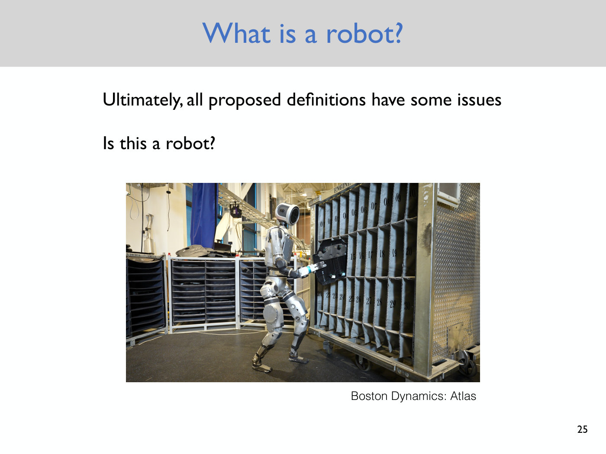

*Slide 25 — What is a robot? (Is this a robot? Atlas). [Deck](https://www.dropbox.com/scl/fi/oltefsy9ihq4efgxvtyn9/Lecture1.pdf?rlkey=4kc7a1r2pja5z932phyakcq73&dl=0)*

**The course's own drone**, a Crazyflie with a camera mounted on top, is also a robot by his
argument (slide 26, ≈13:15–14:48). It is embodied, and plainly programmable, since that is what
the assignments do. The only arguable test is the physical task. Students offered taking
pictures, flying, and navigation with collision avoidance.

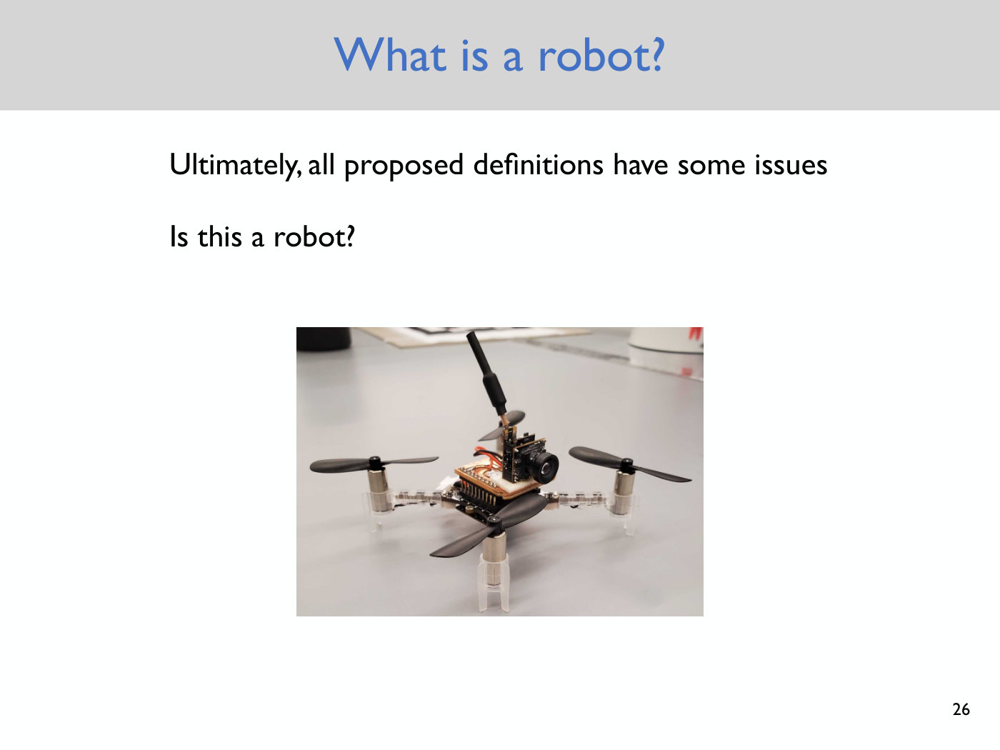

*Slide 26 — What is a robot? (Is this a robot? small drone). [Deck](https://www.dropbox.com/scl/fi/oltefsy9ihq4efgxvtyn9/Lecture1.pdf?rlkey=4kc7a1r2pja5z932phyakcq73&dl=0)*

**A dishwasher** is the first hard case (slide 27, ≈14:48–16:22). Two students argued that it
is a robot: it matches the embodied-agent and physical-task tests, and "if you put two googly
eyes on it, you'd expect it to be a robot." A third argued that it is not: you still have to
load it and close the door, so it does not do enough on its own. Majumdar draws out the two
factors the other definitions add. One is **autonomy**: the dishwasher is autonomous only once
loaded. The other is **variety and complexity of tasks**: its tasks are "very, very narrow in
scope." And, he adds, everyone would be disappointed if all the assignments were on a
dishwasher.

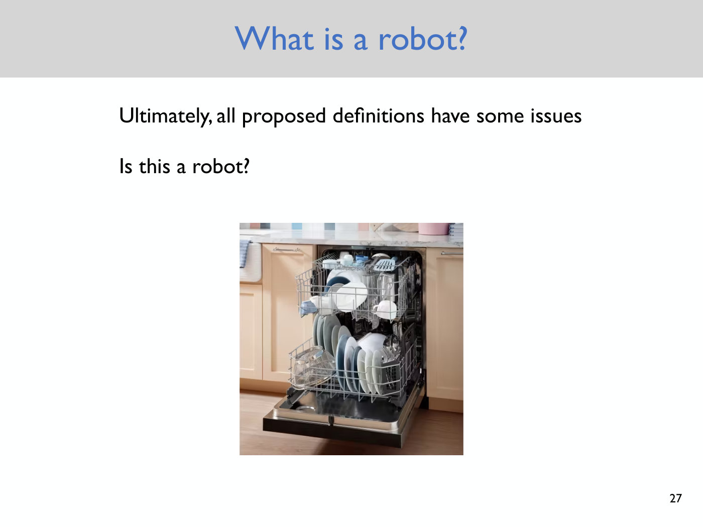

*Slide 27 — What is a robot? (Is this a robot? dishwasher). [Deck](https://www.dropbox.com/scl/fi/oltefsy9ihq4efgxvtyn9/Lecture1.pdf?rlkey=4kc7a1r2pja5z932phyakcq73&dl=0)*

**An automatic door**, which uses a sensor to open when someone approaches, is an embodied agent
with a physical task (slide 28, ≈16:22–17:08). A student argued it qualifies by the definition
and pointed out that it once seemed remarkable ("whoa, doors are opening on their own"), much
as elevators once had human operators and now do not.

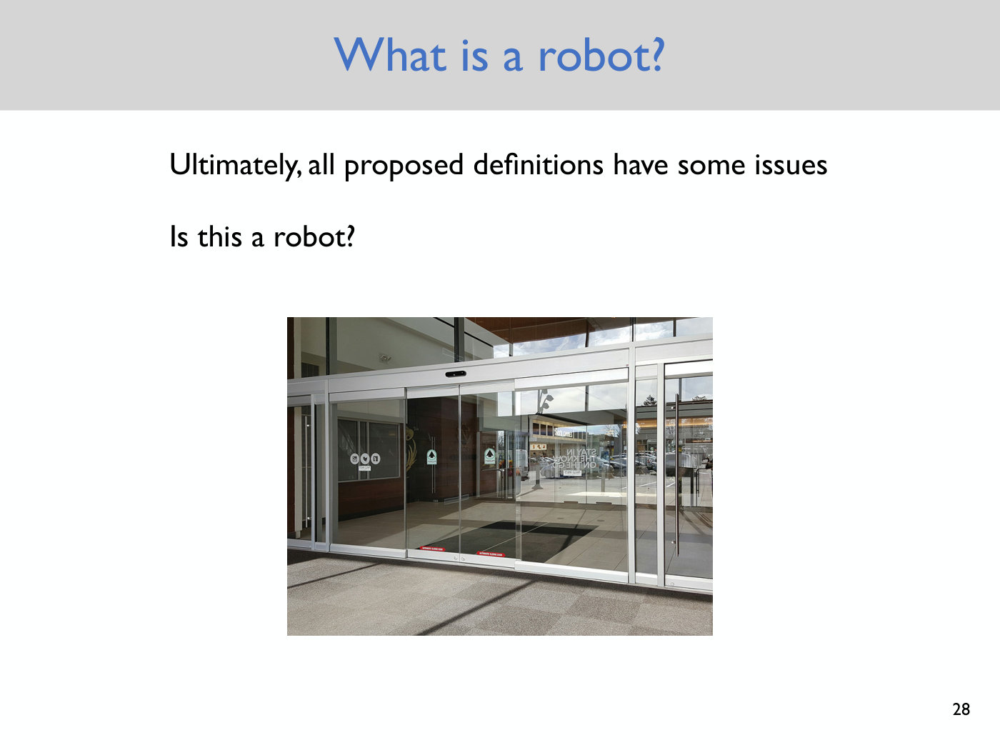

*Slide 28 — What is a robot? (Is this a robot? automatic door). [Deck](https://www.dropbox.com/scl/fi/oltefsy9ihq4efgxvtyn9/Lecture1.pdf?rlkey=4kc7a1r2pja5z932phyakcq73&dl=0)*

**A home assistant** (a smart speaker) is not doing a physical task, said one student, unless
you consider it as part of a system, for example one that turns on your air conditioner
(slide 29, ≈17:08–17:53).

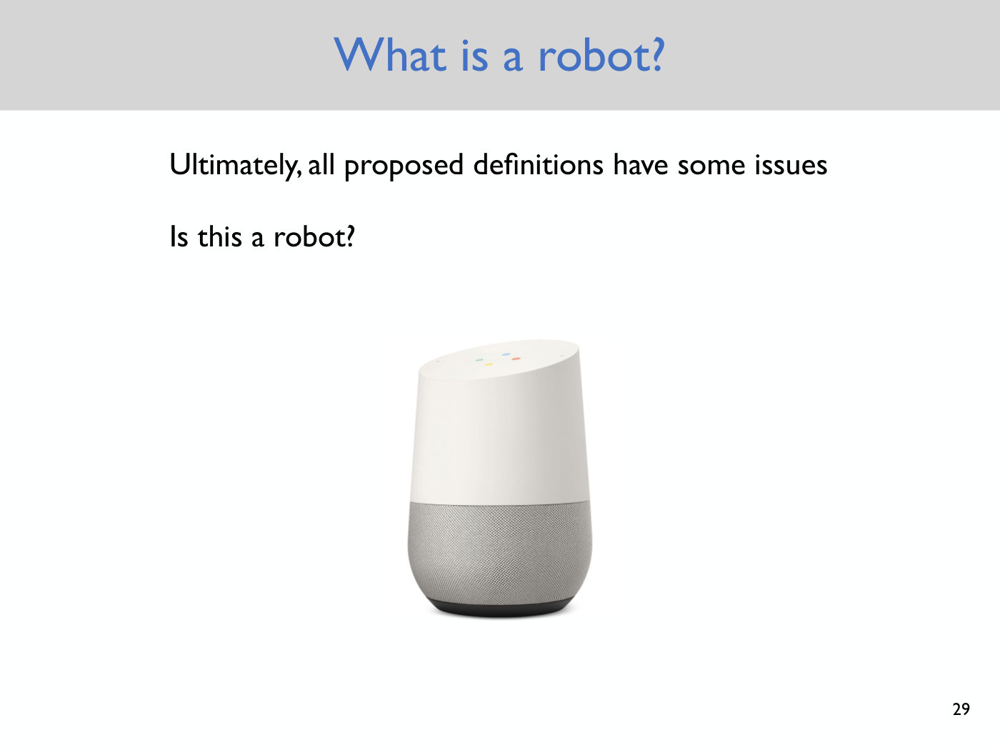

*Slide 29 — What is a robot? (Is this a robot? smart speaker). [Deck](https://www.dropbox.com/scl/fi/oltefsy9ihq4efgxvtyn9/Lecture1.pdf?rlkey=4kc7a1r2pja5z932phyakcq73&dl=0)*

**The da Vinci surgical robot from Intuitive Surgical** is not fully autonomous, because a
surgeon teleoperates it. Yet not calling it a robot "would be a shame". He considers it one of
the most commercially successful examples of robotics ever (slide 30, ≈17:53).

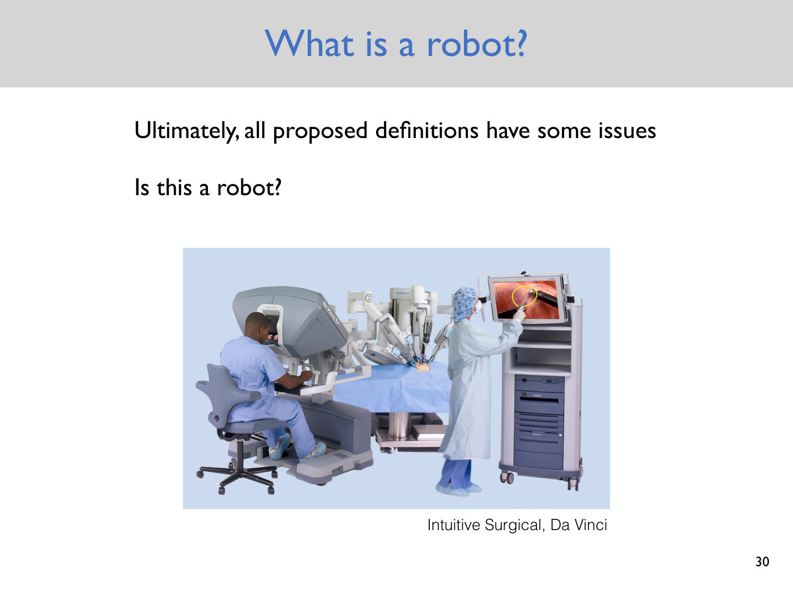

*Slide 30 — What is a robot? (Is this a robot? Da Vinci). [Deck](https://www.dropbox.com/scl/fi/oltefsy9ihq4efgxvtyn9/Lecture1.pdf?rlkey=4kc7a1r2pja5z932phyakcq73&dl=0)*

All the proposed definitions have some issues. The slides point to
<https://robotsguide.com/learn/what-is-a-robot> for a longer discussion of them (slide 31,
≈18:40).

## Anatomy of a robotic system: sense–think–act

Even without an agreed definition, most roboticists agree on a robot's main components
(slide 32, ≈18:40–20:56), illustrated on the course drone:

*Slide 32 — the sense–think–act loop on the course's Crazyflie: sensors (IMU, optical flow camera) feed computation, which commands the actuators (motors and propellers), clockwise and repeating. [Deck](https://www.dropbox.com/scl/fi/oltefsy9ihq4efgxvtyn9/Lecture1.pdf?rlkey=4kc7a1r2pja5z932phyakcq73&dl=0)*

- **Actuators** let the robot effect physical change in its environment. On the drone they are
  the propellers and motors.
- **Sensors** let it sense its own state or the state of the world. The drone has several. An
  **inertial measurement unit (IMU)** gives it a sense of its orientation and acceleration. An
  **optical flow camera** points down at the ground and looks for relative motion: "if that
  downward-facing camera sees everything moving this way, then it infers that the drone must be
  moving that way." Together with a **height sensor**, this gives a fairly accurate estimate of
  the drone's velocity relative to the ground. Optical flow gets its own lecture later in the
  course, [Lecture 9](09-optical-flow.md).
- **Computation** takes in sensor measurements and processes them to decide which actuator
  commands to apply. It might be "some hand-engineered system that you've coded up" or "a
  gigantic neural network that you've trained using lots of data."

Together these form **the sense–think–act cycle**: sense, compute, act, and repeat "in a closed
feedback loop." Most robotic architectures are built this way. See
[sense–think–act](sense-think-act.md) for the concept across the course.

## The three technical areas of the course

The course falls roughly into three areas (slide 33, ≈20:56–22:29):

*Slide 33 — the course's three technical areas and their topics: planning and control, localization and mapping, robot learning. [Deck](https://www.dropbox.com/scl/fi/oltefsy9ihq4efgxvtyn9/Lecture1.pdf?rlkey=4kc7a1r2pja5z932phyakcq73&dl=0)*

1. **Planning and control**: geometric planning, robot dynamics, feedback control, planning
   with dynamics. It starts with **geometric motion planning**: how a robot plans a trajectory
   from point A to point B without colliding with obstacles, or how a manipulator reaches a
   target object around obstacles. At first the drone's dynamics are ignored and the task is
   treated as finding a curve. Then come the dynamics, "F equals MA" ($F = ma$): what the
   forces are and how they change the drone's state. Finally, control: making the drone hover
   or follow a desired trajectory.
2. **Localization and mapping**: Bayes filtering, Kalman filters, particle filters, SLAM. How
   the drone estimates its own state (position, velocity) and the state of the world: where the
   obstacles are, what their geometry is, and perhaps the semantic categories of the agents and
   objects around it. In this knowledge base the module so far is
   [Lecture 9 — Optical Flow](09-optical-flow.md) and
   [Lecture 10 — Nondeterministic Filter](10-nondeterministic-filter.md); see
   [state estimation](state-estimation.md).
3. **Robot learning**: imitation learning, generative architectures, reinforcement learning,
   world models. How robots learn their own dynamics, the world's dynamics, or how to act. The
   course covers imitation learning (learning from humans) and architectures such as flow
   matching, "the backbones of modern imitation learning and robot learning more broadly". It
   ends with reinforcement learning and world models "if we have some time".

[The course map](course-map.md) lists the lectures under each area.

## What makes robotics hard? Uncertainty

Why do we need all this? The things shown earlier (manipulating objects, running, driving)
come naturally to humans, but it is very hard to program robots to do them. This is **Moravec's
paradox**: what seems easy and effortless for us is extremely hard to get robots to do
autonomously (≈22:29–23:14).

His answer to what makes it hard is one word: **uncertainty** (slide 35, ≈24:01). "All the
different topics that we've covered, the reason we need them, and the reason it's hard from a
technical perspective, has to do with uncertainty." To build intuition he analyses three failure
videos, all from the month or two before the lecture, asking each time what was uncertain. He
stresses that there is no single right answer and that the true causes are not public.

**Case 1: a delivery drone drops a package into a swimming pool** (slide 36, ≈24:47–26:18).
An Amazon Prime Air delivery from August 17, reported by ABC7 under the headline "Amazon drone
delivery drops woman's package into swimming pool". Student hypotheses:

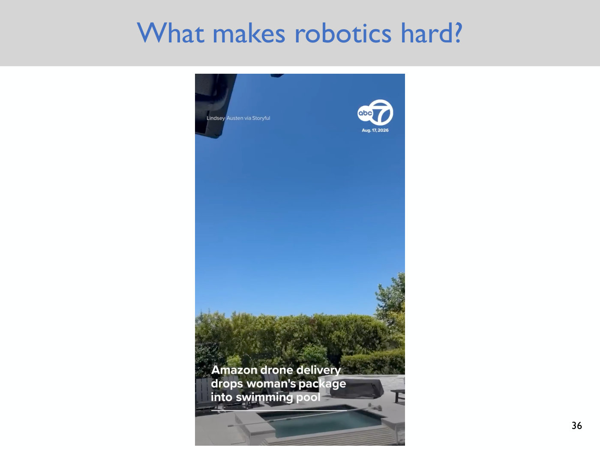

*Slide 36 — uncertainty case 1: an Amazon delivery drone dropped a package into a backyard swimming pool (ABC7, Aug. 17, 2026). [Deck](https://www.dropbox.com/scl/fi/oltefsy9ihq4efgxvtyn9/Lecture1.pdf?rlkey=4kc7a1r2pja5z932phyakcq73&dl=0)*

- **Localization.** The drone reached a user-defined GPS drop point, believed it was there, but
  had not localized itself correctly.
- **Perception out of distribution.** A vision system checking the ground beneath the drone may
  have misidentified the pool as ordinary ground. Pools are "kind of out of distribution."
- **User error** in marking the drop-off. Majumdar notes that the system should ideally be
  robust to such errors.

**Case 2: a humanoid weightlifting robot fails mid-lift** (slide 37, ≈26:18–29:40). This one is
also from the Beijing humanoid robot games; the captions garble the lead-in. Student hypotheses:

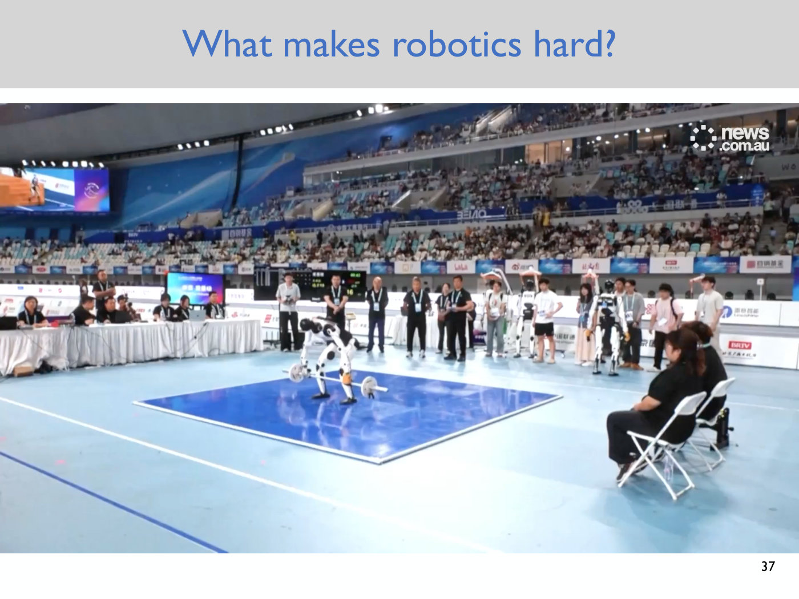

*Slide 37 — uncertainty case 2: a frame from the video of the humanoid weightlifting failure the class analysed, with the robot bent over a loaded barbell. [Deck](https://www.dropbox.com/scl/fi/oltefsy9ihq4efgxvtyn9/Lecture1.pdf?rlkey=4kc7a1r2pja5z932phyakcq73&dl=0)*

- **A switching error.** The robot thought the first subtask of the lift was done when it was
  not, and carried on with its planned action.
- **Uncertain estimates of its own state.** It lacks human-like sensing, so its inferences about
  where its body was and what it was holding were wrong.
- **Not knowing what it doesn't know**, i.e. uncertainty in its own abilities.
- **A programming error.** It seemed to move forward as it lifted.

Majumdar adds his own hypothesis. State-of-the-art legged locomotion controllers are often
trained with **reinforcement learning in a simulator**, a trial-and-error process that learns a
neural-network controller against a nominal dynamics model. They are made robust with **domain
randomization**: randomizing physical parameters such as friction, masses and inertias, "in the
hope that the real world lies somewhere in the combination of things that you've randomized."
Either the learning fixated on peculiarities of the simulator, or there was a plain mismatch
between simulation and reality: **the sim-to-real gap**.

**Case 3: a Waymo collides with a human-driven car** (slide 38, ≈29:40–31:13). The collision
was somewhere around Sunnyvale, California; the dashcam's GPS stamp agrees. News reports said
the Waymo stopped to exchange insurance information. Student hypotheses:

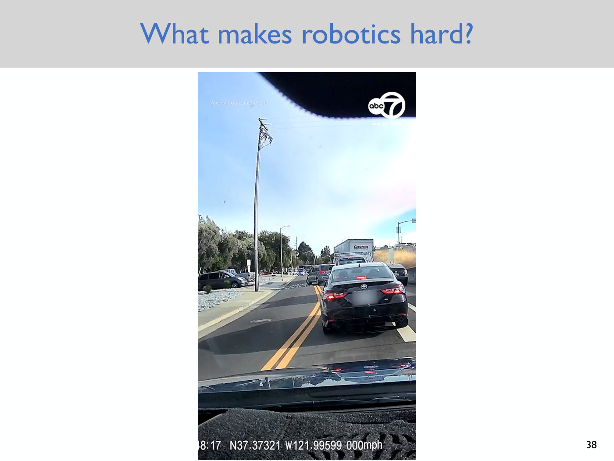

*Slide 38 — uncertainty case 3: a dashcam frame from the video of the Waymo collision the class analysed; the GPS stamp places it near Sunnyvale. [Deck](https://www.dropbox.com/scl/fi/oltefsy9ihq4efgxvtyn9/Lecture1.pdf?rlkey=4kc7a1r2pja5z932phyakcq73&dl=0)*

- **Partial observability.** From the Waymo's viewpoint, the oncoming car was hidden by a car in
  the middle.
- **Uncertainty about the human driver.** The human should have yielded, and the Waymo assumed
  the human would behave rationally. Majumdar calls this a prediction about the human's
  "emotions and intent."
- He adds that it may also be a hard-to-attribute error inside the large neural networks
  running these systems, which are not transparent.

### Uncertainty in each area

Keep uncertainty in mind through the whole course: "I think it's absolutely fundamental to
everything in robotics" (slide 39, ≈32:01–32:48). Each technical area faces its own forms:

*Slide 39 — the same three areas, each with the uncertainty it has to handle: dynamics and initial state; robot and world state, geometry, semantics; data quality, human intent, rewards. [Deck](https://www.dropbox.com/scl/fi/oltefsy9ihq4efgxvtyn9/Lecture1.pdf?rlkey=4kc7a1r2pja5z932phyakcq73&dl=0)*

| Area | Uncertainty in |
| --- | --- |
| Planning and control | the dynamics of the robot; the dynamics of the world; the robot's initial state; … |
| Localization, mapping | the state of the robot; the state and geometry of the world; the semantics of the environment; … |
| Robot learning | the quality of the data (e.g. in imitation learning); human intent (as in the Waymo case); the rewards from the world, or estimated in reinforcement learning; … |

He argues that "basically every algorithmic contribution or theoretical contribution in robotics
in some way or the other tries to address some particular form of uncertainty." See
[uncertainty](uncertainty.md).

## Hardware: the Crazyflie drone

"This would not be a robotics course without actual physical robots" (≈32:48). The best way to
appreciate the technical challenges is to try things on hardware: "Nothing like seeing things
work (or not) in practice!" This year the course uses the **Crazyflie 2.1 brushless** drone, an
open-source platform that is small, light and ideal for testing (slide 40, ≈32:48–34:21).

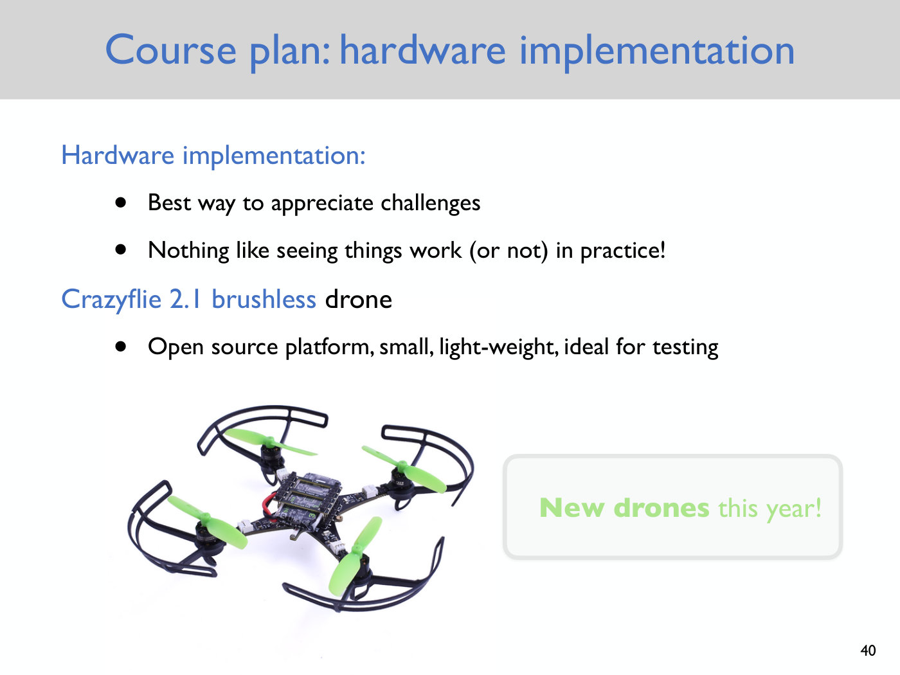

*Slide 40 — the Crazyflie 2.1 brushless drone used for every hardware assignment, new for Fall 2026. [Deck](https://www.dropbox.com/scl/fi/oltefsy9ihq4efgxvtyn9/Lecture1.pdf?rlkey=4kc7a1r2pja5z932phyakcq73&dl=0)*

The fleet is new. Course evaluations from the previous year had raised "lots of well-founded
complaints" about the earlier, non-brushless drones, and the department paid to overhaul it.
The motors, flight time and battery should all be better, and the analog cameras are replaced
by digital FPV cameras. He asks students to report hardware problems early rather than at the
end of the course.

The hardware goal is to **make the drone navigate autonomously** through an obstacle
environment set up in the lab (slide 41, ≈34:21–35:54). A video from the previous year's final
project shows how this works. On demo day the obstacles are placed in a configuration the team
has not seen. The drone's camera streams images to a laptop, where a **visual navigation policy
trained by imitation learning**, a neural network, does the navigation. The course builds up
to this.

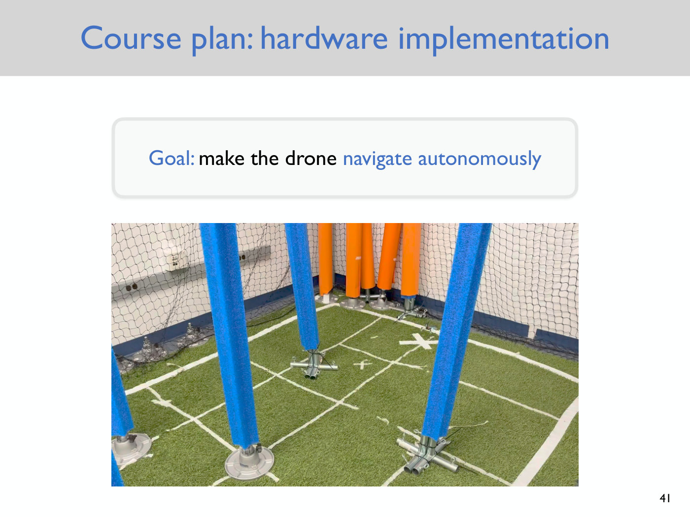

*Slide 41 — the hardware goal, autonomous navigation, and one of the netted flight arenas with its foam-padded pole obstacles. [Deck](https://www.dropbox.com/scl/fi/oltefsy9ihq4efgxvtyn9/Lecture1.pdf?rlkey=4kc7a1r2pja5z932phyakcq73&dl=0)*

Hardware work is done in **teams of four**, formed by the following Wednesday, September 9,
and emailed to course staff (slide 42, ≈35:54–36:40). The 12 graduate students form three
teams of four among themselves. Ed Discussion has a thread to help. He recommends teams that mix
majors (MAE, computer science and the others represented in the class), since the course spans
control, Python programming, motion planning and learning.

The netted flying spaces are in G109 in the E-Quad and the SEAS Robotics Lab, and general
lab-safety training through Princeton EHS is required for access (slide 43, ≈55:56–56:42).
Details on the drone, its sensors and the lab are on [the Crazyflie page](crazyflie.md).

## Course logistics

The logistics run from about 36:40 to the end and are collected on
[course logistics](course-logistics.md). In brief:

- **Staff**: four TAs, Asher Hancock, Jutang Gao, Kian Orr and Yanbo Xu, with emails in the
  syllabus (slide 45, ≈36:40). Jon Prevost of MAE sets up the lab spaces and hardware and
  built the custom PCB that powers the drone cameras. Copy him when a drone breaks
  (slide 46, ≈37:25–38:58).
- **Prerequisites**: multivariable calculus, linear algebra, basic probability, basic
  differential equations, and some programming in Python (slide 47, ≈38:58–42:04). He calls
  the list "overly conservative". What matters most is multivariable calculus and linear
  algebra, the latter especially for feedback control. He will refresh probability: about
  70–80% of the room said they could write down Bayes' rule. For differential equations,
  nothing is solved analytically except the linear ones. You only need the idea that a
  differential equation in a state, here $\dot{x} = f(x)$, predicts the state at any future
  time from an initial state, and that it can be integrated numerically. (The captions read
  "x equals f of x"; the dot is implied by the context of a differential equation.)
- **Grading**: weekly problem sets 40% (assigned Wednesday, due Wednesday midnight; theory and
  coding individually, hardware in teams); an in-person term exam 30%, planned for roughly
  November; final project 30%, vision-based navigation on the drones (slide 48,
  ≈42:04–43:37).
- **Office hours**: five hours a week, one from each TA and one from Majumdar, held in a lab
  space (slide 49, ≈43:37).
- **Policies**: collaboration is encouraged, but write-ups and code are your own except for the
  hardware portions. Late work loses 10% per day and is not accepted after a week, with
  exceptions for emergencies but not for busyness. Attendance is not tracked but is strongly
  encouraged (slide 50, ≈44:23–45:56).
- **References**: no required textbook. Three references are named: *Principles of Robot
  Autonomy* (Gammelli, Lorenzetti, Luo, Zardini, Pavone), free on arXiv; LaValle's *Planning
  Algorithms*, a classic for motion planning; and *Probabilistic Robotics* (Thrun, Burgard, Fox)
  for localization, mapping and SLAM (slide 55, ≈52:53–54:24).
- **Tools**: Gradescope and Ed Discussion, both through Canvas. Ask on Ed rather than by email
  unless it is confidential (slide 56, ≈54:24–55:09).
- **ROB 345 vs. ROB 549**: 60 undergraduates in 345 and 12 graduate students in 549. Lectures
  and most assignments are shared; 549 gets extra or different problems, clearly marked, and
  possibly a slightly different exam (slide 57, ≈55:09–55:56).

## Generative AI: the course's position and policy

Majumdar sees "really massive potential" for generative AI in education, alongside a
fundamental tension. You want to be proficient with the latest coding agents while having "the
individual and collective discipline to learn the fundamentals" (slide 51, ≈45:56–46:42).

He frames the individual response as a spectrum between two extremes (slide 52, ≈46:42–48:15).
At one end is **Luddism**: "Never use AI for anything!" At the other is what he calls the
inevitabilist or **nihilist** argument: "AGI is inevitable. No need to learn anything!" Where
you sit is your own decision. He notes that the people now making the inevitabilist argument
include many who told us ten years ago that everyone must learn to code, and who said social
media would solve our social problems. Some of them are now paying 18 billion dollars to
settle lawsuits filed by "nearly every state in the country". He is not saying the argument is wrong, only that you should decide for yourself.

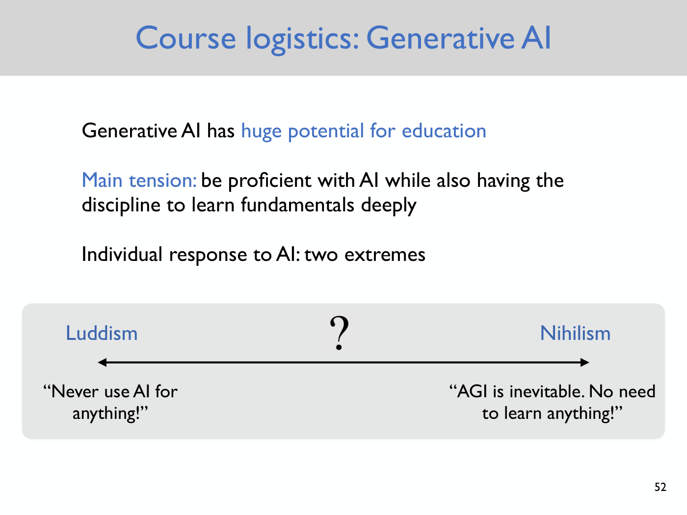

*Slide 52 — the individual response to generative AI as a spectrum, from Luddism (never use AI) to nihilism (AGI is inevitable, so learn nothing). [Deck](https://www.dropbox.com/scl/fi/oltefsy9ihq4efgxvtyn9/Lecture1.pdf?rlkey=4kc7a1r2pja5z932phyakcq73&dl=0)*

His personal case study is a chat with Claude about LLM mid-training for a PhD student's project
(slide 53, ≈49:02–50:37). The model argued confidently that his proposal ("M1-as-teacher") was
"specifically wrong for this case." He cited a paper by Princeton computer-science colleagues
(arXiv 2510.18874) whose finding pointed the other way, and the model flipped completely: "Why
this makes your proposal the strong version." The model was one of the latest Claude models; he
was not sure which. His lesson: these tools have massive potential for explaining technical
topics, but they are "imperfect in very, very subtle ways." Catching this error required
already knowing the paper.

**The policy permits four uses**, and no others (slide 54, ≈51:22–52:53):

1. Analysing your past, already-submitted assignments, including what you got wrong.
2. Explaining technical concepts.
3. Asking about Python syntax ("basically flawless at syntactical things").
4. **Any use at all** for the hardware-based team assignments and the final project. The point
   is to learn the strengths and limits of coding agents where there is "some loop with the
   physical system itself."

If you think of another valuable use, he asks you to tell him.

## What comes next

The deck ends with the three-area topic map, with "Planning and control" highlighted and
"Geometric planning" in bold. The next lecture starts the technical content with geometric
motion planning (≈56:42): see [Lecture 2 — Discrete Motion Planning](02-discrete-motion-planning.md)
and [the course map](course-map.md).

## Gaps in the record

The captions are garbled in a few places, marked `[Ed: unclear]` in the
[transcript](../raw/transcripts/01-intro-to-robotics.md). These include:

- the name of the third startup at ≈3:14;
- most of the humanoid-running passage at ≈3:14–4:00;
- the lead-in to the weightlifting video at ≈27:20;
- one of the majors listed at ≈36:40;
- a verb about coding agents and the hardware assignments at ≈52:07.

This page does not fill those gaps.
