# Lecture 2 — Discrete Motion Planning

Anirudha Majumdar, Princeton ROB 345/549, Fall 2026 ·
[video](https://www.youtube.com/watch?v=LhLd8Kon1GY) (75 min) ·
[slides (PDF, Dropbox)](https://www.dropbox.com/scl/fi/pnwucnirlwgviqwaj67hl/Lecture2.pdf?rlkey=6s2et2apw9rtnvr8x2ke243sp&dl=0) ·
[slide-by-slide text](../raw/slides/02-discrete-motion-planning.md) ·
[transcript](../raw/transcripts/02-discrete-motion-planning.md)

**What this lecture establishes.** The first technical lecture opens the planning-and-control
module with **geometric motion planning**: get a robot from configuration A to configuration B
without collisions, assuming any path can be followed, the robot's state is known exactly, and
the map is given. It defines **degrees of freedom**, the **configuration space** $C$, and its
free and obstacle subsets $C_{free}$ and $C_{obs}$, which turn the problem into "find a path in
$C_{free}$ from $q_A$ to $q_B$". It then solves the problem by **discretizing** the space into a
grid and running **graph search** on it. Breadth-first search (BFS) and depth-first search (DFS)
are presented as two ways of choosing the next vertex to explore, and **A\*** as a third that
uses a cost-to-come plus an underestimate of the cost-to-go. Each is walked through on the same
5-by-5 grid.

Slide numbers are the numbers printed on the slides, and in this deck they equal the PDF page
numbers. Timestamps (≈M:SS) point into the video and the
[transcript](../raw/transcripts/02-discrete-motion-planning.md). The concepts have their own
pages: [configuration space](configuration-space.md) and [graph search](graph-search.md).

## Contents

1. [Where this lecture sits](#where-this-lecture-sits)
2. [Geometric motion planning](#geometric-motion-planning)
3. [Degrees of freedom](#degrees-of-freedom)
4. [Configuration space, free space and obstacle space](#configuration-space-free-space-and-obstacle-space)
5. [Discretization](#discretization)
6. [Planning as graph search](#planning-as-graph-search)
7. [The forward search algorithm](#the-forward-search-algorithm)
8. [Breadth-first search, worked on the grid](#breadth-first-search-worked-on-the-grid)
9. [Depth-first search](#depth-first-search)
10. [Two limitations of BFS, and the cost of a plan](#two-limitations-of-bfs-and-the-cost-of-a-plan)
11. [The A\* algorithm](#the-a-algorithm)
12. [A\* worked on the grid](#a-worked-on-the-grid)
13. [BFS against A\*, and learned heuristics](#bfs-against-a-and-learned-heuristics)
14. [The full A\* algorithm](#the-full-a-algorithm)
15. [What comes next](#what-comes-next)
16. [Gaps in the record](#gaps-in-the-record)

## Where this lecture sits

Majumdar restates the course's overarching goal with a video from a final project in a previous
year of the course: autonomous vision-based navigation (slide 2, ≈0:10). On demo day the team
does not know where the obstacles will be. A fixed number of them are placed semi-randomly that
morning, and the drone has to use its onboard sensors to avoid them, reach the end of the course
without collisions, and find a target object, a book. The sensors are an inertial measurement
unit, an optical flow camera that gives velocity information, and a forward-facing camera used
for obstacle detection (≈0:56).

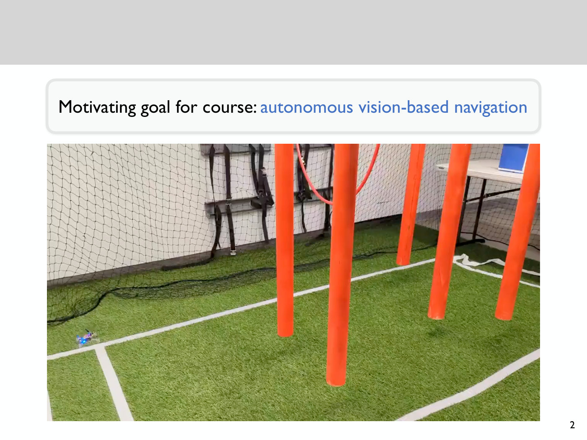

*Slide 2 — a frame of the motivating video: a past year's final project, the drone flying a netted arena of orange columns placed that morning, using only its onboard sensors. [Deck](https://www.dropbox.com/scl/fi/pnwucnirlwgviqwaj67hl/Lecture2.pdf?rlkey=6s2et2apw9rtnvr8x2ke243sp&dl=0)*

He then recaps the three technical modules (slides 3 and 4, ≈0:56–2:28). **Planning and
control** asks how a robot gets from point A to point B when it knows where the obstacles are,
and then how to account for dynamics, since not every motion is feasible. **Localization and
mapping** drops the assumption of a given map: the robot has to work out what the environment
looks like and where it is in it. **Robot learning** covers imitation learning, reinforcement
learning and, time permitting, world models. This lecture starts the first module, with what he
calls geometric motion planning. The course makes very restrictive assumptions at first and
removes them one at a time over the term (≈2:28–3:13).

## Geometric motion planning

The first assumption is a **geometric model of the environment**, provided before the robot
starts operating (slide 5, ≈3:13–3:59). Majumdar notes that the phrase "is doing a lot of work":
the model might be a point cloud like the one on the slide, an occupancy map such as a voxel grid,
or a neural surface. The course returns to these options later. For now, everything that is an
obstacle and everything that is free is marked.

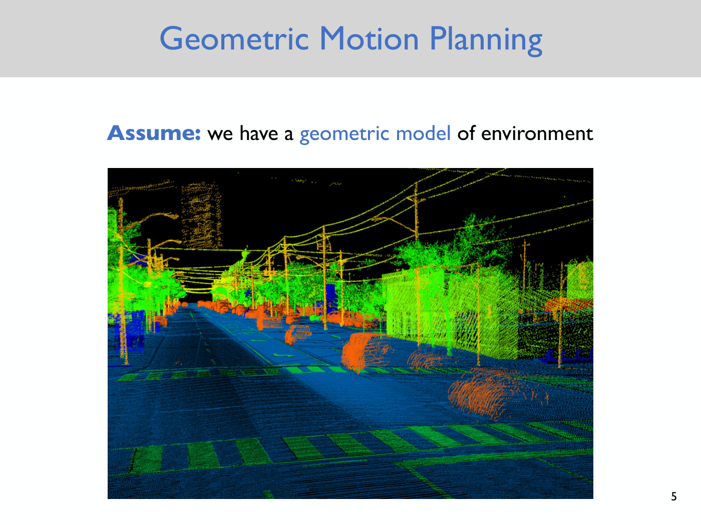

*Slide 5 — the geometric model of the environment that geometric planning assumes is given, here a street-level point cloud coloured by surface: road, trees and walls, poles and wires, cars. [Deck](https://www.dropbox.com/scl/fi/pnwucnirlwgviqwaj67hl/Lecture2.pdf?rlkey=6s2et2apw9rtnvr8x2ke243sp&dl=0)*

The question is then how to get the robot from a starting point A to a goal B without colliding
with any obstacle in that map (slide 6, ≈3:59).

**The piano mover's problem.** The problem is "surprisingly geometrically challenging" and is
known in robotics as the piano mover's problem. The slide's video shows a literal piano being
manoeuvred in simulation, where both the piano's geometry and the environment's have to be taken
into account (slide 7, ≈4:44).

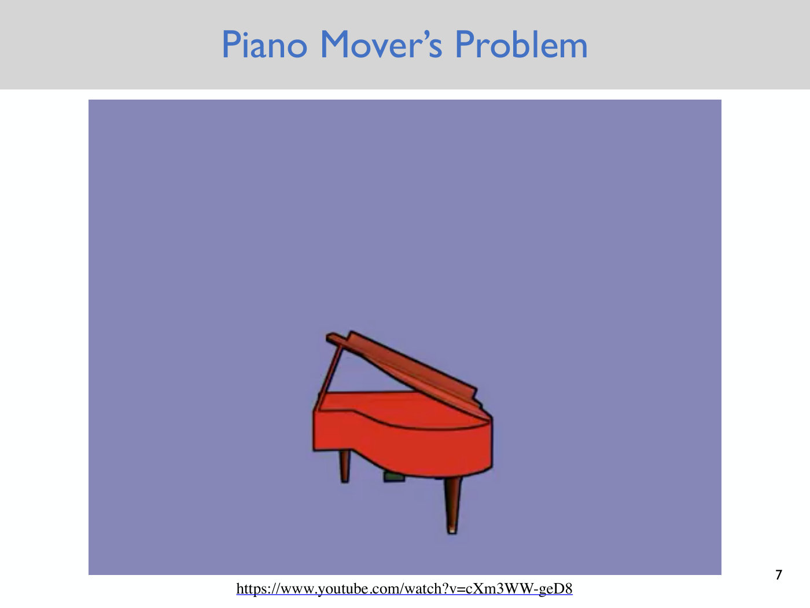

*Slide 7 — Piano Mover's Problem (video). [Deck](https://www.dropbox.com/scl/fi/pnwucnirlwgviqwaj67hl/Lecture2.pdf?rlkey=6s2et2apw9rtnvr8x2ke243sp&dl=0)*

The problem has a long history in robotics, going back to the 1980s, and much of the early work
was on its computational complexity (slide 8, ≈4:44–5:31). One early result was that it is
**PSPACE-complete**. Majumdar's gloss is that, assuming standard conjectures in complexity
theory, the problem "requires polynomial space to be able to solve in its generality" (≈5:31).
Today "piano mover's problem" is synonymous with motion planning.

**Examples of planning.** Three applications follow.

**Zoox**, which Majumdar describes as Amazon's autonomous-vehicle subsidiary, is the first
(slide 9, ≈5:31–7:48). The top half of its video is the vehicle's egocentric camera view; the
bottom half is the geometric representation the car builds, with its currently computed motion
plan as a green path ("if it's red it means it's going to stop, I think"). Unlike the setup of
this lecture, the map is not given in advance and keeps changing as pedestrians and cars move, so
the vehicle constantly updates its occupancy and semantic representation. He gives the example
that autonomous vehicles check whether a pedestrian is looking at a phone, since that person's
motion is more uncertain.

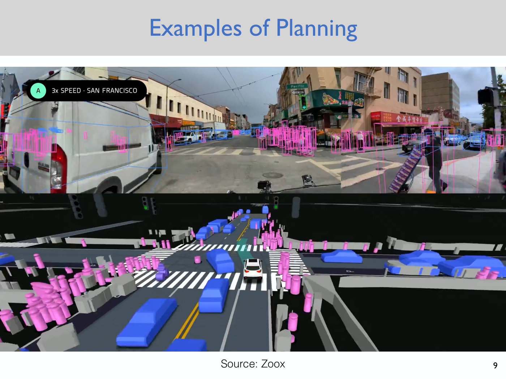

*Slide 9 — Zoox: the camera view with pedestrians and vehicles boxed (top), and the geometric scene the car builds, in which it plans its path (bottom). [Deck](https://www.dropbox.com/scl/fi/pnwucnirlwgviqwaj67hl/Lecture2.pdf?rlkey=6s2et2apw9rtnvr8x2ke243sp&dl=0)*

**Protein folding** is the second (slide 10, ≈7:48–8:34). For a while, a line of work tried to
understand how proteins fold by treating it as motion planning from an initial configuration to a
stable folded one. The state of the art today is AlphaFold and geometric deep learning, but the
motion planning techniques the course covers "had a lot of impact" there.

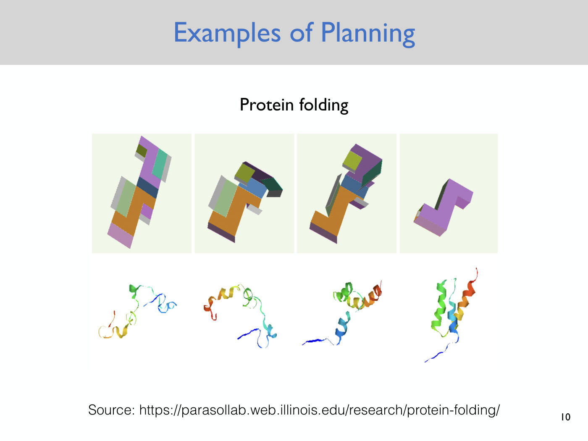

*Slide 10 — Examples of Planning (protein folding). [Deck](https://www.dropbox.com/scl/fi/pnwucnirlwgviqwaj67hl/Lecture2.pdf?rlkey=6s2et2apw9rtnvr8x2ke243sp&dl=0)*

**Rubik's cube solving** is the third (slide 11, ≈8:34–9:21). Majumdar thinks the video was the
world record for autonomous solving at the time. The goal is a set of acceptable states rather
than a single one, and it is a **discrete** motion planning problem: the cube has a finite set of
states.

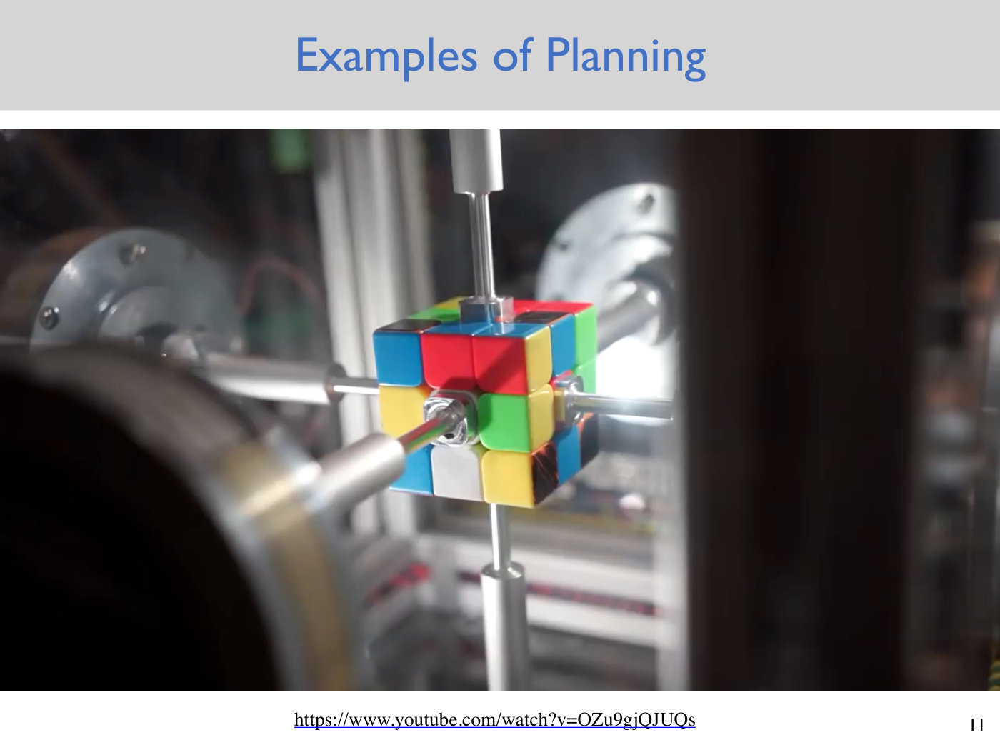

*Slide 11 — Examples of Planning (Rubik's cube video). [Deck](https://www.dropbox.com/scl/fi/pnwucnirlwgviqwaj67hl/Lecture2.pdf?rlkey=6s2et2apw9rtnvr8x2ke243sp&dl=0)*

**The problem and its assumptions.** The geometric motion planning problem is to find a path from
configuration A to configuration B without collisions (slide 12, ≈10:07–11:38), under three
assumptions:

1. **Any path is feasible to follow**, so dynamics are ignored. Within reason (no teleporting),
   any continuous path from A to B is assumed to be followable. This is not true in practice: a
   car pointing straight ahead cannot move sideways. It is relaxed "in a few lectures".
2. **The robot's state is perfectly known**, so the robot knows exactly where it is and follows
   any given path without error. This is relaxed in the localization and mapping module.
3. **The map of the environment is provided.**

## Degrees of freedom

The formal setup moves to the blackboard (≈11:38). **Degrees of freedom (DoFs)** are "the
number of independent ways a system can move" (slide 14), or equivalently the minimal number of
coordinates needed to specify the configuration of the system (≈12:26–13:14). Most of the class
had met the idea before. The slide's examples are a point in $d$-dimensional space ($d$ DoFs),
$N$ points in $d$-dimensional space ($N \cdot d$ DoFs), a pendulum (1 DoF) and a planar
quadrotor (3 DoFs).

**A point in $D$ dimensions** has $D$ degrees of freedom, since it can move independently along
each dimension and needs $D$ coordinates (≈13:14–14:05).

**A planar pendulum** has one. A student's justification was that its position can be measured
with the angle $\theta$, and one scalar specifies the whole configuration (≈14:52). Majumdar adds
another way to see it: a free point in the plane would have two degrees of freedom, $x$ and $y$,
but the rod imposes the constraint that $\sqrt{x^2 + y^2}$ equals its length, so $x$ and $y$ are
not independent. Change $x$, and $y$ must change to satisfy the constraint (≈14:52–15:39).

**A snake robot with $n$ links in the plane, whose base is not fixed**, was the class exercise
(≈15:39–21:53). Students proposed $n + 1$ (two translations plus $n - 1$ joint rotations) and
$n + 2$. The answer the lecture settles on is **$n + 2$**: two numbers, $x$ and $y$, for the
position of the base point, plus one angle for each of the $n$ links. Majumdar's way to see it is
a snake with zero links, which is just a point with two degrees of freedom; each link added needs
one more angle (≈21:04). He briefly second-guessed the count when a student asked whether the
last link should count, and checked it against the planar quadrotor, the one-link special case
(≈17:57–19:31).

**A planar quadrotor** has three degrees of freedom: $x$, $y$ and the angle $\theta$, since it can
translate and change its orientation independently (slide 15, ≈18:43). The course will use the
planar quadrotor often as a simplification of the full drone. Asked whether moving the centre
point affects the count, Majumdar stresses the word *independent*: two numbers locate the centre
of mass, and the orientation can be changed independently of them, which is the third degree of
freedom (≈20:18).

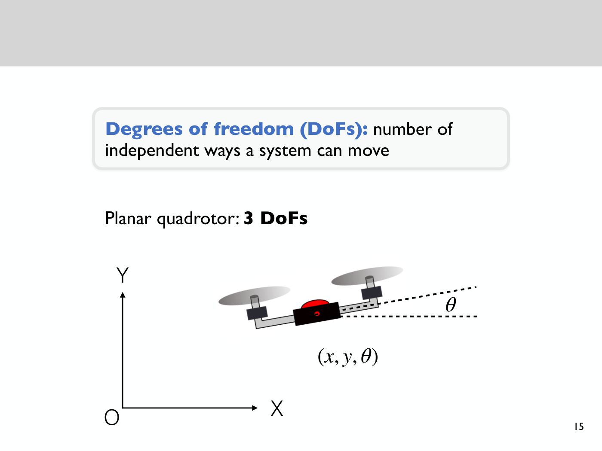

*Slide 15 — the planar quadrotor's three degrees of freedom: position x and y, and the tilt angle θ. [Deck](https://www.dropbox.com/scl/fi/pnwucnirlwgviqwaj67hl/Lecture2.pdf?rlkey=6s2et2apw9rtnvr8x2ke243sp&dl=0)*

## Configuration space, free space and obstacle space

The **configuration space** $C$ is "the set of possible configurations that a system can be in"
(slide 16, ≈21:53–22:40). Each point in it defines one configuration of the system, which in
general might be a robot, a protein, or whatever is being planned for. The examples:

- a point in $d$-dimensional space: $C = \mathbb{R}^d$, the usual Euclidean space;
- $N$ points in $d$-dimensional space: $C = \mathbb{R}^{N \cdot d}$;
- a pendulum: $C = S^1$, the circle, the space of orientations of a single angle running from
  0 to $2\pi$ with 0 equal to $2\pi$ (≈22:40–23:31);
- a planar quadrotor: $\mathbb{R}^2 \times S^1$, which a student named SE2. Two numbers give
  $x$ and $y$, and one angle the orientation (≈23:31–24:19).

For the $n$-link snake, Majumdar describes the space as $\mathbb{R}^2$ "crossed with ... $n$
copies of the circle", one orientation per link (≈24:19). The caption renders his symbol as "s n",
and his gloss, $n$ copies of $S^1$, is what this page follows.

**Free space** $C_{free} \subseteq C$ is the set of configurations where the system is **not** in
collision (slide 17, ≈25:07–26:39). For a planar quadrotor among a few obstacles, it is the subset
of $(x, y, \theta)$ for which the drone touches nothing. A configuration that is free can stop
being free just by rotating: turn the drone clockwise and at some point it collides with an
obstacle.

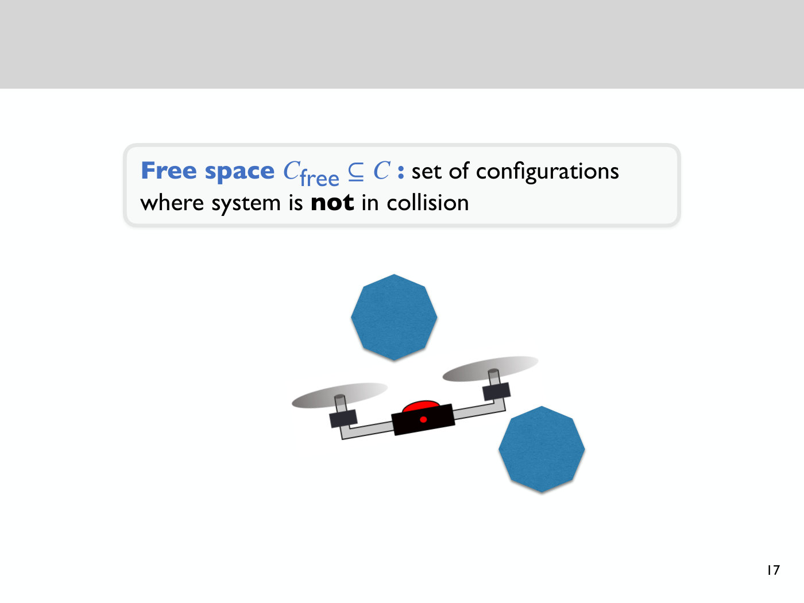

*Slide 17 — a configuration in free space: the planar quadrotor clear of both obstacles. [Deck](https://www.dropbox.com/scl/fi/pnwucnirlwgviqwaj67hl/Lecture2.pdf?rlkey=6s2et2apw9rtnvr8x2ke243sp&dl=0)*

**Obstacle space** $C_{obs} = C \setminus C_{free}$, the complement of the free space, is the set
of configurations where the system **is** in collision with some obstacle (slide 18, ≈26:39).

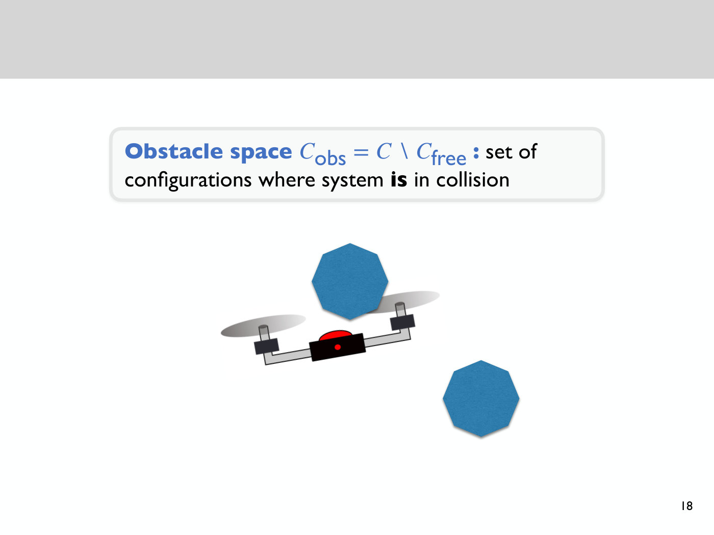

*Slide 18 — a configuration in obstacle space: moved up and to the left, the quadrotor's propeller overlaps an obstacle. [Deck](https://www.dropbox.com/scl/fi/pnwucnirlwgviqwaj67hl/Lecture2.pdf?rlkey=6s2et2apw9rtnvr8x2ke243sp&dl=0)*

**Configuration-space obstacles** are hard to picture, so Majumdar shows a video (slide 19,
≈27:26–30:30). The system is a triangle in the plane, with three degrees of freedom for the same
reason as the planar quadrotor. Its configuration space is drawn as a 3D space whose vertical
axis is orientation, with the top plane ($2\pi$) the same as the bottom one. A triangle that
moves around a circle while rotating traces a helix in this space. An obstacle in the plane
becomes a complicated solid in configuration space: every point inside it is a configuration in
which the triangle collides with the obstacle, and with several obstacles $C_{obs}$ becomes "a
very complicated-looking subset" of $C$. Asked about the colours, he says the red and green
surfaces mean nothing in particular. They are there so the surface can be seen, and all of it is
the boundary of the obstacle space (≈29:44, ≈31:17–32:50).

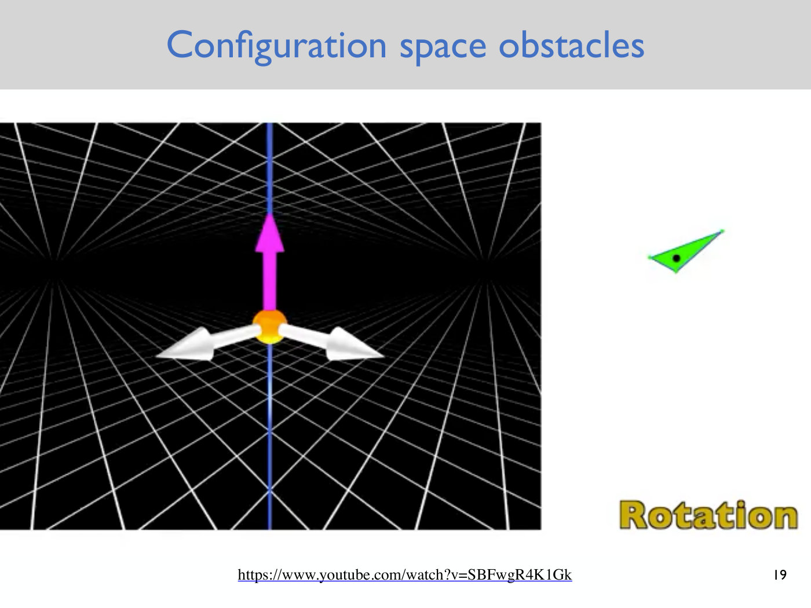

*Slide 19 — opening frame of the video that visualizes configuration-space obstacles for a triangle robot (right), which has two translational and one rotational degree of freedom. [Deck](https://www.dropbox.com/scl/fi/pnwucnirlwgviqwaj67hl/Lecture2.pdf?rlkey=6s2et2apw9rtnvr8x2ke243sp&dl=0)*

**The problem, stated formally.** Geometric motion planning is to find a path in $C_{free}$ from
configuration $q_A$ to configuration $q_B$ (slide 20, ≈30:30–31:17). Asked why configuration
space is worth the trouble, Majumdar says that for today it is "a mathematical device that helps
us state the problem formally". The next lecture uses it in a deeper way.

## Discretization

This lecture and the next stay with geometric motion planning: dynamics ignored, map given
(≈32:50). This one covers **discrete** motion planning, and the next covers continuous motion
planning (≈32:50–33:36).

A discrete planning problem is one whose set of configurations is finite. The Rubik's cube is
already discrete. If the configuration space is not, it can be **discretized** (≈33:36). The
running example is a point robot in the plane that must get from A to B without touching four
blue obstacles (slide 22, ≈33:36–34:24).

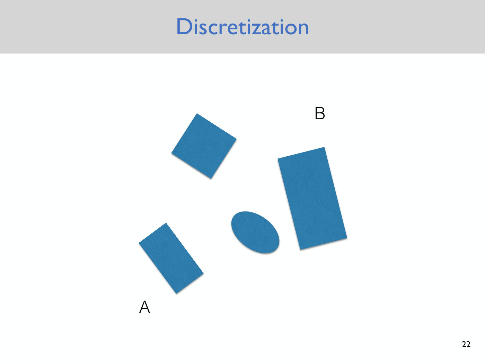

*Slide 22 — Discretization. [Deck](https://www.dropbox.com/scl/fi/pnwucnirlwgviqwaj67hl/Lecture2.pdf?rlkey=6s2et2apw9rtnvr8x2ke243sp&dl=0)*

Laying a grid over this two-dimensional configuration space discretizes it (slide 23). The goal
is now a path of grid cells from A to B in which no cell collides with an obstacle (slide 24,
≈34:24). The reason for discretizing is that it lets us apply graph search algorithms, which are
well understood (slide 25, ≈35:12).

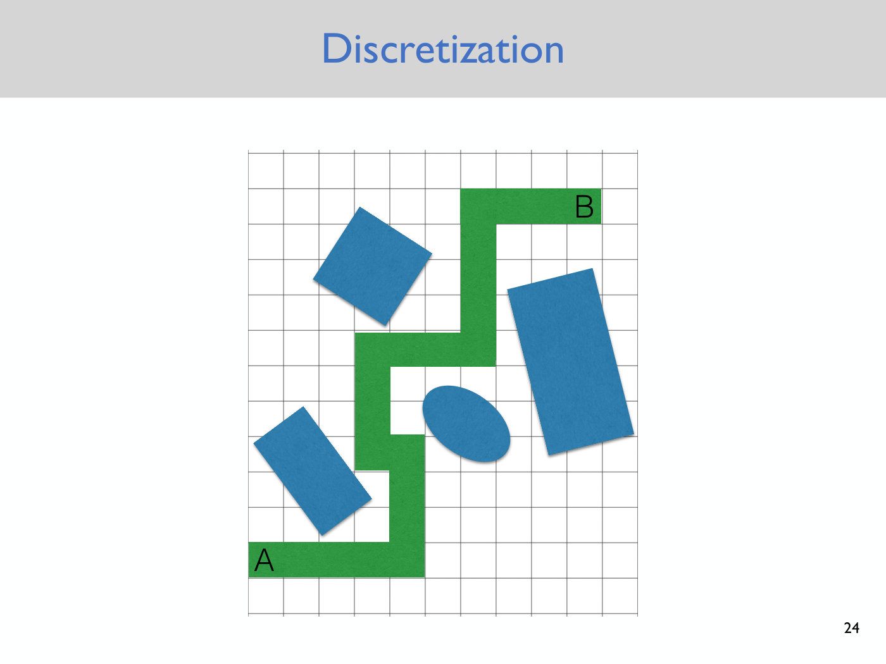

*Slide 24 — the workspace discretized into an 11-by-13 grid, with a 4-connected path of free cells from A to B; the obstacles are not snapped to the grid. [Deck](https://www.dropbox.com/scl/fi/pnwucnirlwgviqwaj67hl/Lecture2.pdf?rlkey=6s2et2apw9rtnvr8x2ke243sp&dl=0)*

The discretization involved three choices, none of them fundamental (slide 26, ≈35:12–36:45):

- **A uniform grid**, every cell the same size. An adaptive resolution could have been used
  instead, finer around obstacles and narrow passages and coarser in open space.
- **4-connectivity**: the robot moves only north, south, east or west, not diagonally (which
  would be 8-connectivity).
- **The resolution of the grid.** A finer grid is a better approximation and may find paths
  through narrow passages that a coarse grid misses, but it makes planning harder.

## Planning as graph search

A **graph** is a collection of vertices (nodes; the two words are synonyms) and edges, where the
edges define connectivity (slide 27, ≈36:45). An edge between two vertices means the robot can go
from one discrete state to the other in a single hop (≈37:30).

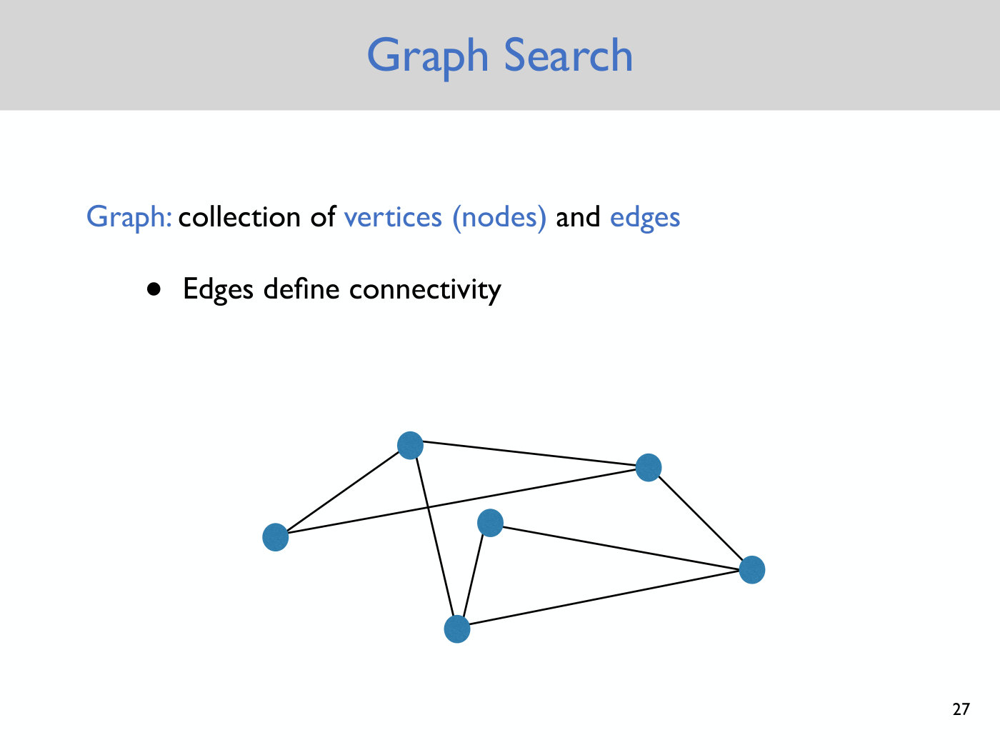

*Slide 27 — a graph: vertices joined by edges, the edges defining which vertices are connected. [Deck](https://www.dropbox.com/scl/fi/pnwucnirlwgviqwaj67hl/Lecture2.pdf?rlkey=6s2et2apw9rtnvr8x2ke243sp&dl=0)*

Going from the grid to a graph takes three steps (slide 28, ≈37:30–38:16):

1. **Associate a vertex with each cell** of the grid. The convention is that the vertex sits at
   the centre of its cell, not at the cell's corners, which Majumdar notes sometimes confuses
   people.
2. **Connect vertices with edges** according to the chosen connectivity: 4-connectivity, or
   8-connectivity if the robot can also move diagonally.
3. **Delete any vertex whose cell intersects an obstacle**, together with its edges.

For reading, slide 30 gives *Principles of Robot Autonomy*, chapter 4.2, which Majumdar calls a
"very compact and nice description" of the day's content. It also gives *Planning Algorithms*,
chapters 1.1–1.3 and 2.1–2.2, which he calls the classic in the field, by Steve LaValle (≈38:16).

**The worked example** is a 5-by-5 grid (slide 31, ≈39:02). Four cells are obstacles, forming an
upside-down L: two cells in the second row from the top, and two more below the right-hand one.

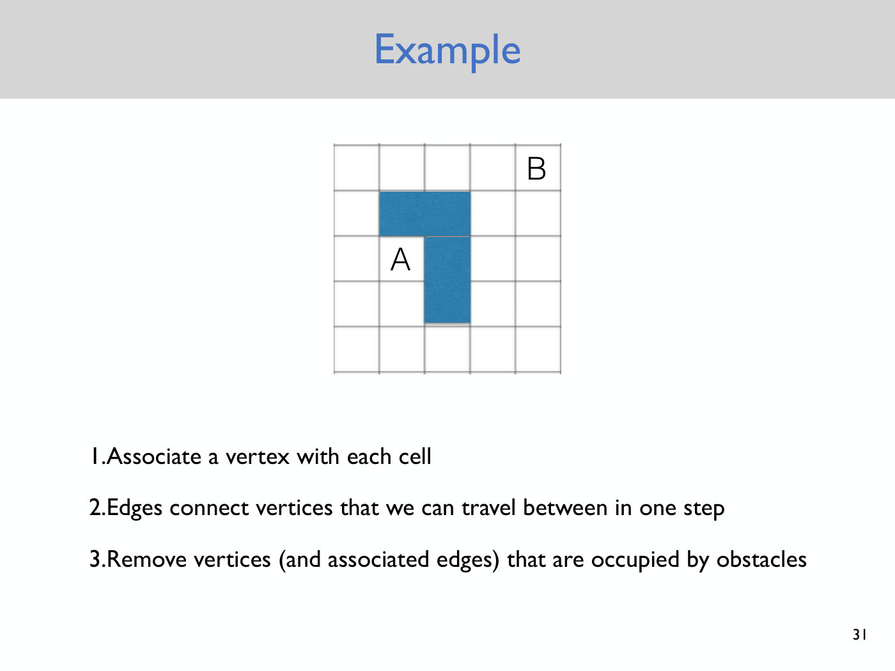

*Slide 31 — the 5-by-5 worked example: start A at (2,3), goal B at (5,5), and four obstacle cells in an upside-down L. [Deck](https://www.dropbox.com/scl/fi/pnwucnirlwgviqwaj67hl/Lecture2.pdf?rlkey=6s2et2apw9rtnvr8x2ke243sp&dl=0)*

Placing a vertex at every cell and connecting horizontal and vertical neighbours gives a full
5-by-5 lattice (slide 32). Here 4-connectivity is used "just so I can walk through examples
quickly", though diagonal connections are possible (≈39:02).

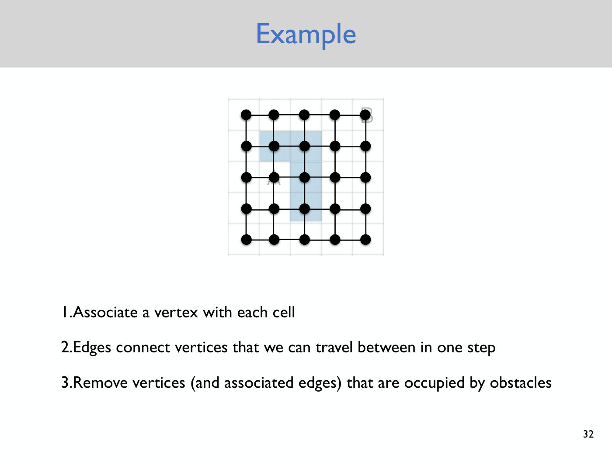

*Slide 32 — Example (full graph). [Deck](https://www.dropbox.com/scl/fi/pnwucnirlwgviqwaj67hl/Lecture2.pdf?rlkey=6s2et2apw9rtnvr8x2ke243sp&dl=0)*

Removing the four obstacle vertices and every edge touching them leaves a graph of 21 vertices
(slide 33, ≈39:02–39:48).

Vertices are labelled $(i, j) = (x, y)$ = (column, row), with $(1, 1)$ at the bottom left and
$(5, 5)$ at the top right (slide 34, ≈40:35). The start A is $(2, 3)$ and the goal B is $(5, 5)$.
The obstacle cells are $(2, 4)$, $(3, 4)$, $(3, 3)$ and $(3, 2)$. Majumdar first misspeaks the
start as $(1, 1)$ and corrects it to $(2, 3)$ at ≈41:21.

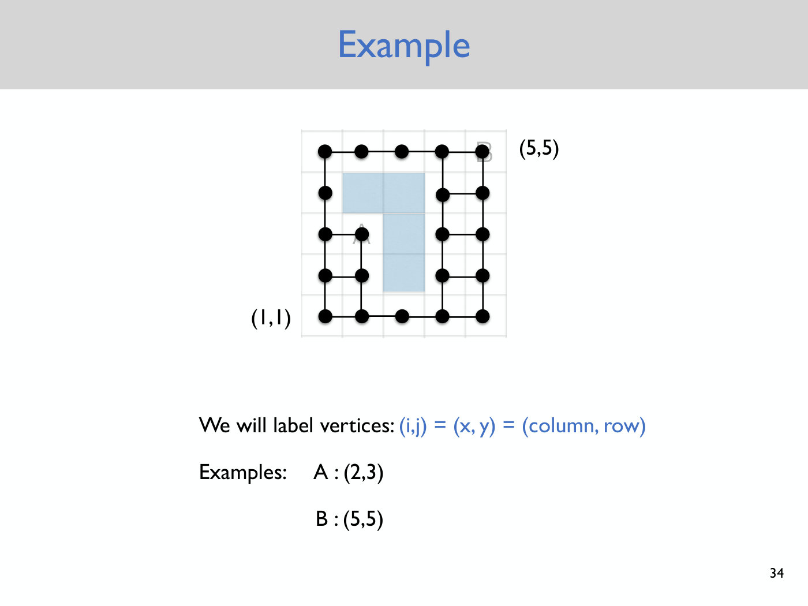

*Slide 34 — the graph after removing the obstacle vertices: 21 vertices, labelled (column, row) from (1,1) at the bottom left. [Deck](https://www.dropbox.com/scl/fi/pnwucnirlwgviqwaj67hl/Lecture2.pdf?rlkey=6s2et2apw9rtnvr8x2ke243sp&dl=0)*

## The forward search algorithm

Any graph search algorithm for motion planning has roughly the same structure (slide 35,
≈40:35–41:21). With $x_G$ the goal set (here $\lbrace B \rbrace$) and $x'$ a neighbour of $x$:

```
Algorithm 1: Forward Search
Q.Insert(A) and mark A as visited;
while Q not empty do
    x <- Q.GetVertex();
    if x in x_G then
        // x_G is goal set, e.g., {B};
        Return SUCCESS;
    end
    for all neighbors x' of x do
        if x' not visited then
            Parent(x') <- x;
            Mark x' as visited;
            Q.Insert(x');
        end
    end
end
Return FAILURE;
```

Its three parts are highlighted in turn (slides 36–38). The **queue** $Q$ is a data structure
holding the vertices still being explored. **Q.GetVertex()** removes a vertex from $Q$ to explore,
by some convention that we choose. The **loop over neighbours** incrementally explores the graph:
any neighbour not yet visited is marked visited, given $x$ as its parent, and added to $Q$.

The whole difference between the search algorithms in this lecture is how Q.GetVertex chooses
which vertex to take out (≈42:51–43:38).

## Breadth-first search, worked on the grid

The first convention is **first in, first out (FIFO)**: whatever was added to the queue first is
taken out first. Neighbours are added in some fixed order that we commit to, such as clockwise
(≈43:38). Visited vertices are drawn in red (slide 39, ≈41:21–42:06).

| Slide | Iteration | Q at start | x taken out | Unvisited neighbours, marked and queued | Neighbours already visited | Q at end |
| --- | --- | --- | --- | --- | --- | --- |
| 39–41 | 1 | (2,3) | (2,3) = A | (1,3), (2,2) | — | (1,3), (2,2) |
| 42–44 | 2 | (1,3), (2,2) | (1,3) | (1,4), (1,2) | (2,3) | (2,2), (1,4), (1,2) |
| 45 | 3 | (2,2), (1,4), (1,2) | (2,2) | (2,1) | (1,2), (2,3) | (1,4), (1,2), (2,1) |
| 46 | 4 | (1,4), (1,2), (2,1) | (1,4) | (1,5) | (1,3) | (1,2), (2,1), (1,5) |

After the first iteration, A has been taken out and its two neighbours, $(1, 3)$ and $(2, 2)$,
are marked visited and queued (slide 41, ≈42:06–42:51). There is no choice to make yet, since A
is the only vertex in the queue.

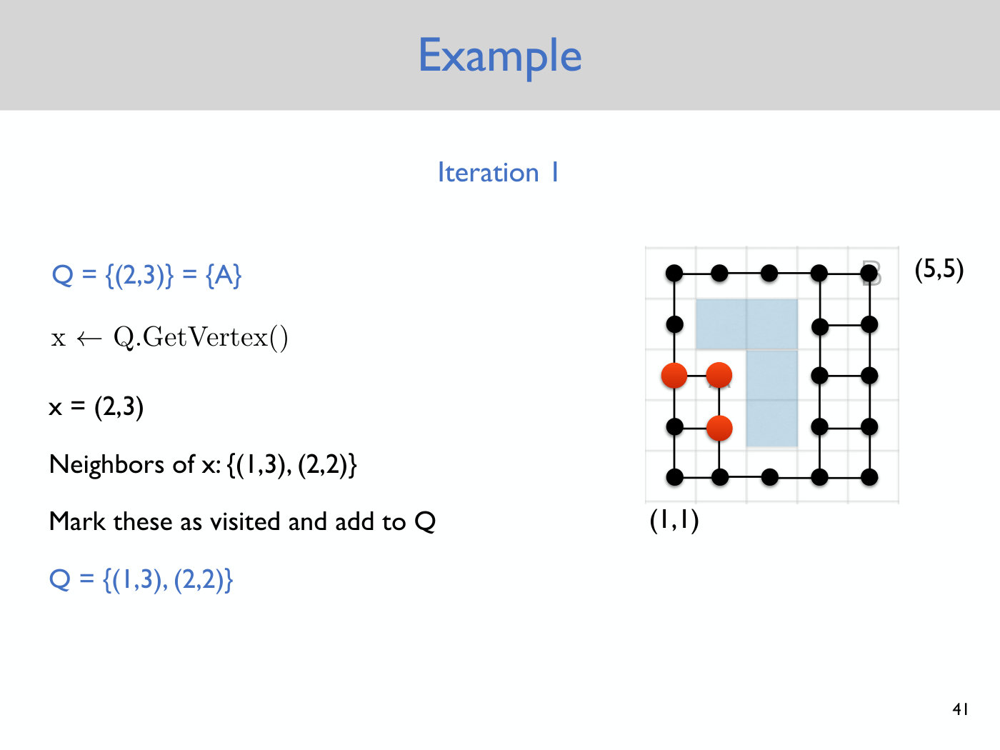

*Slide 41 — BFS after iteration 1: A and its two neighbours are red (visited), and the queue holds (1,3), (2,2). [Deck](https://www.dropbox.com/scl/fi/pnwucnirlwgviqwaj67hl/Lecture2.pdf?rlkey=6s2et2apw9rtnvr8x2ke243sp&dl=0)*

From the second iteration on, the FIFO rule matters. By the end of the fourth iteration, seven
vertices are red, all within a few hops of A, and the queue holds $(1, 2)$, $(2, 1)$ and
$(1, 5)$ (slide 46). The slides then say "and so on, until x hits goal vertex B" (slide 47). The
algorithm ends when Q.GetVertex takes out the goal, $(5, 5)$ (≈45:58).

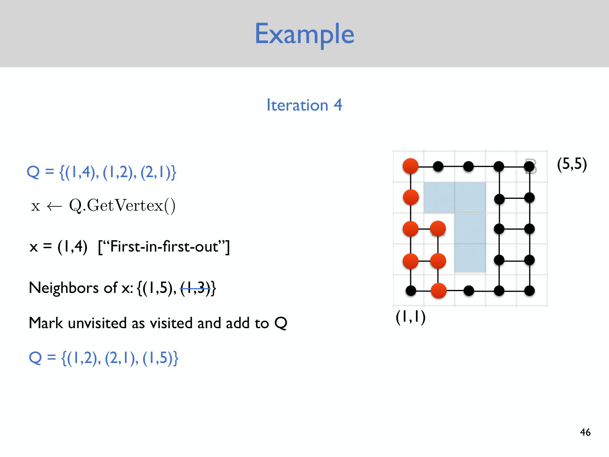

*Slide 46 — BFS after iteration 4: seven visited vertices spreading out around A; the queue holds (1,2), (2,1), (1,5). [Deck](https://www.dropbox.com/scl/fi/pnwucnirlwgviqwaj67hl/Lecture2.pdf?rlkey=6s2et2apw9rtnvr8x2ke243sp&dl=0)*

A student asked how $(2, 2)$ came to be taken out in iteration 3. Majumdar's answer was that
$(2, 2)$ was a neighbour of A, added in the first iteration, so it was ahead of $(1, 4)$ and
$(1, 2)$ in the FIFO queue (≈45:58–47:28).

**Recovering the path.** The search itself only marks vertices. To get the path, keep track of
each vertex's **parent**, the vertex it was reached from. Then recursively follow parents back
from the goal to A, and reverse the result (slide 48, ≈47:28–48:14).

Implementing Q.GetVertex with FIFO gives **breadth-first search (BFS)**. BFS searches all paths
of length $k$ before searching any path of length $k + 1$ (slide 49, ≈49:02–49:47).

## Depth-first search

Asked how to get depth-first search instead, a student answered: use a stack instead of a queue,
that is, **last in, first out (LIFO)** (≈48:14–49:47). The most recently added vertex is taken
out first, so the search keeps going down one path before backtracking (slide 51). In the
lecture Majumdar left the worked DFS example to the posted slides as a refresher (≈49:47). It
runs on the same grid:

| Slide | Iteration | Q at start | x taken out (last in) | Q at end |
| --- | --- | --- | --- | --- |
| 52 | 1 | (2,3) | (2,3) = A | (2,2), (1,3) |
| 53 | 2 | (2,2), (1,3) | (1,3) | (2,2), (1,2), (1,4) |
| 54 | 3 | (2,2), (1,2), (1,4) | (1,4) | (2,2), (1,2), (1,5) |
| 55 | 4 | (2,2), (1,2), (1,5) | (1,5) | (2,2), (1,2), (2,5) |
| 56 | 5 | (2,2), (1,2), (2,5) | (2,5) | (2,2), (1,2), (3,5) |
| 57 | 6 | (2,2), (1,2), (3,5) | (3,5) | (2,2), (1,2), (4,5) |
| 58 | 7 | (2,2), (1,2), (4,5) | (4,5) | (2,2), (1,2), (5,5) |
| 59 | 8 | (2,2), (1,2), (5,5) | (5,5) = B | done |

DFS reaches B in eight iterations. The vertices it expands run in a single line from A, up the
left column and along the top row to B. Only $(2, 2)$ and $(1, 2)$ were queued without being
taken out, and the bottom row and the right-hand columns below the top row are never visited
(slide 59).

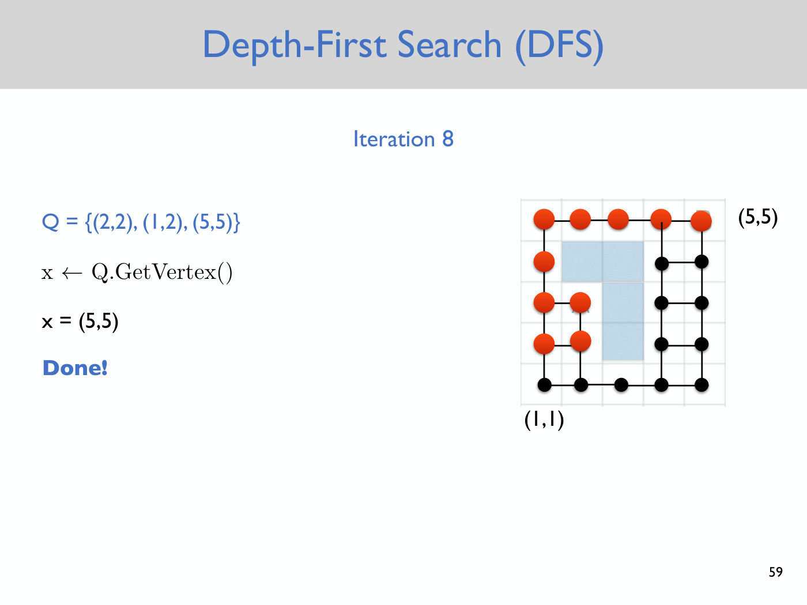

*Slide 59 — DFS finished: the expanded vertices form one line from A up the left column and along the top row to B, and the right side of the grid is never visited. [Deck](https://www.dropbox.com/scl/fi/pnwucnirlwgviqwaj67hl/Lecture2.pdf?rlkey=6s2et2apw9rtnvr8x2ke243sp&dl=0)*

In general DFS keeps exploring one path deeply until it hits a dead end or the goal, then picks
another avenue. It can work well compared with BFS when the path is long and there are only a few
ways to reach the goal (slide 60).

## Two limitations of BFS, and the cost of a plan

A\* is motivated by two limitations of BFS (slide 62, ≈50:33).

**BFS is only optimal for path length.** If optimality means the fewest hops from A to B, BFS is
optimal, and the version described needs no modification. There may be several optimal paths
(≈51:20–52:07). The reason is the property on slide 49. If an optimal path has length $L$, BFS
searches every path of length $L$ before any of length $L + 1$, so it is guaranteed to find one
(≈52:07–52:55). But other notions of optimality break this. Majumdar's example is a drone in a
wind, for which some directions are more energy-efficient than others. BFS will not necessarily
give the optimal path for that cost (≈52:55).

**BFS explores slowly.** An animation on a finer grid shows BFS "just uniformly expanding away from
the initial state" even though we know where the goal is. We would like to tell the algorithm to
search in that direction (≈53:41).

**Cost of a plan.** Associate with every edge $e$ a cost (or "loss") $l(e)$ of traversing it. The
total cost of a plan is the sum of the costs along the path from A to B, and the goal is to find
the path that minimizes it (slide 63, ≈53:41–54:28). Asked whether edge costs may be negative, a
student said no, and Majumdar agreed. With a single negative edge you could keep going back and
forth across it, "some kind of reward hacking", and drive the total cost to negative infinity.
Costs are assumed non-negative, and nothing more is assumed about them (≈54:28–55:15).

## The A\* algorithm

The key idea of A\* is to change how Q.GetVertex prioritizes vertices. It takes out the vertex with
the smallest value of

$$F(x) \triangleq C(x) + H(x)$$

where $C(x)$ is the estimated **cost-to-come** from A to $x$ and $H(x)$ is the estimated
**cost-to-go** from $x$ to B (slide 64, ≈55:15–56:46). Asked what the triangle over the equals
sign means, Majumdar says it defines $F(x)$ as $C(x) + H(x)$ for every vertex in the graph
(≈58:19).

**The heuristic must be an underestimate.** $H(x)$ has to be a lower bound on the optimal
cost-to-go from $x$ to the goal (slide 64, ≈56:46). The version of the algorithm presented is
only guaranteed to return optimal paths if this holds. Majumdar presents it as a claim rather than
proving it. He suggests constructing counterexamples, where $H$ is not an underestimate and A\*
returns a suboptimal path, as a useful exercise (≈58:19–59:52).

**Getting an underestimate is often easy.** The slide's example is the Euclidean distance between
$x$ and B for distance-optimal planning (slide 64). In class a student suggested the straight-line
distance. For the grid, Majumdar uses the Manhattan (L1) distance: count the steps north or south
and the steps east or west, ignoring all obstacles. It is a lower bound because the true optimal
path has to go around obstacles, so it is at least as long as the shortest path without them
(≈57:34–58:19).

**Dijkstra's algorithm** is the special case $H(x) = 0$ for all $x$, which is trivially an
underestimate (slide 65, ≈59:06–59:52). Versions of Dijkstra's algorithm and A\* with "fancy
heuristics" power route-finding such as Google Maps (slide 66, ≈59:52).

Implementing A\* is part of the assignment that "goes out tomorrow" (≈59:52). The course site
posts [Assignment 1](https://www.dropbox.com/scl/fi/171ylogxcqkc3b5capcx7/Assignment1.pdf?rlkey=g02au5oyfe0kss98l01qg3j53&dl=0)
alongside this lecture (see [`sources.md`](../sources.md)).

## A\* worked on the grid

**Setup** (slide 68, ≈59:52–1:01:26). The problem is the same 5-by-5 grid. For compactness the cost
is still path length, so every edge costs $l(e) = 1$, though the algorithm itself is general.
$C(x)$ is the cost of the best path to $x$ found so far. The cost-to-go estimate is the Manhattan
distance to $B = (5, 5)$,

$$H(x) = |x_1 - 5| + |x_2 - 5|$$

where $x = (x_1, x_2)$ is the vertex's (column, row) label. $Q$ is a priority queue: GetVertex
returns the vertex with the smallest $F = C + H$.

**Three kinds of vertices** (slide 69, ≈1:01:26–1:02:12). **Unvisited** vertices have not been
explored yet. **Alive** vertices are in $Q$: encountered but not yet taken out. **Dead** vertices
have been removed from $Q$, having "contributed whatever they can contribute to the search so
far". The terminology is the planning book's. On the slides, alive vertices are yellow and dead
ones red (slide 70).

**Initialization** (slide 70, ≈1:02:12–1:02:58). $C(A) = 0$. A is two hops vertically and three
horizontally from B, so $H(A) = 5$ and $F(A) = 5$. A is inserted into $Q$ with priority 5.

| Slide | x taken out | Neighbours: $C$, $H$, $F$ | Q at end (vertex: F) |
| --- | --- | --- | --- |
| 71–72 | (2,3) = A, the only choice | (1,3): 1, 6, 7 · (2,2): 1, 6, 7 | (1,3): 7, (2,2): 7 |
| 73 | (1,3), tie broken (see below) | (1,4): 2, 5, 7 · (1,2): 2, 7, 9 · (2,3) dead, skipped | (1,4): 7, (2,2): 7, (1,2): 9 |
| 74 | (1,4) | (1,5): 3, 4, 7 · (1,3) dead | (1,5): 7, (2,2): 7, (1,2): 9 |

In the first iteration A is taken out and marked dead, and both neighbours get $C = 1$ and $H = 6$,
so $F = 7$ (slide 72, ≈1:03:43–1:05:14). A student asked how $H$ could be 6 for $(2, 2)$. It is
three steps vertically and three horizontally, because $H$ ignores the obstacle. Majumdar calls
this the key point: taking obstacles into account would be "almost as hard as solving the
planning problem to begin with", whereas ignoring them makes $H$ cheap and the algorithm
efficient (≈1:04:28–1:05:14).

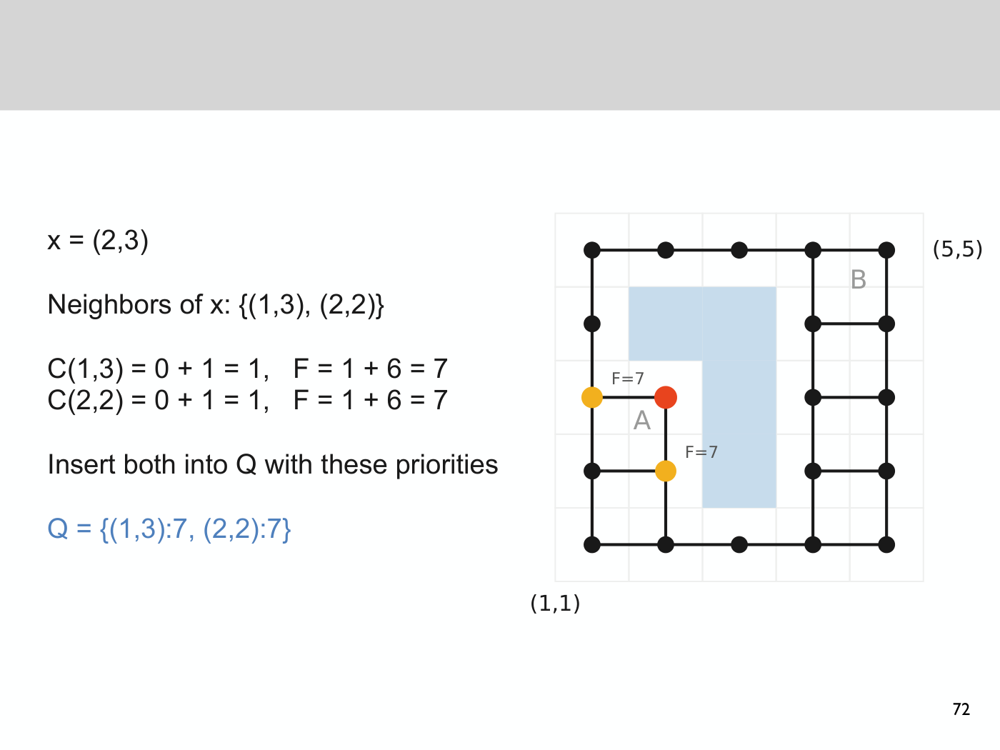

*Slide 72 — A\* after iteration 1: A is dead (red), and its two neighbours are alive (yellow), each with F = 1 + 6 = 7. [Deck](https://www.dropbox.com/scl/fi/pnwucnirlwgviqwaj67hl/Lecture2.pdf?rlkey=6s2et2apw9rtnvr8x2ke243sp&dl=0)*

**Ties.** Both vertices in the queue now have $F = 7$, so a tie must be broken. First in, first
out or last in, first out would work. The convention here is to take the vertex with the smaller
$H$ (≈1:05:14–1:06:01). The slide says $(1, 3)$ is taken because of "tie in F broken by smaller
H" (slide 73). Majumdar checks this in class and finds that both have $H = 6$, so the rule does
not separate them here: "maybe there's another tiebreaking, or you just do it randomly". Either
way some tie-break is needed, and it starts to matter in later steps (≈1:06:01–1:06:47).

The second iteration expands $(1, 3)$. Its neighbour $(1, 4)$ is two hops from A and five from B
($F = 7$). Its neighbour $(1, 2)$ gets $F = 2 + 7 = 9$, and A is dead and skipped (slide 73,
≈1:06:47–1:07:34).

The third iteration expands $(1, 4)$ and adds $(1, 5)$ with $C = 3$, $H = 4$, $F = 7$ (slide 74,
≈1:09:05). The queue now holds two vertices at $F = 7$ and one at 9, and the search continues
until it reaches B (slide 75). How Majumdar breaks the next tie is not clear from the captions
(≈1:09:52).

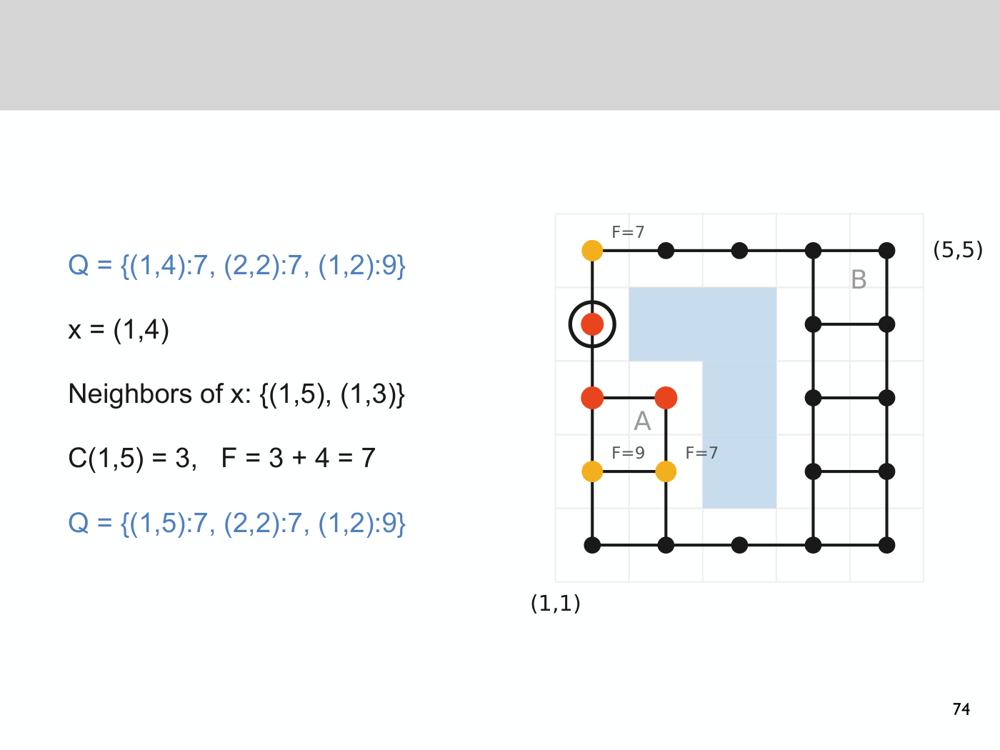

*Slide 74 — A\* expanding (1,4), the ringed vertex: dead vertices red, alive ones yellow with their F values. [Deck](https://www.dropbox.com/scl/fi/pnwucnirlwgviqwaj67hl/Lecture2.pdf?rlkey=6s2et2apw9rtnvr8x2ke243sp&dl=0)*

**Two implementation notes from questions.**

- $C$ is not recomputed by counting hops back to A. When $x'$ is reached from $x$, its cost-to-come
  is $C(x)$ plus the cost of the edge from $x$ to $x'$ (≈1:07:34–1:08:19).
- Finding the vertex with the lowest $F$ can be a linear search over everything in the queue,
  which is all the course assumes. Cleverer data structures can make it faster (≈1:08:19–1:09:05).

## BFS against A\*, and learned heuristics

The comparison animation runs BFS and A\* side by side on the finer grid, where an upside-down-L
obstacle hangs over A and blocks the direct route to B at the top right (slide 76,
≈1:09:52–1:10:39). Each panel counts the vertices it has expanded. The PDF holds a single early
frame, in which both counters read 4. As Majumdar
narrates it, A\* starts out like BFS because of the obstacle, expanding uniformly as it tries to go
toward the goal and gets stuck. But "as soon as it turns the corner it knows the goal is over
there, so it just makes a beeline". That is because it prioritizes vertices with a lower
cost-to-go estimate.

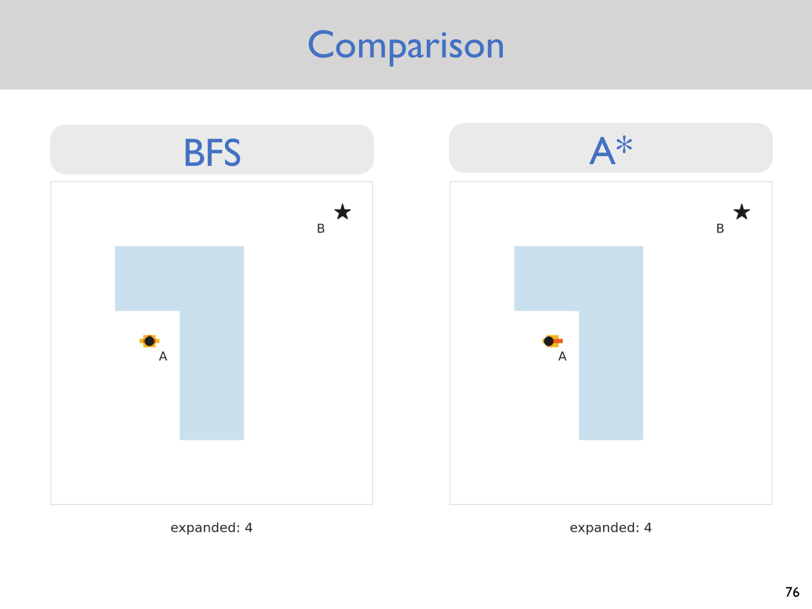

*Slide 76 — a single early frame of the BFS-versus-A\* animation on a finer grid: the obstacle hangs over A, B is at the top right, and both counters read "expanded: 4". [Deck](https://www.dropbox.com/scl/fi/pnwucnirlwgviqwaj67hl/Lecture2.pdf?rlkey=6s2et2apw9rtnvr8x2ke243sp&dl=0)*

A student pointed out that the heuristic can be tricked, for instance by a wall. Majumdar agrees
that an adversarial environment can make heading for the goal exactly the wrong thing to do, and
that worst-case complexity differs from average-case complexity. Most robotics problems are not
adversarial, so these heuristics work quite well (≈1:10:39–1:11:27).

**Learned heuristics.** Rather than a hand-designed heuristic like the Manhattan distance,
state-of-the-art graph search uses **learned heuristics**. The example is a clip from Tesla's AI
Day, 2021 (slide 77, ≈1:11:27–1:13:45). In the clip, a baseline search with the Euclidean distance
to the goal as its heuristic shoots straight at the goal, quickly gets trapped in a local
minimum, and backtracks to search for a way around a parked car, using **400,000 nodes**. Adding a navigation route to the heuristic
helps immediately but still backtracks at cones and other obstacles, using **22,000 nodes**.
The clip also mentions a final continuous optimization of the trajectory, and Majumdar points
out that it accounts for costs such as passenger comfort. He recommends Tesla's "surprisingly
detailed" description of the planner, but does not go into it.

## The full A\* algorithm

The last slide gives the full algorithm, as a reference for implementing it in the assignment
(slide 79, ≈1:13:45). Like the forward search above, it checks for the goal when a vertex is selected from $Q$.
Unlike it, it keeps a set of dead vertices instead of marking vertices visited when they are
inserted. It also updates a neighbour's parent and cost-to-come whenever it finds a cheaper path
to it:

```
// Initialize the queue and also initialize a set of "dead" states
Q := {start},
DeadSet = {}
// For vertex v, parent(v) is the vertex immediately preceding it on the cheapest path from start to v currently known.
parent := empty list
// For vertex x, C(x) is the cost of the cheapest path from start to x currently known.
Initialize C(x) to be infinity for all x
C(A) := 0 // Initialize C to be 0 for the start vertex A
// For vertex x, F(x) := C(x) + H(x).
Initialize F(x) to be infinity for all x
F(A) := H(A) // Initialize F(A) to be H(A) since C(A) = 0

while Q is not empty
    x := the vertex in Q having the lowest F value
    if x = goal
        Return SUCCESS

    Q.Remove(x)
    DeadSet.Add(x)
    for each neighbor x' of x
        if x' in DeadSet
            continue
        // l(x,x') is the cost of the edge from x to x'
        // tentative_C is the cost from A to x' through x
        tentative_C := C(x) + l(x, x')
        if tentative_C < C(x')
            // This path to neighbor is better than any previous one. Record it!
            parent(x') := x
            C(x') := tentative_C
            F(x') := C(x') + H(x')
            if x' not in Q
                Q.add(x')

// Open set is empty but goal was never reached
return FAILURE
```

## What comes next

The next lecture covers **continuous** motion planning, still under the geometric assumptions
(≈32:50–33:36). It is where configuration space is used "in a deeper way" than as a device for
stating the problem (≈31:17). That is [Lecture 3](03-rrts.md), on rapidly exploring randomized
trees. The assumptions that any path is feasible and that the state is
known are relaxed later in the planning module and in the localization and mapping module
(≈10:52–11:38). Feasibility is taken up from [Lecture 4](04-quadrotor-dynamics.md), on quadrotor
dynamics.

## Gaps in the record

The captions are garbled in a few places, marked `[Ed: unclear]` in the
[transcript](../raw/transcripts/02-discrete-motion-planning.md). These include:

- a student's count of joint rotations in the snake-robot discussion at ≈17:10;
- the symbol for the $n$-link configuration space at ≈24:19 (captioned "s n");
- a student's question at ≈45:58;
- the tie-break used in the third A\* iteration at ≈1:09:52;
- the name of the "standard algorithm" in the Tesla clip at ≈1:12:13.

At ≈44:25 the captions have Majumdar saying $(2, 2)$ had not yet been included in the queue,
when it had been (slide 44). This page follows the slide. It does not fill any of these gaps.
