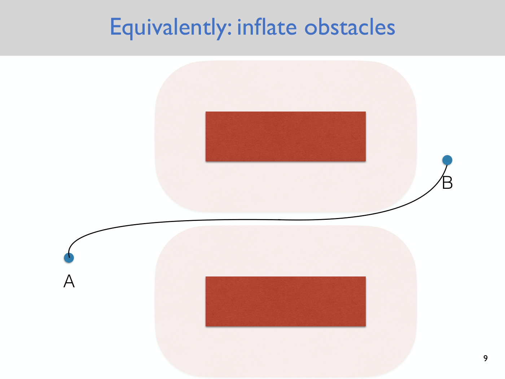
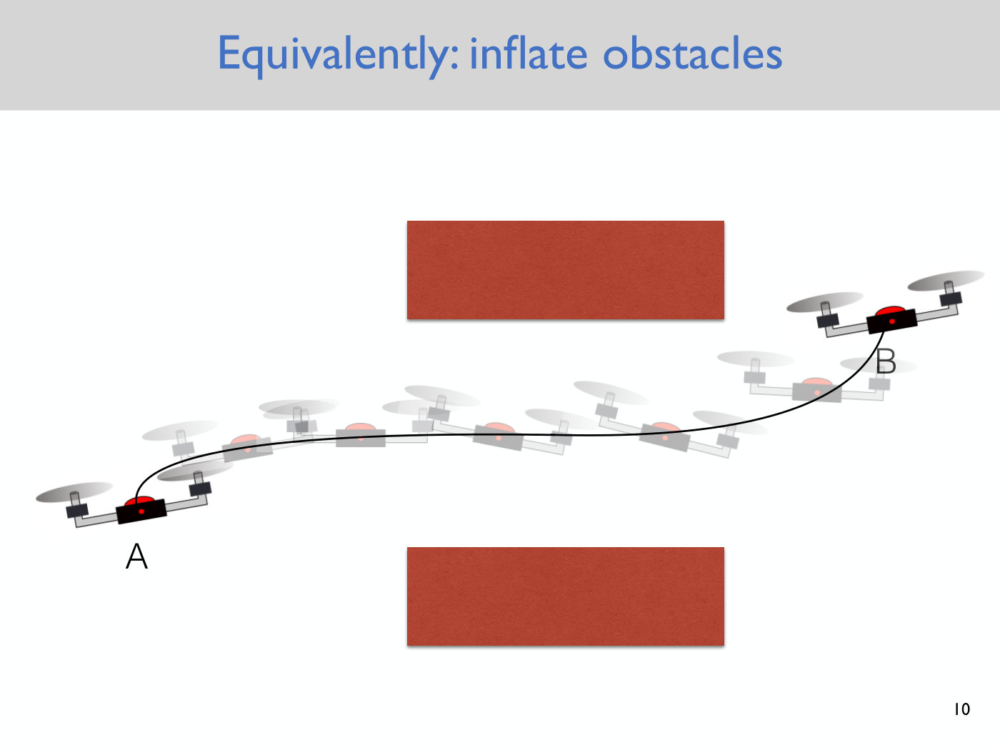
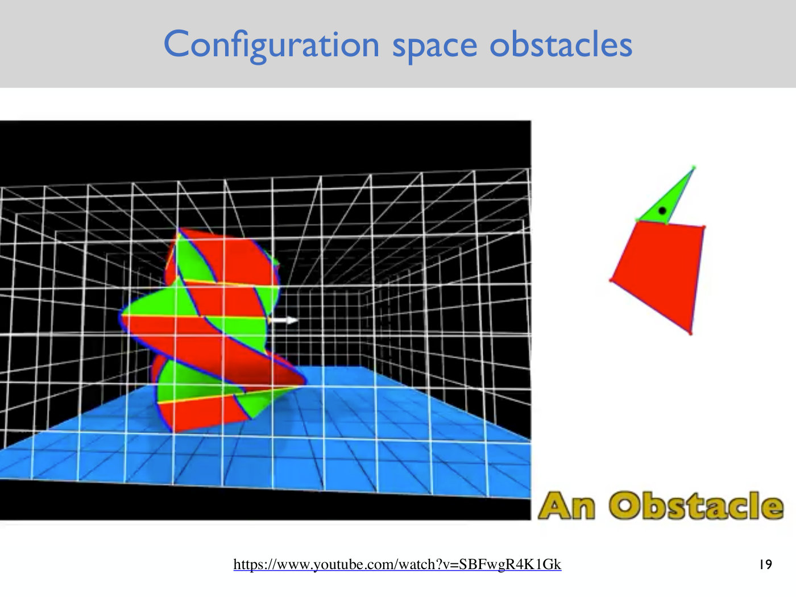
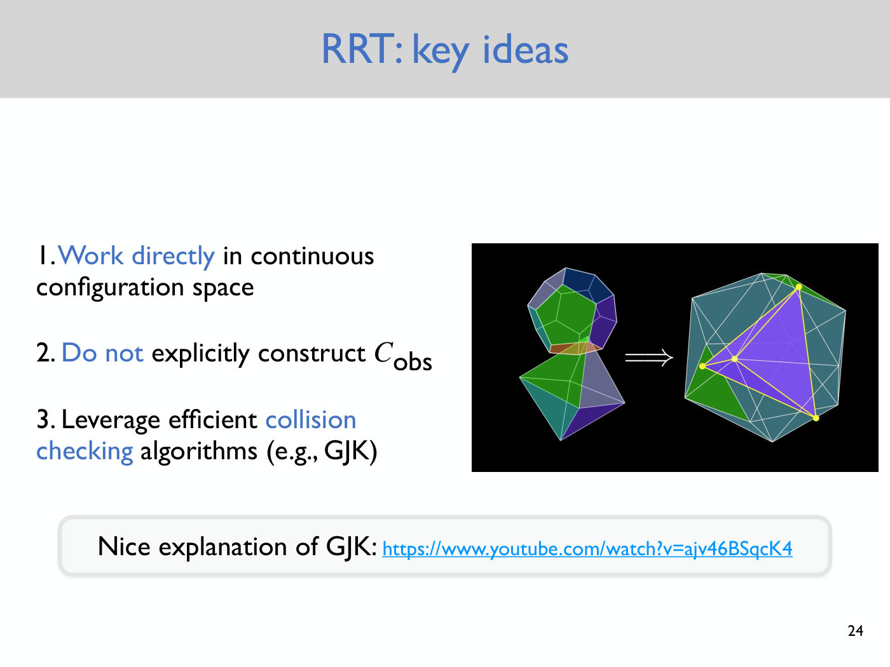
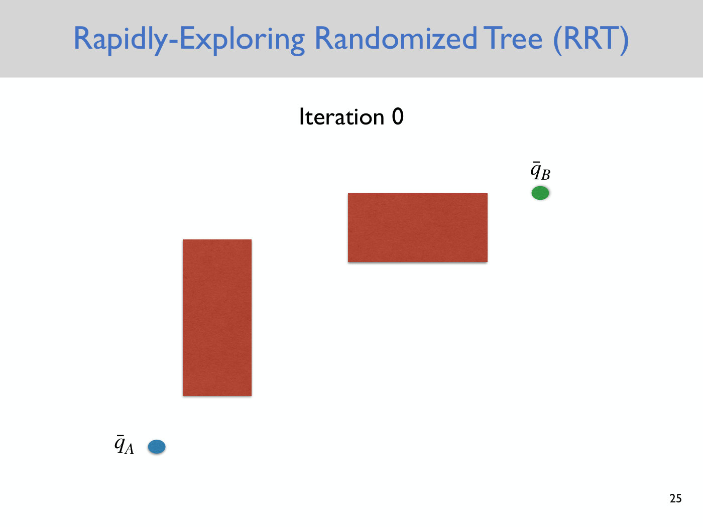
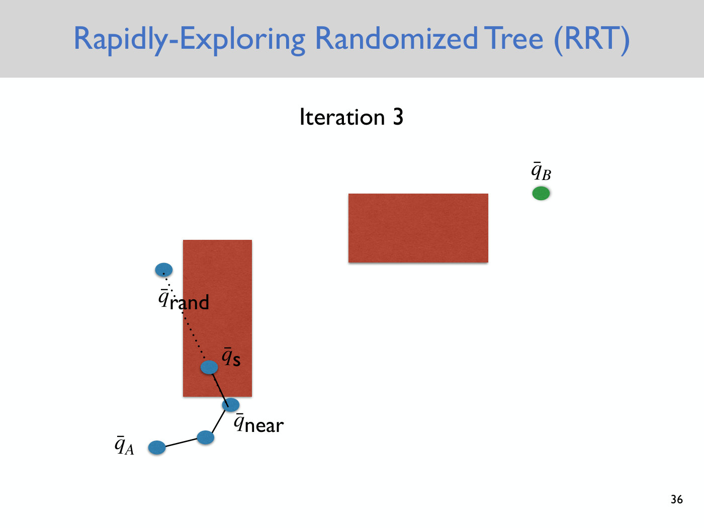
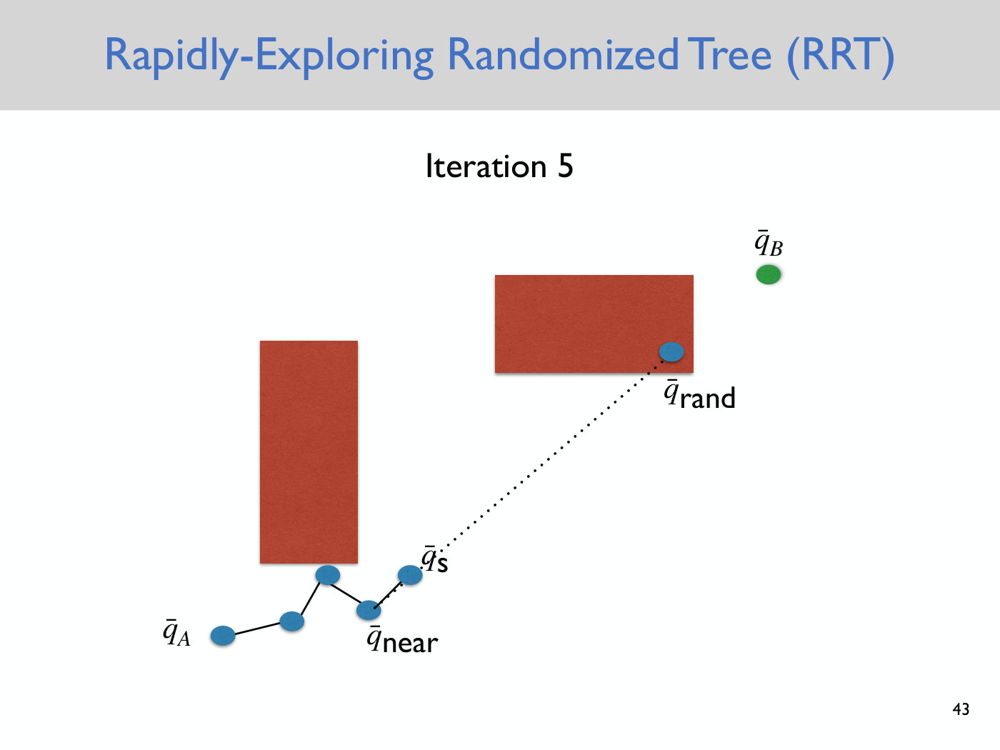
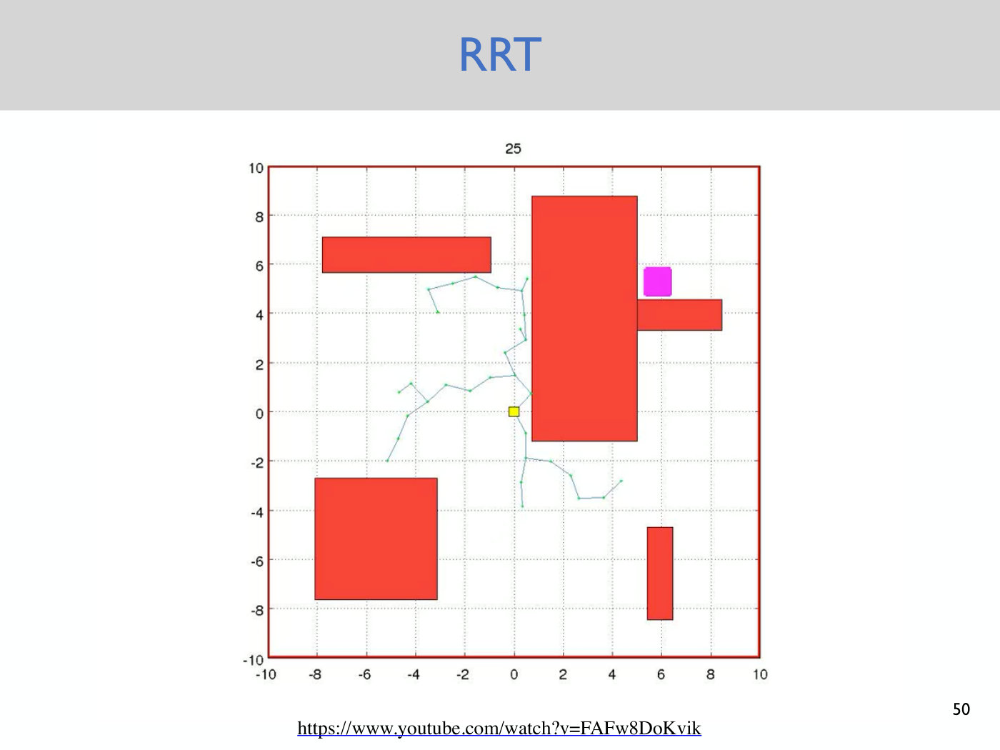
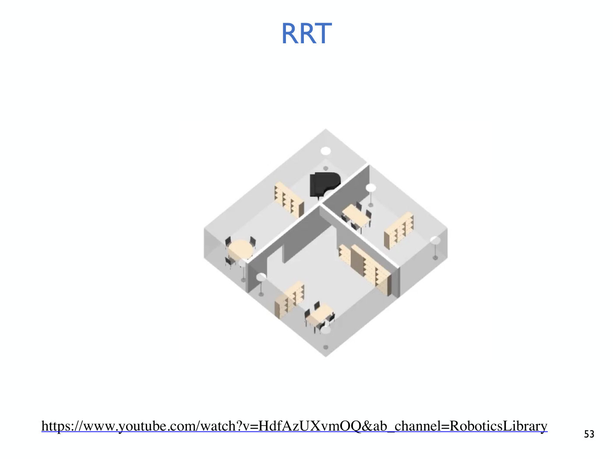
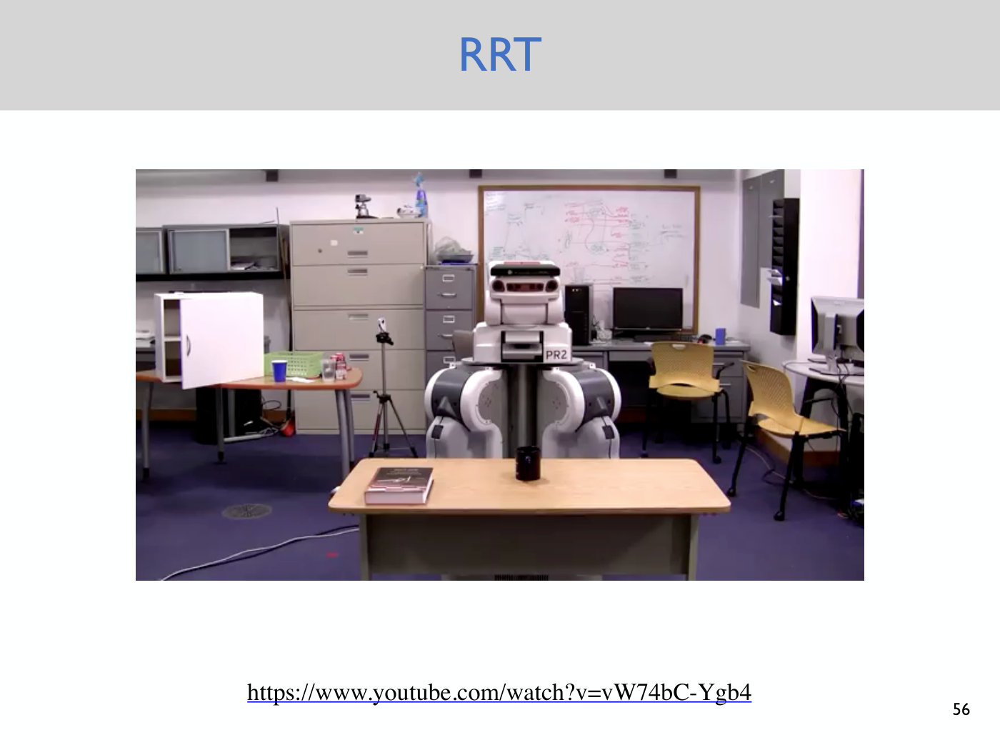

# Lecture 3 — Rapidly Exploring Randomized Trees (RRTs)

Anirudha Majumdar, Princeton ROB 345/549, Fall 2026 ·
[video](https://www.youtube.com/watch?v=KDIe1094FMo) (71 min) ·
[slides (PDF, Dropbox)](https://www.dropbox.com/scl/fi/5uv2vt76nqj4b32vr4i37/Lecture3.pdf?rlkey=nx8jjqjlvmgcqqhb8r1p6okzp&dl=0) ·
[slide-by-slide text](../raw/slides/03-rrts.md) ·
[transcript](../raw/transcripts/03-rrts.md)

**What this lecture establishes.** The second lecture on geometric motion planning drops
Lecture 2's assumption that the robot is a point. The quickest fix is to enclose the robot in a
circle and inflate the obstacles by its radius. That is safe, but it fails in cluttered
environments, so the lecture goes back to the **configuration space**, where the robot really is
a point. Planning there by discretizing and running graph search is correct in principle and
hopeless in practice: a grid over a $d$-dimensional configuration space has $B^d$ cells, and the
obstacle space $C_{obs}$ cannot even be constructed. The **rapidly exploring randomized tree
(RRT)** avoids both problems. It works directly in the continuous configuration space, never
builds $C_{obs}$, and touches the obstacles only by collision-checking individual
configurations. The lecture walks the algorithm through six iterations, gives its pseudocode,
shows it planning for a piano, a drone and a PR2 robot, introduces the **RRT\*** variant for
approximately optimal paths, and ends with **completeness**: RRTs are not complete, but they are
probabilistically complete.

Slide numbers are the numbers printed on the slides, and in this deck they equal the PDF page
numbers. Timestamps (≈M:SS) point into the video and the
[transcript](../raw/transcripts/03-rrts.md). The concepts have their own pages:
[configuration space](configuration-space.md), [graph search](graph-search.md) and
[rapidly exploring randomized trees](rrt.md).

## Contents

1. [Where this lecture sits](#where-this-lecture-sits)
2. [Accounting for the robot's geometry](#accounting-for-the-robots-geometry)
3. [Back to configuration space](#back-to-configuration-space)
4. [The curse of dimensionality](#the-curse-of-dimensionality)
5. [The RRT and its three key ideas](#the-rrt-and-its-three-key-ideas)
6. [The RRT, step by step](#the-rrt-step-by-step)
7. [The RRT algorithm](#the-rrt-algorithm)
8. [Stopping near the goal, and recovering the path](#stopping-near-the-goal-and-recovering-the-path)
9. [What a growing tree looks like](#what-a-growing-tree-looks-like)
10. [The step size, and checking the whole segment](#the-step-size-and-checking-the-whole-segment)
11. [Why RRTs work: no explicit obstacle space](#why-rrts-work-no-explicit-obstacle-space)
12. [RRTs in action](#rrts-in-action)
13. [Optimality and RRT\*](#optimality-and-rrt)
14. [Completeness and probabilistic completeness](#completeness-and-probabilistic-completeness)
15. [Choosing what to optimize](#choosing-what-to-optimize)
16. [What comes next](#what-comes-next)
17. [Gaps in the record](#gaps-in-the-record)

## Where this lecture sits

Majumdar opens with a recap of [Lecture 2](02-discrete-motion-planning.md) (≈0:10–1:41).
Geometric motion planning assumes the robot is given a geometric model of the environment, such
as a point cloud or an occupancy map, and asks how it can get from an initial configuration A to
a final configuration B without colliding with anything (slides 3 and 4). Lecture 2 solved this
with discrete motion planning by graph search: breadth-first search, and A\*, which adds to the
cost from the start a heuristic estimate of the cost-to-go that ignores the obstacles. Dijkstra's
algorithm is the special case with a heuristic of zero for every node.

This lecture starts relaxing that lecture's very strong assumptions, beginning with the
assumption that **the robot is a point** (slide 5, ≈1:41). When Lecture 2 discretized the space,
it assumed the robot had at most the extent of one cell, and with a fine grid that means no
extent at all. The slide shows a frame of Lecture 2's search animation as a reminder. A real
robot has non-trivial geometry that planning must take into account (≈2:28).

## Accounting for the robot's geometry

The motivating example is the planar quadrotor, a planarized version of the course's 3D drone,
which has to get from an initial configuration A to a goal configuration B between two obstacles
(slide 6, ≈2:28–3:14). Here a configuration is both position and orientation: the location of the
centre of mass and the angle $\theta$ that gives the drone's tilt.

**The circle approximation.** Majumdar asked for the simplest thing one could do while staying
committed to the graph search algorithms of Lecture 2. A student suggested making the point
bigger. Majumdar turned the suggestion into a circle: find the smallest circle that encloses the
robot (slide 7, ≈3:14–4:02).

*Slide 7 — the circle approximation: each quadrotor is enclosed in the smallest circle that contains it. [Deck](https://www.dropbox.com/scl/fi/5uv2vt76nqj4b32vr4i37/Lecture3.pdf?rlkey=nx8jjqjlvmgcqqhb8r1p6okzp&dl=0)*

**Inflating the obstacles** is the equivalent view, and it is what makes the circle useful (slide
8, ≈4:02). Inflate every obstacle by the circle's radius, and the robot can again be treated as a
point. Each quadrotor on the slide is reduced to a dot at the centre of its body.

The point robot's plan is then an ordinary path through the gap between the inflated obstacles,
which any of Lecture 2's graph search algorithms can find once the environment is discretized
(slide 9, ≈4:02–4:49).

*Slide 9 — the obstacles inflated by the circle's radius (pink), with the robot reduced to a point: an ordinary path for the point runs through the gap. [Deck](https://www.dropbox.com/scl/fi/5uv2vt76nqj4b32vr4i37/Lecture3.pdf?rlkey=nx8jjqjlvmgcqqhb8r1p6okzp&dl=0)*

Because the circle contains the whole robot, a collision-free path for the point among the
inflated obstacles is guaranteed to be collision-free for the real robot, whatever orientation
the robot takes along the way (slide 10, ≈4:49).

*Slide 10 — the same path flown by the real quadrotor; because the circle contained the whole robot, every pose along it is collision-free. [Deck](https://www.dropbox.com/scl/fi/5uv2vt76nqj4b32vr4i37/Lecture3.pdf?rlkey=nx8jjqjlvmgcqqhb8r1p6okzp&dl=0)*

**The Minkowski sum.** The inflation has a name: it is the **Minkowski sum** of the obstacle and
the circle, an operation that adds two shapes together. One way to picture it is to place the
circle at every point of the obstacle and take the union of all those circles; the union is the
inflated shape (≈5:35). No slide draws this construction.

**Why the circle is not enough.** The approach is a "first cut", the "relatively lazy" way to
reuse graph search, and it does not work well in cluttered environments (≈6:21). Add a thin third
obstacle between the original two (slide 11), and the planar quadrotor can still pass level
through the narrow lower gap and climb to B (slide 12). The planning problem is feasible.

But the circle that encloses the drone is too big for the gap. It overlaps the obstacle above and
the one below, so under the circle approximation the same problem becomes infeasible (slide 13,
≈7:06–7:52). A student had already proposed the alternative, though the captions do not record
the suggestion. "That's going to be the actual approach that we end up following" (≈6:21): go
back to the configuration space (≈7:52).

*Slide 13 — where the circle fails: the quadrotor itself fits through the narrow lower gap, but the circle around it overlaps the obstacles above and below. [Deck](https://www.dropbox.com/scl/fi/5uv2vt76nqj4b32vr4i37/Lecture3.pdf?rlkey=nx8jjqjlvmgcqqhb8r1p6okzp&dl=0)*

## Back to configuration space

Majumdar recaps Lecture 2's definitions (slides 15–18, ≈7:52–10:12). The **degrees of freedom**
of a system are the number of independent ways it can move: equivalently, the minimal number of
coordinates needed to describe its configuration. The planar quadrotor has three, $(x, y, \theta)$.
The **configuration space** $C$ is the set of all its configurations. For the planar quadrotor it
is $\mathbb{R}^2$ crossed with the circle, "which is the same as SE2, the special Euclidean group
in two dimensions" (≈8:38). The **free space** $C_{free}$ is the set of configurations in which
the robot collides with nothing. The **obstacle space** $C_{obs} = C \setminus C_{free}$ is its
complement. These slides are the same as Lecture 2's; see
[configuration space](configuration-space.md).

**Configuration-space obstacles** come back in a different frame of the triangle-robot video that
Lecture 2 showed (slide 19, ≈10:12–10:59). The triangle has three degrees of freedom, so its
configuration space is three-dimensional: the plane, plus a vertical axis for orientation that
wraps around, since $\theta = 0$ is the same as $\theta = 2\pi$. Even simple obstacles in the
plane become very complicated configuration-space obstacles. Asked whether the axes are $x$, $y$,
$z$, Majumdar says they are $x$, $y$ and $\theta$ for this robot. A 3D quadrotor would have six
degrees of freedom: three translational ones for the centre of mass and three for orientation
(≈12:32–13:19).

*Slide 19 — a frame of the configuration-space obstacle video: the obstacle and the triangle robot in the plane (right), and the twisted solid they produce in the robot's configuration space, whose vertical axis is orientation (left). [Deck](https://www.dropbox.com/scl/fi/5uv2vt76nqj4b32vr4i37/Lecture3.pdf?rlkey=nx8jjqjlvmgcqqhb8r1p6okzp&dl=0)*

**The good news** is on slide 20 (≈10:59–11:46). Geometric motion planning is to find a path in
$C_{free}$ from configuration $q_A$ to configuration $q_B$, and this turns the problem of
accounting for the robot's geometry back into finding a path for a point. In theory, then, one
could discretize the configuration space and run BFS, DFS, Dijkstra's algorithm or A\* on it. The
result is a discrete path through the configuration space that avoids $C_{obs}$, which is a path
for the real robot that accounts for the geometry of both the environment and the robot
(≈11:46–12:32).

## The curse of dimensionality

Majumdar then asks whether this is practical (≈13:19–14:51). Students pointed out that there are
parameters to choose and that the configuration space can have a large dimension. The second is
the decisive problem (slide 21, ≈14:51–16:24). A typical robot arm has seven degrees of freedom.
In general, a robot with $d$ degrees of freedom has a $d$-dimensional configuration space. Cut
each dimension into $B$ bins, and the graph has $B^d$ vertices, exponential in the dimension.
The slide prints $B^d$ and "d DOFs" (with an italic $d$) without defining them; the definitions are spoken
(≈14:51).

*Slide 21 — the curse of dimensionality: a robot arm with d degrees of freedom, whose discretized configuration space has B to the d cells. [Deck](https://www.dropbox.com/scl/fi/5uv2vt76nqj4b32vr4i37/Lecture3.pdf?rlkey=nx8jjqjlvmgcqqhb8r1p6okzp&dl=0)*

The numbers become ridiculous quickly, "more than the number of observable atoms in the
universe". Multiple arms make it worse, a snake robot with $n$ links can have very many degrees of
freedom, and a humanoid has 30 or 40 "easily", more with dexterous hands (≈15:38–16:24). Simple
discretization is therefore not tractable beyond about three dimensions (≈16:24).

There is a second, subtler problem on the same slide: **how would we even construct $C_{obs}$**
in a high-dimensional space? We could enumerate all $B^d$ configurations and decide for each one
whether it is in collision, but that is intractable. Just representing $C_{obs}$ is
computationally hard, before any planning is done (≈16:24–17:11).

## The RRT and its three key ideas

The **rapidly exploring randomized tree (RRT)** circumvents many of these challenges (≈17:11).
It was developed in the late 1990s, "maybe around 2000"; the exact year is garbled in the
captions. It has had "a really massive impact" on motion planning. When Majumdar was a student,
conferences had whole sessions on new variants of it, and the RRT paper has citations "in the
thousands" (≈17:59, ≈31:53). The lecture presents only the most basic, "vanilla" version.

The readings are *Principles of Robot Autonomy*, chapter 4.4.2, which is compact and good for a
first cut, and *Planning Algorithms*, chapter 5.5, for the more extensive treatment (slide 22,
≈17:59–18:44). *Planning Algorithms* is by Steve LaValle, who came up with these randomized
algorithms with his collaborators.

The RRT rests on three ideas (slide 23, ≈18:44–19:30, and the third on the next slide):

1. **Work directly in the continuous configuration space.** There is no upfront discretization.
2. **Never explicitly construct $C_{obs}$.** The obstacle space is never represented,
   mathematically or computationally.
3. **Use efficient collision-checking algorithms**, such as GJK (slide 24, ≈19:30–21:04). GJK is
   named after Gilbert, Johnson and Keerthi. Given two objects, it decides whether they intersect.
   Algorithms like it are extremely efficient for convex objects, and a non-convex object can be
   approximated by a union of convex ones. They were developed for video games, where collision
   checking is "an absolutely fundamental computational building block". Bringing them from
   computer graphics into motion planning was one of the big breakthroughs behind RRTs.

*Slide 24 — the third key idea, efficient collision checking, with a still from the GJK explainer video linked on the slide. [Deck](https://www.dropbox.com/scl/fi/5uv2vt76nqj4b32vr4i37/Lecture3.pdf?rlkey=nx8jjqjlvmgcqqhb8r1p6okzp&dl=0)*

Majumdar leaves the details of GJK to the video linked on the slide, but gives its key idea
(≈21:04–21:50). It uses a **Minkowski difference**. To check whether shapes A and B collide, form
their Minkowski difference and check whether the origin is contained in it. If it is, the objects
are in collision; if not, they are not.

## The RRT, step by step

The example is drawn in the plane for the pictures, but the configuration space should be thought
of in full generality (≈21:50–22:37). Two red rectangles are the obstacles, $\bar{q}_ A$ is the
initial configuration, and $\bar{q}_ B$ is the goal. The tree is built incrementally and starts
as the single vertex $\bar{q}_ A$ (slide 25).

*Slide 25 — the worked example's map: two obstacles, the start at the lower left and the goal at the upper right; the tree begins as the start alone. [Deck](https://www.dropbox.com/scl/fi/5uv2vt76nqj4b32vr4i37/Lecture3.pdf?rlkey=nx8jjqjlvmgcqqhb8r1p6okzp&dl=0)*

The slides put a bar over every configuration. $\bar{q}_ {\text{rand}}$ is a random sample,
$\bar{q}_ {\text{near}}$ is the vertex of the tree nearest to it, $\bar{q}_ s$ is the new point
reached by extending from $\bar{q}_ {\text{near}}$, and $d$ is the step size.

**Iteration 1** (slides 26–29, ≈22:37–24:56). Sample a configuration at random from the whole
configuration space, ignoring the obstacles; for a drone this would be a random $x$, $y$, $z$
location and a random orientation. Find the closest point in the existing tree, which can only be
$\bar{q}_ A$, and connect the two with a straight line in configuration space. Then **extend**
from $\bar{q}_ A$ toward the sample by a distance $d$. The step size $d$ is a hyperparameter of
the algorithm, picked up front. The new point is added to the tree with an edge, so at the end of
the first iteration the tree has two vertices and one edge.

*Slide 28 — iteration 1: a random sample (bottom middle), the dotted line to the only vertex, and the step of length d toward it that gives the new point. [Deck](https://www.dropbox.com/scl/fi/5uv2vt76nqj4b32vr4i37/Lecture3.pdf?rlkey=nx8jjqjlvmgcqqhb8r1p6okzp&dl=0)*

**Iteration 2** (slides 30–33, ≈24:56–27:59). Sample again, and find the closest vertex, which is
now the second one; call it $\bar{q}_ {\text{near}}$. On slide 31 the dotted line to the sample
crosses a corner of an obstacle. Nothing checks it, because the connection ignores the obstacles,
just as the sampling does. A student asked what happens if a sample lands on an obstacle.
Nothing special: the sampling step does not even check (≈25:41).

*Slide 32 — iteration 2: the sample's nearest vertex is now the second one; the dotted line clips the obstacle's corner, but only the extended point, below the obstacle, is checked. [Deck](https://www.dropbox.com/scl/fi/5uv2vt76nqj4b32vr4i37/Lecture3.pdf?rlkey=nx8jjqjlvmgcqqhb8r1p6okzp&dl=0)*

The obstacles enter at one point only. **The extended point $\bar{q}_ s$ is collision-checked**,
and only for that particular configuration: for a drone, one specific $x$, $y$, $z$ and
orientation (≈26:27–27:59). Majumdar promises to keep emphasizing this. There is no mathematical
representation of $C_{obs}$, only collision checks of the points met while building the tree.
Here $\bar{q}_ s$ is free, so it joins the tree, which is now a chain of three vertices (slide 33).

**Iteration 3: a rejected extension** (slides 34–37, ≈27:59–28:45). The sample lies to the left of
the tall obstacle, and the nearest vertex is the one just below it. Extending toward the sample
puts $\bar{q}_ s$ inside the obstacle. An extended point that is in collision is thrown away and
not added to the tree, so the tree is unchanged at the end of the iteration (slide 37). In reply
to a student, Majumdar describes the random sample's job: it guides the search in different
directions, away from the existing tree (≈28:45).

*Slide 36 — iteration 3, rejected: the extension from the vertex under the tall obstacle lands inside it, so the new point is thrown away. [Deck](https://www.dropbox.com/scl/fi/5uv2vt76nqj4b32vr4i37/Lecture3.pdf?rlkey=nx8jjqjlvmgcqqhb8r1p6okzp&dl=0)*

**Iteration 4** (slides 38–40, ≈29:31–30:19). A sample below and to the right gives an extension
from the top of the chain into free space, and it is added. Slide 40 already draws its edge, and
the deck has no separate slide for the end of this iteration. The tree is still "a boring chain".

**Iteration 5: a sample inside an obstacle** (slides 41–44). This time $\bar{q}_ {\text{rand}}$
falls inside the other obstacle. That does not matter. The nearest vertex is the end of the chain,
and the extension toward the sample lands in free space, so it is added (slide 44). Majumdar
points back to it later: "this was an iteration where q rand is in collision, but we don't care.
... We just care whether the extension is in collision or not" (≈34:17).

*Slide 43 — iteration 5: the sample lies inside the right-hand obstacle, but the extension toward it is in free space, so it is added. [Deck](https://www.dropbox.com/scl/fi/5uv2vt76nqj4b32vr4i37/Lecture3.pdf?rlkey=nx8jjqjlvmgcqqhb8r1p6okzp&dl=0)*

**Iteration 6: the tree branches** (slides 45–47). The sample lands below the tree, and the vertex
nearest to it is the second vertex, not the most recent one. The new point branches off there
(slide 47). This step is what makes the structure a tree and not a chain: the closest vertex to a
new sample need not be the vertex added last (≈31:53–32:40). "Tree" here means a graph with no
cycles, rooted at the initial configuration (≈30:19).

*Slide 47 — after six iterations: one extension was rejected, and the newest vertex branches off the second vertex, the one nearest its sample, instead of extending the chain. [Deck](https://www.dropbox.com/scl/fi/5uv2vt76nqj4b32vr4i37/Lecture3.pdf?rlkey=nx8jjqjlvmgcqqhb8r1p6okzp&dl=0)*

Two questions from the class settled details. Exact ties for the nearest vertex have probability
zero in a continuous space, and if one happened you would break it arbitrarily, since the
algorithm is randomized anyway (≈33:32–34:17). And the distances in the hand-drawn example were
eyeballed (≈33:32).

## The RRT algorithm

Slide 48 writes the algorithm out, and implementing this vanilla version is part of the assignment
(≈35:03). In the notation above:

1. Initialize a graph $G$ with vertex set $V = \lbrace \bar{q}_ A \rbrace$, where $\bar{q}_ A$ is
   the starting configuration.
2. While the goal has not been reached:
   1. $\bar{q}_ {\text{rand}} \leftarrow$ randomly sample a configuration, that is, a point in
      configuration space;
   2. $\bar{q}_ {\text{near}} \leftarrow$ the vertex in $V$ nearest to $\bar{q}_ {\text{rand}}$;
   3. $\bar{q}_ s \leftarrow \text{Extend}(\bar{q}_ {\text{near}}, \bar{q}_ {\text{rand}})$;
   4. if $\bar{q}_ s$ is in collision, continue to the next iteration;
   5. otherwise add $\bar{q}_ s$ to $V$, add an edge between $\bar{q}_ {\text{near}}$ and
      $\bar{q}_ s$, and if $\Vert \bar{q}_ s - \bar{q}_ B \Vert \lt \epsilon$, so that the new point
      is close enough to the goal, return SUCCESS.

The slide prints "nearest fo" for "nearest to", and writes the collision test with a capital S,
$\bar{q}_ S$. Both are corrected silently above. The listing has no FAILURE branch; why not is the
subject of the completeness discussion below.

## Stopping near the goal, and recovering the path

**The termination test** stops the algorithm once the extended point lies within an
$\epsilon$-ball of the goal in configuration space (≈35:50, ≈37:21–38:08). The path then runs from
$q_A$ to within $\epsilon$ of $q_B$, not to $q_B$ exactly. The threshold $\epsilon$ is chosen by
the user: "I'm okay with my drone getting to 0.01 centimeters or whatever from the goal".

A student asked about $\epsilon = 0$. In a randomized algorithm the probability of hitting
$q_B$ exactly is zero (≈38:53). Majumdar then asked the class how to reach the goal exactly
without an $\epsilon$. One student proposed connecting the final point, once within $\epsilon$,
straight to the goal. Majumdar added another simple fix: every now and then, sample the goal
configuration itself and see whether the existing tree can connect to it (≈38:53–40:35).

A large $\epsilon$ is no shortcut. If $\epsilon$ were the radius of the room, the algorithm would
stop at once, and getting from that point to the actual goal would be "an equally hard, or almost
equally hard, planning problem" (≈40:35–41:20).

**Recovering the path** works as in discrete search, by keeping track of parents (slide 55,
≈35:50–36:35, ≈55:15–56:00). Each time a $\bar{q}_ s$ is added, record the $\bar{q}_ {\text{near}}$
it was extended from as its parent. When the algorithm stops, follow parents back from the last
vertex. Because the tree has no cycles, this is guaranteed to reach $q_A$. The slide adds that the
path returned by an RRT "can be quite jagged".

## What a growing tree looks like

The first animation runs the RRT with no obstacles at all (slide 49, ≈41:20–43:39). The PDF holds
only a nearly empty first frame of it. As Majumdar narrates it, the tree very quickly splits into
three or four directions. It explores coarsely at first, and then more and more finely: it has a
**space-filling property**, which can be shown mathematically. The argument uses **Voronoi
regions**, an idea from computational geometry. These partition the configuration space by which
point of the tree is closest. The RRT biases itself toward large Voronoi regions, which in plain
English means it biases its exploration toward regions of the configuration space it has not yet
explored. Majumdar offers to point students to papers that prove it.

The more interesting case has obstacles (slide 50, ≈43:39–44:25). The tree has to get from the
yellow square to the magenta box, and it very quickly finds a way toward the goal region. Here the
$\epsilon$ is implicit in the goal region: reaching any point of the magenta box ends the search.
That is the trade-off in choosing $\epsilon$. A very large goal region ends the search quickly but
does not get the robot where it needs to go. The PDF frame shows the tree part-grown, and the
"25" above the plot is not explained. One of the problems with the basic algorithm is apparent in
the video: the path is very jagged (≈44:25).

*Slide 50 — a frame of the RRT video: the tree spreads from the yellow start square through the free space toward the magenta goal box, which it has not yet reached. [Deck](https://www.dropbox.com/scl/fi/5uv2vt76nqj4b32vr4i37/Lecture3.pdf?rlkey=nx8jjqjlvmgcqqhb8r1p6okzp&dl=0)*

**Speed.** Graph search is "basically out of the question" for configuration spaces of more than
three or four dimensions. The RRT is extremely efficient (≈45:13–45:59). Some of LaValle's early
demonstrations were geometric plans for humanoid robots reaching under a table, computed in "a few
seconds, maybe, if you have an optimized algorithm". Students twice suggested biasing the search
toward the goal with something like A\*'s heuristic. Majumdar agreed that people do this in
practice and that it can speed things up (≈31:05, ≈45:59).

## The step size, and checking the whole segment

The Extend operation needs the **step size** $d$ (slide 51, ≈45:59–46:45). The algorithm as
stated also skips a check. Even if $\bar{q}_ {\text{near}}$ and $\bar{q}_ s$ are both free, points
on the segment between them may be in collision, and the robot cannot teleport (≈36:35–37:21,
≈46:45). The correct thing is to check the entire segment. The slide's compromise is that, for a
small step size, it is reasonable to check only $\bar{q}_ s$.

*Slide 51 — the Extend step: the new point lies a step d from the nearest vertex toward the sample; checking only that point ignores the segment in between. [Deck](https://www.dropbox.com/scl/fi/5uv2vt76nqj4b32vr4i37/Lecture3.pdf?rlkey=nx8jjqjlvmgcqqhb8r1p6okzp&dl=0)*

In some special cases the whole segment can be checked efficiently, and the next assignment shows
one way to do it (≈47:31). In general, people use some kind of **bisection search** along the
segment, checking points on it for collision. Alternatively, they pick a small step size and
inflate the obstacles slightly to cover what lies between the two checked endpoints
(≈47:31–48:17).

## Why RRTs work: no explicit obstacle space

Majumdar calls this "the key conceptual idea behind RRTs, all the variants, and all the randomized
algorithms in general for motion planning". Nowhere does the algorithm represent $C_{obs}$. It only
asks, for particular configurations, whether the robot collides with its environment (slide 52,
≈48:17–49:03). Collision checking can be done very efficiently. Much of the software was developed
for video games, which have to check collisions at real-time rates, and this is "the main
conceptual reason why RRTs work so well".

A student pointed out that graph search need not build $C_{obs}$ either. Majumdar agreed: some
variants of A\* also check collisions as they go (≈49:03–50:36). The difference is that graph
search discretizes up front, whereas the RRT discretizes "as you go", building the tree
incrementally. Graph search still runs into the exponential growth of the grid with the dimension
of the configuration space.

## RRTs in action

**A piano** (slide 53, ≈51:22–52:57). Motion planning is often called the piano mover's problem,
and this video solves a literal one with an RRT. The piano is a rigid body in 3D, with three
translational and three rotational degrees of freedom, so its configuration space is
six-dimensional. The video steps through the algorithm: sample a configuration for the piano, find
the nearest point in the tree, connect them by a line segment in configuration space, extend, and
collision-check. Collision checking is the only point at which the environment is queried, and it
can use off-the-shelf, highly optimized software. The result is a feasible path from start to
finish, though "maybe not even close to optimal as you can see in this video".

*Slide 53 — the opening frame of the piano video: a literal piano mover's problem, planned by an RRT in the piano's six-dimensional configuration space. [Deck](https://www.dropbox.com/scl/fi/5uv2vt76nqj4b32vr4i37/Lecture3.pdf?rlkey=nx8jjqjlvmgcqqhb8r1p6okzp&dl=0)*

**A drone at MIT** (slide 54, ≈52:57–54:29). This work is from Nick Roy's group. It uses the RRT,
with modifications covered in a few lectures to account for the drone's dynamics, to find a coarse
motion plan from one point in the building to another, which the drone then executes. The flights
are in MIT's Stata Center and reach about 8 meters per second. Majumdar uses the video to restate
what the geometric setting leaves out. The video also involves dynamics, since a drone cannot
follow an arbitrary path through configuration space. It involves uncertainty in the dynamics
model, which feedback must correct, and state estimation and sensing, needed to know how far the
drone is from the path. Those are for later lectures. This lecture covers only the geometric part:
how to get from A to B without colliding (≈54:29–55:15).

**A PR2 robot arm** (slide 56, ≈56:00–57:32). The PR2 is a bimanual robot, "a classic robot that
people used to use for research". Majumdar first says the goal is for the arm to touch the book on
the table, then corrects himself: the goal was to reach a target while avoiding the book and the
table. The RRT's path is "not the nicest path". It is feasible and gets where it needs to, but the
arm does "all sorts of random extraneous things along the way".

*Slide 56 — the PR2 video: the basic RRT's path for the arm is feasible but full of extraneous motion. [Deck](https://www.dropbox.com/scl/fi/5uv2vt76nqj4b32vr4i37/Lecture3.pdf?rlkey=nx8jjqjlvmgcqqhb8r1p6okzp&dl=0)*

## Optimality and RRT\*

Motion planning has two criteria (≈56:00). One is **feasibility**: a collision-free path from A to
B. The other is to **optimize** something, such as time or energy. The basic RRT has no notion of
optimality.

There are many variants of the RRT (*Planning Algorithms*, chapter 5, covers a few), and an
important one is **RRT\***, pronounced "RRT-star" (slide 57, ≈57:32). RRT\* returns approximately
optimal paths, where the standard RRT only tries to find a feasible one. The slide also names a
**bi-directional** RRT, which the lecture does not discuss. Majumdar does not go through RRT\* in
detail, saying it would take a full lecture (≈1:00:37), but gives the high-level picture.

- **The key step is rewiring** (≈57:32–59:03). The overall structure is the RRT's: sample, find
  the nearest vertex, extend. RRT\* adds an optimization step. It looks locally for paths more
  efficient than the ones it has, and when it finds one it rewires the tree toward it
  (≈59:49–1:00:37).
- **It keeps improving after the first path.** The RRT finds a path and stops. RRT\* keeps
  optimizing as the tree grows, so the paths get closer and closer to optimal. In the video,
  optimal means shortest path length (≈58:18; slide 58).
- **It is anytime valid** (≈59:03–59:49). Once RRT\* has found a feasible path, the path never
  becomes infeasible; it only becomes more nearly optimal. You can stop it whenever the
  computational budget runs out, which suits a robot with bounded computation. The rewiring step
  is local and "pretty efficient to implement", so the extra cost is not a big issue
  (≈1:02:11–1:02:57).

The PR2 comparison makes the difference visible (slide 59, ≈59:49). The RRT does "all this random
stuff", and RRT\* goes directly toward the goal configuration. For both comparison slides, 58 and
59, the PDF holds only identical opening frames of the two videos.

**Why not just bias the search toward the goal?** (≈1:00:37–1:02:11). One can. But some
environments have several qualitatively different ways from start to finish: different
**homotopy classes**, topologically different paths. RRT\* may first find a path that is locally
optimal, one that small adjustments cannot improve, while a completely different route is closer to
the global optimum. Exploring far away is how that route gets found. If local optimality is enough,
which it often is, biasing the search is perfectly reasonable.

## Completeness and probabilistic completeness

Suppose a path from $\bar{q}_ A$ to $\bar{q}_ B$ exists: will an RRT find it? (slide 60,
≈1:02:57–1:03:45). The class's intuition was "eventually", and Majumdar says that is exactly right
and can be formalized.

**Completeness** is the classical notion. A planning algorithm is **complete** if it finds a path
from start to goal whenever one exists, in a finite amount of time, and when no path exists it
still terminates and returns failure instead of running forever (slide 60, ≈1:03:45–1:04:31). The
second half is the hard part for an RRT: how would it know it had explored enough to conclude that
there is no way from A to B, say because a wall separates them (≈1:04:31)?

**The discrete search algorithms are complete for discrete problems** (slide 61, ≈1:05:20–1:06:07).
BFS, DFS, Dijkstra's algorithm and A\* can be proved complete; *Planning Algorithms* has a proof.
Once the problem is discretized, they find a path in finite time if the graph contains one, and
otherwise terminate in finitely many iterations with failure. The guarantee is for the discretized
problem.

**RRTs are not complete.** If no path exists, they may run forever (slide 61, ≈1:06:07).

**RRTs are probabilistically complete** (slide 62, ≈1:06:07–1:06:52). If a path exists, the
probability that the RRT finds a solution converges to one as the number of iterations goes to
infinity. This follows from the space-filling property. Even a narrow path from start to goal will
be found with probability approaching one, "as long as there's some extent in the path"
(≈1:06:52).

The guarantee holds "under some mild technical conditions having to do with enough separation
between obstacles" (slide 62). One can construct pathological environments, mathematically well
defined but not physical, in which the RRT is not probabilistically complete. The next assignment
has a simple example where it breaks down (≈1:07:38). For any realistic problem a physical robot
would meet, the RRT is probabilistically complete. When no path exists, it may run forever, "and I
guess that's just what we give up" (≈1:07:38–1:08:24).

## Choosing what to optimize

Majumdar closes with a caution about optimality (≈1:08:24–1:10:43). Both A\* and RRT\* look for an
optimal path, but defining what optimality should be for a particular problem is "a massive
challenge". Good cost functions are hard to write down, and bad ones have unintended effects. He
says this matters most in reinforcement learning, citing "the OpenAI and Hugging Face incidents"
as a classic case of alignment issues: a reward that does not capture everything you want, and
unintended consequences when an algorithm optimizes it. The lecture does not describe those
incidents.

In motion planning it is less extreme, but still real. The Tesla planner shown in
[Lecture 2](02-discrete-motion-planning.md#bfs-against-a-and-learned-heuristics) weighs several
cost terms (≈1:09:57). You want the car to get from A to B fast, but not by breaking speed limits.
You want it energy efficient, but not too energy efficient. You want comfort, but not only comfort.
Majumdar may give 15 or 20 minutes of a later lecture to this question (≈1:09:11).

## What comes next

The drone example uses an RRT "with some modifications that I'll talk about in a few lectures" to
account for dynamics (≈52:57). The [course map](course-map.md) puts quadrotor dynamics,
differential flatness and trajectory optimization next, under planning with dynamics. Uncertainty
in the dynamics, feedback and state estimation come later still (≈54:29–55:15).
[Lecture 4](04-quadrotor-dynamics.md) begins with quadrotor dynamics, and
[Lecture 5](05-differential-flatness.md#planning-with-an-rrt-in-the-flat-output-space) names the
modification in the drone example: the RRT is built in the space of differential flatness's flat
outputs.

The assignment asks students to implement the vanilla RRT (≈35:03). The next assignment also shows
an efficient way to check a whole segment for collision (≈47:31) and an example in which
probabilistic completeness breaks down (slide 62, ≈1:07:38). The course site posts
[Assignment 2](https://github.com/Princeton-Introduction-to-Robotics/F2026/blob/main/Lab2.ipynb), a
Jupyter notebook, with this lecture (see [`sources.md`](../sources.md)).

## Gaps in the record

The captions are garbled in a few places, marked in the
[transcript](../raw/transcripts/03-rrts.md):

- the year the RRT was developed, at ≈17:11: the lecture says "late 90s ... maybe around 2000",
  and the year after that is garbled;
- the algorithm named at ≈1:09:57 ("something like the AR algorithm in practice");
- many student questions, which the captions did not catch, so only the replies survive: among
  them the suggestion at ≈6:21 that anticipated the configuration-space approach.

The deck's animations and videos survive in the PDF as single frames. Slide 49's no-obstacle
animation is a nearly empty frame. Slide 50's tree is part-grown, under a counter ("25") the
slides do not explain, and both comparison slides (58 and 59) show identical opening frames. This
page describes those videos as the lecture narrates them. It does not fill any of these gaps.
