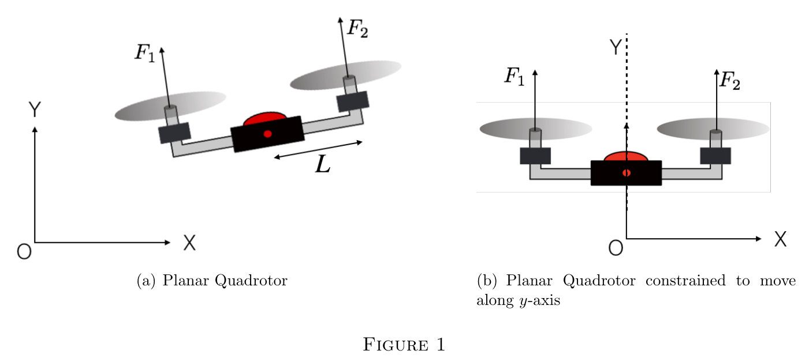
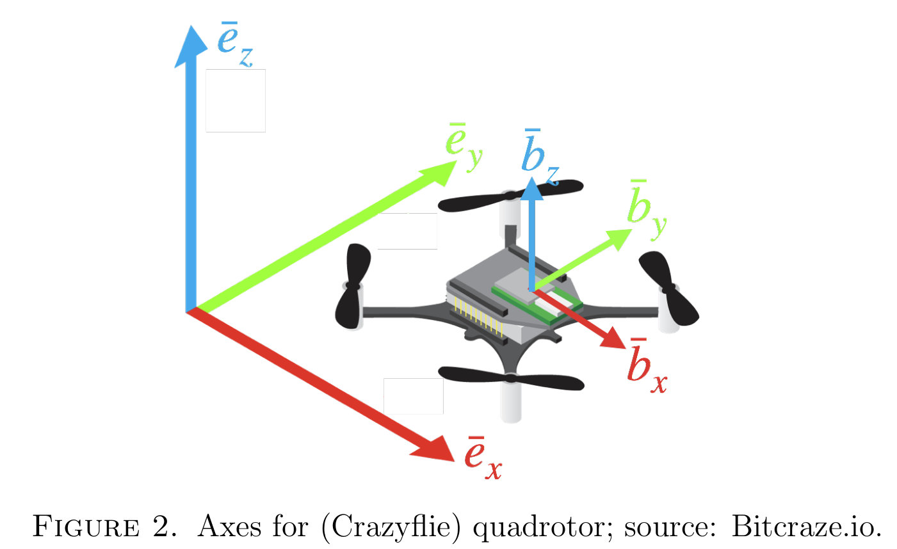
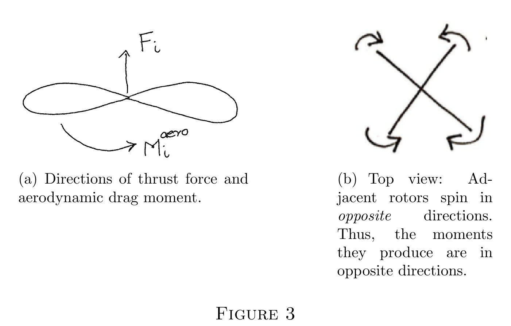
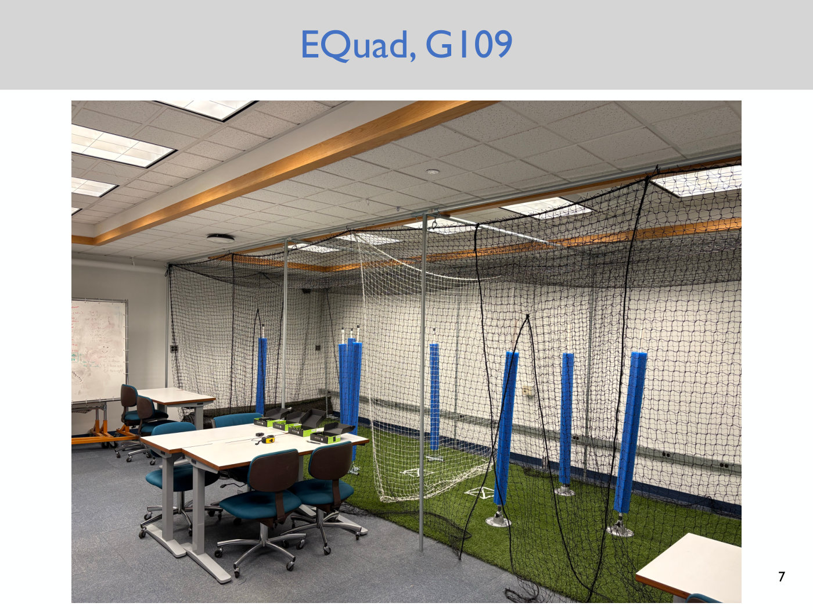
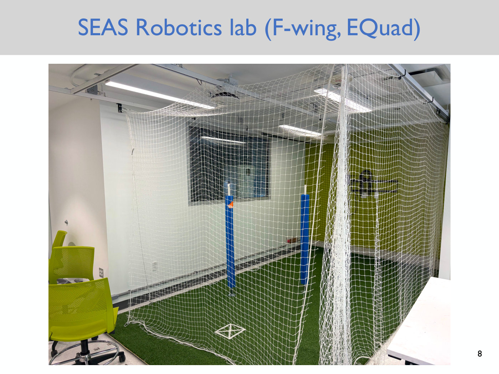
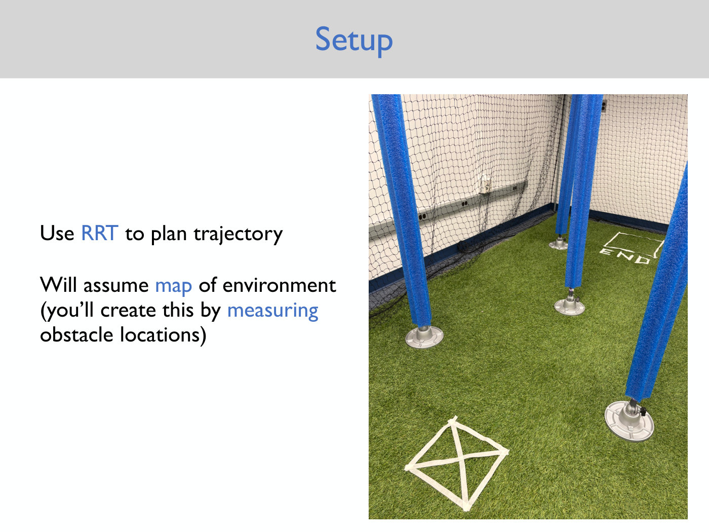
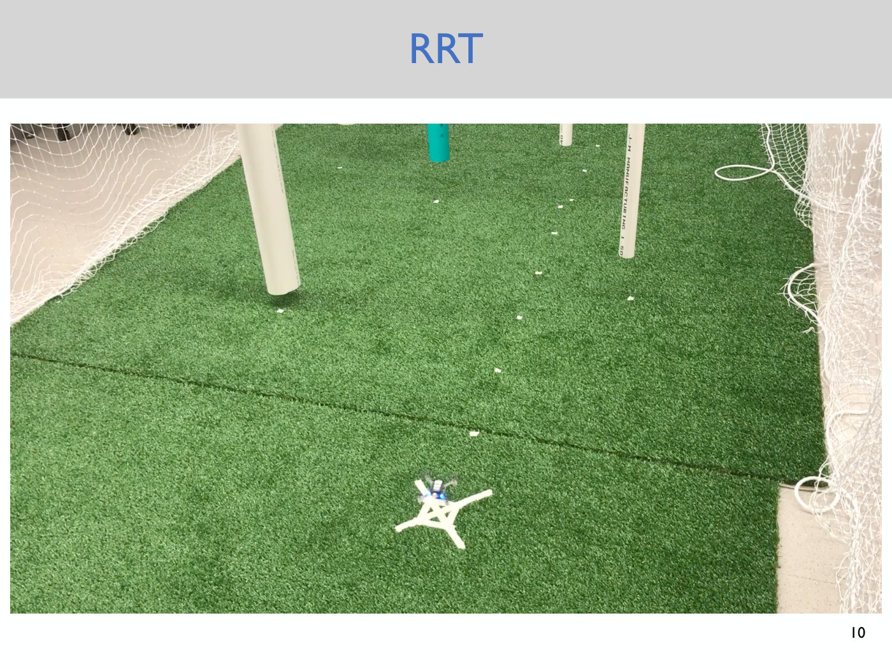

# Lecture 4 — Quadrotor Dynamics

Anirudha Majumdar, Princeton ROB 345/549, Fall 2026 ·
[video](https://www.youtube.com/watch?v=upI4KaGawyE) (69 min) ·
[slides (PDF, Dropbox)](https://www.dropbox.com/scl/fi/v8bp2gyhpixill7c70u7q/Lecture4_slides.pdf?rlkey=h44i0kp1bpmxk3zdg65gvqu29&dl=0) ·
[notes (PDF, Dropbox)](https://www.dropbox.com/scl/fi/onuvrtpb64sytgp78towu/Lecture4_notes.pdf?rlkey=yo9dpy9jxt7730f0ex3sjdcuw&dl=0) ·
[slide-by-slide text](../raw/slides/04-quadrotor-dynamics.md) ·
[notes as text](../raw/notes/04-quadrotor-dynamics.md) ·
[transcript](../raw/transcripts/04-quadrotor-dynamics.md)

**What this lecture establishes.** Geometric motion planning, the subject of Lectures 2 and 3,
ignores the robot's dynamics. A plan it produces may be impossible for the robot to fly, and even
a feasible plan can be thrown off by modelling errors and disturbances. This lecture opens the
course's treatment of the first problem, **dynamic feasibility**, by asking how a quadrotor
actually moves. Newton's second law gives the **equations of motion** of the planar quadrotor:
three second-order differential equations in $x$, $y$ and the tilt angle $\theta$, driven by
the total thrust and the total moment of the two propellers. Introducing velocity variables turns
them into six first-order equations, and the result has the form every system in the course will
take, $\dot{\bar{x}} = f(\bar{x}, \bar{u})$: the time derivative of the **state** is a function
of the state and the **control input**. The lecture then sketches the full 3D quadrotor, with
12 states, an orientation described by **Euler angles** in the space 1-2-3 convention, and a
control input of total thrust plus three moments. A **motor model** links what the drone really
controls, the propeller speeds, to thrust and to the aerodynamic drag moment that lets the drone
yaw. The last quarter of the lecture covers the lab spaces and the first hardware lab, in which
students plan a path for the Crazyflie with an RRT.

**Where to find what.** The derivation was done on the blackboard (≈4:51), which the video does
not show, and the deck has only 13 slides. Slide 5 says "See notes". The written record of the
technical content is the course's **lecture notes**, a 7-page document whose equations are
numbered (1)–(32); this page cites them as "notes eq. (N)" and "notes p. N". The deck's slides
are cited as "slide N", using the printed number, which equals the PDF page. Timestamps (≈M:SS)
point into the video and the [transcript](../raw/transcripts/04-quadrotor-dynamics.md). Where
the lecture says "this one" or "over here", it is pointing at the board, and this page does not
guess what was drawn. The concepts have their own pages: [the quadrotor model](quadrotor-model.md)
collects every equation and convention in one place, and [state and dynamics](state-and-dynamics.md)
covers the general form $\dot{\bar{x}} = f(\bar{x}, \bar{u})$.

## Contents

1. [Where this lecture sits: two challenges](#where-this-lecture-sits-two-challenges)
2. [The planar quadrotor](#the-planar-quadrotor)
3. [Equations of motion from Newton's second law](#equations-of-motion-from-newtons-second-law)
4. [From second order to first order](#from-second-order-to-first-order)
5. [State, control input and the form every model takes](#state-control-input-and-the-form-every-model-takes)
6. [The 3D quadrotor and its body axes](#the-3d-quadrotor-and-its-body-axes)
7. [Euler angles](#euler-angles)
8. [The 3D quadrotor's state and control input](#the-3d-quadrotors-state-and-control-input)
9. [The full 3D dynamics, sketched](#the-full-3d-dynamics-sketched)
10. [The motor model: thrust and the thrust coefficient](#the-motor-model-thrust-and-the-thrust-coefficient)
11. [How a quadrotor yaws](#how-a-quadrotor-yaws)
12. [The labs and the first hardware assignment](#the-labs-and-the-first-hardware-assignment)
13. [What comes next](#what-comes-next)
14. [Gaps in the record](#gaps-in-the-record)

## Where this lecture sits: two challenges

The previous two lectures solved **geometric motion planning**: find a path from configuration A
to configuration B that collides with nothing (≈0:13; see [configuration space](configuration-space.md)).
The plan for the next few lectures is to start accounting for the dynamics of the robot, which
"so far is something that we've ignored". Slide 4 names two challenges with geometric motion
planning (≈0:13–4:04, notes p. 1).

**1. Dynamic feasibility.** "Not all motion plans are physically executable by our robot"
(slide 4). A path that comes out of A\* or the RRT algorithm need not be one the robot can follow.
Majumdar asked the class for a plan that a quadrotor could not execute (≈1:00–3:18). Students
suggested very tight turns, a sharp reversal at maximum velocity, and a crevice the drone could
only pass by orienting sideways, where its thrust would then point into the wall. Majumdar's "super
simple example" is **pure sideways translation**: start the drone flat and move it horizontally at
a constant height. That is impossible, because the propellers produce thrust that is always
perpendicular to the drone's body, so a level drone has no way to apply a purely horizontal
force (≈2:33–3:18). The notes give the analogue for a car: a plan that makes an autonomous
vehicle travel sideways is infeasible unless the car has omni-directional wheels (notes p. 1).

**2. Errors and disturbances.** "Even if the plan is feasible, there may be errors or external
disturbances (e.g., wind gusts)" (slide 4). The dynamics model itself is imperfect: there are
complicated aerodynamic effects the course will mostly ignore. And outdoors an unpredictable gust
can push the drone off its planned motion (≈3:18).

**The plan.** This lecture and the next two address dynamic feasibility, developing techniques
that account for the robot's dynamics when generating motion plans. After that the course turns
to feedback control to correct for errors and disturbances (≈4:04, notes p. 1). Today's goal is
narrower: "understand dynamics of a quadrotor" (slide 5). Majumdar notes that whole courses are
devoted to dynamics. Some students took MAE 206, which spends about 23 lectures building up to a
full derivation of the quadrotor's equations of motion, so this lecture is "a much quicker
overview" whose aim is to show what such equations look like (≈4:04–4:51).

## The planar quadrotor

The lecture starts with a simplified model the course has already met in
[Lecture 2](02-discrete-motion-planning.md) and [Lecture 3](03-rrts.md): the **planar
quadrotor**, a quadrotor that lives in a vertical plane, with coordinates $x$ and $y$, as if viewed from the front with every
motion constrained to that plane (≈4:51, notes §1). It has two propellers, "so it's really a
birotor rather than a quadrotor", but the course calls it the planar quadrotor (≈5:38).

*Notes Figure 1 — (a) the planar quadrotor, tilted so that both thrust arrows, F1 and F2, perpendicular to the arm, lean left; L is the arm length, measured from the centre of the body. (b) The same vehicle held level and constrained to move along Y. [Notes](https://www.dropbox.com/scl/fi/onuvrtpb64sytgp78towu/Lecture4_notes.pdf?rlkey=yo9dpy9jxt7730f0ex3sjdcuw&dl=0)*

It has **three degrees of freedom**: the $x$ and $y$ coordinates of its centre of mass, and its
orientation $\theta$. Those three coordinates are what you need to specify its configuration
(≈5:38). It has **two control inputs**, the thrust forces $F_1$ and $F_2$ of the two propellers.
For now the drone is imagined to command whatever thrust it wants directly. In practice it
controls the propeller speed, and a simple relationship links speed to thrust; that comes later in
the lecture (≈6:24, see [the motor model](#the-motor-model-thrust-and-the-thrust-coefficient)).

**The one-degree-of-freedom warm-up.** The notes first simplify even further, to a planar
quadrotor that can only move up and down (Figure 1(b)). Its configuration is a single number, the
$y$ position of the centre of mass (COM), so it has one degree of freedom (notes p. 1). The notes
refer to this figure as "Figure 3(b)", a printed slip for Figure 1(b). Newton's second law gives

$$m\ddot{y} = F_1 + F_2 - mg \tag{1}$$

where $m$ is the total mass of the quadrotor, $g$ is the gravitational acceleration, $F_1$ and
$F_2$ are the propeller thrusts, and $\ddot{y}$ is the second time derivative of $y$, the vertical
acceleration. Dividing by $m$ and naming the **total thrust**

$$u_1 \triangleq F_1 + F_2 \tag{3}$$

gives $\ddot{y} = u_1/m - g$, eq. (4). The symbol $\triangleq$, "an equal sign with a little
triangle on top", means "is defined as" (≈14:57). The lecture itself goes straight to the
three-degree-of-freedom model.

## Equations of motion from Newton's second law

The **equations of motion (EoMs)** come from Newton's second law: analyze the total force
applied to the system and equate it to mass times acceleration (≈7:14, notes p. 2). For the planar
quadrotor that gives one equation per degree of freedom (notes eqs. (5)–(7)):

$$\ddot{x} = -\frac{u_1}{m}\sin\theta \tag{5}$$

$$\ddot{y} = \frac{u_1}{m}\cos\theta - g \tag{6}$$

$$\ddot{\theta} = \frac{(F_2 - F_1)L}{I} \tag{7}$$

Here $u_1 = F_1 + F_2$ is the total thrust, $L$ is the length of the quadrotor's arm, and $I$ is
its moment of inertia.

On the board, Majumdar first wrote the $x$ equation with $\cos\theta$, then corrected it aloud:
"let me get the signs correct here. Sorry, this should be negative ... and then sine theta"
(≈7:14–8:02). The $x$ and $y$ equations are the dynamics of the centre of mass. Each equates
$m$ times the acceleration in one direction to the total force in that direction (≈8:49).

**Two sanity checks** come with the derivation (≈8:49–10:19):

- **The sign of the $x$ equation.** Suppose $F_1$ and $F_2$ are both positive and $\theta$ is a
  small positive angle. Then the thrust is tilted so that its horizontal component points in the
  negative $x$ direction, and indeed $\sin\theta \gt 0$ with a minus sign in front. Notes Figure
  1(a) draws a tilt of this kind, with both thrust arrows leaning left.
- **The level drone.** If $\theta = 0$, then $\cos\theta = 1$, the drone is horizontal, and the
  vertical force is the total thrust $F_1 + F_2$ minus gravity. The notes make the same check:
  eq. (10) matches eq. (2) when $\theta = 0$ (notes p. 2).

**The orientation equation.** Eq. (7) relates the angular acceleration $\ddot{\theta}$ to the
moment applied to the drone and its **moment of inertia** $I$ (≈10:19). $I$ is a physical
parameter that "captures how the mass of the drone is spread out in its body". It can be measured
by experiment, or estimated from a CAD model of the drone (≈10:19–11:05; the notes say "from the
geometry (and mass distribution)", notes p. 2). $L$ is also a physical parameter: the length of
the moment arm, the distance from the centre of mass to one of the propellers. Force times
distance is the moment (≈11:53).

**Compact form.** Defining the **total moment** (the torque)

$$u_2 \triangleq (F_2 - F_1)L \tag{8}$$

alongside $u_1$ turns the equations into (≈11:05–12:40, notes eqs. (9)–(11))

$$\ddot{x} = -\frac{u_1}{m}\sin\theta \tag{9}$$

$$\ddot{y} = \frac{u_1}{m}\cos\theta - g \tag{10}$$

$$\ddot{\theta} = \frac{u_2}{I} \tag{11}$$

On the board these were labelled 1A, 1B and 1C (≈11:05).

**You will not be asked to derive these.** The notes are explicit: "I will not expect you to
derive equations of motion in this course (although students in the MAE department should be able
to do this!)" (notes p. 3). The course will usually assume the equations of motion are given. In
the lecture's words, "maybe one of your MAE friends has derived equations of motion for you", and
the course then uses them for motion planning or feedback control (≈25:48–26:34).

## From second order to first order

Eqs. (9)–(11) are **second-order** ordinary differential equations: they contain double time
derivatives. Applying Newton's second law always produces second-order equations, because
acceleration is the second derivative of position (≈13:26). A tool the next few lectures use
repeatedly is converting them to **first-order** form (≈13:26–14:12, notes p. 3).

The trick is to introduce new variables that name the first derivatives (≈14:57, notes eqs.
(12)–(14)):

$$v_x \triangleq \dot{x} \tag{12}$$

$$v_y \triangleq \dot{y} \tag{13}$$

$$\omega \triangleq \dot{\theta} \tag{14}$$

These are just new names. But they let you write the derivative of each new variable using the
equations of motion: $\dot{v}_ x$ is the time derivative of $\dot{x}$, which is $\ddot{x}$, which
eq. (9) gives (≈15:43–16:31). The three definitions plus the three equations of motion are **six
first-order ODEs** (notes eqs. (15)–(20), ≈17:16):

$$\dot{x} = v_x, \quad \dot{y} = v_y, \quad \dot{\theta} = \omega,$$

$$\dot{v}_ x = -\frac{u_1}{m}\sin\theta, \quad \dot{v}_ y = \frac{u_1}{m}\cos\theta - g, \quad \dot{\omega} = \frac{u_2}{I}.$$

This generalizes: $n$ second-order differential equations always become $2n$ first-order ones
(≈17:16–18:01). The equations are first order because the left-hand side has a single dot, not a
double dot. The right-hand side involves only the state variables, the control inputs and
physical constants such as the mass and the inertia (≈21:10–21:58). Majumdar polled the class on
whether this conversion was familiar; most had seen it, in MAE 206 or a differential-equations
course. It is worth being comfortable with, because control theory courses use it constantly
(≈14:12, ≈21:58).

## State, control input and the form every model takes

**The state.** The six quantities form the state of the planar quadrotor, written with a bar
because the course uses bars to denote vectors (≈18:50, notes p. 3):

$$\bar{x} = [x, y, \theta, \dot{x}, \dot{y}, \dot{\theta}]^T$$

The state "defines everything we need to know in order to predict the motion of the system"
(notes p. 3). The **number of states** is the dimension of this vector: 6 for the planar
quadrotor, and 2 for the version constrained to move along $y$ ($y$ and $\dot{y}$).

**Configuration variables.** The part of the state that describes the configuration,
$[x, y, \theta]$, without the time derivatives. These are the three degrees of freedom, the same notion
as in [configuration space](configuration-space.md): given these three numbers, the configuration
of the planar quadrotor is completely determined (≈24:17–25:03, notes p. 3).

**The control input.** The things the robot can directly command, collected as
$\bar{u} = [u_1, u_2]^T$, the total thrust and the total moment (≈19:38, notes p. 3).

**The general form.** With this notation, all six first-order equations combine into one vector
equation (notes eq. (21)):

$$\dot{\bar{x}} = f(\bar{x}, \bar{u}) \tag{21}$$

The time derivative of the state is some function of the state and the control input
(≈20:24–22:44). "We will always be able to write EoMs in this form" (notes p. 3), and the lecture
stresses that this form, not the particular equations, is what students should take away
(≈25:48).

**Why it matters: prediction.** Given the state at some initial time, say the planar quadrotor's
$x$, $y$, $\theta$ and its speeds $v_x$, $v_y$, $\omega$, and the control inputs the drone will
apply over a time horizon, the system of first-order equations predicts exactly what the state
will be at any future time, solved analytically or numerically (≈23:32, notes p. 3). "That's
basically the starting point for doing motion planning in a way that accounts for the dynamics
of the system, or to do feedback control to correct for errors" (≈23:32–24:17). Majumdar says a
more thorough justification for the first-order form will come in future lectures. Students who
have taken a dynamics class have plugged such equations into MATLAB or Python to simulate a system
(≈24:17). See [state and dynamics](state-and-dynamics.md).

## The 3D quadrotor and its body axes

The lecture next sketches the full **3D quadrotor**, without writing out its full equations
(≈25:48). The notes, posted on Canvas, point to a reference that does (≈25:48;
[§9 below](#the-full-3d-dynamics-sketched)).

**Six degrees of freedom**: three numbers for the position of the centre of mass ($x$, $y$,
$z$), and three for the orientation (≈26:34–27:19, notes p. 4). Position is easy. Orientation is
"slightly more complicated", and the course describes it with Euler angles (notes p. 4).

**Two frames.** An **inertial frame** $I$, with unit directions $\bar{e}_ x$, $\bar{e}_ y$,
$\bar{e}_ z$, is fixed to, say, the room you are working in (≈28:06, notes p. 5). A **body frame**
$B$, with directions $\bar{b}_ x$, $\bar{b}_ y$, $\bar{b}_ z$, is attached to the drone with its
origin at the centre of mass, and moves and tilts with the drone (≈28:06–29:39). Its axes are
(notes p. 4):

- $\bar{b}_ x$ points **forward**;
- $\bar{b}_ y$ points **left**;
- $\bar{b}_ z$ points **up**.

*Notes Figure 2 — the inertial axes at the left (x red, y green, z blue) and the body axes in the same colours at the drone's centre, drawn parallel to them. The notes credit the drawing to Bitcraze.io. [Notes](https://www.dropbox.com/scl/fi/onuvrtpb64sytgp78towu/Lecture4_notes.pdf?rlkey=yo9dpy9jxt7730f0ex3sjdcuw&dl=0)*

On the course's drone, "there's a little kind of nub which denotes the forward direction", and
that is positive $x$. Forward $x$, left $y$ and up $z$ form a right-handed coordinate system. This
is the convention for the whole course, and in particular for the RRT lab that goes out the day
after the lecture: there too, $x$ is forward, $y$ is left and $z$ is up (≈28:52–29:39).

## Euler angles

Euler angles describe any orientation of the body frame relative to the inertial frame by three
rotations (≈29:39–33:37, notes §3.1):

0. Start with the body frame aligned with the inertial frame: $\bar{b}_ x = \bar{e}_ x$,
   $\bar{b}_ y = \bar{e}_ y$, $\bar{b}_ z = \bar{e}_ z$. (Majumdar adds this as "a zero step",
   ≈30:24–31:13.)
1. Rotate $B$ about $\bar{e}_ x$ by an angle $\phi$, the **roll**.
2. Then rotate $B$ about $\bar{e}_ y$ by an angle $\theta$, the **pitch**.
3. Then rotate $B$ about $\bar{e}_ z$ by an angle $\psi$, the **yaw**.

Rotations follow the **right-hand rule**: point the thumb along the axis and rotate (≈32:01). On
the drone, roll is a rotation about the forward axis. Positive pitch, about the left-pointing
$\bar{e}_ y$, "is kind of pitching down" by this convention. Yaw is a rotation about the
vertical axis of the room (≈32:50–34:24). Majumdar demonstrated each rotation with the drone and
repeated them in answer to a student's question.

**Every orientation has Euler angles.** "Any arbitrary orientation of the drone ... you can always
describe that orientation using these three numbers" $(\phi, \theta, \psi)$ (≈34:24, notes p. 5).
The numbers are not necessarily unique: two sets of angles can describe the same physical
orientation, which the course will not worry about. There are more sophisticated descriptions of
orientation, quaternions for example, but the course keeps it simple with Euler angles (≈35:10).

**The space 1-2-3 convention.** This particular recipe is the **space 1-2-3** convention (also
called x-y-z): "space" because every rotation is about the inertial (space) axes, and "1-2-3"
because the order is $\bar{e}_ x$ (axis 1), then $\bar{e}_ y$ (axis 2), then $\bar{e}_ z$ (axis 3)
(≈35:10–36:02, notes p. 5). There are many other conventions (≈36:02–37:34, notes p. 5):

- a different **order**, such as 3-2-1 or 2-3-1. Some orders are useless: "if I of course do
  1-1-1, that's a sort of useless convention";
- **body conventions**, which rotate about the new, intermediate body axes: rotate about
  $\bar{e}_ x$, then about the new $\bar{b}_ y$, then about the new $\bar{b}_ z$. That is the body
  1-2-3 convention.

Different fields prefer different conventions, for historical and convenience reasons (≈37:34).
**This course uses the space 1-2-3 convention throughout** (notes p. 5).

**Why the warning matters.** "In practice, the fact that we have so many different conventions is
a source of many headaches/errors" (notes p. 5), so make sure everyone on a team uses the same
one. Majumdar's own example: modelling a fixed-wing airplane in graduate school, "I wasted about,
like, three months one summer", because the motion capture system reported a different convention
from the one assumed, a mistake made despite knowing to look for it (≈38:20–39:06). Asked whether
body-fixed frames have advantages, Majumdar said there are some, particularly on the sensing side,
where measurements may be easier in the body frame; one convention can always be converted to
another (≈38:20).

## The 3D quadrotor's state and control input

**Twelve states.** Asked how many dimensions the 3D quadrotor's state has, a student answered 12:
six degrees of freedom, plus a velocity for each. Newton's second law gives six second-order
equations, and converting to first order doubles them to 12 (≈40:38–41:23). The notes' state
vector is (notes p. 5)

$$\bar{x} = [x, y, z, \phi, \theta, \psi, \dot{x}, \dot{y}, \dot{z}, p, q, r]^T$$

The first three entries are the centre-of-mass position, the next three are the Euler angles in
the space 1-2-3 convention, and $\dot{x}, \dot{y}, \dot{z}$ (the lecture writes them $v_x$, $v_y$,
$v_z$) are the velocities (≈41:23–42:11). There is some freedom in choosing the state.

**Angular velocity instead of Euler-angle rates.** The last three entries could be $\dot{\phi}$,
$\dot{\theta}$, $\dot{\psi}$, which is "a perfectly valid definition of the state". In practice
the course uses $p$, $q$ and $r$, the components of the drone's **angular velocity**, because they
make the equations a little more compact and easier to work with (≈42:59–43:47, notes p. 5). The
two are interchangeable: given the angles and their rates you can compute $p, q, r$, and back
(≈43:47). The notes show the first row of that relationship, eq. (30), and elide the rest.

**The control input.** The drone directly controls the four propeller thrusts $F_1, F_2, F_3, F_4$,
but, as with $u_1$ and $u_2$ for the planar quadrotor, it is more convenient to use (notes eq.
(22), ≈44:37–46:12)

$$\bar{u} = [F_{\text{tot}}, M_1, M_2, M_3]^T \tag{22}$$

where $F_{\text{tot}} = F_1 + F_2 + F_3 + F_4$ is the total thrust, and $M_1$, $M_2$, $M_3$ are the
moments about the $x$, $y$ and $z$ axes (the lecture says the body axes $\bar{b}_ x$, $\bar{b}_ y$,
$\bar{b}_ z$). The moments can be computed from the four thrusts and the geometry of the drone, so
"it is easy to go back and forth" between the two descriptions (notes p. 5, ≈46:12).

## The full 3D dynamics, sketched

The full 3D equations are "a little bit messy" and long, and the lecture does not write them out
(≈46:57–47:43). The point is that the derivation, Newton's second law followed by conversion to
first order, again gives equations of the form

$$\dot{\bar{x}} = f(\bar{x}, \bar{u}) \tag{25}$$

which predict the drone's state at any future time from its initial state and control inputs
(≈47:43). The notes sketch them (notes §6, pp. 6–7) and cite C. Powers, D. Mellinger and V. Kumar,
"Quadrotor Kinematics and Dynamics", *Handbook of Unmanned Aerial Vehicles*, for a thorough
treatment. With the position vector $\bar{r} = [x, y, z]^T$ (eq. (26)), Newton's second law reads
(notes eq. (28)):

$$\ddot{\bar{r}} = \begin{bmatrix} 0 \cr 0 \cr -g \end{bmatrix} + \bar{R}(\phi, \theta, \psi) \begin{bmatrix} 0 \cr 0 \cr F_{\text{tot}}/m \end{bmatrix} \tag{28}$$

Gravity pulls down along the inertial $z$ axis. The thrust acts along the body's own $z$ axis, and
$\bar{R}(\phi, \theta, \psi)$ is the rotation matrix that takes vectors in the body frame to the
inertial frame. This is the 3D version of the planar quadrotor's eqs. (9) and (10), and the reason
a level drone cannot accelerate sideways. (The notes print eq. (28) with $\triangleq$, and the
matrix as $\bar{R}(\phi, \theta), \psi)$, with a stray parenthesis, in the line after it; both are printed slips.)

With the angular velocity $\bar{\omega}_ {BW} = [p, q, r]^T$ (eq. (29)), the rotational dynamics
are (notes eq. (31)):

$$\dot{\bar{\omega}}_ {BW} = \mathbb{I}^{-1} \left[ -\bar{\omega}_ {BW} \times (\mathbb{I}\bar{\omega}_ {BW}) + \begin{bmatrix} M_1 \cr M_2 \cr M_3 \end{bmatrix} \right] \tag{31}$$

where $\times$ is the cross product and $\mathbb{I}$ is the **inertia matrix**, diagonal with
entries $I_{xx}$, $I_{yy}$, $I_{zz}$ (eq. (32)). Eq. (30) relates
$[\dot{\phi}, \dot{\theta}, \dot{\psi}]^T$ to $[p, q, r]^T$; its first row is $\dot{\phi} = p + \sin(\phi)\tan(\theta)\thinspace q + \cos(\phi)\tan(\theta)\thinspace r$,
and the notes print the other six entries of the matrix as dots. The full equations are in the
[notes as text](../raw/notes/04-quadrotor-dynamics.md#page-7). The notes close as the lecture did:
"I don't expect you to derive these equations. I just want you to understand that the equations
have the form $\dot{\bar{x}} = f(\bar{x}, \bar{u})$" (notes p. 7).

## The motor model: thrust and the thrust coefficient

A student asked whether $M_3$ is a function of the forces or of something like drag (≈47:43–48:30),
which led into the **motor model** (≈48:30–53:52, notes §2 and §5). The propellers are not really
thrusters. What is controlled is the current to each motor, which sets the propeller's rotational
speed, and there is "a nice relationship" between that speed and both the thrust and the moment
(≈48:30). The thrust of propeller $i$ is

$$F_i = k_f \omega_i^2, \quad i = 1, 2, 3, 4 \tag{23}$$

where $\omega_i$ is the rotational speed of propeller $i$ and $k_f$ is the **thrust coefficient**
(≈49:16–50:03, notes eq. (23)). The thrust grows with the *square* of the speed.

**What sets $k_f$.** It depends on the geometry of the propeller: a larger propeller might have a
larger coefficient, and so does the pitch of the blades (≈50:03–50:49). It could in principle be
computed with a computational fluid dynamics model, but in practice it is much more convenient to
measure it for your drone (≈50:49). The course staff redid this measurement for the new drones
this year, and the value will be used in later assignments (≈50:49). In an upcoming assignment
students use the measured data to estimate $k_f$ themselves (notes p. 4).

**Measuring it.** Majumdar asked how (≈51:35–52:20). One student proposed comparing thrust against
gravity and watching how fast the drone moves, which is reasonable but needs a motion capture
system or some other way to estimate position, and could be noisy. Another proposed weights to
hold the drone at steady state: also reasonable, "but just a bunch of work. We want to be as lazy
as possible". A third proposed a scale, which is what the course did (≈52:20–53:52):

- **Flip the drone** so that it presses down on a digital weighing scale, and read the thrust
  straight off the scale. The notes say to convert the reading from kilograms to newtons
  (notes p. 4).
- **Raise it up**, "on one of those chemistry stand things". Placed directly on the scale, the
  propellers blow air onto it that comes back and creates lift (prop wash), and the readings come
  out wrong.
- **Sweep the motor speed.** Plot $\omega_i^2$ on the $x$-axis against thrust on the $y$-axis,
  remembering that the four motors together produce four times the thrust. The points fall on a
  line, and its slope is the thrust coefficient.

A student pointed out that this assumes the four motors are basically identical, which, the lecture
agrees, will not be perfectly true. The model itself is not perfect either: it is "an aggregate
kind of aerodynamics model", but good enough for much of what you want to do with a drone
(≈53:52).

**Three parameters.** With the motor model, the planar quadrotor has three physical parameters,
$m$, $I$ and $k_f$, and the dynamics model is fully specified only once their values are known
(notes p. 4).

## How a quadrotor yaws

A drone cannot translate horizontally while level, yet it can **yaw in place**, changing its
orientation about the vertical axis. Majumdar asked how (≈53:52–54:38). A student answered that
the rotors spin in opposite directions, and that slowing the rotors spinning one way changes the
drag. "That's exactly right" (≈54:38–55:31).

Seen from the top, **adjacent propellers spin in opposite directions**: going round the drone,
clockwise, counter-clockwise, clockwise, counter-clockwise (≈55:31, notes Figure 3(b)).

*Notes Figure 3 — (a) each rotor produces a thrust straight up and an aerodynamic drag moment about the vertical axis. (b) Top view: the top-left and bottom-right rotors spin clockwise and the other two counter-clockwise, so adjacent rotors spin in opposite directions. [Notes](https://www.dropbox.com/scl/fi/onuvrtpb64sytgp78towu/Lecture4_notes.pdf?rlkey=yo9dpy9jxt7730f0ex3sjdcuw&dl=0)*

**The drag moment.** A spinning propeller applies a moment to the air, and by Newton's third law
the air applies a moment in the opposite direction: an **aerodynamic drag** moment on the drone
(≈56:16). It acts about the $\bar{b}_ z$ direction, and "this is actually what allows the
quadrotor to turn in the yaw direction" (notes p. 6). It follows the same square law as the thrust
(≈57:04, notes eq. (24)):

$$M_i^{\text{aero}} = k_m \omega_i^2, \quad i = 1, 2, 3, 4 \tag{24}$$

where $k_m$ is the **moment coefficient** (the notes say "drag/moment coefficient") and
$\omega_i$ is the same rotational speed as before. Because adjacent propellers spin in opposite
directions, their moments are in opposite directions (notes Figure 3). Speeding up one pair and
slowing the other unbalances them, and the drone yaws one way; doing the opposite yaws it the
other way (≈56:16–57:04). The lecture pointed at the pairs on the board, so the transcript does
not record which pair is sped up for which direction.

**Why no propeller gives negative thrust.** If two propellers spin in opposite directions, why
doesn't one of them push down? A student had the answer: the **pitch of the blades** is flipped.
The blades of a propeller spinning the other way are angled the other way, so every propeller
produces positive thrust. Students will see this on the drones in the next assignment
(≈57:04–58:37).

## The labs and the first hardware assignment

The rest of the lecture covers the lab and the first hardware lab, which goes out the day after
the lecture and is due "the Wednesday after" (≈58:37–1:07:51; the deck's lab section starts at slide 6). Majumdar caps the
course by how much lab space is available each year. This year that is 72 students, about 60 in
ROB 345 and 12 in the graduate version (≈59:25). See also [the Crazyflie drone](crazyflie.md#the-lab).

**G109, in the G-wing of the EQuad**, has two netted flying spaces separated by a middle net, with
drones and equipment in the room (slide 7, ≈59:25).

*Slide 7 — G109 in the EQuad: the netted flying area with green turf and blue foam-pole obstacles, desks outside the net. [Deck](https://www.dropbox.com/scl/fi/v8bp2gyhpixill7c70u7q/Lecture4_slides.pdf?rlkey=h44i0kp1bpmxk3zdg65gvqu29&dl=0)*

**The SEAS Robotics lab, in the F-wing**, is a slightly smaller space (slide 8, ≈59:25–1:00:11).
Entering the EQuad, it is the large robotics lab on the left, right by the EQuad café. Part of it is
used for teaching, with another netted zone and some seating for students.

*Slide 8 — the smaller netted space in the SEAS Robotics lab, F-wing of the EQuad, seen through the netting. [Deck](https://www.dropbox.com/scl/fi/v8bp2gyhpixill7c70u7q/Lecture4_slides.pdf?rlkey=h44i0kp1bpmxk3zdg65gvqu29&dl=0)*

**The first lab: RRT on the drone.** Students implement the RRT algorithm from
[Lecture 3](03-rrts.md) to plan a collision-free trajectory for the drone (slide 9,
≈1:00:11–1:01:42; see [RRTs](rrt.md)). The lab keeps all of the assumptions made so far. The map
of the environment is given to the algorithm, and it is built with "the simplest possible mapping
algorithm": measure where the obstacles are and their radii with the tape measure in the room.
The RRT then finds a collision-free path from the start, marked with an X on the floor, to the end
box. The goal is to land anywhere inside that box.

*Slide 9 — the first lab's arena: blue foam poles as obstacles, the taped X start marker at the lower left and the taped END landing box at the upper right. [Deck](https://www.dropbox.com/scl/fi/v8bp2gyhpixill7c70u7q/Lecture4_slides.pdf?rlkey=h44i0kp1bpmxk3zdg65gvqu29&dl=0)*

The lab does **not** account for dynamics. It assumes the drone has a good enough built-in
controller to follow whatever trajectory the RRT produces (≈1:01:42). Because the RRT is not
optimal, the drone does "a bunch of kind of wacky stuff" in the middle, which the lab will not try
to optimize. The point is to see the algorithm work in practice and to get familiar with the drone:
connecting to it, controlling it, and giving it waypoints.

Slide 10, titled "RRT", is meant to show this. The slide holds a single still of a small white
quadrotor on the turf, among white pipe obstacles. The video did not play in the lecture ("I
guess you can imagine what it looks like. Sorry"). As described, the drone takes off, avoids the
obstacles and gets to the landing zone (≈1:01:42).

*Slide 10 — a single still of the RRT lab video, which did not play in the lecture: a small quadrotor on the turf among white pipe obstacles. [Deck](https://www.dropbox.com/scl/fi/v8bp2gyhpixill7c70u7q/Lecture4_slides.pdf?rlkey=h44i0kp1bpmxk3zdg65gvqu29&dl=0)*

**What is in the lab spaces** (slide 11, ≈1:02:28): four drones in G109 and three in the SEAS
Robotics lab, picked up by whichever team arrives; spare parts (propellers, extra motors, and
prop guards, which are new on the brushless drone); a measuring tape in each space, for creating
the map; and safety glasses.

**Using the spaces** (slide 12, ≈1:02:28–1:05:33). With 72 students there is no lab hour: the
labs can be used any time, weekdays and weekends. Anyone who has completed at least the online
safety training can use them. Ideally students also complete the in-person part, but scheduling
is sometimes a problem. A show of hands found fewer had done both than Majumdar expected, so the
online part of the EHS training was to be finished by the next day; it is required for almost any
lab space in the EQuad (≈1:03:14). There is no sign-up sheet. The first time the course ran, in
2019, it had one, and it was abandoned within about two weeks because teams signed up five
minutes before arriving. What works is taking turns: test something, step out of the netted area
to debug with your teammates, and let the next team fly (≈1:04:02–1:04:48).

**When a drone has a problem**, post in the "Drone issues" thread on Ed Discussion (the drones are
numbered) and use another drone. Jon Prevost will try to fix it from the stock of replacement
parts. The situation to avoid is a lab full of broken drones that nobody has reported
(≈1:04:48–1:05:33).

**Safety and care** (slide 13, ≈1:05:33–1:07:51). The drones are light, the propellers small and
guarded, so a severe injury is unlikely but possible. The main worry is the eyes: a propeller that
breaks off, or a drone that hits someone standing in the netted area. Wear the safety glasses at all
times, and stand outside the netted area while a drone is operating: put the drone in, run your
code, watch it fly or crash, then pick it up. Treat the drones with care. All the teams share the
same seven or eight drones, and each costs about 600 dollars once the optical flow camera,
propellers, motors and the camera added late in the course are counted. The course bought a whole
new fleet this year. Last year two different teams stepped on drones and crushed them: "Please do
not step on the drones."

## What comes next

This lecture and the next two concern dynamic feasibility (≈4:04). The [course map](course-map.md)
lists them as differential flatness (Lecture 5) and trajectory optimization (Lecture 6), under
planning with dynamics. Then come stability and PD control, and the linear quadratic regulator,
under feedback control. The Lecture 3 RRT drone video was already planned with "some
modifications" for dynamics (see [Lecture 3](03-rrts.md#what-comes-next)). The first-order form
$\dot{\bar{x}} = f(\bar{x}, \bar{u})$ is what those lectures build on.

## Gaps in the record

- **The blackboard is not in the record.** The derivation was written on the board (≈4:51), and
  the video and deck do not show it. This page reconstructs the equations from the notes, whose
  numbering differs from the board's (the board labelled the planar equations 1A, 1B, 1C). Where
  the lecture points ("this one", "these two motors"), the transcript cannot say what was meant.
- **"Double dot" in the captions.** The auto-captions write "x dot" where the lecturer means the
  second derivative, for example "x dot, so the second time derivative of x" (≈7:14). The edited
  transcript restores "x double dot" from that wording and from the notes.
- **Two unclear phrases**: a list of rotation orders at ≈36:47 ("sort of 31213" in the captions),
  and the name of the "simplest possible mapping algorithm" at ≈1:00:56, which the captions give
  as "U".
- **Elided equations.** The notes print only the first row of eq. (30) and sketch the 3D dynamics
  without the rotation matrix $\bar{R}$; this page does not fill them in.
- **Printed slips in the notes**, listed in the [notes file](../raw/notes/04-quadrotor-dynamics.md#printed-slips):
  "Figure 3(b)" for Figure 1(b) on p. 1, $\triangleq$ in eq. (28), and a stray parenthesis after
  eq. (28).
- **Slide 10's video** did not play in the lecture. The PDF holds one still, and this page
  describes the clip only as the lecture narrates it.
