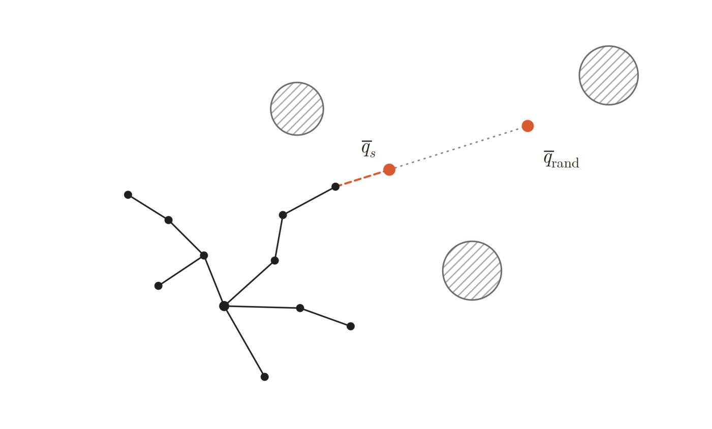
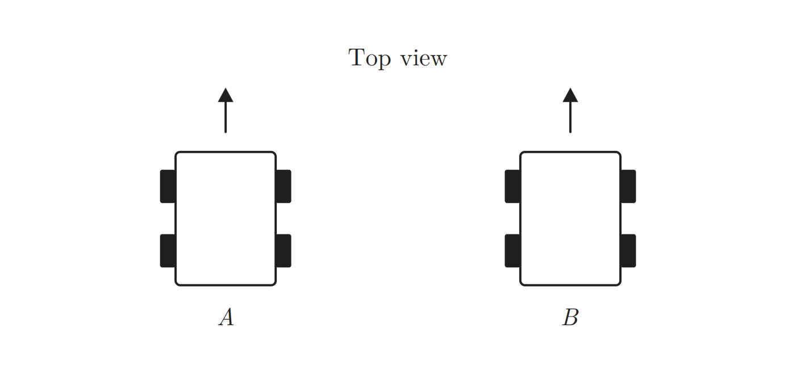
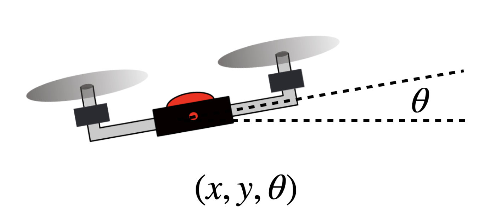
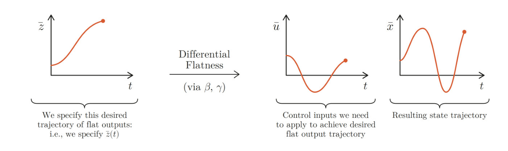
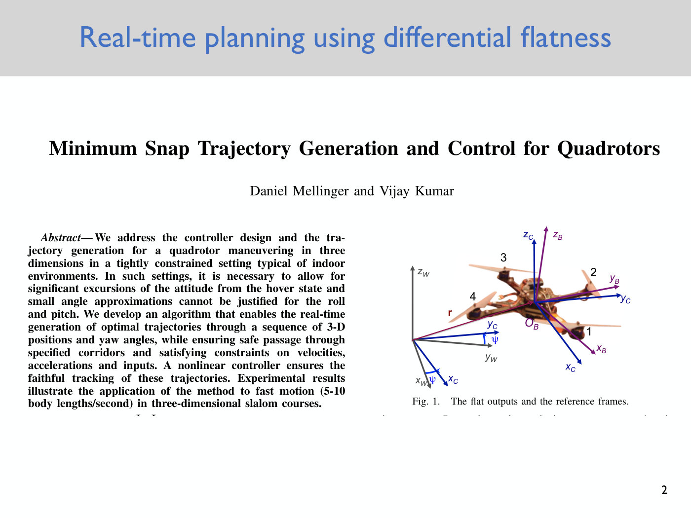
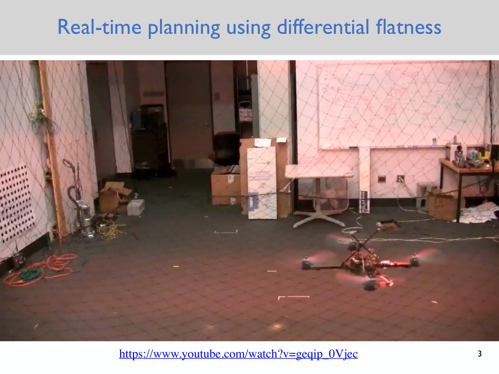
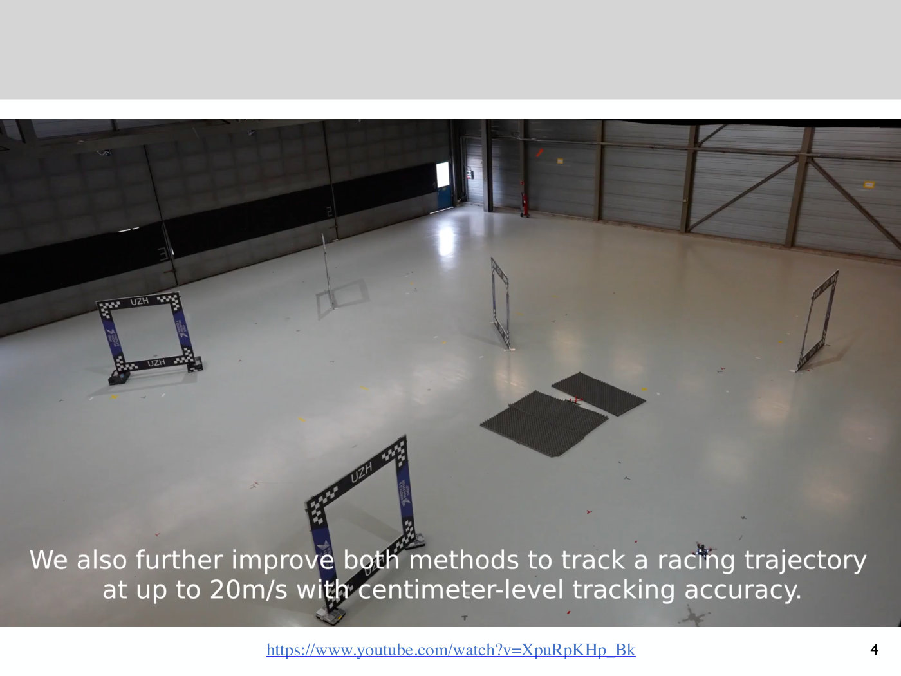

# Lecture 5 — Differential Flatness

Anirudha Majumdar, Princeton ROB 345/549, Fall 2026 ·
[video](https://www.youtube.com/watch?v=64Rfzm359Xg) (67 min) ·
[slides (PDF, Dropbox)](https://www.dropbox.com/scl/fi/e90rrmg0036wqix2xmv0f/Lecture5_slides.pdf?rlkey=qonzpbom400u3wozymjv3fga3&dl=0) ·
[notes (PDF, Dropbox)](https://www.dropbox.com/scl/fi/d0g09pk1opfkwdw7udmsi/Lecture5_notes.pdf?rlkey=l1sriwzrnb499bsbcyo3cylm9&dl=0) ·
[slide-by-slide text](../raw/slides/05-differential-flatness.md) ·
[notes as text](../raw/notes/05-differential-flatness.md) ·
[transcript](../raw/transcripts/05-differential-flatness.md)

**What this lecture establishes.** The RRT of Lecture 3 grows its tree by moving in a straight line
through configuration space, and a robot with dynamics often cannot follow that line: a level drone
cannot slide sideways, and neither can a car. This lecture introduces a class of systems for which
the problem becomes easy, the **differentially flat systems**. For such a system there is a small
set of **flat outputs**, as many as there are control inputs, whose trajectory can be chosen
freely, provided it is smooth enough. From any such trajectory and its time derivatives, the
control inputs that make the robot follow it, and the full state trajectory that results, can
both be computed. The lecture proves this for the planar quadrotor, whose flat outputs are the
position of its center of mass, and shows that the control inputs depend on the **fourth** time
derivative of that position. It then gives the general definition, states that the 3D quadrotor
is flat with flat outputs $x$, $y$, $z$ and the yaw angle $\psi$, and explains how to run the
RRT in the flat output space instead of the configuration space. It ends with videos of flatness-based
planning on real drones.

**Where to find what.** The derivation was written on the blackboard, which the video does not
show. The course's **lecture notes** (4 pages) are its written record: they number the planar
quadrotor's equations (1)–(4), as the board did (≈8:41, ≈33:46). This page cites them as "notes
eq. (N)" and "notes p. N". The deck has six slides: a title, the first page of the paper credited
with the approach, and four video slides. They are cited as "slide N", which is also the PDF page.
Timestamps (≈M:SS) point into the video and the
[transcript](../raw/transcripts/05-differential-flatness.md). Where the lecture says "this one" or
"over here", it is pointing at the board, and this page does not guess what was drawn. The concept
has its own page, [differential flatness](differential-flatness.md), and the model it is applied to
is on [the quadrotor model](quadrotor-model.md).

## Contents

1. [Where this lecture sits: the RRT's extension step](#where-this-lecture-sits-the-rrts-extension-step)
2. [A class of systems, introduced by example](#a-class-of-systems-introduced-by-example)
3. [The planar quadrotor again](#the-planar-quadrotor-again)
4. [The claim: choose the center of mass trajectory](#the-claim-choose-the-center-of-mass-trajectory)
5. [Questions on the claim](#questions-on-the-claim)
6. [Proof, part two: recovering the state](#proof-part-two-recovering-the-state)
7. [Proof, part one: computing the control inputs](#proof-part-one-computing-the-control-inputs)
8. [The general definition](#the-general-definition)
9. [What the definition buys, and what it does not](#what-the-definition-buys-and-what-it-does-not)
10. [How many flat outputs?](#how-many-flat-outputs)
11. [The 3D quadrotor's flat outputs](#the-3d-quadrotors-flat-outputs)
12. [Planning with an RRT in the flat output space](#planning-with-an-rrt-in-the-flat-output-space)
13. [Flatness in practice: the videos](#flatness-in-practice-the-videos)
14. [What comes next](#what-comes-next)
15. [Gaps in the record](#gaps-in-the-record)

## Where this lecture sits: the RRT's extension step

The course has covered motion planning by graph search (breadth-first search, depth-first search,
Dijkstra's algorithm and A\*) and by the RRT, which builds a tree directly in continuous
configuration space. Lecture 4 started on dynamics, with the equations of motion of the planar
quadrotor, "a three degree of freedom system, six dimensional state space, two control inputs".
The goal now is to plan while taking those dynamics into account (≈0:10–1:42; see
[state and dynamics](state-and-dynamics.md)).

Majumdar sets the scene with the RRT (≈1:42–3:19). At iteration $k$ the tree has some shape. At
iteration $k + 1$ it samples a random configuration $\bar{q}_ {\text{rand}}$, finds the nearest
vertex $\bar{q}_ {\text{near}}$, and **extends** from it a short distance toward the sample, to a new
configuration $\bar{q}_ s$ (notes p. 1; see [the RRT](rrt.md)). When the course studied the RRT, it
assumed that the robot could simply follow the straight segment from $\bar{q}_ {\text{near}}$ to
$\bar{q}_ s$.

*Notes p. 1 — the RRT at iteration k. The red dashed segment is the extension from the nearest vertex to the new point q s; the grey dotted line continues on to the random sample q rand; the hatched circles are obstacles. [Notes](https://www.dropbox.com/scl/fi/d0g09pk1opfkwdw7udmsi/Lecture5_notes.pdf?rlkey=l1sriwzrnb499bsbcyo3cylm9&dl=0)*

That assumption fails for a robot with dynamics. "Not all continuous paths that come out of your
motion planning algorithm are physically executable by the robot" (≈3:19). The simplest example is
the drone of Lecture 4: it cannot translate sideways without changing its orientation, because it
has "no way to apply a thrust in the horizontal direction without tilting". Another is a car seen
from above (≈4:07–4:52). If $\bar{q}_ {\text{near}}$ and $\bar{q}_ s$ are two configurations side by
side, interpolating between them means translating the car sideways, which is impossible for a
regular car. A car with omnidirectional wheels could do it. The notes pose the same question: "We
can't just move sideways. We have to do some potentially complicated maneuver to get from A to B.
How do we find such a maneuver?" (notes p. 1).

*Notes p. 1 — top view of a car at configuration A and at configuration B, displaced sideways with the same heading. The straight-line extension from A to B would slide the car sideways, which it cannot do. [Notes](https://www.dropbox.com/scl/fi/d0g09pk1opfkwdw7udmsi/Lecture5_notes.pdf?rlkey=l1sriwzrnb499bsbcyo3cylm9&dl=0)*

So the lecture concentrates on the extension step. For now it ignores obstacles: given A and B,
find a path that is **dynamically feasible**. The notes add a caveat: "It won't quite be possible
to do this, but we will come close to doing this…" (notes p. 2, ≈5:37).

## A class of systems, introduced by example

The answer covers a special class, the **differentially flat systems**, "a class of systems with
special properties that makes it easy to plan motions while obeying the dynamics of the robot"
(notes p. 2). The class is relatively broad but "definitely doesn't encompass every robot you might
encounter". Its members include the planar quadrotor, the 3D quadrotor and cars like the one
sketched (≈5:37–6:22); the notes add the car with a trailer. Because the general definition is
"relatively abstract and hard to understand at first glance", Majumdar works through the planar
quadrotor before stating it (≈6:22–7:07).

## The planar quadrotor again

The planar quadrotor has two thrust forces, $F_1$ and $F_2$, which the robot controls and which
are always perpendicular to its body. It has three degrees of freedom: the position $x$, $y$ of its
center of mass and its orientation $\theta$ (≈7:07–7:53).

*Notes p. 3 — the planar quadrotor, tilted by the angle θ between the horizontal and its arm. Its configuration is (x, y, θ). [Notes](https://www.dropbox.com/scl/fi/d0g09pk1opfkwdw7udmsi/Lecture5_notes.pdf?rlkey=l1sriwzrnb499bsbcyo3cylm9&dl=0)*

Newton's second law gives three second-order differential equations, as derived in
[Lecture 4](04-quadrotor-dynamics.md#equations-of-motion-from-newtons-second-law). With $m$ the
mass, $g$ the gravitational acceleration, $L$ the arm length (the distance from the center of mass
to where a thrust is applied, so that the drone is $2L$ across) and $I$ the moment of inertia
(notes eqs. (1)–(3), ≈7:53–10:15):

$$\ddot{x} = -\frac{(F_1 + F_2)}{m}\sin(\theta) \tag{1}$$

$$\ddot{y} = \frac{(F_1 + F_2)}{m}\cos(\theta) - g \tag{2}$$

$$\ddot{\theta} = \frac{(F_2 - F_1)L}{I} \tag{3}$$

The first two relate the forces in the $x$ and $y$ directions to mass times acceleration, and the
third comes from a moment analysis: the rate of change of angular momentum equals the applied
moment. These are Lecture 4's eqs. (9)–(11) with the total thrust $u_1 = F_1 + F_2$ and the moment
$u_2 = (F_2 - F_1)L$ written out (see [the quadrotor model](quadrotor-model.md#the-planar-quadrotor)).
The state is $\bar{x} = [x, y, \theta, \dot{x}, \dot{y}, \dot{\theta}]^T$ and the control input is
$\bar{u} = [F_1, F_2]^T$ (notes p. 3). They could be converted to six first-order equations as in
Lecture 4, but this lecture works with the second-order form (≈10:15).

On the board, eq. (3) was first written with $F_1 + F_2$ (≈8:41). A student pointed out near the
end of the proof that it must be "two minus one": otherwise the drone could not turn. Majumdar
agreed and corrected it (≈37:46). The notes print $F_2 - F_1$.

## The claim: choose the center of mass trajectory

The claim has two parts (≈10:15–16:35). Define the vector of the center of mass position ("bars in
this course will always denote vectors", ≈11:01):

$$\bar{z}(t) = \begin{bmatrix} x(t) \cr y(t) \end{bmatrix}, \qquad t \in [0, T].$$

Suppose someone specifies any center of mass trajectory $\bar{z}(t)$ over the interval from $0$ to
$T$. Then:

1. one can compute a **control input trajectory** $\bar{u}(t) = [F_1(t), F_2(t)]^T$, $t \in [0, T]$,
   that makes the drone's center of mass follow $\bar{z}(t)$ (≈12:36–13:32); and
2. one can compute the **full state trajectory** $\bar{x}(t)$, $t \in [0, T]$, that the drone
   follows (≈14:19–15:04).

Of the state, $x$ and $y$ are given, and $\dot{x}$ and $\dot{y}$ come from differentiating them.
The new piece in part 2 is the orientation $\theta(t)$, and once it is known, differentiating it
gives $\dot{\theta}$ (≈16:35).

## Questions on the claim

The questions that followed sharpen what the claim does and does not promise.

**The orientation is not yours to choose** (≈17:22–18:54, ≈21:13–21:58). Only the center of mass
trajectory may be specified, not $\theta$. The orientation is "a degree of freedom for me to
control": the control inputs found will make $\theta$ do something, possibly "something really
wacky", and the drone "could be flipping around wildly". What is guaranteed is that the center of
mass does exactly what was specified. The notes say the same: "The full state trajectory might end
up being a bit wacky… but the flat outputs will behave as desired" (notes p. 3).

**The start of the trajectory is the initial condition** (≈18:54–19:40). Setting $t = 0$ in the
specified trajectory gives the drone's starting position, and the drone is assumed to start there.
The control input is a function of time: "just imagine that the drone has some clock", and at each
time it looks up the input to apply.

**Continuous time is a modelling assumption** (≈20:26–21:13). In practice a control input is
applied over some small interval at a high frequency. The analysis is in continuous time, using
differential equations rather than discrete-time ones, and so it assumes the drone can apply a
particular input at literally every instant, "a modeling assumption, not quite real in practice".

**As stated, the claim cannot be true** (≈21:58–25:00). Majumdar asked for a counterexample, and a
student gave one: the drone cannot jump from one half of the room to the other. "You can't
teleport." The trajectory must also not have a sharp corner, where the drone goes one way and
suddenly its derivative jumps. So the claim needs a condition: the trajectory must be
**sufficiently differentiable**, "like the fourth time derivative or something like that", made
precise by the proof.

**The inputs need not be unique** (≈23:28–25:00). The claim is to find *some* control input
trajectory. If the specified trajectory is to stay in one place, the drone could hold still and
counteract gravity, or stay at the same place while changing its orientation.

## Proof, part two: recovering the state

Majumdar proves the second part first, sketching it and skipping some algebra (≈25:47–26:35). Given
$x(t)$ and $y(t)$, differentiating gives $\dot{x}(t)$ and $\dot{y}(t)$, so four of the six
components of the state are known. Only $\theta(t)$ remains, and then $\dot{\theta}$ follows by
differentiating again (≈26:35–28:13).

Equations (1) and (2) contain $\sin\theta$ and $\cos\theta$, so their ratio gives $\tan\theta$.
From (1), $\sin\theta = -m\ddot{x}/(F_1 + F_2)$, and from (2), $\cos\theta = m(\ddot{y} + g)/(F_1 + F_2)$.
In the ratio, $F_1 + F_2$ cancels and so does $m$ (notes p. 3, ≈28:59–30:34):

$$\tan(\theta) = \frac{(F_1 + F_2)\sin(\theta)}{(F_1 + F_2)\cos(\theta)} = \frac{-m\ddot{x}}{m\ddot{y} + mg} = \frac{-\ddot{x}}{\ddot{y} + g}$$

$$\theta = \arctan\left(\frac{-\ddot{x}}{\ddot{y} + g}\right) \tag{4}$$

At any time, $\ddot{x}$ and $\ddot{y}$ come from differentiating the specified trajectory twice, so
eq. (4) gives the orientation at every time (≈31:25). This is what the drone's orientation must be
for its center of mass to follow the trajectory (≈32:14).

It also makes the smoothness condition concrete: this step needs $\ddot{x}$ and $\ddot{y}$, so the
trajectory must be at least twice differentiable. That rules out teleporting, and it rules out a
trajectory that goes one way and suddenly pivots, where not even $\dot{x}$ exists (≈32:14–33:46).

## Proof, part one: computing the control inputs

Differentiate eq. (4) twice with respect to time to get $\ddot{\theta}$ at every time
(≈33:46–34:38). Then two equations of motion become two equations in the two unknowns $F_1$ and
$F_2$ (≈34:38–37:00). Eq. (3) is one: $\ddot{\theta}$ is now known, and $L$ and $I$ are physical
parameters. Eq. (1) is the other, since $\ddot{x}$ is known from the trajectory and $\theta$ from
eq. (4); eq. (2) would serve equally well. Rearranged, the two are

$$(F_1 + F_2)\sin(\theta) = -m\ddot{x}, \qquad (F_2 - F_1)L = I\ddot{\theta}.$$

These are linear in $F_1$ and $F_2$: "two linear equations, two unknowns". They can be solved by
substitution, or as a 2-by-2 linear system with a matrix inverse, "whatever your preferred method
is" (≈37:00). That gives $F_1(t)$ and $F_2(t)$ for every $t$ from $0$ to $T$, the first part of the
claim (notes p. 3). A student summed up why it works: every other quantity in the two equations is
already known (≈38:33–39:19).

**The fourth derivative.** The control inputs depend on $\ddot{\theta}$. Eq. (4) expresses
$\theta$ through second derivatives of $x$ and $y$, and $\ddot{\theta}$ differentiates it twice
more, so $F_1$ and $F_2$ depend on $\frac{d^4 x(t)}{dt^4}$ and $\frac{d^4 y(t)}{dt^4}$ (notes p. 3,
≈46:21). The specified trajectory must be four times differentiable.

## The general definition

The definition follows the same two-part structure (≈39:19–45:35, notes p. 2). Suppose the dynamics
take the general form of [Lecture 4](04-quadrotor-dynamics.md#state-control-input-and-the-form-every-model-takes),
already converted to first order:

$$\dot{\bar{x}} = f(\bar{x}, \bar{u}), \qquad \bar{x} \in \mathbb{R}^n, \qquad \bar{u} \in \mathbb{R}^m,$$

where $\bar{x}$ is the state with $n$ components and $\bar{u}$ the control input with $m$. The system
is **differentially flat** if there exist **flat outputs** $\bar{z}$, given by some function $\alpha$
of the state, the control input and its time derivatives up to the $p\text{th}$,

$$\bar{z} = \alpha(\bar{x}, \bar{u}, \dot{\bar{u}}, \ddot{\bar{u}}, \ldots, \bar{u}^{(p)}),$$

such that the state and the control input can both be written as functions, $\beta$ and $\gamma$,
of the flat outputs and their time derivatives up to the $q\text{th}$:

$$\bar{x} = \beta(\bar{z}, \dot{\bar{z}}, \ddot{\bar{z}}, \ldots, \bar{z}^{(q)}), \qquad \bar{u} = \gamma(\bar{z}, \dot{\bar{z}}, \ddot{\bar{z}}, \ldots, \bar{z}^{(q)}).$$

The lecture writes the dependence on time explicitly, $\bar{z}(t)$, $\dot{\bar{z}}(t)$ and so on, "because I think
it's a bit clearer" (≈44:03).

**How the planar quadrotor fits** (≈44:50–47:07). There, $\alpha$ is a function of the state alone:
it picks out the first two components, the center of mass position. The function $\beta$ is part two
of the proof, which built the full state from the flat outputs and their derivatives, and $\gamma$ is
part one, which built the control inputs. A student identified $q$: $\theta$ involves $\ddot{x}$ and
$\ddot{y}$, which are differentiated twice more to get $\ddot{\theta}$, so **$q = 4$ for the planar
quadrotor**. In general, the smoothness condition is that the $q\text{th}$ time derivative of the
specified flat output trajectory must exist, and $q$ depends on the system.

The general definition allows the flat outputs to depend on the control input and its derivatives.
In practice, Majumdar says, the flat outputs of robotic systems are typically a function of the
state alone (≈43:16). Asked whether a flat system could have control inputs in its flat outputs
(≈52:41–53:26): the definition allows it, but "for all the systems that I've encountered that are
flat, z is just a function of x".

## What the definition buys, and what it does not

**The main idea** (notes p. 2): for a differentially flat system, "we can plan a trajectory in the
flat output space and then *easily* figure out what control inputs we need to apply in order to
execute this flat output trajectory (by using the function $\gamma$)". The resulting state
trajectory comes from $\beta$, and "*any* (sufficiently smooth) trajectory in the flat output space
can be executed". Majumdar drew this as three plots against time (≈49:29–51:03). The notes have the
same picture.

*Notes p. 2 — how flatness is used. Choose the flat output trajectory z̄(t) on the left; β and γ then give the control inputs ū(t) that achieve it and the resulting state trajectory x̄(t), which may swing widely. Each plot is a scalar stand-in for a vector. [Notes](https://www.dropbox.com/scl/fi/d0g09pk1opfkwdw7udmsi/Lecture5_notes.pdf?rlkey=l1sriwzrnb499bsbcyo3cylm9&dl=0)*

The curves in the picture are scalars, but each stands for a vector. For the planar quadrotor,
$\bar{z}$ has two components, $\bar{u}$ two and $\bar{x}$ six (≈51:03).

**What it does not give: a way to tell whether a system is flat** (≈47:56–48:41, notes p. 4). The
definition "is just giving a name": a robot is called differentially flat if the functions $\alpha$,
$\beta$ and $\gamma$ exist. There is no general method for showing that a system is flat. It takes
"some human ingenuity", and there used to be entire papers devoted to showing that one physical
system is flat. "You can't just plug in some equations of motion … and turn the crank" (≈57:22).
Majumdar plans to point to a paper listing many flat systems in the next assignment (≈48:41).

But once a system is known to be flat, "it's extremely powerful, because it means that you can
basically control the flat outputs to your will, as long as it's sufficiently smooth", and recover
what the entire state does as a bonus (≈48:41–49:29). The notes put it as "Don't let the technical
details throw you off: this is *extremely powerful*!" (notes p. 3).

## How many flat outputs?

Asked whether the definition fixes how many flat outputs there are, Majumdar stated a theorem
without proof (≈51:03–51:55, notes p. 3): **the number of flat outputs equals the number of control
inputs**. The planar quadrotor fits, with two flat outputs and two control inputs. The theorem says
this always holds for a flat system.

## The 3D quadrotor's flat outputs

The [3D quadrotor](quadrotor-model.md#the-3d-quadrotor) is differentially flat too, and it matters
most to this course (≈54:13). A student guessed $x$, $y$, $z$, the center of mass position. The
theorem says there must be a fourth, since the 3D quadrotor has four control inputs, "the four
thrusts, let's say". Students narrowed it to an orientation angle and then to the **yaw**, "the one
that doesn't move the x, y". As Lecture 4 showed, spinning the propellers at different speeds turns
the drone about its vertical axis (≈55:01–56:37). The flat outputs are (notes p. 3)

$$\bar{z} = \begin{bmatrix} x \cr y \cr z \cr \psi \end{bmatrix},$$

the center of mass position $x$, $y$, $z$ and the yaw angle $\psi$.

The lecture does not prove this. The notes refer to Section 16.2.6 of C. Powers, D. Mellinger and
V. Kumar, "Quadrotor Kinematics and Dynamics", in the *Handbook of Unmanned Aerial Vehicles*
(notes p. 4, ≈56:37). What it means: any sufficiently smooth trajectory for the position and the
yaw, "no kinks in the trajectory, obviously no teleportation", can be followed. The control inputs
that achieve it can be computed, and the roll and pitch angles, which are not chosen, can be
worked out too. Differentiating then gives the rest of the state (≈56:37–57:22).

The paper the lecture credits with pioneering this approach draws the same flat outputs in its
Fig. 1, captioned "The flat outputs and the reference frames" (slide 2). It shows the position
$\mathbf{r}$ of the drone's center $O_B$ from the world frame's origin, and the yaw $\psi$ between the world axes
$x_W$, $y_W$ and the blue $x_C$, $y_C$ axes.

*Slide 2 — the first page of Mellinger and Kumar, "Minimum Snap Trajectory Generation and Control for Quadrotors". In Fig. 1 on the right, the red arrow r is the position of the drone's center and the blue arcs mark the yaw ψ: the four flat outputs. [Deck](https://www.dropbox.com/scl/fi/e90rrmg0036wqix2xmv0f/Lecture5_slides.pdf?rlkey=qonzpbom400u3wozymjv3fga3&dl=0)*

Not everything is controllable this way: the flat outputs are only "some subset of the states or
some function of the state". In both examples in the lecture they were a subset of the states
(≈58:09).

## Planning with an RRT in the flat output space

Back to the motivation (≈58:57–1:01:16). For a flat system, a student proposed planning in the
space of $\bar{z}$ and getting the dynamics from flatness, and Majumdar agreed: "That's exactly
right." For the 3D quadrotor the RRT is built in the space of $x$, $y$, $z$ and yaw. It samples
random flat outputs rather than whole configurations, and when it extends the tree, differential
flatness guarantees that the trajectory needed for the extension can be followed. The notes: "For a
differentially flat system, you can implement RRT in the flat output space. The extension operation
is then straightforward" (notes p. 4).

There is one more requirement. The whole flat output trajectory must be sufficiently
differentiable, including at the tree's **vertices**, where one segment meets the next. Continuity
there is not enough. One way is to parameterize the trajectories as **polynomials of time**, which
are easy to differentiate, and add constraints so that, for example, the fourth time derivative
arriving at a vertex equals the fourth time derivative leaving it. These constraints go on top of
the regular RRT algorithm (≈59:43–1:01:16). The general idea is "do the planning in differentially
flat output space rather than in the full configuration space".

## Flatness in practice: the videos

**Mellinger and Kumar** (slides 2 and 3, ≈1:01:16–1:04:36). The paper that "really pioneered this
approach of differential flatness for drones" is Daniel Mellinger and Vijay Kumar's "Minimum Snap
Trajectory Generation and Control for Quadrotors", from UPenn's GRASP Lab. Majumdar dates it to
around 2010, about 16 years ago. Its abstract, on slide 2, describes generating optimal
trajectories in real time "through a sequence of 3-D positions and yaw angles" with a nonlinear
controller to track them, flying at "5-10 body lengths/second" through slalom courses. Majumdar
played the video with its audio: "We can precisely track trajectories with large accelerations and
velocities…" Majumdar recalls that when it came out it was, as the captions have it, "the first
robotics research video to get a billion views on YouTube", and "a really impressive demonstration
of what's possible in terms of planning and control".

*Slide 3 — the single frame the PDF holds of the Mellinger and Kumar video: a quadrotor low over the floor of a netted lab. The flights described in the lecture, through thrown hoops, are not in this frame. [Deck](https://www.dropbox.com/scl/fi/e90rrmg0036wqix2xmv0f/Lecture5_slides.pdf?rlkey=qonzpbom400u3wozymjv3fga3&dl=0)*

In every trajectory of that video, the flat outputs $x$, $y$, $z$ and yaw are specified, and
differential flatness computes the control inputs (≈1:03:04). In one, the specification is a circle in
$x$ and $y$ with $z$ constant and a reasonable change in yaw. The obstacles are hoops, and Majumdar
explains why. Flatness does not control roll and pitch, so the drone is approximated by a sphere,
and only the sphere must miss the obstacles, which is easy to check for circular ones. The flights
are in a motion capture arena that tracks both the drone and a hoop in real time. When the hoop is
thrown, its projectile motion is predicted, and a trajectory for the drone's $x$, $y$, $z$ and yaw
through the hoop is planned in real time and executed (≈1:03:51–1:04:36).

**Drone racing** (slide 4, ≈1:04:36–1:05:22). More recent demonstrations come from a group at the
University of Zurich, Davide Scaramuzza's group in the restored transcript, doing drone racing with
differential flatness and some **model predictive control**, which the next lecture touches on. The
frame on slide 4 shows the racing gates, lettered "UZH", and a subtitle: "We also further improve
both methods to track a racing trajectory at up to 20m/s with centimeter-level tracking accuracy."

*Slide 4 — a frame of the University of Zurich drone-racing video: racing gates in a hall, a small drone near the bottom centre, and the subtitle about tracking a racing trajectory at up to 20 m/s. [Deck](https://www.dropbox.com/scl/fi/e90rrmg0036wqix2xmv0f/Lecture5_slides.pdf?rlkey=qonzpbom400u3wozymjv3fga3&dl=0)*

**A tail-sitter** (slide 5, ≈1:05:22–1:06:07). Beyond quadrotors, a group in MIT's AeroAstro
department has a tail-sitter drone. It is fixed-wing, which lets it fly very fast forward, and it
can also take off and land vertically and then switch to fixed-wing flight. This is an example of a
paper that shows a particular system is flat, after which "you can do all these cool demos", with
the drone following different specified trajectories. Slide 5's frame in the PDF is black, so this
video is known only from the lecture.

**RRT\* with differential flatness** (slide 6, ≈1:06:07–1:06:53). The last video is the MIT drone
flight shown in [Lecture 3](03-rrts.md#rrts-in-action) (its slide 54). Majumdar said then that there
was one more component beyond the RRT, and it is differential flatness: the RRT is computed in the
flat output space of $x$, $y$, $z$ and yaw, the control inputs needed to follow those trajectories
are computed, and the drone executes them. The slide is titled "RRT\* + Differential Flatness", and
its frame is the title card of Charles Richter, Adam Bry and Nicholas Roy's "Polynomial Trajectory
Planning for Quadrotor Flight" (Robust Robotics Group, MIT).

## What comes next

Lecture 6 is trajectory optimization, the last of the lectures on planning with dynamics (see the
[course map](course-map.md)); see [Lecture 6](06-trajectory-optimization.md). Model predictive control
was to be touched on there (≈1:04:36), but Lecture 6 as recorded does not mention it. The
next assignment is to point to a paper listing systems shown to be differentially flat (≈48:41).
The [differential flatness](differential-flatness.md) page collects this lecture's results in one
place.

## Gaps in the record

- **The blackboard is not in the record.** The derivation was written on the board, which the video
  does not show. This page follows the notes, whose equation numbers (1)–(4) match the ones spoken
  in the lecture. Where the lecture points ("this one", "over here"), the transcript cannot say
  what was meant.
- **The sign in eq. (3).** It was first written with $F_1 + F_2$ (≈8:41) and corrected by a student
  to $F_2 - F_1$ (≈37:46). The edited transcript keeps both as spoken. The notes print $F_2 - F_1$.
- **Garbled passages.** At ≈34:38 the captions say $\ddot{\theta}$ is a function of "x dot, y dot";
  the notes say it depends on the fourth derivatives, and this page follows the notes. Three student
  questions are partly garbled: one at ≈21:13, whose answer shows it was about specifying $\theta$,
  and two at ≈51:03 and ≈57:22.
- **Names said aloud but not printed.** The lab (UPenn's GRASP Lab) and the heads of the Zurich and
  MIT groups (Davide Scaramuzza, Sertac Karaman) are restored from garbled captions. They appear on
  no slide, and Majumdar prefaced the MIT name with "I think". The view count of the Mellinger and
  Kumar video is quoted as captioned.
- **The videos.** Slides 3–6 are videos and the PDF holds one frame of each; slide 5's frame is
  black. This page describes the videos as the lecture narrates them.
- **Printed slips in the notes**, listed in the [notes file](../raw/notes/05-differential-flatness.md#printed-slips):
  "it turns out the at the system" (p. 3), $t \in [0, t]$ for $[0, T]$ (p. 3), and "control inputs
  require to execute" (p. 3).
