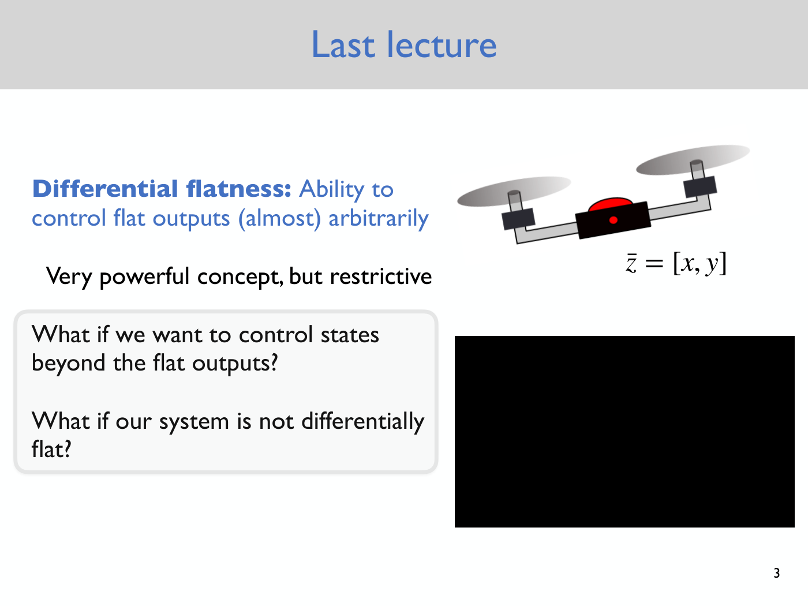
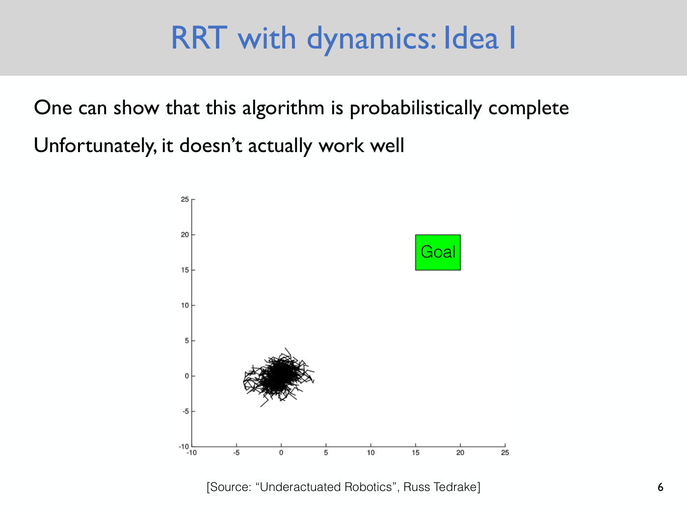
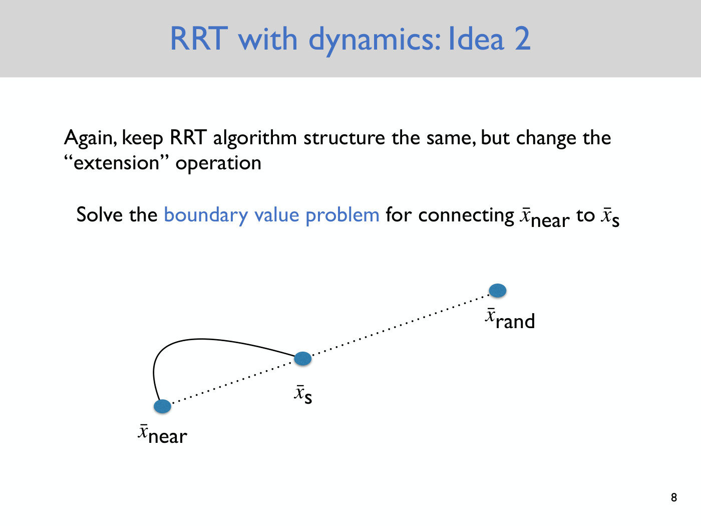
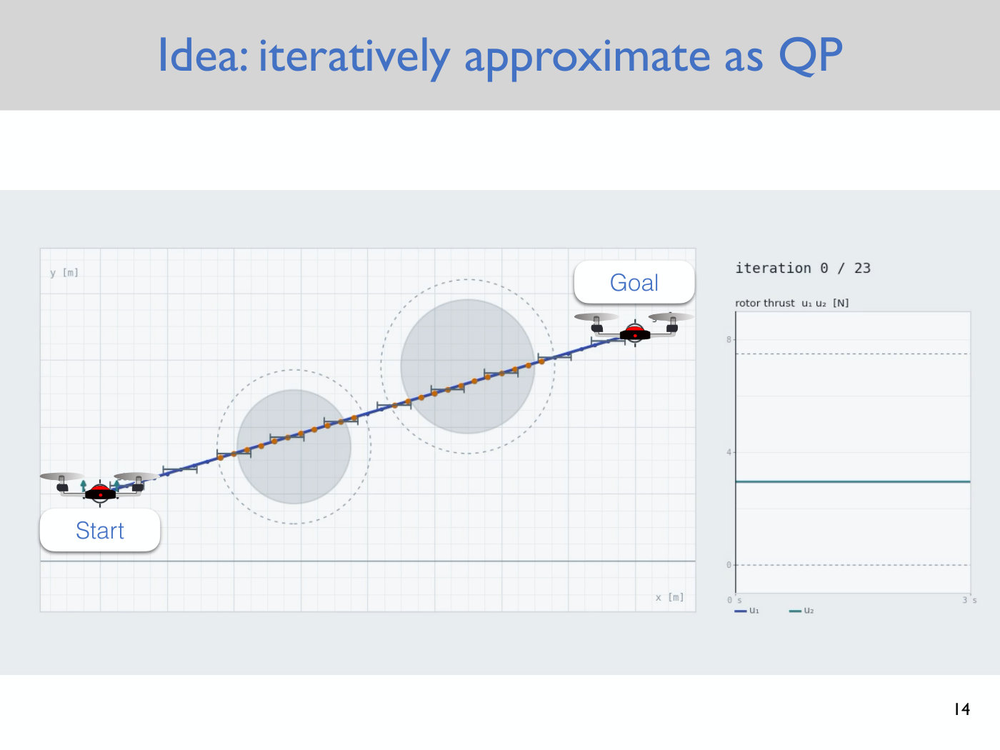
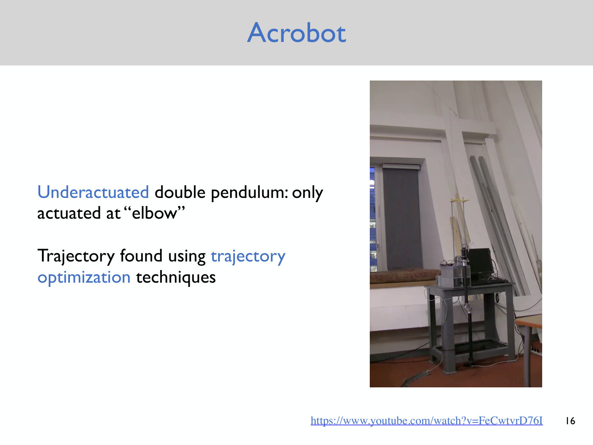

# Lecture 6 — Trajectory Optimization

Anirudha Majumdar, Princeton ROB 345/549, Fall 2026 ·
[video](https://www.youtube.com/watch?v=ETOwJ-aPWe8) (72 min) ·
[slides (PDF, Dropbox)](https://www.dropbox.com/scl/fi/9wnsc9wkmxmvwbugm7rps/Lecture6_slides.pdf?rlkey=9dsf9cbn7sjy9b5m6dieznycs&dl=0) ·
[notes (PDF, Dropbox)](https://www.dropbox.com/scl/fi/ctybyh0a1gdrvaywbcylu/Lecture6_notes.pdf?rlkey=i9tmfyhkjiws7gboip2a8fkvl&dl=0) ·
[slide-by-slide text](../raw/slides/06-trajectory-optimization.md) ·
[notes as text](../raw/notes/06-trajectory-optimization.md) ·
[transcript](../raw/transcripts/06-trajectory-optimization.md)

**What this lecture establishes.** Differential flatness, the subject of Lecture 5, controls only
the flat outputs and applies only to systems known to be flat. This lecture gives a more general way
to plan with dynamics. It first tries growing the RRT directly in state space by applying random
control inputs, which is probabilistically complete but useless in practice. It then keeps the RRT
as it is and changes only the extension step: connecting the nearest vertex $\bar{x}_ {\text{near}}$
to the new state $\bar{x}_ s$ becomes a **boundary value problem**, also called **trajectory
optimization**: find control inputs that drive the system from one state to the other. The special
case the lecture works through is linear dynamics. The planar quadrotor's nonlinear dynamics are
**linearized** about hover by a first-order Taylor expansion, giving
$\dot{\bar{x}} = A(\bar{x} - \bar{x}_ 0) + B(\bar{u} - \bar{u}_ 0)$, with $A$ and $B$ computed
entry by entry. The result is discretized in time, and trajectory optimization becomes a **convex
quadratic program (QP)**: minimize the control effort subject to linear constraints. Such problems
can be solved in milliseconds. For nonlinear systems the problem is solved approximately by
**sequential quadratic programming**, re-linearizing about the latest trajectory and solving a QP at
each iteration, and used inside the RRT for each short extension. The lecture ends with three
examples from Majumdar's own work: an acrobot swing-up, a knife-edge flight between poles, and
funnel libraries for real-time planning.

**Where to find what.** The linearization and the quadratic program were written on the blackboard
(≈13:19), which the video does not show. The course's **lecture notes** (3 pages) are their written
record. They number the equations (1)–(10), and this page cites them as "notes eq. (N)" and "notes
p. N"; the lecture itself never speaks these numbers. The deck has 18 slides, cited as "slide N",
which is also the PDF page. It covers the RRT ideas, two pictures of a quadratic program, a demo of
sequential QP and the example videos, and its slide 10 says only "See lecture notes". Timestamps
(≈M:SS) point into the video and the [transcript](../raw/transcripts/06-trajectory-optimization.md).
Where the lecture says "this one" or "over here", it is pointing at the board, and this page does not
guess what was drawn. The method has its own page, [trajectory optimization](trajectory-optimization.md),
and the linearization step has [linearization](linearization.md).

## Contents

1. [Where this lecture sits: the limits of differential flatness](#where-this-lecture-sits-the-limits-of-differential-flatness)
2. [RRT with dynamics, idea 1: grow the tree in state space](#rrt-with-dynamics-idea-1-grow-the-tree-in-state-space)
3. [Idea 2: keep the RRT, change the extension](#idea-2-keep-the-rrt-change-the-extension)
4. [Linearizing the planar quadrotor's dynamics](#linearizing-the-planar-quadrotors-dynamics)
5. [Computing A and B](#computing-a-and-b)
6. [Discretizing time](#discretizing-time)
7. [Trajectory optimization as a quadratic program](#trajectory-optimization-as-a-quadratic-program)
8. [Why the quadratic program is easy](#why-the-quadratic-program-is-easy)
9. [Picturing a quadratic program](#picturing-a-quadratic-program)
10. [Nonlinear systems: sequential quadratic programming](#nonlinear-systems-sequential-quadratic-programming)
11. [Putting it together: trajectory optimization inside the RRT](#putting-it-together-trajectory-optimization-inside-the-rrt)
12. [Examples: an acrobot, a knife-edge airplane, funnel libraries](#examples-an-acrobot-a-knife-edge-airplane-funnel-libraries)
13. [What comes next](#what-comes-next)
14. [Gaps in the record](#gaps-in-the-record)

## Where this lecture sits: the limits of differential flatness

The course is still in its first technical module, motion planning and control (≈0:10). Lecture 4
described dynamics with equations of motion, differential equations from Newton's laws, and Lecture
5 introduced [differentially flat](differential-flatness.md) systems. For those systems, any
sufficiently smooth trajectory of the **flat outputs** can be followed, and the control inputs and
the full state can be recovered from it. For the planar quadrotor the flat outputs are the center of
mass location $x$ and $y$; the orientation, the velocities and the orientation rate all follow
(≈0:56–1:41). Majumdar recalls the fixed-wing tail-sitter shown last time, which takes off and lands
vertically and is known to be flat, and notes that the 3D quadrotor is flat too. The assignment that
goes out the next day has further examples (≈2:28).

Slide 3 states the verdict: flatness is "very powerful", "but restrictive", for two reasons
(≈2:28–3:13).

- **States beyond the flat outputs cannot be controlled.** If the planar quadrotor has to pass
  through a small slit, its orientation $\theta$ as it goes through has to take some value or range
  of values. Flatness gives no authority over the orientation, because $\theta$ is not a flat
  output. For the 3D quadrotor, whose flat outputs are $x$, $y$, $z$ and yaw, it gives none over the
  roll and pitch (≈3:13–4:00).
- **The system may not be flat, or may not be known to be.** A new robot might not be flat, and
  there are examples of systems that are not flat for non-trivial definitions of flatness (≈3:13).

A student drew the consequence for obstacle avoidance, and Majumdar agreed: with flatness alone you
control only $x$, $y$ (or $x$, $y$, $z$ and yaw), so you basically have to treat the robot as a
sphere, since the roll and pitch "could be just doing completely arbitrary things" (≈4:00–4:46).
The goal of the lecture is a more general set of techniques, starting from the RRT (≈4:46–5:33).

*Slide 3 — the recap: flatness controls the flat outputs z̄ = [x, y] of the planar quadrotor (drawn on the right) "(almost) arbitrarily", but it is restrictive. The black rectangle is a video frame that is entirely black in the PDF. [Deck](https://www.dropbox.com/scl/fi/9wnsc9wkmxmvwbugm7rps/Lecture6_slides.pdf?rlkey=9dsf9cbn7sjy9b5m6dieznycs&dl=0)*

## RRT with dynamics, idea 1: grow the tree in state space

Suppose the robot's dynamics are known, $\dot{\bar{x}} = f(\bar{x}, \bar{u})$, where $\bar{x}$ is
the state and $\bar{u}$ the control input (see [state and dynamics](state-and-dynamics.md)). The
first idea is to build the RRT in **state space** instead of configuration space, so that each vertex
is a full state, not just a configuration (slide 5, ≈5:33–6:18). Initialize the tree with the
starting state $\bar{x}_ A$. Then, on each iteration:

1. Sample a random state $\bar{x}_ {\text{rand}}$ **from the existing tree**. This differs from the
   original RRT, which samples a configuration from the whole space (≈6:18).
2. Select a random control input $\bar{u}_ {\text{rand}}$.
3. Apply it for a short time $\Delta T$ and integrate the equations of motion to predict where the
   system ends up (≈7:05–7:50).
4. If the new state $\bar{x}_ s$ is in collision, discard it and continue. Otherwise add it to the
   tree, and terminate if it is close enough to the goal.

Step 3 is written on slide 5 as

$$\bar{x}_ s = \bar{x}_ {\text{rand}} + \int_ 0^{\Delta T} f(\bar{x}(t), u_ {\text{rand}}) \thinspace dt,$$

with $u_ {\text{rand}}$ printed without its bar. Since the dynamics are assumed known, this
prediction is exact: "we're just integrating the equations of motion" (≈7:05).

Asked whether it would work, a student pointed to the lack of exploration; the answer is inaudible in
the recording, but Majumdar agreed with it (≈8:38–9:25). In theory the algorithm is **probabilistically complete**: if some way from start to goal exists, the
probability that it finds one approaches one as the number of iterations goes to infinity (slide 6,
≈8:38–9:25). In practice it is "a completely useless algorithm". Because every sample is drawn from
the tree itself, there is no exploration. Starting from a jumble of points, sampling within the
jumble and extending only adds more jumble (≈9:25).

*Slide 6 — what idea 1 does in practice: the tree (black, near the origin) stays a dense tangle a few units across, and never approaches the green goal square at 15–20 on both axes. The plot is credited to Russ Tedrake's "Underactuated Robotics". [Deck](https://www.dropbox.com/scl/fi/9wnsc9wkmxmvwbugm7rps/Lecture6_slides.pdf?rlkey=9dsf9cbn7sjy9b5m6dieznycs&dl=0)*

## Idea 2: keep the RRT, change the extension

The second idea keeps the structure of the [RRT](rrt.md) exactly as originally introduced: sample a
random point, find the nearest vertex of the tree, extend toward the sample. Only the **extension
operation** changes (slide 7, ≈9:25–10:56). The original RRT extends with a line segment, which does
not account for the motions the robot can physically make. Instead, solve the **boundary value
problem** of connecting the nearest vertex $\bar{x}_ {\text{near}}$ to the extended state
$\bar{x}_ s$. That means finding control inputs that, when the robot executes them, take it from
$\bar{x}_ {\text{near}}$ to $\bar{x}_ s$ (≈10:56–11:44).

*Slide 8 — the new extension step. The dotted straight line runs from the nearest vertex x̄ near through the extended state x̄ s to the sample x̄ rand; the original RRT would add the straight piece from x̄ near to x̄ s. Idea 2 replaces it with the solid curve, a path the dynamics allow. [Deck](https://www.dropbox.com/scl/fi/9wnsc9wkmxmvwbugm7rps/Lecture6_slides.pdf?rlkey=9dsf9cbn7sjy9b5m6dieznycs&dl=0)*

This boundary value problem is the hard part, and it is "also known as trajectory optimization" in
the literature on motion planning with dynamics constraints (slide 9, ≈11:44–12:30). It can be
tackled with techniques from nonlinear optimization. The lecture treats a special case that is
computationally efficient, linear dynamics, and then briefly describes the general version (slide 9,
≈12:30–13:19).

On the board, Majumdar drew the tree in 2D for visualization, while stressing that it is really built
in state space, which is six-dimensional for the planar quadrotor and 12-dimensional for the 3D
quadrotor (≈13:19). The tree starts at a start state $\bar{x}_ A$ and should reach a goal state
$\bar{x}_ B$ (≈14:06). If the straight segment happens to be physically feasible, the solution
curve is just that segment. Often it is not (≈14:53). A drone cannot translate horizontally, and a
car seen from above cannot slide sideways to a state beside it unless it is omnidirectional. It has
to drive forward and back up, or the other way round, and there may be many ways to do it
(≈14:53–16:26). The problem to solve is therefore: from a state $\bar{x}_ A$ to another state, find a
sequence of control inputs that makes the system get there (≈16:26).

## Linearizing the planar quadrotor's dynamics

The special case that is easy is linear dynamics (≈16:26). The planar quadrotor's dynamics are not
linear, so the first step is to approximate them by something linear (notes p. 1). The dynamics, in
the first-order form of Lecture 4 (see [the quadrotor model](quadrotor-model.md#the-planar-quadrotor)),
are (notes eq. (1), ≈17:21–19:43):

$$\dot{\bar{x}} = \frac{d}{dt} \begin{bmatrix} x \cr y \cr \theta \cr \dot{x} \cr \dot{y} \cr \dot{\theta} \end{bmatrix} = f(\bar{x}, \bar{u}) = \begin{bmatrix} \dot{x} \cr \dot{y} \cr \dot{\theta} \cr -\frac{u_1}{m} \sin\theta \cr \frac{u_1}{m} \cos\theta - g \cr \frac{u_2}{I} \end{bmatrix} \tag{1}$$

Here $x$ and $y$ are the position of the center of mass, $\theta$ the orientation, $m$ the mass, $I$
the moment of inertia and $g$ gravity. On the board the last three states were named $v_x$, $v_y$ and
$\omega$, defined as $\dot{x}$, $\dot{y}$ and $\dot{\theta}$ (≈17:21–18:09); the notes write the
derivatives directly. The control inputs are $u_1 = F_1 + F_2$, the total thrust of the left and
right propellers, and $u_2 = (F_2 - F_1) L$, the total moment, where $L$ is the arm length (≈18:57; the symbol is Lecture
4's).
In general the state is in $\mathbb{R}^n$ and the control input in $\mathbb{R}^m$, with $n = 6$ and
$m = 2$ here (≈19:43–20:28). The dynamics are **nonlinear** because $f$ is a nonlinear function of
the state and control input: it contains $\sin\theta$ and $\cos\theta$. A linear approximation makes
trajectory optimization "much, much simpler" (≈20:28).

**The nominal point.** A student proposed a first-order Taylor approximation (≈21:14). It needs a
**nominal** (reference) state and control input to expand about, and which one is right depends on
the system and the application. Asked for a reasonable nominal state, a student suggested all zeros:
the drone at the origin, level, with no velocity (≈22:00–22:52). The nominal control input is then
the one that cancels gravity, total thrust $mg$ and no moment, so no difference between $F_2$ and
$F_1$ (≈23:38–24:24). The notes allow any position (notes eq. (2), p. 1):

$$\bar{x}_ 0 = \begin{bmatrix} x_0 \cr y_0 \cr 0 \cr 0 \cr 0 \cr 0 \end{bmatrix}, \qquad \bar{u}_ 0 = \begin{bmatrix} mg \cr 0 \end{bmatrix} \tag{2}$$

and $x_0$, $y_0$ can be taken to be 0 by shifting the origin. A student asked why the nominal input is
not written in terms of $F_1$ and $F_2$. The answer is that the control input vector was defined as
$(u_1, u_2)$, total thrust and total moment, only because it makes the equations slightly more compact
(≈24:24–25:12).

At the nominal point nothing moves (notes eq. (3), ≈25:59–26:46):

$$\dot{\bar{x}} = f(\bar{x}_ 0, \bar{u}_ 0) = \bar{0} \tag{3}$$

The first three components are the velocities, which are zero. The fourth contains $\sin 0 = 0$. The
fifth is $mg/m - g = 0$, and the sixth is $u_2/I = 0$. "If your drone is hovering perfectly ... and
you're canceling out gravity exactly, then nothing is going to happen" (≈26:46).

**The Taylor expansion.** Since $f$ is a function of both $\bar{x}$ and $\bar{u}$, its first-order
approximation about $(\bar{x}_ 0, \bar{u}_ 0)$ has a term for each (notes eq. (5), ≈27:34–28:20):

$$\dot{\bar{x}} = f(\bar{x}, \bar{u}) \approx \underbrace{f(\bar{x}_ 0, \bar{u}_ 0)}_ {=0} + \underbrace{\left. \left[ \frac{\partial f}{\partial \bar{x}} \right] \right\vert_ {\substack{\bar{x} = \bar{x}_ 0 \cr \bar{u} = \bar{u}_ 0}}}_ {:= A} (\bar{x} - \bar{x}_ 0) + \underbrace{\left. \left[ \frac{\partial f}{\partial \bar{u}} \right] \right\vert_ {\substack{\bar{x} = \bar{x}_ 0 \cr \bar{u} = \bar{u}_ 0}}}_ {:= B} (\bar{u} - \bar{u}_ 0) \tag{5}$$

The first term is zero by eq. (3). Naming the two matrices of partial derivatives $A$ and $B$ gives
the **linearized dynamics** (notes eq. (4), ≈29:54):

$$\dot{\bar{x}} = A(\bar{x} - \bar{x}_ 0) + B(\bar{u} - \bar{u}_ 0) \tag{4}$$

where $A$ is $n \times n$ and $B$ is $n \times m$, $6 \times 6$ and $6 \times 2$ for the planar
quadrotor, "to make the dimensions work out". They are constant matrices. Most of the class had seen
Taylor approximation before (≈29:08). See [linearization](linearization.md) for the step in general.

## Computing A and B

Row $i$ of $A$ holds the partial derivatives of the $i$-th component of $f$ with respect to each of
the six states, in order, evaluated at the nominal point (notes eq. (6), ≈30:39–32:12). The first
row differentiates $\dot{x}$, the first component of $f$. Since $\dot{x}$ does not depend explicitly
on $x$, $y$ or $\theta$, those entries are zero. The only non-zero entry is its derivative with
respect to itself, which is 1 (≈32:58). Rows 2 and 3 follow the same pattern (≈33:44). In rows 4–6,
the only partial derivative that survives the evaluation is row 4, column 3, the derivative of the
fourth component with respect to $\theta$ (≈34:31–36:55):

$$\left. \frac{\partial}{\partial \theta}\left( -\frac{u_1}{m} \sin\theta \right) \right\vert_ {\bar{x}_ 0, \bar{u}_ 0} = \left. -\frac{u_1}{m} \cos\theta \right\vert_ {\theta = 0, \thinspace u_1 = mg} = -g$$

So (notes eq. (7)):

$$A = \begin{bmatrix} 0 & 0 & 0 & 1 & 0 & 0 \cr 0 & 0 & 0 & 0 & 1 & 0 \cr 0 & 0 & 0 & 0 & 0 & 1 \cr 0 & 0 & -g & 0 & 0 & 0 \cr 0 & 0 & 0 & 0 & 0 & 0 \cr 0 & 0 & 0 & 0 & 0 & 0 \end{bmatrix} \tag{7}$$

A student asked what the approximation is for. The answer was that it makes the trajectory
optimization problem easy, a claim Majumdar had not yet justified (≈36:55).

$B$ is built the same way from the partial derivatives with respect to $u_1$ and $u_2$ (notes eq.
(8), ≈37:42–39:13). Most entries are zero, and the first four rows are all zero. The class worked out
the two that are not (≈39:59–43:07). Row 5, column 1 is the derivative of the fifth component,
$\frac{u_1}{m}\cos\theta - g$, with respect to $u_1$, which is $\cos\theta / m$ and so $1/m$ at
$\theta = 0$. Row 6, column 2 is the derivative of $u_2/I$ with respect to $u_2$, which is $1/I$:

$$B = \begin{bmatrix} 0 & 0 \cr 0 & 0 \cr 0 & 0 \cr 0 & 0 \cr \frac{1}{m} & 0 \cr 0 & \frac{1}{I} \end{bmatrix} \tag{8}$$

The linearized dynamics, eq. (4) with these matrices, are "not going to be a perfect approximation,
but kind of good enough if you're close to the nominal state, close to the nominal control input"
(≈43:07). Doing this by hand is tedious, but worth doing once or twice for a simple system. In the
assignment that goes out the next day, a few lines of Python compute the linearization, which matters
for systems such as the full 3D quadrotor (notes p. 2, ≈43:56–44:42).

## Discretizing time

Before stating the optimization problem, one more approximation helps: turn the continuous-time
differential equation into a difference equation (≈46:14–47:46). The state a short time $\Delta t$
later is the state now plus its time derivative, from eq. (4), times $\Delta t$ (notes eq. (10)):

$$\bar{x}[t + \Delta t] \approx \bar{x}[t] + \Delta t \left[ A(\bar{x}[t] - \bar{x}_ 0) + B(\bar{u}[t] - \bar{u}_ 0) \right] \tag{10}$$

Square brackets mark discrete time. Majumdar calls this an **Euler discretization**, or Euler
integration (≈47:00–47:46).

## Trajectory optimization as a quadratic program

The problem: given a start state $\bar{x}_ A$ and a goal state $\bar{x}_ B$, find control inputs that
take the system from one to the other (≈45:28). It is posed as an optimization problem with three
parts (notes p. 3, ≈47:46–52:28; the notes write $\bar{x}_ {\text{start}}$ and $\bar{x}_ {\text{goal}}$).

**Find** the states $\bar{x}[t]$ and control inputs $\bar{u}[t]$ at the times $t = 0, \Delta t, 2\Delta t, \ldots, T$.
The **time horizon** $T$ is the longest you are willing to wait for the system to get from start to
goal, for instance 5 or 10 seconds (≈48:34).

**Minimize** the control effort, the squared magnitude of the control input summed over time:

$$\sum_ {t=0}^{T} \Vert \bar{u}[t] \Vert_ 2^2$$

"Be as lazy as possible, apply as little control input as possible" (≈48:34–49:24). For the planar
quadrotor that means: at each time, square the total thrust and the total torque, add them up, and
sum over time (≈56:22–57:11).

**Subject to** four kinds of constraint:

- the discretized dynamics, eq. (10) with equality, for $t = 0, \ldots, T - \Delta t$ (≈50:09–50:58);
- the start, $\bar{x}[0] = \bar{x}_ {\text{start}}$, and
- the goal, $\bar{x}[T] = \bar{x}_ {\text{goal}}$, which make it a boundary value problem (≈49:24–50:09);
- a bound on the state, $C \bar{x}[t] \le \bar{d}$ for $t = 0, \ldots, T$ (≈50:58).

The last constraint keeps the state inside a **polytope**, a region of state space defined by linear
inequalities (notes p. 3). Each row of $C$ says that the state must lie on one side of a hyperplane
(≈53:13). One way to use it is to approximate the collision-free space around some obstacles by a
polytope and require the state to stay inside it for all time (≈54:00). It is not fully general: if
the trajectory has to weave between obstacles, there may be no clean way to capture the free space
with linear inequalities (≈54:00–54:48). On the board, $C$ was $k \times n$ and $\bar{d}$ was
$k \times 1$ (≈51:43); the notes give $C$ as $n \times n$ and $\bar{d}$ as $n \times 1$.

## Why the quadratic program is easy

The key observation is the shape of the problem (≈54:48–55:35). The objective is **convex** and
**quadratic**; convex means "it sort of looks like a bowl". Every constraint is **linear** in the
states and control inputs, with no nonlinearities anywhere. This makes it a **convex quadratic
program**, or **QP**, a kind of problem for which extremely efficient methods exist. Problems with
thousands of variables can be solved in milliseconds (≈55:35), and for the planar quadrotor it might
be microseconds with a fast implementation (≈56:22). The notes name the solvers Mosek and Gurobi
(notes p. 3), and the lecture adds a third whose name the captions garble (≈1:00:17). The lecture
does not cover how the solvers work. ORF 363 at Princeton is one course devoted to optimization (notes
p. 3, ≈55:35).

## Picturing a quadratic program

Slides 11 and 12 show a QP in two decision variables $x_1$ and $x_2$ (≈57:58–1:00:17). Here $x_1$ and
$x_2$ are generic variables, not the drone's position. Without constraints, a quadratic function is
pictured by its level sets, nested ellipses. Its minimum, at $(4, 3)$ for the function drawn, can be
found by gradient descent: start anywhere, step along the negative gradient, repeat until it
converges. That problem is "almost trivial" (slide 11, ≈57:58–58:44).

It becomes interesting with constraints (slide 12, ≈58:44–59:31). Two linear constraints,
$2x_2 - x_1 \le 4$ and $x_1 + x_2 \le 4$, each keep the point on one side of a line. Together they
leave the green shaded **feasible region**, and the problem is to minimize the function within it.

*Slide 12 — a convex QP in two variables. The ellipses are level sets of the objective, whose unconstrained minimum (4, 3) lies outside the green feasible region. The constrained minimum x\* = (2, 2) is where the thick brown ellipse just touches the edge x₁ + x₂ ≤ 4, and the arrow −∇f there points out of the region, perpendicular to that edge. [Deck](https://www.dropbox.com/scl/fi/9wnsc9wkmxmvwbugm7rps/Lecture6_slides.pdf?rlkey=9dsf9cbn7sjy9b5m6dieznycs&dl=0)*

The slide prints the answer, $x^\ast = (2, 2)$, which the lecture does not discuss aloud. It lies on
the boundary $x_1 + x_2 = 4$, where the thick contour touches the feasible region, and not at the
unconstrained minimum. The pictures are drawn in 2D, but the lecture asks you to imagine them in a
high-dimensional space, where the functions and constraints of trajectory optimization live (≈57:58).

## Nonlinear systems: sequential quadratic programming

Real systems are never exactly linear, and the constraints are "never quite linear either" (≈1:00:17). For
the general case Majumdar sketched the approach without details (slide 13, ≈1:01:02), using an
interactive demo of the planar quadrotor that he says was vibe coded with Claude (slide 14). The demo
has the same setup as before: a start state, a goal state and obstacles to avoid. The idea is to
**iteratively approximate the problem as a QP** (≈1:01:02–1:02:36):

1. Guess a solution. The first guess is a straight line that goes through the obstacles and so
   violates the constraints.
2. Linearize the dynamics along the current trajectory, so that the dynamics constraints are linear.
3. Approximate the obstacle constraints as linear, or relax them, at first not bothering too much
   about them.
4. Solve the resulting QP. Raise the penalty for violating the obstacle constraints, re-linearize
   about the latest trajectory, and solve again.
5. Repeat, and "hopefully you'll converge to something that's feasible".

*Slide 14 — iteration 0 of 23 of the demo, the only frame in the PDF: the initial guess is the straight blue line from Start to Goal, straight through both obstacles (grey discs with dashed safety margins). Orange dots lie along the stretches of the line inside the obstacles' margins. The thrust plot on the right is flat, at about 3 N, between dashed lines at 0 and about 7.5 (apparently the thrust limits). The iterations that follow were shown in class. [Deck](https://www.dropbox.com/scl/fi/9wnsc9wkmxmvwbugm7rps/Lecture6_slides.pdf?rlkey=9dsf9cbn7sjy9b5m6dieznycs&dl=0)*

A student asked about the objective. This demo minimizes control input, but other objectives can be
used: minimum path length, or minimum time (≈1:02:36). Minimum time leads to **bang-bang control**,
which maxes out the control input and then switches to the other extreme. That is not friendly to a
physical system, so in practice the objective is often a mix of time, control effort and path length
penalties, with the obstacles as constraints (≈1:02:36–1:03:21).

This is **sequential quadratic programming** (≈1:03:21–1:04:07). For linear dynamics and linear
constraints the QP is solved efficiently and essentially exactly, up to small numerical errors. For
nonlinear ones, sequential QP comes with **no guarantee** of finding a collision-free path, and the
chance of finding one falls as the obstacles grow more numerous and the environment's geometry more
complicated.

## Putting it together: trajectory optimization inside the RRT

That is why trajectory optimization is combined with the RRT (≈1:04:07–1:04:52). Each extension of the
tree covers only a short time, and over a short time these problems can be solved efficiently. The
fully general approach is to build the RRT and, every time the tree is extended, solve one of these
small optimization problems. At the end you hopefully have a path from start to goal that is
dynamically feasible for your system. See [trajectory optimization](trajectory-optimization.md) and
[the RRT](rrt.md#where-it-appears).

## Examples: an acrobot, a knife-edge airplane, funnel libraries

The examples are "a super biased set", all from Majumdar's own work (slide 15, ≈1:04:52). Each video
was played in class; the PDF holds one frame or title card of each.

**The acrobot** (slide 16, ≈1:04:52–1:07:11). Majumdar worked with this system during his PhD. It is
a double pendulum, a classic chaotic system, with two degrees of freedom, at the "shoulder" and the
"elbow". It is **underactuated**: there is a motor at the elbow and none at the shoulder. It models a
human acrobat hanging from a bar, and it is also a simple model of walking, the compass gait walker,
with one leg fixed to the ground and the other swinging, little torque at the ankle and a lot at the
hip. The task is to swing up from hanging down to upright and balance there. The trajectory was found
by sequential quadratic programming. In the video the acrobot does not quite stabilize at the top,
going back and forth because of friction. Majumdar said more about such errors later; this example is
about the planning, with no obstacles.

*Slide 16 — a single frame of the acrobot video, with the pendulum standing upright above its mount. "Underactuated double pendulum: only actuated at 'elbow'"; the trajectory was found with trajectory optimization. [Deck](https://www.dropbox.com/scl/fi/9wnsc9wkmxmvwbugm7rps/Lecture6_slides.pdf?rlkey=9dsf9cbn7sjy9b5m6dieznycs&dl=0)*

**A knife-edge airplane** (slide 17, ≈1:07:11–1:08:03). A fixed-wing airplane is shot off a launcher
and has to pass between obstacles, PVC pipes, less than a wingspan apart. To get through it flies a
**knife-edge** maneuver, and because the room was very small it ends in a net.
The first step was to model the dynamics, including the aerodynamics. Then sequential quadratic
programming found a trajectory that obeys them and avoids the pipes. The slide's frame is the video's
title card, "Fast and Accurate Knife-Edge Maneuvers for Autonomous Aircraft", by Andrew Barry,
Anirudha Majumdar, Tim Jenks and Russ Tedrake (Robot Locomotion Group, MIT/CSAIL).

**Funnel libraries** (slide 18, ≈1:08:03–1:10:41). This video is about real-time planning. A robot
moving fast may not have time to solve a trajectory optimization problem when it sees an obstacle.
The approach shown computes **funnels** that the plane is guaranteed to stay within, for a whole family
of trajectories and control inputs, offline, before the flight. At runtime all that is left is
collision checking: search the library of funnels for one that does not collide with the obstacles
(≈1:09:37). After the clip Majumdar says, "I guess that was me in my PhD days" (≈1:08:49). The slide's frame is the title
card, "Funnel Libraries for Realtime Obstacle Avoidance", by Anirudha Majumdar and Russ Tedrake.

## What comes next

All the trajectories shown were computed with sequential quadratic programming (≈1:10:41). What the
lecture left out is **control**. A real system never follows a planned trajectory exactly: the
dynamics model is imperfect, there may be unmodeled aerodynamics, and a gust of wind can push it off
course. From the next lecture, the course turns to how to apply control inputs that correct for such
disturbances and bring the system back (≈1:10:41–1:11:27). That is the feedback control section of the
[course map](course-map.md): [Lecture 7](07-stability-and-pd-control.md) on stability and PD control,
which opens by replaying this lecture's demo to show the drift, then the linear quadratic regulator. The
assignment that goes out the day after this lecture computes linearizations in Python (≈43:56) and
includes further examples of differentially flat systems (≈2:28); see [`sources.md`](../sources.md)
for Assignment 3.

## Gaps in the record

- **The blackboard is not in the record.** The linearization, the matrices $A$ and $B$ and the
  quadratic program were written on the board. This page follows the notes, whose equations match what
  is spoken. Where the lecture points ("this one", "this element right here"), for instance when
  listing which entries of $B$ are non-zero (≈39:13–39:59), the transcript cannot say what was meant;
  the notes' eq. (8) gives the result.
- **Notation differs between board and notes.** The board named the velocities $v_x$, $v_y$, $\omega$
  where the notes write $\dot{x}$, $\dot{y}$, $\dot{\theta}$, and the start and goal $\bar{x}_ A$,
  $\bar{x}_ B$ where the notes write $\bar{x}_ {\text{start}}$, $\bar{x}_ {\text{goal}}$. The board
  gave $C$ as $k \times n$ (≈51:43), the notes as $n \times n$.
- **Garbled passages**, marked unclear in the transcript: the time derivative of $v_x$ at ≈18:09
  (the captions say "x dot"); part of the list of $B$'s entries at ≈38:27; the list of discrete
  times at ≈47:46, where the captions have no "2 delta t" (the notes print $0, \Delta t, 2\Delta t, \ldots, T$);
  and a third solver name at ≈1:00:17.
- **Student contributions are mostly inaudible.** The captions catch the lecturer's replies, so a
  student's answer, such as the explanation at ≈8:38 of why idea 1 fails, is known only from what
  Majumdar says back.
- **Slides that hold a single frame.** Slide 3's video frame is entirely black, and the lecture does
  not say that a video was played on it. Slide 14 is the first iteration of a demo whose later
  iterations were shown live. Slides 16–18 hold one frame or a title card of videos played in class,
  which this page describes as the lecture narrates them. "Claude", the tool Majumdar says the demo was
  made with (≈1:01:02), is restored from the captions' "cloud" and printed nowhere in the course
  material.
- **Slide 5** prints $u_ {\text{rand}}$ without the bar it has elsewhere on the slide.
