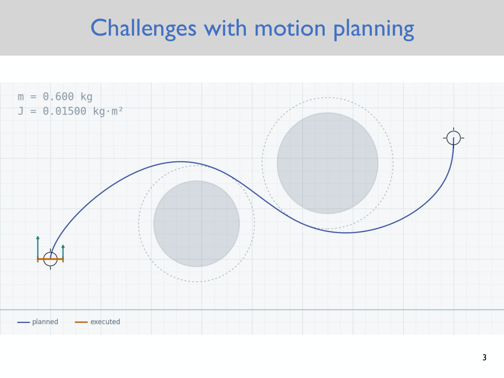
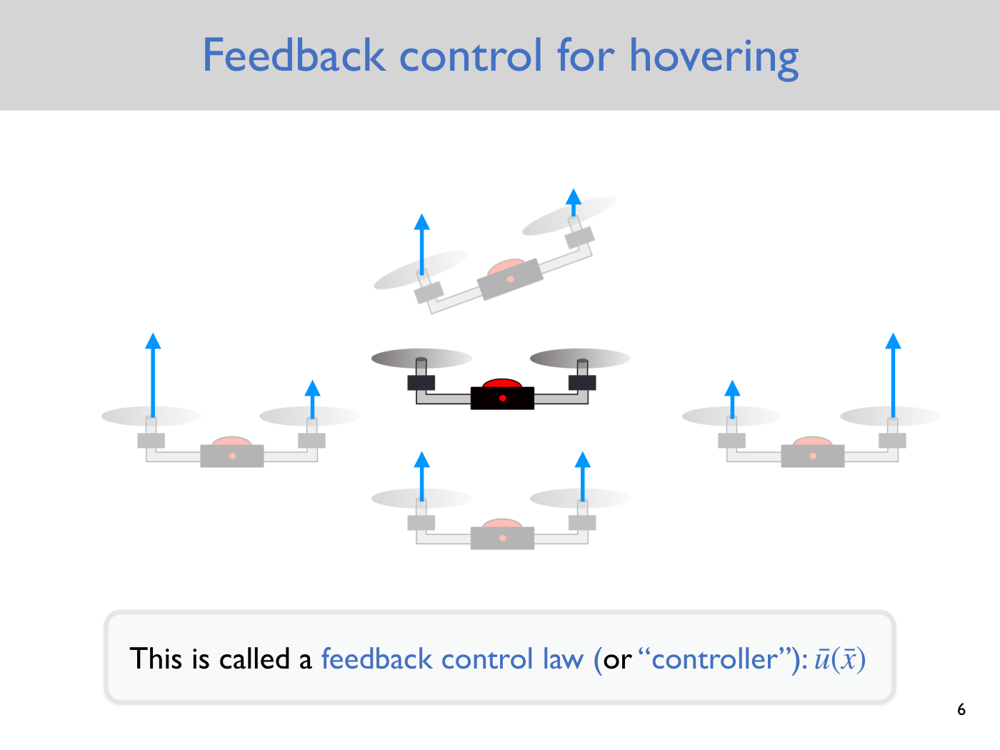
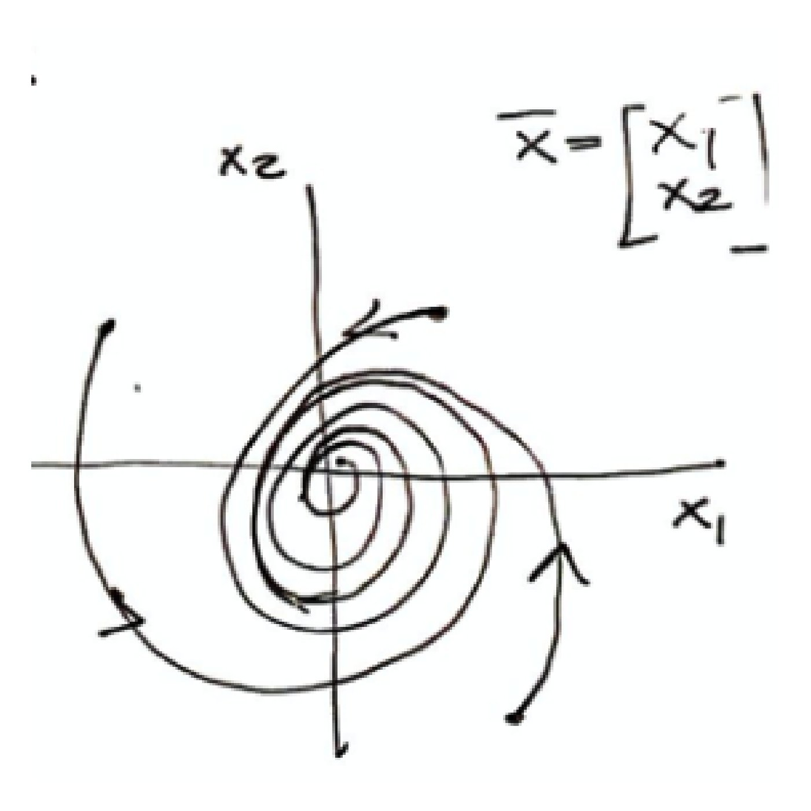
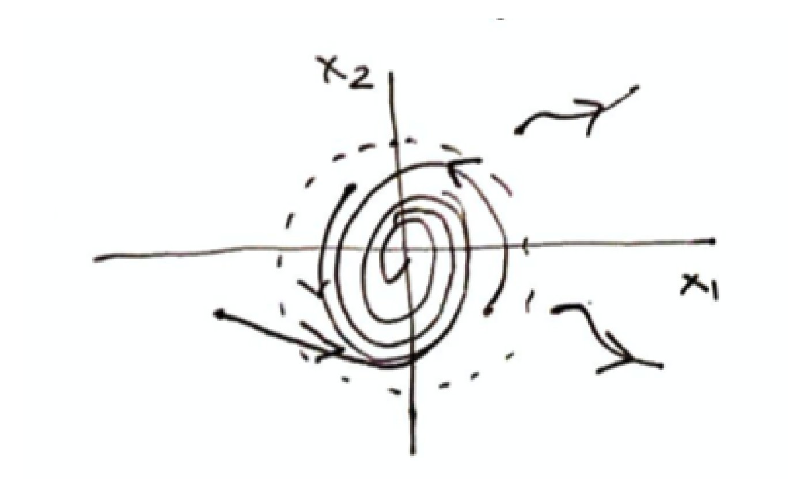
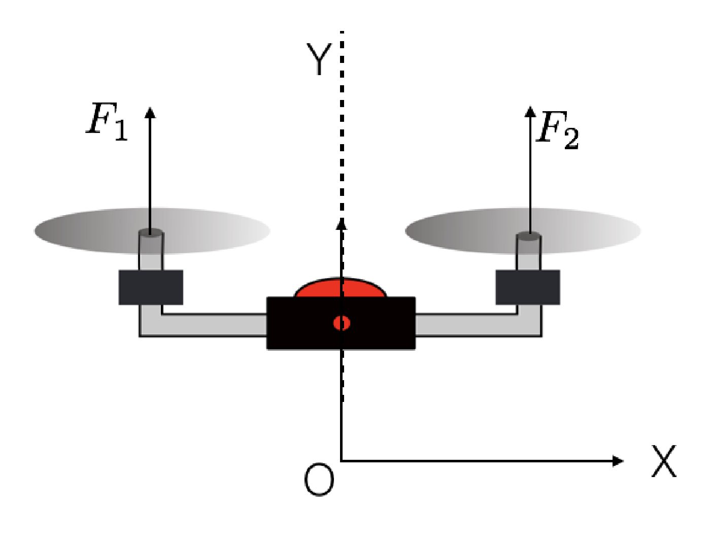

# Lecture 7 — Stability and PD Control

Anirudha Majumdar, Princeton ROB 345/549, Fall 2026 ·
[video](https://www.youtube.com/watch?v=nn022Copybg) (77 min) ·
[slides (PDF, Dropbox)](https://www.dropbox.com/scl/fi/6jzh0fey1mnfs8drq3905/Lecture7_slides.pdf?rlkey=nqo1qiqzhktzpy5klid7hyvgs&dl=0) ·
[notes (PDF, Dropbox)](https://www.dropbox.com/scl/fi/70lppdz21xpgitd1ohhuo/Lecture7_notes.pdf?rlkey=bkk76zdh9ep0cvryzmpr34y7x&dl=0) ·
[slide-by-slide text](../raw/slides/07-stability-and-pd-control.md) ·
[notes as text](../raw/notes/07-stability-and-pd-control.md) ·
[transcript](../raw/transcripts/07-stability-and-pd-control.md)

**What this lecture establishes.** A motion plan executed open loop drifts from the plan: even
numerical integration error is enough, and a 10% error in the mass makes the planned flight hit an
obstacle. The cure is **feedback control**, a **feedback control law** (or "controller")
$\bar{u}(\bar{x})$ that says, at every state, which control input to apply. This lecture defines what
we want such a controller to achieve. It starts from a **fixed point**, a state where some constant
input keeps the system still, and the **closed-loop dynamics** $\dot{\bar{x}} = f_{\text{cl}}(\bar{x})$
obtained by plugging the controller in. It then builds up the flavors of **stability**: global and
local attractivity, **stability in the sense of Lyapunov** (a "game" of two radii, $\epsilon$ and $\delta$), and
their combinations, **global** and **local asymptotic stability**, which are equivalent for linear
systems. A system is **stabilizable** if some controller can achieve this, and not every system is.
The lecture ends with a first controller, **proportional-derivative (PD) control**, for a quadrotor
that can only move up and down. Proportional feedback alone gives a spring-mass system that
oscillates forever. Adding a derivative term gives a spring-mass-damper, which is asymptotically
stable whenever both gains are negative. The next lecture chooses the gains optimally (LQR).

**Where to find what.** The deck has 7 slides, cited as "slide N", which is also the PDF page; it
motivates feedback control (slides 3–6) and states the plan (slide 7). The definitions and the PD
example were written on the blackboard, which the video does not show. The course's **lecture notes**
(5 pages) are their written record. They number the equations (1)–(19), and this page cites them as
"notes eq. (N)" and "notes p. N"; the lecture never speaks these numbers. Where the board and the notes
differ, this page follows the notes and gives the board's version with its timestamp. The biggest
difference is in naming: the board defines **global attractivity** and **local attractivity** as
separate properties and builds asymptotic stability from them, while the notes fold the same
condition into their definitions of asymptotic stability. Timestamps (≈M:SS) point into the video and
the [transcript](../raw/transcripts/07-stability-and-pd-control.md). Where the lecture says "this one"
or "over here", it is pointing at the board, and this page does not guess what was drawn. The
definitions have their own page, [stability](stability.md), and the controllers have
[feedback control](feedback-control.md).

## Contents

1. [Where this lecture sits: why a plan is not enough](#where-this-lecture-sits-why-a-plan-is-not-enough)
2. [Feedback control for hovering](#feedback-control-for-hovering)
3. [Replanning as feedback: receding horizon control](#replanning-as-feedback-receding-horizon-control)
4. [Fixed points](#fixed-points)
5. [Closed-loop dynamics](#closed-loop-dynamics)
6. [Global attractivity](#global-attractivity)
7. [Local attractivity](#local-attractivity)
8. [Stability in the sense of Lyapunov](#stability-in-the-sense-of-lyapunov)
9. [Global and local asymptotic stability](#global-and-local-asymptotic-stability)
10. [Stabilizability](#stabilizability)
11. [Questions about asymptotic convergence](#questions-about-asymptotic-convergence)
12. [PD control for a quadrotor that moves only up and down](#pd-control-for-a-quadrotor-that-moves-only-up-and-down)
13. [What comes next](#what-comes-next)
14. [Gaps in the record](#gaps-in-the-record)

## Where this lecture sits: why a plan is not enough

This lecture and the next are the last two of the course's first module, planning and control
(≈0:10; slide 2 marks "Feedback control" as the current topic). Majumdar recaps the module so far:
geometric motion planning, which ignores the dynamics; [differentially flat](differential-flatness.md)
systems, for which some part of the state can be controlled almost arbitrarily; and
[trajectory optimization](trajectory-optimization.md), solved efficiently for linear systems and
approximately, by iterated linear approximations, for nonlinear ones (≈0:10–0:56).

He then replays the trajectory-optimization demo from [Lecture 6](06-trajectory-optimization.md): a
planar quadrotor has to get from a start at the lower left to a goal at the top right, around two
obstacles, with a plan that obeys the dynamics and minimizes control effort (slide 3, ≈0:56–1:44). The
plan is a function of time, a control input for every moment. When those inputs are applied, the
executed trajectory (orange; "yellowish" in the lecture) matches the planned one (blue) almost exactly
at first, and then deviates near the end (≈2:29). Asked why, a student suggested external influences,
and a second guess, judging from Majumdar's reply, was the error of approximating nonlinear dynamics by
linear ones. Neither is the cause: the simulation changes nothing in the dynamics, with no wind. The cause is **numerical integration error**
in simulating the system, and "even just numerical integration error is enough to cause this sort of
visible deviation" (≈3:15–4:02).

*Slide 3 — the frame before execution starts: the blue planned path from the start (lower left) to the goal (upper right) between two obstacles, each with a dashed safety margin. The orange "executed" trace appears only when the run is played, as it was in class. The simulation's parameters are printed at the top left: m = 0.600 kg, J = 0.01500 kg·m². [Deck](https://www.dropbox.com/scl/fi/6jzh0fey1mnfs8drq3905/Lecture7_slides.pdf?rlkey=nqo1qiqzhktzpy5klid7hyvgs&dl=0)*

Changing the dynamics makes it worse. With the inertia changed by 10%, the executed flight deviates
significantly and comes close to an obstacle; with the mass changed by 10%, it collides
(≈4:02–4:47). Small differences between the dynamics used for planning and the real system's dynamics
are enough to cause significant deviations when the control inputs are simply applied as planned.

This is the course's theme of [uncertainty](uncertainty.md) again: "every technical challenge in
robotics in my opinion comes down somehow or the other to dealing with uncertainty" (≈4:47). Slide 4
lists the three kinds that motion planning has not yet dealt with (≈4:47–6:19):

- **An imperfect dynamics model.** The real drone has aerodynamic effects that are not modeled. Its
  physical parameters are estimated imperfectly; the inertia, for instance, comes from simple
  experiments with a pendulum setup. The thrust produced may change with the battery level.
- **External disturbances**, such as wind gusts when flying outdoors.
- **Imperfect knowledge of the robot's state or of the map.** The planners so far assume the robot knows
  exactly where it starts and exactly what the environment looks like.

This lecture and the next address the first two, through feedback control. The course's second module
addresses the third: the robot's estimate of its own state from its sensors, and imperfections in its
map (≈6:19).

## Feedback control for hovering

The next two lectures mostly focus on **hovering**, "the simplest thing that a drone can do": stay in
the hover configuration forever (≈7:05). Because of wind or modeling errors, the drone is not exactly
at the planned state, and the question is what to do about it. Slides 5 and 6 picture the intuition
with a planar quadrotor at the goal state in the middle and four displaced copies around it, each with
blue arrows for the thrust of its two rotors (≈7:05–8:36):

- **Too low** (the bottom copy): increase the thrust and go up.
- **To the left of the goal**: tilt to the right. Crank up the left rotor's thrust and crank down the
  right one's; that gives a torque that rotates the drone, which can then correct itself.
- **To the right**: the mirror image, with the right rotor cranked up.
- **Tilted and offset** (the top copy, above the goal and tilted with its right end up): it has to get
  down to the goal state and also get horizontal, so decrease the thrust of both rotors but keep the
  left one a little higher.

*Slide 6 — the goal state is the dark drone in the middle. Around it, displaced copies show the thrusts that bring each back: equal arrows below, a longer left arrow on the left copy and a longer right arrow on the right copy, and a longer left arrow on the tilted copy above. Slide 5 has the same picture under "Goal: define this vector field". [Deck](https://www.dropbox.com/scl/fi/6jzh0fey1mnfs8drq3905/Lecture7_slides.pdf?rlkey=nqo1qiqzhktzpy5klid7hyvgs&dl=0)*

The goal of feedback control is to define this "vector field" (slide 5): at every possible state, a
mapping from that state to the control input to apply. That mapping is called a **feedback control
law**, or for short a **controller**, written $\bar{u}(\bar{x})$, where $\bar{x}$ is the state and
$\bar{u}$ the control input (slide 6, ≈8:36–9:21). Given that the robot finds itself at some state at
some time, it says what input to apply to stabilize itself, in this example to the hover configuration.

Slide 7 gives the plan (≈9:21–10:06). Today: define mathematically what we want from feedback
control, which intuitively is some kind of **stability**, and then sketch a basic approach, PD
control, which anyone who has taken a controls course has probably seen. Next lecture: optimal feedback
control for linear dynamics, the **linear quadratic regulator (LQR)**. In the lab that goes out the
following Wednesday, students implement an LQR controller that makes the real drone stabilize itself
(≈10:06).

## Replanning as feedback: receding horizon control

Taking questions on the setup, Majumdar explained that trajectory optimization itself can be used for
feedback control (≈10:06–11:40). Plan a trajectory from start to goal around the obstacles and start executing its
control inputs. After a little time the drone, having deviated because of imperfect dynamics, senses
its own state, sees the deviation and replans a trajectory to the goal. Repeating this, planning,
executing a portion and replanning until the goal is reached, is a way of doing feedback, because the
plan is constantly adapted to where the drone actually is. It is a common method, called **receding
horizon control** or **model predictive control (MPC)**. Its challenge is that the trajectory
optimization has to be solved very quickly. That is feasible for linear systems, but it can get
challenging for nonlinear systems with complex obstacles. The techniques in this lecture and the next
do not need iterative replanning; with the computational budget for it, MPC is "definitely a valid
approach" to feedback control (≈11:40).

A second question, inaudible in the recording, drew the answer that PD control does not think about
obstacles at all: given a
planned trajectory, it tries to track it as tightly as possible, without accounting for the global
geometry of the obstacles in the environment (≈11:40–12:25).

## Fixed points

The most basic concept is a **fixed point**, also called an **equilibrium point** (≈12:25). For a
system $\dot{\bar{x}} = f(\bar{x}, \bar{u})$, where $f$ gives the dynamics in first-order form (see
[state and dynamics](state-and-dynamics.md)), a fixed point is a state $\bar{x}_ 0$ such that

$$\dot{\bar{x}} = f(\bar{x}_ 0, \bar{u}_ 0) = 0 \quad \text{for some choice of } \bar{u}_ 0$$

(notes eq. (1), ≈14:47). Intuitively, it is a state that you remain at forever when you apply
$\bar{u}_ 0$: the rate of change of the state is zero (≈14:47–15:40).

The course has met one already. To [linearize](linearization.md) the planar quadrotor in Lecture 6,
it chose the hover state as the nominal point (≈13:13–14:00, notes eq. (2)):

$$\bar{x}_ 0 = \begin{bmatrix} x_0 \cr y_0 \cr 0 \cr 0 \cr 0 \cr 0 \end{bmatrix}, \qquad \bar{u}_ 0 = \begin{bmatrix} mg \cr 0 \end{bmatrix},$$

where the state is $(x, y, \theta, \dot{x}, \dot{y}, \dot{\theta})$, $m$ is the mass and $g$ the
acceleration due to gravity. The control input $\bar{u}_ 0$ cancels gravity and applies no net torque.
In the course's convention $u_1 = F_1 + F_2$ is the total thrust and $u_2 = (F_2 - F_1)l$ the moment,
where $F_1$ and $F_2$ are the rotor thrusts and $l$ the arm length (≈14:00; see the
[quadrotor model](quadrotor-model.md)).

**A check on the definition** (notes eq. (3), ≈15:40–19:35). Can a fixed point of the planar
quadrotor have non-zero entries other than $x_0$ and $y_0$? The position can be anything: hovering
somewhere else is the same as calling that place the origin, cancelling gravity and staying there
forever (≈17:12). The velocities cannot. The first three components of $\dot{\bar{x}}$ are the
velocities $\dot{x}$, $\dot{y}$, $\dot{\theta}$ (on the board $v_x$, $v_y$, $\omega$), so if any of
them is non-zero then $\dot{\bar{x}}$ is not zero and the state is changing (≈17:58–18:44). The notes
answer "No!" and suggest writing down the equations of motion to see it. A student asked about the
orientation, which the board had set to zero. Majumdar's answer was that any non-zero angle would give
a torque or a fall, so $\theta_0$ has to be zero too, apart from "a sort of boring case" of flipping
the drone completely and flipping the thrust as well, which is a "weirdness of the planar quadrotor
model" (≈18:44–19:35).

## Closed-loop dynamics

Suppose a feedback controller $\bar{u}(\bar{x})$, some function from states to control inputs, has
been chosen. Plugging it into the dynamics gives the **closed-loop system**, whose dynamics are

$$\dot{\bar{x}} = f(\bar{x}, \bar{u}(\bar{x})) \triangleq f_{\text{cl}}(\bar{x})$$

(notes eq. (4), ≈22:41–24:14). Once the controller is fixed, the right-hand side depends only on
$\bar{x}$, because $\bar{u}$ is now an explicit function of $\bar{x}$; "cl" stands for closed loop.
The question of the lecture is what properties we would like $f_{\text{cl}}$ to have, and the answer
is that the closed-loop system should be **stable** (notes p. 1). There are many definitions, or
"flavors", of stability; the lecture introduces the few most relevant to robotics (≈20:21). For the
definitions, the controller is abstracted away and the system is written $\dot{\bar{x}} = f(\bar{x})$,
dropping the subscript (≈25:06, ≈27:26).

## Global attractivity

The board's first flavor is **global attractivity** (≈20:21). Majumdar draws the pictures in two
dimensions, $\bar{x} = [x_1, x_2]^T$, but every definition applies to high-dimensional states too
(≈21:07). A system is globally attractive if, no matter where it starts, it asymptotically approaches
the fixed point, which in his picture is the origin (≈21:07–21:53). Formally, $\dot{\bar{x}} = f(\bar{x})$
is globally attractive if for every initial state $\bar{x}(0)$,

$$\lim_{t \to \infty} \Vert \bar{x}(t) - \bar{x}_ 0 \Vert = 0$$

(≈25:51; this is condition (ii) of the notes' asymptotic stability, notes eq. (6)). Here $\bar{x}(t)$ is
the state at time $t$ when the system starts off at $\bar{x}(0)$, and $\Vert \cdot \Vert$ is the distance.
Majumdar stresses the two different "x zeros": $\bar{x}_ 0$, with a subscript, is the fixed point, the
state towards which all trajectories approach; $\bar{x}(0)$, with parentheses, is the initial state
(≈26:38, ≈28:12–28:59).

*Notes p. 2 — the picture for the global definition, with the state in two dimensions: every trajectory, wherever it starts (the dots), spirals in to the fixed point at the origin.*

**Too strong, and too weak** (≈28:59–31:27). Is this a reasonable thing to ask of a controller for the
drone? A student answered that it is very hard to do for every single possible state, and Majumdar
agreed: it asks the controller to stabilize the drone if it is upside down, thousands of kilometers
away, or traveling at nearly the speed of light (the notes say $0.99 \times$ the speed of light, notes
p. 2). In that sense it is too strong. It does not require reaching the fixed point in finite time,
only that the distance goes to zero in the limit. In that sense it is also too weak: the drone might
take years to get where it should be, and the definition lets it go arbitrarily far away from the goal
as long as it eventually comes back. The notes put the same point this way: their definition is
really **global** asymptotic stability, "a very strong condition (and may be impossible to achieve in
practice)" (notes p. 2).

## Local attractivity

**Local attractivity** makes things "a little bit more reasonable" (≈31:27). Draw a ball of radius $R$
around the fixed point. If the system starts anywhere in that ball, it asymptotically approaches the
fixed point; if it starts outside, the definition says nothing (≈32:19–33:05). Some states outside the
ball might still converge; others might go far away. Formally, the condition is that for every initial
state with $\Vert \bar{x}(0) - \bar{x}_ 0 \Vert \leq R$,

$$\lim_{t \to \infty} \Vert \bar{x}(t) - \bar{x}_ 0 \Vert = 0$$

(notes eq. (7), ≈33:52–34:38). On the board the condition was spoken as a strict inequality, "less
than r" (≈33:52).

*Notes p. 3 — the local version: the dashed circle is the ball of radius R around the fixed point. Inside it everything spirals in; from outside, one trajectory comes in and two leave, which the definition allows.*

The local definition rules out the drone at 0.99 times the speed of light: about such states there is
nothing intelligent to say (≈34:38). The radius $R$ sets the strength of the claim, small for a weak
statement about stability and large for a strong one (≈34:38–35:24). It keeps the other weaknesses: a
trajectory starting inside the ball might leave it, go far away and only eventually come back, or it
might stay inside but take years to get close (≈35:24).

## Stability in the sense of Lyapunov

The third flavor is **stability in the sense of Lyapunov**, abbreviated **ISL** (≈36:11–37:00).
Majumdar warns that it takes some getting used to, and poses it as a game (≈37:00–39:20). The system
and its controller are fixed. You come to me with a ball of radius $\epsilon$ around the equilibrium
point, of any size you please. My job is to find a ball of radius $\delta$ such that any trajectory
starting in the $\delta$ ball never leaves your $\epsilon$ ball. The $\delta$ may depend on $\epsilon$:
if you make $\epsilon$ very small, I might have to make $\delta$ very small. The system is stable ISL
if, whatever $\epsilon$ you bring, I can find such a $\delta$. Formally (notes eq. (5), ≈40:10–41:43):
a system is stable in the sense of Lyapunov with respect to a fixed point $\bar{x}_ 0$ if for every
$\epsilon \gt 0$ there exists a $\delta = \delta(\epsilon)$ such that

$$\Vert \bar{x}(0) - \bar{x}_ 0 \Vert \lt \delta \implies \Vert \bar{x}(t) - \bar{x}_ 0 \Vert \lt \epsilon \quad \text{for all } t \geq 0.$$

It is a weak notion of stability: the state may never approach the equilibrium, but it does not go too
far from it (≈39:20).

**Questions on the definition** (≈42:28–46:20).

- **A stronger property.** A student asked whether stability means that every state starting in the
  $\epsilon$ ball stays in it. That is stronger than ISL, and corresponds to $\delta = \epsilon$. Under it, a state starting right on the
  boundary of the $\epsilon$ ball must not leave. ISL asks only for some, possibly very small, $\delta$
  ball whose states never leave. There might be a "pocket" of states near the boundary of the
  $\epsilon$ ball that do leave it, while every trajectory from the $\delta$ ball avoids the pocket
  (≈42:28–45:34).
- **The radius $\delta$ cannot exceed $\epsilon$**: you would have lost as soon as you started, since some
  initial state would lie within $\delta$ but already outside the $\epsilon$ ball (≈45:34).
- **It can equal $\epsilon$.** Some systems have that property, and it too has a name:
  **invariance**, the state being invariant within some region (≈45:34–46:20). The notes describe
  invariance as asking that trajectories remain bounded in some region (notes p. 3).

These are the most common definitions of stability, and any feedback control course uses them; only a
few students in the room had seen them before (≈46:20).

## Global and local asymptotic stability

The final two definitions only rename combinations of the three above (≈47:09–48:46):

- **Global asymptotic stability**: global attractivity plus stability in the sense of Lyapunov.
- **Local asymptotic stability**: local attractivity plus stability in the sense of Lyapunov.

These are the definitions most often used in practice: you usually want the closed-loop system to be
locally or globally asymptotically stable (≈48:46). In the notes, they are the definitions themselves:
a system is asymptotically stable if (i) it is stable in the sense of Lyapunov and (ii) eq. (6) holds
for every initial condition, which the notes then call global asymptotic stability; it is locally
asymptotically stable if (i) holds and eq. (7) holds in some ball of radius $R$ (notes pp. 2–3).

How they relate (≈48:46–51:52; notes p. 3):

- **Global attractivity does not imply stability in the sense of Lyapunov.** Some systems approach the
  fixed point from every initial state without being stable ISL; Majumdar offered to point interested
  students to examples (≈49:33).
- **Global asymptotic stability implies local asymptotic stability**, which is clear from the
  definitions: the ISL condition is the same, and global attractivity implies local attractivity.
- **For linear systems the converse holds as well.** For linear systems
  $\dot{\bar{x}} = A(\bar{x} - \bar{x}_ 0) + B(\bar{u} - \bar{u}_ 0)$, local asymptotic stability implies
  global asymptotic stability, so the two notions are the same. This is not true for nonlinear systems,
  which can be locally but not globally asymptotically stable. Majumdar did not prove it. There is a
  short proof, which might appear on the next assignment (≈50:18–51:52).

## Stabilizability

The definitions describe what we want from feedback. Can it always be achieved? (notes p. 3,
≈51:52). The example is

$$\dot{\bar{x}} = \frac{d}{dt} \begin{bmatrix} x_1 \cr x_2 \end{bmatrix} = \begin{bmatrix} x_1 \cr x_2 + u \end{bmatrix}$$

(notes eq. (8); the board first had $x_1 + u$ in the second entry, which a student corrected to
$x_2 + u$, ≈52:42–54:13). The goal state is the origin (≈55:04). Can some feedback controller make
this system globally attractive?

A student answered no, because the control input can never change the first component (≈55:04). That
is almost the full explanation. Majumdar sharpened it by flipping a sign: in the system with
$\dot{x}_ 1 = -x_1$, $u$ still does not affect $x_1$, yet that system is stabilizable and the original
is not. So it is not just a question of whether the input directly affects a component
(≈55:52–56:38). The reason lies in the $x_1$ dynamics on their own (≈56:38–58:58). With
$\dot{x}_ 1 = x_1$, a positive $x_1$ has a positive rate of change and a negative $x_1$ a negative one,
and the larger $x_1$ is, the faster it grows. Starting anywhere other than the origin, following this
vector field pushes $x_1$ away from the origin and it blows up to infinity: the $x_1$ dynamics are
unstable, and no controller can touch them. With $\dot{x}_ 1 = -x_1$ the arrows point towards the
origin, and $x_1$ is "naturally stable", without any control input. The notes state the conclusion for
eq. (8): the dynamics of $x_1$ and $x_2$ are completely decoupled, the input has no effect on $x_1$, the
dynamics of $x_1$ are unstable, "hence, no matter what controller you choose, this system cannot be
stabilized" (notes p. 3).

**What $u$ should be** for the $x_2$ component (≈1:00:34–1:02:07). There are many choices. One is to
cancel $x_2$ and add a negative $x_2$: with $u = -2x_2$ the second component becomes
$\dot{x}_ 2 = -x_2$, which is stable for the same reason as $\dot{x}_ 1 = -x_1$. The coefficient does not
have to be 2; any number greater than one works, "100, thousand, million". Exactly $u = -x_2$ does not:
it makes $\dot{x}_ 2 = 0$, so a non-zero $x_2$ just stays where it is and never approaches the origin. The
input has to cancel $x_2$ "and then just add a little bit more negative $x_2$".

**The definition.** Spoken, a system is stabilizable if there exists some feedback controller that
makes it globally asymptotically stable; as with stability, there are different notions of
stabilizability, and this one is stabilizability in the global sense (≈58:58–1:00:34). The notes state
it with respect to a fixed point $\bar{x}_ 0$: any initial state can be asymptotically driven to
$\bar{x}_ 0$ by choosing the control inputs $\bar{u}$ appropriately, that is, for any initial state
$\bar{x}(0)$,

$$\lim_{t \to \infty} \Vert \bar{x}(t) - \bar{x}_ 0 \Vert = 0$$

by choosing appropriate control inputs (notes eq. (9)). Not every system is stabilizable, not even
every linear system. For linear systems
$\dot{\bar{x}} = A(\bar{x} - \bar{x}_ 0) + B(\bar{u} - \bar{u}_ 0)$, stabilizability can be checked by
eigenvalue conditions on $A$ and $B$. The notes do not state them; they say a little more is to come
in the next lecture and point to MAE 433/434 for a thorough treatment (notes pp. 3–4).

## Questions about asymptotic convergence

Several questions near the end of the stability discussion clarify what "asymptotically" means
(≈1:02:07–1:05:12).

- *Why ask to converge to zero at all?* The definitions formalize what we want from a controller. If
  you are trying to hover and a wind gust blows you away, it would be very nice to have a way of
  fixing that error and asymptotically approaching the hover state (≈1:02:07).
- *Could the state swing back and forth, like a pendulum?* A pendulum with friction asymptotically
  approaches the downward position; without friction it keeps oscillating. The examples here are first
  order, $\dot{x}_ 1 = -x_1$ or $\dot{x}_ 2 = -x_2$. Near the origin the arrows of the vector field get
  smaller, and at the origin the time derivative is zero, so the state never crosses the origin and
  never reaches it exactly; it only gets closer and closer as time goes to infinity
  (≈1:02:52–1:03:40).
- *With large time steps and a gain of 20 instead of 2, could the state jump to the other side?* If the
  system is discretized in time, yes. But this is a continuous-time system, and a linear one, whose
  solution can be found analytically: it approaches the origin asymptotically and never reaches it in
  finite time (≈1:03:40–1:04:25).
- *Why is stability in the sense of Lyapunov helpful here?* Exactly to guarantee that the asymptotic
  approach does not go too far: global attractivity alone allows states that start close to the goal
  to move very far away before eventually coming back, and ISL rules that out (≈1:04:25).

## PD control for a quadrotor that moves only up and down

The lecture ends with a basic structure for designing feedback controllers, **proportional-derivative
(PD) control**, on an even simpler version of the planar quadrotor (≈1:05:12–1:05:58, notes p. 4). It is
constrained to a vertical line: it can apply thrust and go up and down, its orientation $\theta$ is
held at zero and it cannot move sideways. This is a system with one degree of freedom.

*Notes p. 4 — the planar quadrotor, level, with rotor thrusts F1 and F2 and the X and Y axes; for PD control it may move only along Y.*

Its dynamics are a single second-order equation from Newton's second law, mass times acceleration
equals the force of gravity plus the force of the thrusters (≈1:05:58):

$$\ddot{y} = \frac{u_1}{m} - g,$$

with state $\bar{x} = [y, \dot{y}]^T$, where $u_1$ is the total thrust of the propellers (notes eqs.
(10)–(11)). With $u_0 = mg$ the thrust cancels gravity, $\ddot{y} = mg/m - g = 0$, and any height with
zero velocity is a fixed point (≈1:06:44). The goal is to stabilize the drone to hover at some height
$y_0$ (notes eq. (12), ≈1:07:30):

$$\bar{x}_ 0 = \begin{bmatrix} y_0 \cr 0 \end{bmatrix}.$$

**First guess: proportional feedback.** Majumdar "just makes up" a controller (≈1:08:18, notes eq. (13)):

$$u(\bar{x}) \triangleq u_0 + k_p (y - y_0),$$

where $k_p$ is a constant to be chosen. Plugging it into the dynamics gives the closed loop (notes
eq. (14), ≈1:09:07):

$$\ddot{y} = \frac{mg}{m} - g + \frac{k_p}{m}(y - y_0) = \frac{k_p (y - y_0)}{m}.$$

Define the deviation from the desired height, $\tilde{y} \triangleq y - y_0$. Because $y_0$ is a
constant, $\dot{\tilde{y}} = \dot{y}$ and $\ddot{\tilde{y}} = \ddot{y}$, so (notes eq. (15),
≈1:09:07–1:10:40)

$$\ddot{\tilde{y}} = \frac{k_p}{m} \tilde{y}.$$

What does this remind you of? A student answered: a **spring-mass system**, with no damping
(≈1:11:29). Started anywhere other than the origin, it "is just going to keep oscillating", going back
and forth. Unlike the first-order examples of the stabilizability section, this is a second-order
differential equation. The notes ask whether the controller would work, and answer "(Not quite)"
(notes p. 4).

**Second guess: add damping.** Intuitively, the fix is to add some damping (≈1:12:16), by making the
control input depend not only on the height of the drone but also on its speed:

$$u(\bar{x}) = u_0 + k_p (y - y_0) + k_d \dot{y},$$

where $k_d$ is another constant to be chosen (board, ≈1:12:16; notes eq. (16), where the proportional
term is printed with a factor $1/m$: see [Gaps in the record](#gaps-in-the-record)). Going through the
same calculation, which is in the notes, gives (notes eq. (17), ≈1:13:02–1:13:48)

$$\ddot{\tilde{y}} = \frac{k_p}{m} \tilde{y} + \frac{k_d}{m} \dot{\tilde{y}}.$$

This is now a **spring-mass-damper** (≈1:13:48).

**Choosing the gains** (≈1:14:34–1:15:19). The students worked out the conditions: $k_p$ should be
negative, and $k_d$ should be negative too. A positive $k_d$ would be negative damping, which
exaggerates errors in the speed: a non-zero initial speed would grow. Any choice with
$k_p, k_d \lt 0$ makes the system globally attractive, and it can be shown that it is also stable in
the sense of Lyapunov, so globally asymptotically stable (≈1:15:19; notes p. 5, "any choice of
$k_p, k_d \lt 0$ leads to (global) asymptotic stability"). The notes add: "In general, things will not
be so easy!"

**Terminology** (≈1:16:04, notes p. 5). $k_p$ is the **proportional gain** and $k_d$ the **derivative
gain**. A controller of this form, a nominal control input plus a constant times the deviation in
position plus a constant times the deviation in speed, is a PD controller. In matrix form it is
(notes eqs. (18)–(19))

$$\bar{u}(\bar{x}) = \bar{u}_ 0 + K(\bar{x} - \bar{x}_ 0) = \bar{u}_ 0 + \begin{bmatrix} k_p & k_d \end{bmatrix} \begin{bmatrix} y - y_0 \cr \dot{y} \end{bmatrix},$$

and the matrix $K$ is called the **gain matrix**. PD controllers "are extremely popular and effective
in practice" (notes p. 5).

## What comes next

How should $K$ be chosen in general, perhaps to ensure asymptotic stability while also optimizing some
performance metric? That is the next lecture, Lecture 8, on the linear quadratic regulator (notes
p. 5; slide 7), which will also say a little more about the general structure of PD controllers
(≈1:16:04) and about checking stabilizability (notes p. 4). The lab that goes out the following
Wednesday has students implement an LQR controller on the real drone (≈10:06). See the
[course map](course-map.md); Lecture 8 is not yet in this knowledge base.

## Gaps in the record

- **The blackboard is not in the record.** The definitions, the stabilizability example and the PD
  derivation were written on the board. This page follows the notes, whose content matches what is
  spoken, and gives the board's version where they differ.
- **Board and notes name the definitions differently.** The board defines global and local
  **attractivity** (convergence from every initial state, or from every state within a radius) and then
  global and local asymptotic stability as attractivity plus stability in the sense of Lyapunov
  (≈20:21–48:46). The notes never use the word "attractivity": they define asymptotic stability, global
  and local, directly as stability ISL plus the convergence condition, with radius $R$ and a
  non-strict inequality where the board's was spoken as strict (notes pp. 2–3, ≈33:52). The board's stabilizability asks for a controller that makes
  the system globally asymptotically stable (≈59:47); the notes' eq. (9) asks only that every initial
  state can be driven asymptotically to $\bar{x}_ 0$.
- **A printed slip in the notes.** Eq. (16) prints the proportional term as
  $\frac{k_p}{m}(y - y_0)$. That controller would put $k_p/m^2$, not the $k_p/m$ of eq. (17), into the
  closed loop. Eq. (13) and the board (≈1:12:16) have $k_p(y - y_0)$, which is what this page uses. The
  notes' header also reads "Lecture #4".
- **Notation dropped by the captions.** Where the equation of motion has $\ddot{y}$, the captions say
  "y dot" (≈1:05:58, ≈1:09:07); Majumdar corrects himself to "y double dot" at ≈1:10:40. The board wrote
  the velocities of the planar quadrotor as $v_x$, $v_y$, $\omega$ where the notes write $\dot{x}$,
  $\dot{y}$, $\dot{\theta}$ (≈16:25), and the controller first as $u(x)$, corrected after a student's
  question to $u(\bar{x})$, with $\bar{x}$ the concatenation of $y$ and $\dot{y}$ (≈1:09:54).
- **Garbled passages**: the speed in "traveling at … the speed of light" at ≈29:55 (the notes and the
  lecture at ≈34:38 say 0.99).
- **Student contributions are mostly inaudible.** The captions catch the lecturer's replies, so a
  student's answer, such as the second guess about the demo's deviation (≈3:15) or the argument about
  bounding $x_1$ (≈55:04–55:52), is known only from what Majumdar says back.
- **Slide 3 holds a single frame** of a simulation that was played in class; the deviations described
  above are from the lecture, not the slide. The runs with the inertia and mass changed by 10% are
  not on any slide.
- **Examples promised, not given.** A globally attractive system that is not stable in the sense of
  Lyapunov (≈49:33), and the proof that local asymptotic stability implies global for linear systems
  (≈51:07), were left for later.
