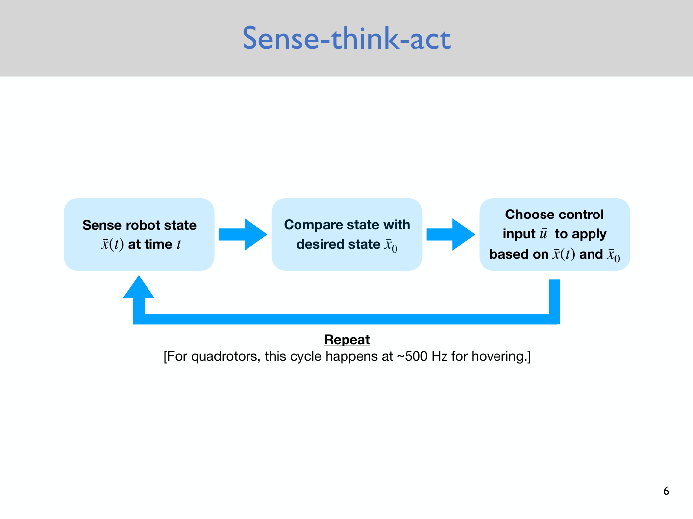
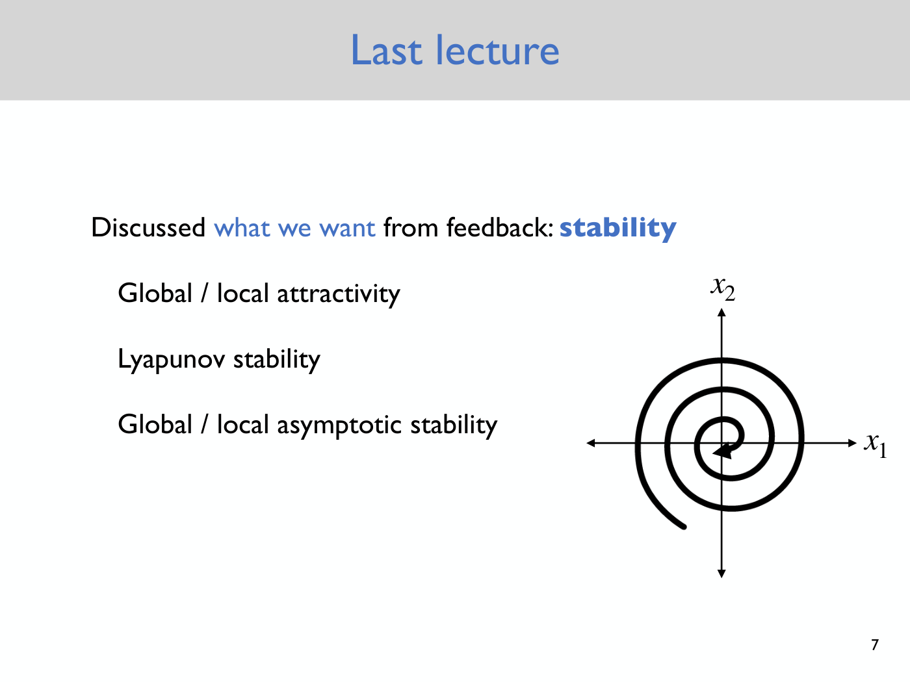
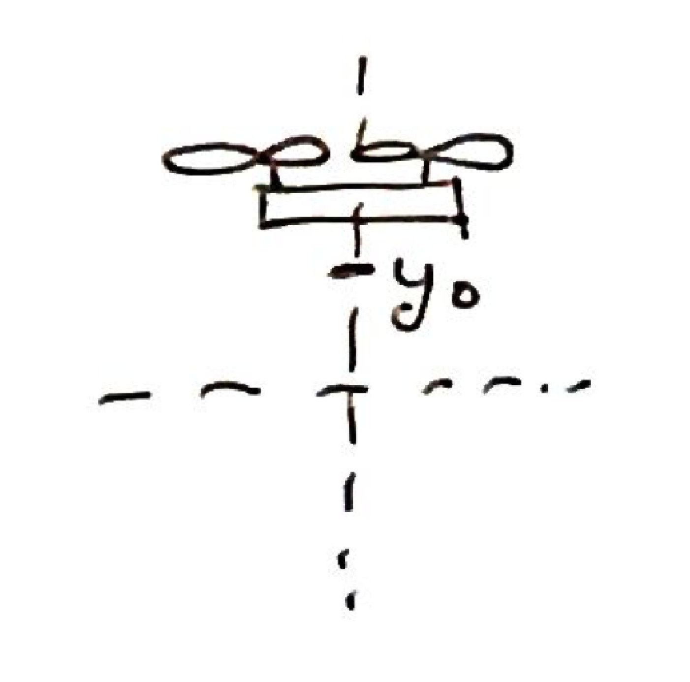
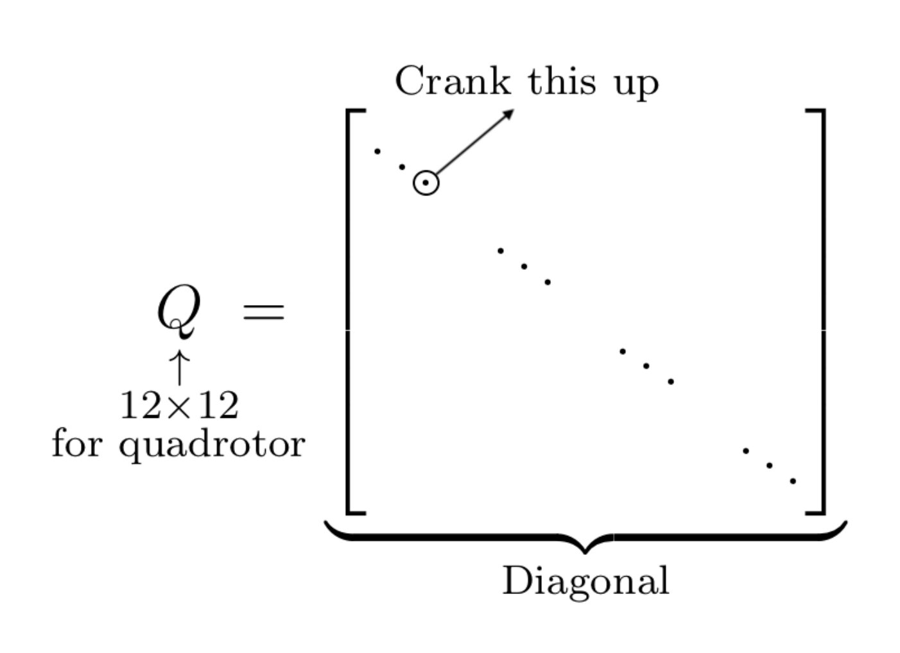
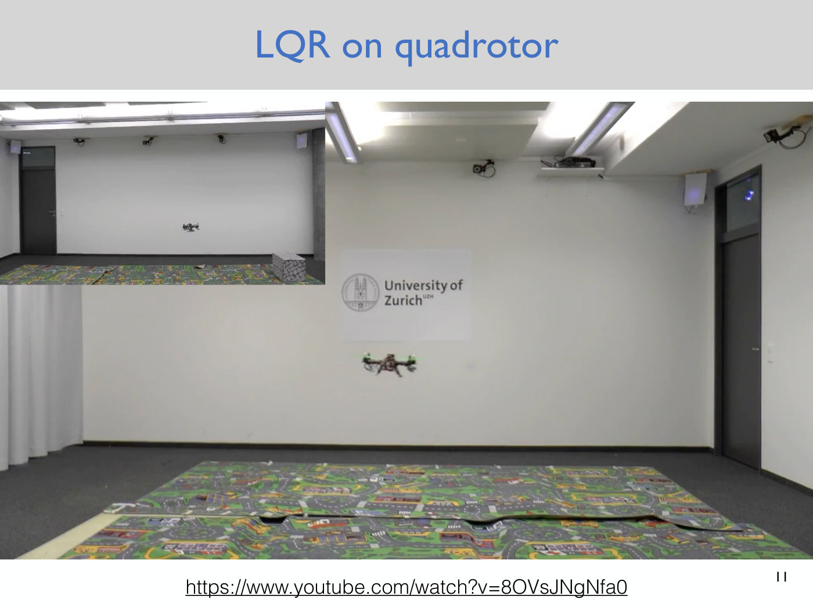
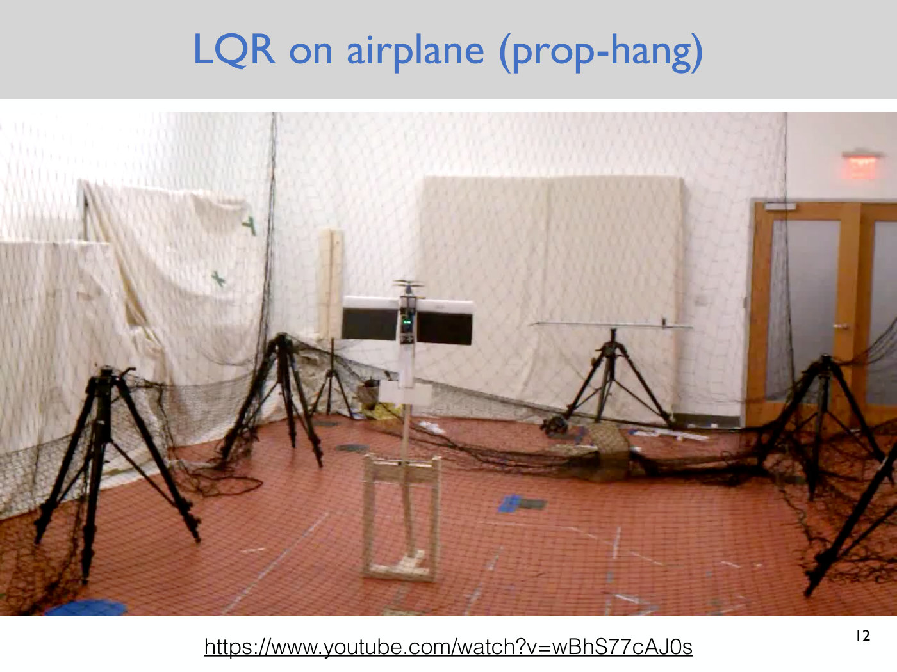

# Lecture 8 — The Linear Quadratic Regulator (LQR)

Anirudha Majumdar, Princeton ROB 345/549, Fall 2026 ·
[video](https://www.youtube.com/watch?v=zqi9QhUio8s) (78 min) ·
[slides (PDF, Dropbox)](https://www.dropbox.com/scl/fi/vg2cumj4cs2kuqb3942fg/Lecture8_slides.pdf?rlkey=uthhn11zguqubxdgo0zrv5viv&dl=0) ·
[notes (PDF, Dropbox)](https://www.dropbox.com/scl/fi/j89tx4kp1skacdhuz918r/Lecture8_notes.pdf?rlkey=4gyqm6qumqutg1lzx83uuac4d&dl=0) ·
[slide-by-slide text](../raw/slides/08-lqr.md) ·
[notes as text](../raw/notes/08-lqr.md) ·
[transcript](../raw/transcripts/08-lqr.md)

**What this lecture establishes.** Any negative gains stabilized Lecture 7's PD controller, but some
choices are better than others. The **linear quadratic regulator (LQR)** chooses the gain matrix
optimally. It assumes the dynamics have been linearized about a fixed point, shifts coordinates so that
the fixed point is the origin, and defines a **cost function**: the integral over all time of a weighted
squared deviation of the state from the fixed point plus a weighted squared deviation of the control
input from its nominal value. The user picks the weights, the positive definite matrices $Q$ and $R$.
The result, stated without derivation, is that the optimal controller is linear in the state, a PD
controller $\bar{u}(\bar{x}) = \bar{u}_ 0 + K^\ast(\bar{x} - \bar{x}_ 0)$. Its gain comes from two steps:
solve the **algebraic Riccati equation** for a matrix $S^\ast$, then compute $K^\ast = -R^{-1}B^TS^\ast$.
The same controller makes the linear system globally asymptotically stable, and $S^\ast$ gives the
optimal cost. In practice $Q$ and $R$ are tuned by hand. That is the next lab, on the real drone. The
lecture ends with three videos of LQR at work and with how planning and feedback are combined. It is the
last lecture of the course's first module, planning and control.

**Where to find what.** The deck has 13 slides, cited as "slide N", which is also the PDF page. Slides
2–9 recap Lecture 7 (slides 2–5 are Lecture 7's slides 2, 4, 5 and 6 again), slide 10 introduces LQR, and slides
11–13 hold one frame of each video. The LQR formulation was written on the blackboard, which the video
does not show. The course's **lecture notes** (4 pages) are its written record. They number one
equation, the first cost function, (1); this page cites it as "notes eq. (1)" and everything else as
"notes p. N". The lecture never speaks the number. Where the board and the notes differ, this page
follows the notes and gives the board's version with its timestamp. Timestamps (≈M:SS) point into the
video and the [transcript](../raw/transcripts/08-lqr.md). Where the lecture says "this term" or "over
here", it is pointing at the board, and this page does not guess what was drawn. The method has its
own page, [the linear quadratic regulator](lqr.md).

## Contents

1. [Recap: why feedback, and the control loop](#recap-why-feedback-and-the-control-loop)
2. [Recap: stability and PD control](#recap-stability-and-pd-control)
3. [The question: which gains?](#the-question-which-gains)
4. [Linear dynamics in shifted coordinates](#linear-dynamics-in-shifted-coordinates)
5. [A performance metric](#a-performance-metric)
6. [Weighting the cost: Q and R](#weighting-the-cost-q-and-r)
7. [The cost as a function of the initial state](#the-cost-as-a-function-of-the-initial-state)
8. [The solution: the optimal controller is linear](#the-solution-the-optimal-controller-is-linear)
9. [Computing the gain: the algebraic Riccati equation](#computing-the-gain-the-algebraic-riccati-equation)
10. [The LQR controller, and its assumptions](#the-lqr-controller-and-its-assumptions)
11. [Solving it in practice, and the sign convention](#solving-it-in-practice-and-the-sign-convention)
12. [What S* means: the optimal cost](#what-s-means-the-optimal-cost)
13. [Stability](#stability)
14. [Tuning Q and R in the lab](#tuning-q-and-r-in-the-lab)
15. [LQR at work: three videos](#lqr-at-work-three-videos)
16. [Planning plus feedback](#planning-plus-feedback)
17. [Gaps in the record](#gaps-in-the-record)

## Recap: why feedback, and the control loop

This is the last lecture of the first module, on motion planning and control (≈0:11). The previous
lecture started on [feedback control](feedback-control.md). Executing a motion plan physically runs
into three challenges (slide 3, the same slide as Lecture 7's slide 4): an imperfect model of the
robot's dynamics, whose physical parameters might be slightly off; external disturbances, like wind
when flying outdoors; and imperfect knowledge of the robot's state, which it estimates with its
sensors, and of the map. Feedback control is primarily meant to address the first two. Sensing,
mapping and localization start in the next lecture (≈0:11–1:45).

The running example is hovering, "in some sense the simplest feedback control problem" for the drone.
What we want is a vector field: for every state the robot might find itself in, the control input to
apply. That function from states to control inputs is the **feedback control law**, or controller
(slides 4–5, ≈1:45–2:31).

Slide 6 draws the loop that implements it, an instance of the [sense–think–act](sense-think-act.md)
architecture from Lecture 1 (≈2:31–3:17). The robot senses its state $\bar{x}(t)$ at time $t$,
compares it with the desired state $\bar{x}_ 0$, the hover state, and chooses a control input
$\bar{u}$ based on both. Then it repeats. For hovering, the typical control cycle runs this loop at
500 hertz: 500 times a second the drone's sensors estimate the state, and the drone computes and
applies a feedback control input.

*Slide 6 — the feedback loop as three boxes: sense the state at time t, compare it with the desired state, choose the control input from both. The arrow along the bottom carries the cycle back to sensing; for a hovering quadrotor it runs about 500 times a second. [Deck](https://www.dropbox.com/scl/fi/vg2cumj4cs2kuqb3942fg/Lecture8_slides.pdf?rlkey=uthhn11zguqubxdgo0zrv5viv&dl=0)*

## Recap: stability and PD control

What we want from a feedback controller is intuitively some kind of stability: after a wind gust or an
imperfection in the dynamics, the controller should bring the robot back to the goal state, at least
asymptotically (≈3:17–4:04). Lecture 7 defined global and local attractivity (the state converges to
the equilibrium point as time goes to infinity), stability in the sense of Lyapunov ("if you start off
close, then you stay close"), and global and local asymptotic stability, which combine the two
(slide 7, ≈4:04–4:51). See [stability](stability.md).

*Slide 7 — the recap of what we want from feedback, with a phase portrait in the state (x1, x2): a single trajectory spirals in, clockwise, to the fixed point at the origin, where its arrowhead sits. [Deck](https://www.dropbox.com/scl/fi/vg2cumj4cs2kuqb3942fg/Lecture8_slides.pdf?rlkey=uthhn11zguqubxdgo0zrv5viv&dl=0)*

The last thing Lecture 7 did was **PD control** of the planar quadrotor simplified to one degree of
freedom, moving only up and down (≈4:51; notes p. 1). Its equation of motion is
$\ddot{y} = u_1/m - g$, where $y$ is the height, $u_1$ the sum of the two thrust forces, $m$ the mass
and $g$ the acceleration due to gravity. The feedback controller is the control input $u_0$ that
cancels gravity, plus a correction for the distance from the desired height $y_0$, plus a correction
for the deviation from the desired speed, which is zero (≈5:38). Spoken (≈7:12), it is

$$u(\bar{x}) = u_0 + k_p (y - y_0) + k_d \dot{y},$$

with $k_p$ the proportional gain and $k_d$ the derivative gain (slide 8 prints the proportional term
divided by $m$; see [Gaps in the record](#gaps-in-the-record)). Any negative $k_p$ and $k_d$ make the
system stable, because the controller turns the equation of motion into a spring-mass-damper, which
converges to $y = y_0$, $\dot{y} = 0$ from anywhere (≈6:25).

*Notes p. 1 — the hand-drawn reminder of Lecture 7's example: a quadrotor on a dashed vertical line, with the height y0 marked below it.*

Written with the state $\bar{x} = [y, \dot{y}]^T$ and the desired state $\bar{x}_ 0$ ($y = y_0$,
$\dot{y} = 0$), the same controller is

$$\bar{u}(\bar{x}) = \bar{u}_ 0 + K(\bar{x} - \bar{x}_ 0),$$

the general form of a **PD controller** (slide 9, ≈7:12; notes p. 1, where $K$ is labelled "Gain
Matrix"). It looks at the deviation of the current state from the state the robot needs to be in,
multiplies it by a matrix $K$, and adds that to the nominal control input. At $\bar{x} = \bar{x}_ 0$ the
second term vanishes and only $\bar{u}_ 0$, which maintains hover, is applied; away from it, a
corrective input is added. The correction is linear in the error in the state (≈7:58–8:44).

## The question: which gains?

Any negative $k_p$ and $k_d$ make the system stable, but some choices might be better than others.
Some might give a more energy-efficient controller; others better tracking, getting to the goal more
quickly (≈9:30). The goal for the lecture is a way of constructing the gains, the matrix $K$ in general,
that ensures stability and also optimizes something beyond stability. That method is the **linear
quadratic regulator**, which gives an optimal controller with respect to some objective function
(≈8:44–10:17; slide 10, "'Optimal' control for linear dynamics"). The notes state the two goals: LQR
stabilizes the (linear) system, assuming it is stabilizable, and optimizes a performance metric,
simultaneously (notes p. 1).

## Linear dynamics in shifted coordinates

"Linear" in the name refers to the assumption that the dynamics are linear (≈10:17). Real robots never
are. Their equations have the general form $\dot{\bar{x}} = f(\bar{x}, \bar{u})$ (see
[state and dynamics](state-and-dynamics.md)), and LQR assumes they have been
[linearized](linearization.md) about some reference state and control input. The course did that by
hand for the planar quadrotor in Lecture 6, and the current assignment does it in Python (≈11:03). LQR
designs a feedback controller for the linear system, and in practice that linear controller is then
applied to the nonlinear system (≈11:03). The notes draw this as a pipeline: the nonlinear system is
approximated by $\dot{\bar{x}} \approx A(\bar{x} - \bar{x}_ 0) + B(\bar{u} - \bar{u}_ 0)$, a controller
is designed from $A$ and $B$, and a dashed arrow labelled "Apply on nonlinear system" carries it back.
"The hope is then that the controller we obtain for the linearized system is also a 'good' controller
for the original nonlinear system" (notes p. 1). The next lab, going out the day after the lecture, does
exactly this: Python linearizes the quadrotor, LQR designs the controller, and students run it on the
physical drone to make it hover (≈11:49).

The starting point is therefore a linear system

$$\dot{\bar{x}} = A(\bar{x} - \bar{x}_ 0) + B(\bar{u} - \bar{u}_ 0),$$

with state $\bar{x} \in \mathbb{R}^n$, control input $\bar{u} \in \mathbb{R}^m$, and $\bar{x}_ 0$ a fixed
point with nominal control input $\bar{u}_ 0$ (notes p. 1). To make the notation compact, define the
deviations

$$\tilde{x} \triangleq \bar{x} - \bar{x}_ 0, \qquad \tilde{u} \triangleq \bar{u} - \bar{u}_ 0,$$

where $\triangleq$, "the equal to with a triangle", means "is defined as" (≈11:49–12:37; notes p. 2).
$\tilde{x}$ is the deviation of the state from the desired state, $\tilde{u}$ the deviation of the
control input from the nominal one. Because $\bar{x}_ 0$ is a constant, $\dot{\tilde{x}} = \dot{\bar{x}}$,
and the dynamics become (≈12:37–13:26; notes p. 2)

$$\dot{\tilde{x}} = A\tilde{x} + B\tilde{u}.$$

This only shifts the origin, so that $\bar{x} - \bar{x}_ 0$ and $\bar{u} - \bar{u}_ 0$ need not be
written out every time (≈13:26).

## A performance metric

What should be optimized, on top of stability? Two things seem reasonable (≈15:02–16:39; notes p. 2).
First, minimize deviations of the state from $\bar{x}_ 0$: over time, the drone should not spend a lot
of time away from hover. Second, minimize deviations of the control input from $\bar{u}_ 0$, the input
that counteracts gravity and applies no moment: as far as possible, do not apply inputs too far from
what keeps the drone at hover. Combining them gives the cost (notes eq. (1), ≈16:39–18:14)

$$J\left(\tilde{x}(0)\right) \triangleq \int_ 0^\infty \left[ \tilde{x}(t)^T \tilde{x}(t) + \tilde{u}(t)^T \tilde{u}(t) \right] dt. \tag{1}$$

Here $\tilde{x}(t)$ is the state deviation at time $t$, starting from $\tilde{x}(0)$. Each term is a
scalar: $\tilde{x}(t)^T \tilde{x}(t) = \Vert \tilde{x}(t) \Vert^2$, the squared magnitude of the state
deviation, and $\tilde{u}(t)^T \tilde{u}(t) = \Vert \tilde{u}(t) \Vert^2$ that of the control input
deviation. At every time there is a penalty with these two components, and the integral adds the
penalties up from time zero to infinity (≈18:14). On the board this was drawn as a curve of the state
against time near the desired state: at each time, square the distance from the desired state and
integrate (≈19:02). The captions garble part of the integrand as it was written (≈17:27).

**Questions on the cost** (≈19:48–26:00).

- **Why integrate?** Some deviation is acceptable: a wind gust blows the drone away, or it starts off
  away from where it should hover. What the cost asks is that, over time, it not spend too much time away
  from the desired state. The integral is the accumulated penalty (≈19:48–21:22).
- **A state that stays away forever** makes the penalty infinitely large, as a student answered. You
  are not allowed to hang out far from the desired state forever, so keeping the cost finite pulls the
  state close (≈21:22–22:09).
- **Why penalize the control input?** It is an efficiency term. Without it, you could crank the control
  inputs up to infinity to reach the desired state as fast as possible. The term says not to apply
  inputs drastically different from the nominal one (≈22:09). For the 3D quadrotor, $\tilde{u}$
  measures how far the total thrust is from the thrust that cancels gravity and how far the moments are
  from zero: it is "a kind of laziness or efficiency metric", a proxy for effort. In practice control
  inputs are bounded, so the controller should not try to apply "a thousand, a million newtons of
  thrust" (≈24:28–25:15).
- **Being close forever versus far forever** both give infinity. But at any given time the penalty is
  the squared magnitude, so being close costs little at that time (≈22:56).
- **The units do not match** (≈23:41, ≈25:15–26:00). The cost adds meters squared, radians squared and
  control inputs squared, and it weighs the state against the control input, and every component of
  the state against every other, equally. A drift in $x$ position counts the same as the same amount of
  roll, although one is in meters, the other in radians and others in meters per second. One fix is a
  scalar $\lambda$ weighing the control term against the state term. The general fix is weighting
  matrices.

## Weighting the cost: Q and R

The general form inserts two matrices (≈26:46; notes p. 2):

$$J\left(\tilde{x}(0)\right) \triangleq \int_ 0^\infty \left[ \tilde{x}(t)^T Q \tilde{x}(t) + \tilde{u}(t)^T R \tilde{u}(t) \right] dt.$$

The notes label $J$ the **cost function**. $Q$ and $R$, the **cost matrices**, are user-defined: the
control designer picks them to specify the relative importance of different states and control inputs.
The theory does not specify them; they are "a kind of hyperparameter" (≈27:34; notes p. 2). For the
products to work out, $Q$ is $n \times n$, where $n$ is the dimension of the state, and $R$ is
$m \times m$, where $m$ is the dimension of the control input (≈27:34–28:22).

They must be **symmetric** and **positive definite** (≈28:22–29:56; notes p. 2). A symmetric matrix $M$
is positive definite if $z^T M z \gt 0$ for every vector $z \neq 0$; at $z = 0$ the quantity is zero. The
notes add that this is equivalent to the eigenvalues being positive, and print the condition "for all
$\bar{x}$", which the lecture corrected aloud to all non-zero vectors (≈29:09). Asked whether $Q$ and $R$
are usually diagonal, Majumdar said that in practice they almost always are, and that a diagonal matrix
is almost certainly sufficient for good performance; more cleverly chosen matrices could account for
interactions between components of the state. Strictly, $Q$ only has to be positive semidefinite and
$R$ positive definite; he says positive definite for simplicity (≈34:31).

Choosing $Q$ and $R$ to be identity matrices recovers the unweighted cost of eq. (1). A student pointed
out that $R$ can be set to the identity times the $\lambda$ from before (≈29:56).

**R for the quadrotor** (≈30:41–31:26). For the 3D quadrotor $R$ is $4 \times 4$, since the control
inputs are the total thrust and the three moments (see the [quadrotor model](quadrotor-model.md)). A
student suggested scaling the moment terms by the distance between the rotors, because thrust is in
newtons and moments in newton meters. One reasonable choice is a diagonal $R$ with entries $R_{11}$,
$R_{22}$, $R_{33}$, $R_{44}$, where $R_{11}$ is set to something and $R_{22} = R_{33} = R_{44}$ are
scaled by the moment arm, the length of the drone.

**Q for the quadrotor** (≈32:13–33:44). $Q$ is chosen from what you care about. With $Q$ diagonal, with
entries $q_{11}, \ldots, q_{nn}$,

$$\tilde{x}^T Q \tilde{x} = q_{11} \tilde{x}_ 1^2 + q_{22} \tilde{x}_ 2^2 + \cdots + q_{nn} \tilde{x}_ n^2,$$

so each diagonal entry weighs the squared deviation of one component of the state. The 3D quadrotor's
state is $x$, $y$, $z$, roll, pitch, yaw, then their derivatives; to lock the position in to the hover
state, make the first three diagonal entries very large. To keep the orientation stable, crank up those
entries instead. In practice $Q$ and $R$ are chosen diagonal and their diagonal entries tuned
(≈33:44; notes p. 2, "In practice, we typically choose diagonal $Q$, $R$").

## The cost as a function of the initial state

The integral is named $J$, a function of the initial state deviation $\tilde{x}(0)$ (≈35:17–36:02).
Start at some initial state, apply some control inputs, and the state and inputs over time give a
penalty for that initial condition. LQR finds the control inputs that minimize it **for every initial
condition** (≈36:02).

A student asked why the initial control input deviation is not an argument as well (the question is
partly unclear in the captions, ≈36:02–36:49). Because the control inputs are what we choose: given
control inputs as a function of time and the initial state, the known linear dynamics determine the state
at every later time, and with that everything in the integrand. So the cost depends only on the initial
state, once the inputs are chosen (≈36:49–37:37).

Another asked whether choosing $Q$ and $R$ means enumerating all possible states. It does not. The
designer specifies $Q$ and $R$ from what they care about, and LQR computes the control inputs that
optimize the cost for any initial condition (≈37:37–38:24).

## The solution: the optimal controller is linear

The derivation is not given; it takes quite a bit of time and involves the calculus of variations
(≈39:18; notes p. 2, "We won't go through the derivation (which is complicated)"). The first result is
that the optimal controller, the one that minimizes the cost from any initial state, is **linear in the
state** (≈40:08; notes p. 2):

$$\tilde{u}(\tilde{x}) = K^\ast \tilde{x}$$

for some matrix $K^\ast$ (on the board the optimal controller was called $u^\ast$, ≈40:08). So the
optimal controller has the general form of a PD controller. Majumdar calls this "a really mind-blowing
result": a single matrix, applied to whatever state the system finds itself in at any time $t$, is
optimal from every initial state. "There's no a priori reason to expect such a simple form", but it
turns out to be the case (≈40:54–41:41; the notes: "This is pretty magical!").

A student asked how $\bar{u}$, a function of time, becomes a function of the state. Written with time
put back in, the control input at time $t$ is $K^\ast \tilde{x}(t)$: the drone's sensors give the state at
time $t$, subtracting $\bar{x}_ 0$ gives the deviation, and premultiplying by $K^\ast$ gives the input
(≈44:47–46:21).

## Computing the gain: the algebraic Riccati equation

$K^\ast$ is found in two steps (≈41:41–47:54; notes p. 2).

**Step 1.** Solve the matrix equation

$$0 = Q - SBR^{-1}B^TS + SA + A^TS$$

for the $n \times n$ matrix $S$. It is called the **algebraic Riccati equation** (≈42:27; the notes
spell it "Riccatti"). $Q$ and $R$ are the cost matrices, and $A$ and $B$ the matrices of the linear
dynamics, so $S$ is the only unknown (≈43:15). Denote the solution $S^\ast$. Under some reasonable
assumptions the solution is unique (≈50:18).

**Step 2.** Compute

$$K^\ast = -R^{-1}B^TS^\ast.$$

This step is just matrix multiplication: $R$ is user-defined and $B$ comes from the dynamics (≈46:21–47:54).

LQR therefore takes four things as input: $A$ and $B$, which define the linear dynamics, and $Q$ and
$R$, which define the penalties (≈44:47). Asked where $A$ and $B$ come from: from system identification
of the dynamics, which may be nonlinear, followed by linearization (≈44:01).

## The LQR controller, and its assumptions

Substituting $\tilde{x} = \bar{x} - \bar{x}_ 0$ and $\tilde{u} = \bar{u} - \bar{u}_ 0$ gives the
controller in the original coordinates (≈47:54–48:44; notes p. 2):

$$\bar{u}(\bar{x}) = \bar{u}_ 0 + K^\ast(\bar{x} - \bar{x}_ 0).$$

This is the general form of the PD controller from the start of the lecture, with the main difference
that $K^\ast$ has been computed this particular way. The claim is that it is the optimal controller,
with optimality defined as above: the state and control input penalties integrated over all time, for
any initial condition (≈48:44–49:32).

A student checked that this is still only the optimal controller for staying at a fixed point under
perturbation. Yes: "linear system, known state at any given time, fixed point. Lots of assumptions"
(≈49:32). There is a version for **trajectory tracking**, where the desired state changes over time. It
is almost identical, but instead of the algebraic equation it gives a matrix differential equation to
solve, and the gain matrix $K$ becomes time-varying (≈51:05–51:51). Majumdar said he might sketch it in
the notes; the notes for this lecture do not include it.

## Solving it in practice, and the sign convention

The Riccati equation is not linear in $S$: it has a quadratic term in which $S$ multiplies itself
(≈51:51). Well-known numerical methods solve it extremely efficiently, at least in the dimensions of
this course. People figured out how to solve it "back in the 60s or 70s": there was a lot of active
research, "one paper that just nailed it and then no one thought about it ever again" (≈52:39–53:29).
In the assignment you call a function for the algebraic Riccati equation, or an LQR function, giving it
$A$, $B$, $Q$ and $R$ (≈52:39). The notes write it as

$$[K^\ast, S^\ast] = \mathit{lqr}(A, B, Q, R)$$

in Python or Matlab, which will also check whether the system is stabilizable and complain if not
(notes p. 3).

**Warning: the sign convention** (≈53:29–55:03; notes p. 3). Matlab and Python use controllers of the
form $\tilde{u} = -K^\ast \tilde{x}$ instead of $\tilde{u} = K^\ast \tilde{x}$, so the matrix they return is
the negative of the $K^\ast$ used here. Applied to the drone as returned, it is a destabilizing
controller. Flip its sign; the lab's instructions say so too.

## What S* means: the optimal cost

The solution $S^\ast$ has a nice interpretation: it gives the optimal cost (≈55:03–57:26; notes p. 3),

$$J^\ast\left(\tilde{x}(0)\right) = \tilde{x}(0)^T S^\ast \tilde{x}(0),$$

the value of the whole integral when the optimal controller $K^\ast \tilde{x}$ is applied from the
initial state $\tilde{x}(0)$. It is a scalar: a $1 \times n$ row times an $n \times n$ matrix times an
$n \times 1$ column (≈59:42). This is not something you necessarily use in practice; it gives extra
information, the total penalty over all time from any initial state, without simulating (≈57:26).

On the board this was first written at time $t$; after a student's question about where the control
input penalty had gone, Majumdar corrected it to the initial state deviation (≈56:37–58:56). The
control input is not missing: given the initial state and the optimal controller, the state and the
input are known at every later time, so $S^\ast$ captures both the state deviation and the control input
deviation (≈58:11–1:00:28).

## Stability

So far nothing has been said about stability. The final result: the LQR controller defined by $K^\ast$
makes the linear system **globally asymptotically stable** (≈1:01:13–1:02:04), here not proved. In the
notes, the closed-loop system is (notes p. 3)

$$\dot{\tilde{x}} = A\tilde{x} + B\tilde{u} = A\tilde{x} + BK\tilde{x} = (A + BK)\tilde{x},$$

with $K$ the LQR gain $K^\ast$, and it is stabilized to the fixed point $\tilde{x} = 0$, that is
$\bar{x} = \bar{x}_ 0$. So LQR does the two things promised at the start: it minimizes a reasonable
performance metric, and it gives a globally asymptotically stable closed-loop system (≈1:02:04–1:02:49;
notes p. 3). See [stability](stability.md) for the definitions.

## Tuning Q and R in the lab

In theory any positive definite $Q$ and $R$ make the system stable. In reality, the notes list three
complications: the system is actually nonlinear, the model has imperfections, and the controller
needs the state sensed perfectly. So $Q$ and $R$ are tuned to get the behavior you want, "a bit of an
art" (notes p. 3). Spoken: the linear system is only an approximation, and even the nonlinear model
leaves out all sorts of aerodynamic effects, so some choices of $Q$ and $R$ make the drone very stable
and others lead to deviations from hover (≈1:05:07).

**The lab** (≈1:02:49–1:05:54). Linearizing the 3D quadrotor's equations of motion by hand is "super
tedious"; the current assignment did it in Python. Kian, one of the TAs, spent a lot of time getting the
physical parameters of the course's new drones (the inertia values, the thrust coefficient and the
moment coefficient from Lecture 4) and so the nonlinear dynamics $f$. Python linearizes them about
hover, and the $A$ and $B$ matrices are given. The students' job is to tune $Q$ and $R$. Kian and a
second person, whose name the captions garble, tuned the matrices and then "untuned" them for the
students to tune back. The drone runs the controller computed from them (see the
[Crazyflie](crazyflie.md)).

For the 3D quadrotor $Q$ is $12 \times 12$, the dimension of the state, and chosen diagonal
(≈1:05:54–1:06:41). The state vector is $x$, $y$, $z$ (the center of mass position), roll, pitch, yaw,
then $\dot{x}$, $\dot{y}$, $\dot{z}$, and the angular velocity terms $p$, $q$, $r$ (≈1:07:27; notes
p. 4). The exercises (≈1:06:41–1:11:17):

- **The height drifts**, going "up and up and up". A student suggested increasing the penalty on $y$;
  "technically it's $z$; $z$ is up." Crank up the diagonal entry for $z$, maybe by a factor of 10, which
  increases the penalty on deviations in $z$ (≈1:07:27–1:08:12). This is the notes' example, drawn as a
  diagonal $Q$ with its third entry circled and labelled "Crank this up" (notes p. 3).

*Notes p. 3 — the answer to "the system is not stabilizing the z (height) well": Q is 12 by 12 and diagonal, and the circled entry is the third on the diagonal, the one that weighs the height z. Raise it.*

- **The height oscillates**, on average where it should be but never settling. A student suggested
  changing the derivative terms, "Q99". Yes: the ninth diagonal entry penalizes $\dot{z}$, the speed in
  the $z$ direction, which is the problem, since it never goes to zero; crank it up (≈1:08:12–1:08:59).
- **The drone rolls a lot**: change the entry for roll, "the 44 component" (≈1:08:59). The notes give
  the same example: increase the fourth diagonal element of $Q$, which places a higher penalty on roll
  $\phi$ (notes p. 4).
- **R** has four diagonal entries, one per control input. Usually you pick a global scalar for the
  whole matrix and multiply or divide it by 10 (≈1:09:44).
- **Nothing tracks; the drone falls out of the sky.** A student suggested changing the magnitude of
  $R$. It is decreasing $R$: a penalty on the control input that is too high says "just don't do
  anything", and lowering it allows much more control input (≈1:10:29). Lowering it too far can make
  the drone jerky, with very aggressive control inputs (≈1:12:02).

Asked whether there are four control inputs because the system is treated as
[differentially flat](differential-flatness.md): no, there is no such assumption here. The four inputs
are the total thrust and the moment about each axis, $M_x$, $M_y$, $M_z$ (≈1:10:29–1:11:17). "It takes
some practice/tuning to get things right! But, usually, with some effort things work well!" (notes p. 4).

## LQR at work: three videos

The deck's last three slides each hold one frame of a video played in class (slides 11–13).

**A quadrotor** (slide 11, ≈1:11:17–1:12:49). From the University of Zurich's group again, "a really
well-tuned LQR controller": the dynamics linearized accurately and $Q$ and $R$ tuned. The set point, the
desired hover state, is changed periodically to show off the controller; each jump is a new commanded
state, and the controller corrects for the deviation. A student checked that $u_0$ is just cancelling
gravity, and Majumdar agreed. He also warned against standing close to such drones, which are much larger
than the course's, without safety glasses, as the man in the video does.

*Slide 11 — a frame of the University of Zurich video: a quadrotor in the air in a lab room, with a second view inset at upper left. In class the video showed the set point jumping and the LQR controller bringing the drone to each new hover point. [Deck](https://www.dropbox.com/scl/fi/vg2cumj4cs2kuqb3942fg/Lecture8_slides.pdf?rlkey=uthhn11zguqubxdgo0zrv5viv&dl=0)*

**An airplane in a prop hang** (slide 12, ≈1:12:49–1:15:07). Work Majumdar was involved with during his
PhD. A prop hang, or propeller hang, treats a fixed-wing airplane like a helicopter, hovering. It is
useful for braking very quickly: if the airplane is flying fast at a wall, it either crashes or goes into
this hover mode. It is stabilized by an LQR controller his group tuned. The airplane has "wingerons":
where typical airplanes have a fixed wing with ailerons as control surfaces for pitch and roll, here the
whole of each wing is a control surface, controlled independently, which gives much more control
authority. Why does aerodynamic drag not spin it about the vertical axis, when no control surface can
counter that moment? A student answered: two counter-rotating propellers, with opposite pitch, so the
drag moments cancel, an idea similar to how drones change their yaw angle (≈1:14:21–1:15:07; see the
[quadrotor model](quadrotor-model.md)).

*Slide 12 — a frame of the prop-hang video: a small fixed-wing airplane held nose-up, propeller at the top, in a netted indoor space. In class it hovered there under an LQR controller. [Deck](https://www.dropbox.com/scl/fi/vg2cumj4cs2kuqb3942fg/Lecture8_slides.pdf?rlkey=uthhn11zguqubxdgo0zrv5viv&dl=0)*

**A humanoid** (slide 13, ≈1:15:07). The slide's frame is the video's title card, "Full Dynamics LQR
Control of a Humanoid Robot", by Sean Mason, Ludovic Righetti and Stefan Schaal. In the video the robot is
perturbed with a stick. A hand-tuned PD controller falls down eventually; the well-tuned LQR controller
visibly has fewer deviations.

LQR is "a really useful tool in practice", a good starting point whenever you are trying to stabilize to
a fixed point (≈1:15:52). There are more sophisticated methods, such as nonlinear control, and whole
courses on feedback control. But "LQR is usually surprisingly effective": during his PhD, Majumdar worked
on fancy nonlinear controllers, compared them with a simple LQR baseline, and "more often than not the LQR
would beat whatever fancy thing I came up with", if it is tuned well.

## Planning plus feedback

LQR is not restricted to a fixed point: a time-varying version tracks trajectories (≈1:15:52–1:16:38).
That is typically how motion planning and feedback control are combined in practice (≈1:16:38). A planning
algorithm, such as an [RRT](rrt.md) or [trajectory optimization](trajectory-optimization.md), produces a
nominal sequence of control inputs that would make the system follow a trajectory if applied perfectly.
Then a feedback controller corrects for deviations from that trajectory, to make the system track it as
closely as possible. This closes the first module. The next lecture starts on sensing, mapping and
localization (≈0:58); see the [course map](course-map.md).

## Gaps in the record

- **The blackboard is not in the record.** The cost function, the Riccati equation and the tuning
  examples were written on the board. This page follows the notes, whose content matches what is
  spoken, and gives the board's version where they differ. The board's pictures (a state curve against
  time at ≈19:02) are not described in the captions.
- **Board and notes differ in small ways.** The board named the optimal controller $u^\ast$ (≈40:08)
  where the notes write $\tilde{u}(\tilde{x}) = K^\ast \tilde{x}$. The board first wrote the optimal cost
  at time $t$ and was corrected to the initial state (≈58:56). The captions of the correction say
  "x tilde transpose zero" for the second factor, where the notes have $\tilde{x}(0)$ with no transpose.
  The scalar $\lambda$ weighting the control term (≈25:15), the quadrotor's diagonal $R$ (≈31:26), the
  remark that $Q$ need only be positive semidefinite (≈34:31) and the trajectory-tracking version
  (≈51:05) are spoken only.
- **The positive definite condition in the notes** reads "for all $\bar{x}$"; the lecture says for all
  non-zero vectors, since at zero the quantity is zero (≈29:09).
- **Slide 8 prints the PD controller's proportional term divided by $m$**, as the Lecture 7 notes' eq.
  (16) does, with $k_d \dot{y}$ undivided. Spoken here, the controller is "the nominal thrust required
  to counteract gravity, plus kp times y minus y0, plus kd times y dot" (≈7:12), with no $m$, which is what this page uses; see
  [Lecture 7](07-stability-and-pd-control.md#gaps-in-the-record). The captions also say "y dot" for the
  $\ddot{y}$ of the equation of motion (≈4:51).
- **Printed slips in the notes**: a subscript printed as the letter o in the fixed-point line
  ($\bar{u}_ o$ for $\bar{u}_ 0$), "derivations" for "deviations", "Riccatti" for Riccati, and "(e.g.;
  hover)". See the [notes file](../raw/notes/08-lqr.md#printed-slips).
- **Garbled passages**: part of the integrand as written (≈17:27); three student questions (≈36:02, the
  two at ≈50:18), whose content is inferred from the answers; the dimension check at ≈59:42; and the
  name of the second person who tuned the lab's matrices (≈1:05:54).
- **Promised, not given.** A sketch of trajectory-tracking LQR in the notes (≈51:05). The derivation of
  LQR and the proofs of uniqueness and stability are deliberately left out (≈39:18, ≈50:18, ≈1:02:04).
- **Slides 11–13 hold single frames** of videos played in class; what the videos showed is from the
  lecture, not the slides. Slide 13's frame is only the title card.
