# Lecture 9 — Optical Flow

Anirudha Majumdar, Princeton ROB 345/549, Fall 2026 ·
[video](https://www.youtube.com/watch?v=wvuVX9L7v4Y) (69 min) ·
[slides (PDF, Dropbox)](https://www.dropbox.com/scl/fi/yjkah2nhv83fdbnf6ea5a/Lecture9_slides.pdf?rlkey=d83o8wcmk8oczkogd2tpuogq3&dl=0) ·
[notes (PDF, Dropbox)](https://www.dropbox.com/scl/fi/az52bpcoly0ophkzc7sqj/Lecture9_notes.pdf?rlkey=ijs39xouvybcpqcv3cluaapvu&dl=0) ·
[slide-by-slide text](../raw/slides/09-optical-flow.md) ·
[notes as text](../raw/notes/09-optical-flow.md) ·
[transcript](../raw/transcripts/09-optical-flow.md)

**What this lecture establishes.** It opens the course's second module, on sensing, localization and
mapping, with a question: in the RRT lab, with no external cameras, how did the drone know where it was?
Integrating the accelerometer twice is too noisy. The answer is **optical flow**: a downward-facing camera
measures the apparent motion of the ground, and with the drone's height that gives its velocity. Optical
flow is *apparent* motion, which need not match real motion; birds and bees navigate by it. The lecture
then derives one way to compute it. Two assumptions, that a point looks the same from one frame to the
next and that it moves only a little, give one linear equation per pixel in the two unknown components of
the flow. That is not enough: the motion along the image gradient can be found, but the motion
perpendicular to it cannot. This is the **aperture problem**. The **Lucas-Kanade** method adds a third
assumption, that neighbouring pixels move together, which gives 25 equations from a 5-by-5 window, solved
by least squares. The solution exists only when a 2-by-2 matrix is invertible, and it fails in
low-texture regions and along edges. Every method of computing flow is imperfect, which motivates the
module's next question: how to account for imperfect sensing.

**Where to find what.** The deck has 21 slides, cited as "slide N", which is also the PDF page. Slides
3–13 motivate optical flow with pictures, questions and three videos, slide 14 hands over to the
blackboard, slide 15 is the aperture-problem illusion, slides 16–18 are the Lucas-Kanade failure cases,
and slides 19–21 close. The derivation was written on the blackboard, which the video does not show. The
course's **lecture notes** (5 pages) are its written record. They number five equations, (1)–(5), cited
here as "notes eq. (N)"; everything else is "notes p. N". The lecture itself calls the first three
"equation one", "two" and "three" (≈25:15, ≈27:36, ≈39:16). Where the board and the notes differ, this
page follows the notes and gives the board's version with its timestamp. Timestamps (≈M:SS) point into
the video and the [transcript](../raw/transcripts/09-optical-flow.md). Where the lecture says "this
term" or "over here", it is pointing at the board, and this page does not guess what was drawn. The
method has its own page, [optical flow](optical-flow.md).

## Contents

1. [A new module: sensing, localization and mapping](#a-new-module-sensing-localization-and-mapping)
2. [How did the drone localize itself?](#how-did-the-drone-localize-itself)
3. [The drone's optical flow camera](#the-drones-optical-flow-camera)
4. [Which way is the drone moving?](#which-way-is-the-drone-moving)
5. [From flow to velocity: the homework](#from-flow-to-velocity-the-homework)
6. [Optical flow is apparent motion](#optical-flow-is-apparent-motion)
7. [Optical flow in birds and bees](#optical-flow-in-birds-and-bees)
8. [The setting: pixel motion between frames](#the-setting-pixel-motion-between-frames)
9. [Two assumptions](#two-assumptions)
10. [The constraint equation](#the-constraint-equation)
11. [Estimating the derivatives from images](#estimating-the-derivatives-from-images)
12. [One equation, two unknowns](#one-equation-two-unknowns)
13. [The aperture problem](#the-aperture-problem)
14. [Lucas-Kanade: spatial coherence](#lucas-kanade-spatial-coherence)
15. [Twenty-five equations from a window](#twenty-five-equations-from-a-window)
16. [The least-squares solution](#the-least-squares-solution)
17. [When the solution exists](#when-the-solution-exists)
18. [When Lucas-Kanade has trouble: low texture and edges](#when-lucas-kanade-has-trouble-low-texture-and-edges)
19. [In practice, and the next assignment](#in-practice-and-the-next-assignment)
20. [Sensing is imperfect](#sensing-is-imperfect)
21. [Gaps in the record](#gaps-in-the-record)

## A new module: sensing, localization and mapping

The first module, on motion planning and [feedback control](feedback-control.md), is done. The second is
on sensing, state estimation, localization and mapping: roughly, how a robot knows where it is in its
environment (sensing and localization), and what that environment looks like, where the obstacles are and
what their geometry is (mapping) (≈0:10). The course outline on slide 2 now highlights this module, with
its four topics: Bayes filtering, Kalman filters, particle filters and SLAM. See the
[course map](course-map.md).

## How did the drone localize itself?

The motivation goes back to planning. A motion planner, such as the [RRT](rrt.md) of the lab, produces a
trajectory from a start to a goal that avoids obstacles. The drone can mostly follow it by applying the
planned control inputs, but it also runs a waypoint-following controller that corrects for deviations: if
it finds itself slightly off the planned path, it applies a corrective action to come back (≈0:57–1:46).
To do that it has to know where it is relative to the path. Slide 3 asks the question: "In the RRT lab,
how did the drone localize itself? (For applying a feedback controller to follow the path you specified)".
There were no external cameras and no motion capture, so it was all onboard sensing (≈1:46).

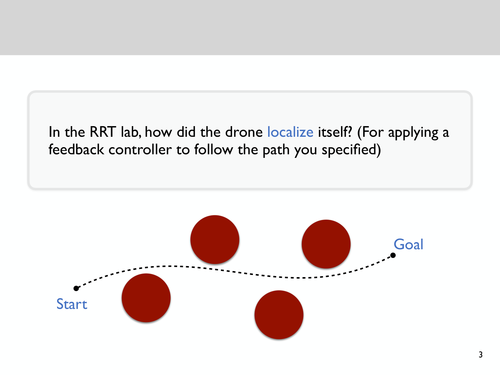

*Slide 3 — the RRT lab's setting: a dotted path from Start at the lower left to Goal at the right, passing below the two upper obstacles and above the two lower ones. To follow it with feedback, the drone has to know where it is. [Deck](https://www.dropbox.com/scl/fi/yjkah2nhv83fdbnf6ea5a/Lecture9_slides.pdf?rlkey=d83o8wcmk8oczkogd2tpuogq3&dl=0)*

A student suggested integrating the accelerometer. The drone has an inertial measurement unit, whose
accelerometer measures acceleration along three axes, $a_x$, $a_y$, $a_z$; integrating twice gives an
estimate of position (≈1:46–2:32). Two things go wrong. The initial velocity has to be known: assuming it
is zero is fine only if it really is (≈2:32). And the measurements are imperfect: integrating a noisy
signal gives an even noisier one, and integrating that again gives something extremely noisy, so the
position estimate is quite poor (≈3:17). The answer, which takes up the whole lecture, is optical flow
(≈3:17).

## The drone's optical flow camera

Underneath the drone is a small downward-facing camera (slide 4). As the drone flies it looks down and
estimates relative motion: if it is moving one way, everything it sees appears to move the opposite way
(≈3:17–4:03). See [the Crazyflie](crazyflie.md) for the drone's other sensors.

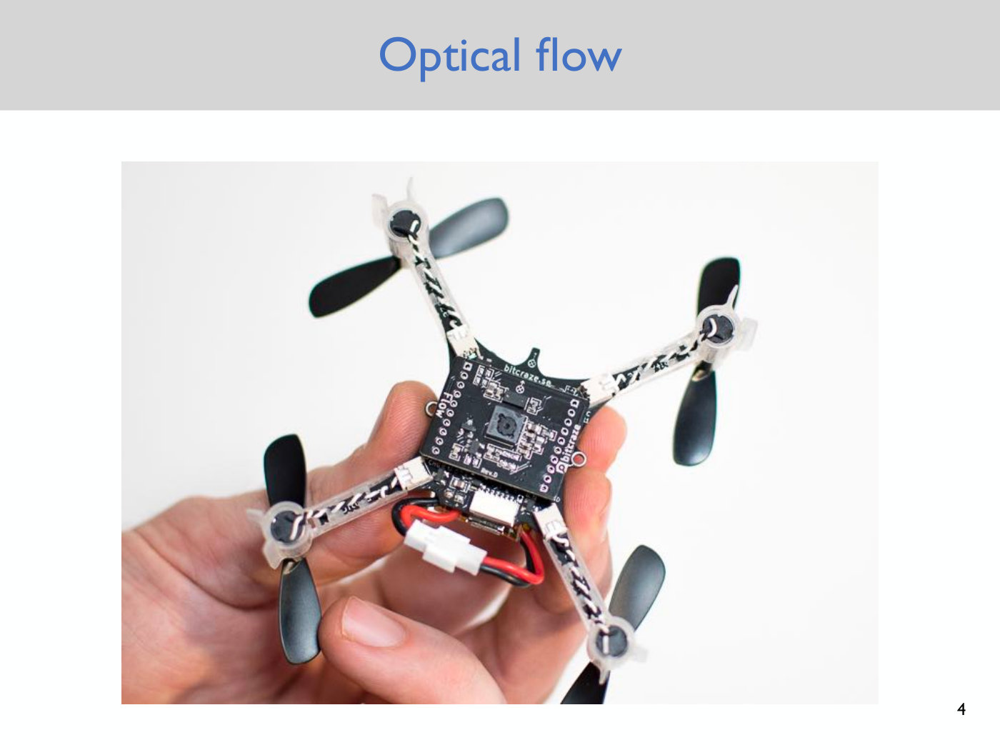

*Slide 4 — a Crazyflie held in a hand, showing the Flow deck: a board with "Flow" printed along its edge and a small camera sensor in its middle, which looks down at the ground in flight. [Deck](https://www.dropbox.com/scl/fi/yjkah2nhv83fdbnf6ea5a/Lecture9_slides.pdf?rlkey=d83o8wcmk8oczkogd2tpuogq3&dl=0)*

Given a video, a stream of images, an optical flow camera produces an **optical flow vector field**: a
vector at every pixel, or most pixels, giving the apparent direction and magnitude of motion there
(≈4:03). Slide 5 is a frame of a video played in class. On its left the magnitude is plotted, more green
meaning a larger apparent motion; on its right, small arrows over a road give the direction perceived at
each pixel as the cars pass by. This vector field is the **optical flow field** (≈4:03–4:48).

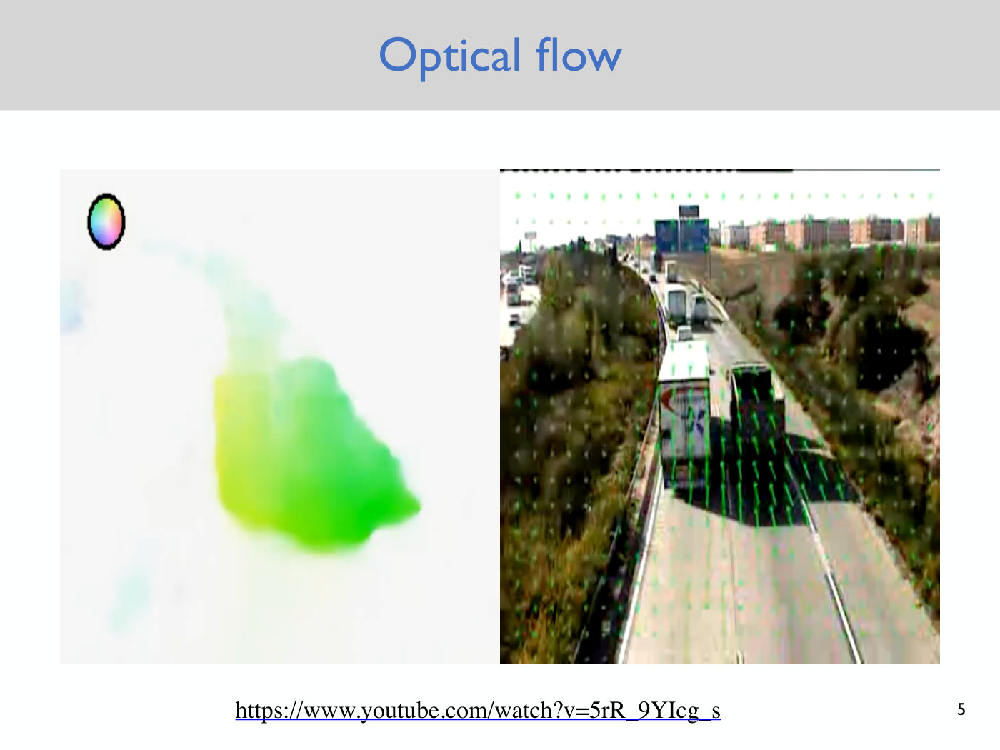

*Slide 5 — one frame of the flow video played in class. Right: a motorway seen from above, with green arrows that are long, and point up the image, over the moving trucks and tiny over the still roadside. Left: the flow's magnitude, larger where it is greener. [Deck](https://www.dropbox.com/scl/fi/yjkah2nhv83fdbnf6ea5a/Lecture9_slides.pdf?rlkey=d83o8wcmk8oczkogd2tpuogq3&dl=0)*

## Which way is the drone moving?

Slide 6 is a quick check of the intuition. It is a flow field computed from a drone's camera, here
forward-facing rather than downward-facing, though the same techniques apply to both, in a corridor. From
this one snapshot, which way is the drone moving (≈4:48–5:33)? The arrows show apparent motion: where
the cars moved, the arrows pointed (≈5:33).

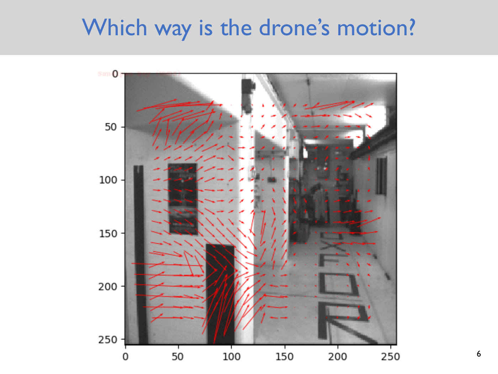

*Slide 6 — a flow field from a forward-facing drone camera in a corridor. Most arrows point right or up and to the right; they are longest on the near wall at the left and shortest, many just dots, down the corridor. The answer given in class: the drone is mostly turning to the left. [Deck](https://www.dropbox.com/scl/fi/yjkah2nhv83fdbnf6ea5a/Lecture9_slides.pdf?rlkey=d83o8wcmk8oczkogd2tpuogq3&dl=0)*

The class tried several answers. One student read the lack of arrows in the middle as the line of travel,
with the arrows on the left pointing right as when zooming out; another suggested a circling motion
(≈6:18–7:04). The answer that
landed: the drone is moving left, because relative to the camera, objects are moving to the right, while
the floor shows little motion. "That's actually roughly what it is. It's mostly turning to the left": the
apparent motion at these points is to the right, which is what you would see turning towards the left
(≈7:04–7:50).

## From flow to velocity: the homework

Given an optical flow field, how do you estimate the drone's velocity? That is the next homework, going
out the following Wednesday (≈7:50). It works with a simple **pinhole camera** model of a downward-facing
camera (slide 7). If the drone measures a flow field and knows its height, from a height sensor such as a
single-point lidar, that turns out to be enough to estimate its velocity fairly accurately: the speed, and
the direction relative to the surface it is flying over (≈7:50–8:36).

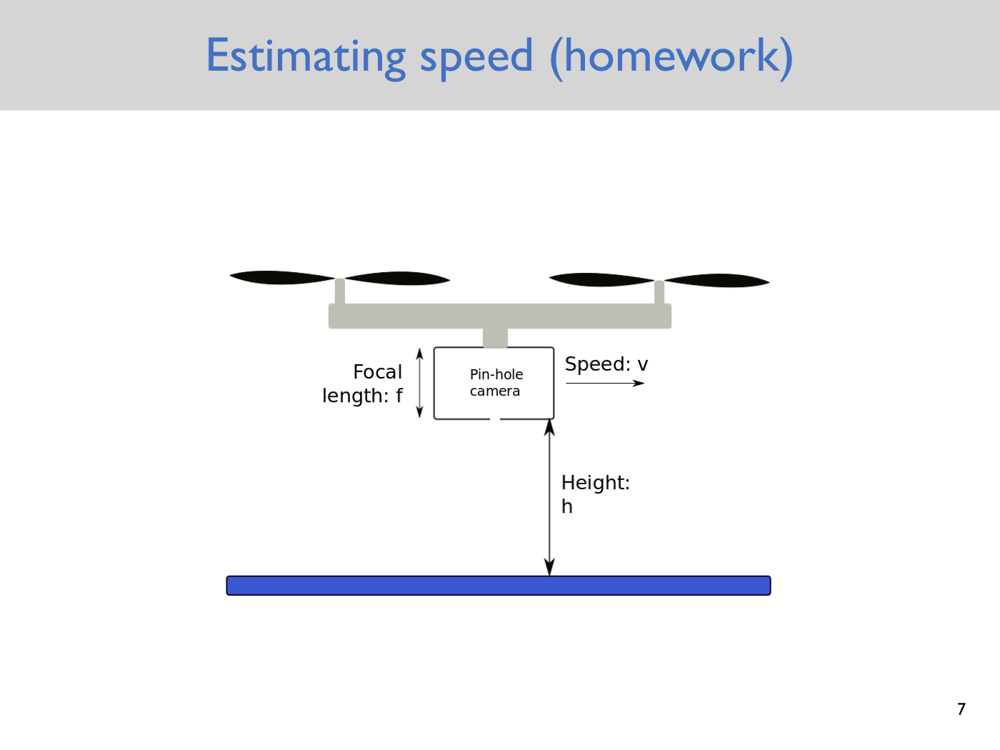

*Slide 7 — the homework's model: a drone carrying a pinhole camera with focal length f, moving to the right at speed v, at height h above the ground. [Deck](https://www.dropbox.com/scl/fi/yjkah2nhv83fdbnf6ea5a/Lecture9_slides.pdf?rlkey=d83o8wcmk8oczkogd2tpuogq3&dl=0)*

## Optical flow is apparent motion

More precisely, optical flow is the **apparent motion of objects** (slide 9, notes p. 1). At each instant
there is an image, represented here by a grayscale value at every pixel: the image intensity
$I(x, y, t)$ at pixel location $(x, y)$ and time $t$. Colour images work too, but grayscale keeps it simple
(≈8:36–9:21). At the next time step, $t + 1$, things in the scene have moved. The goal is to estimate, for
every pixel, the direction of apparent motion: if this object were tracked for one time step, which way
did it move? This is done locally, pixel by pixel (slide 8, ≈9:21).

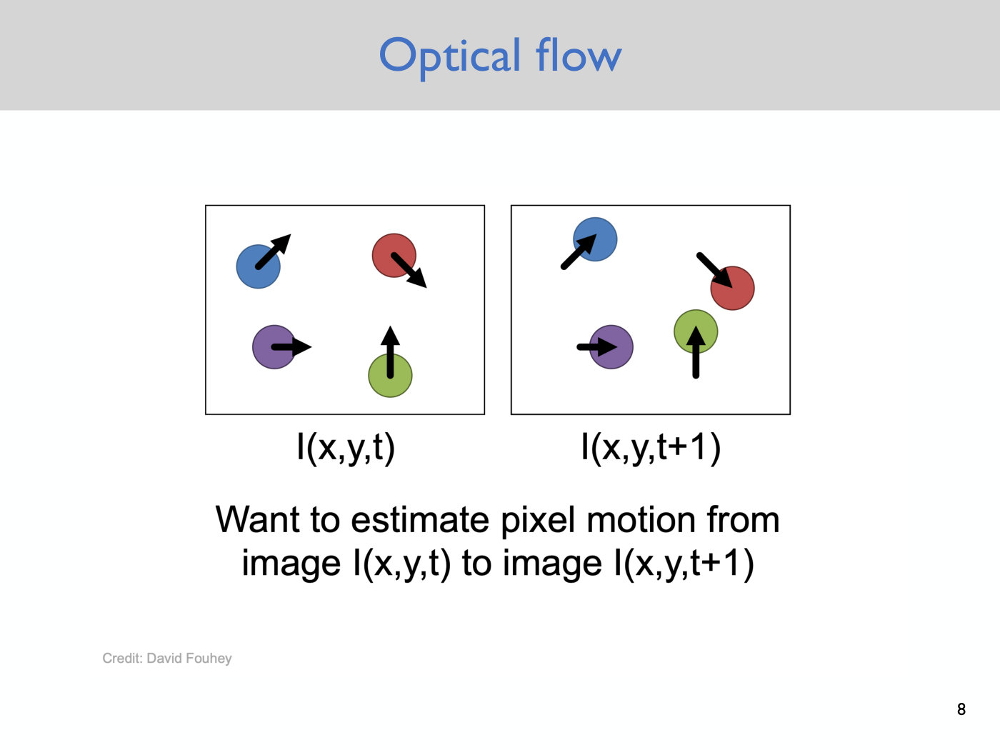

*Slide 8 — the problem: four discs in frame I(x,y,t) and again in frame I(x,y,t+1), each moved in the direction of its arrow (up and right, down and right, right, straight up). Estimate each pixel's motion from one image to the next. [Deck](https://www.dropbox.com/scl/fi/yjkah2nhv83fdbnf6ea5a/Lecture9_slides.pdf?rlkey=d83o8wcmk8oczkogd2tpuogq3&dl=0)*

Because the motion is apparent, it can come apart from real motion in both directions (slide 9,
≈10:07–12:26).

- **Relative motion but no optical flow.** A student's example was a camera very close to a pure white
  object that moves: nothing visible changes. The lecture's: a drone with a downward-facing camera over a
  perfectly textureless carpet, all one colour. Even as the drone moves it sees nothing change, so the flow
  is not the drone's real motion relative to its environment, only what it perceives (≈10:53–11:39).
- **Optical flow but no relative motion.** A student suggested pointing the camera at a video. The
  lecture's example is lighting: point the camera at something and switch the lights on and off, or dim
  them. Nothing moves physically, but the camera perceives flow (≈11:39–12:26).

So apparent motion has several possible causes: objects moving in the camera's view, the camera itself
moving, and lighting changes (slide 10, ≈12:26).

## Optical flow in birds and bees

Two videos, played in class, show animals using optical flow (≈12:26).

**Birds.** The first, linked from slide 11 (whose PDF page holds only the link), describes experiments
with budgerigars, recreated in the video with a starling, by Partha, then a graduate student at the
Australian National University, with colleagues at the Queensland Brain Institute; the captions garble his
surname (≈13:13–14:01). Birds flew down a narrow corridor with horizontal or vertical lines painted on its walls.
Vertical lines give more optic flow. In both cases the birds flew down the centre, but with vertical lines
they flew more slowly, adjusting their speed to the motion they perceived. With one vertical and one
horizontal wall they flew closer to the horizontal one: farther from the vertical stripes, the apparent
speed on that side drops. The scientists think birds keep the optic flow equal in both eyes to avoid
collisions. With one vertical wall and one blank wall, the birds kept away from the stripes so much that
they occasionally hit the blank wall (≈14:01–15:32). There is a lot of work on giving drones similar
bio-inspired strategies, computing optical flow and using it for local collision avoidance and correction
(≈15:32).

**Bees.** The second, the waggle dance (slide 12, a video whose PDF frame is black), shows a honeybee
returning to the hive and telling the others where she found nectar. The duration of her waggle gives the
distance, and the angle at which she dances across the comb gives the direction relative to the sun
(≈17:15–18:46). The lecture's point is that this distance is not measured in kilometres. The magnitude the bee signals is the optical flow integrated over the journey from the nest
to the nectar (≈18:46–19:32). Slide 13 links the Nature news article on the experiment, "Bees go with the
flow" (2001): the bees went to a food source once, and the scene along the route was then changed to give
more or less optical flow; the bees retracing the route flew a greater or shorter physical distance
accordingly (≈19:32–20:18; slide 13). The units of distance are not meters but integrated optical flow
(≈20:18).

## The setting: pixel motion between frames

The method derived on the board is one approach among several: a model-based one. More recent methods
based on machine learning are more accurate, but going through this one shows how one might do it
(≈21:10). The images are grayscale, $I(x, y, t)$, where $I$ is the intensity, $(x, y)$ the pixel location
and $t$ the time index (notes p. 1, ≈21:57–22:43); for an RGB image, imagine averaging the channels
(≈22:43). The goal is to estimate pixel motion from image $I(x, y, t)$ to $I(x, y, t + 1)$, the next frame
of the video, estimating the motion of each pixel separately (notes p. 1).

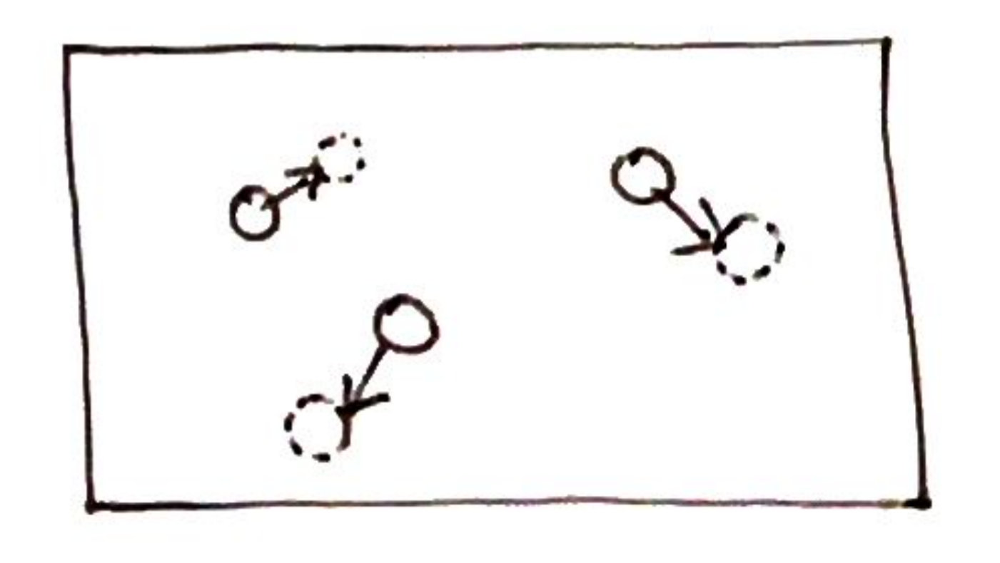

*Notes p. 1 — the same idea as slide 8, hand-drawn: each solid circle is an object at one time, the dashed circle where it is a frame later, and the arrow between them its motion.*

## Two assumptions

The method makes two assumptions (notes p. 1, ≈22:43–25:15).

1. **Color and intensity constancy**: a point (an object) looks the same at time $t + 1$ as at time $t$.
   The notes call this the brightness constancy assumption on p. 2; the lecture calls it intensity
   constancy. If an object moves from here to there, its appearance does not change much in that short
   time (≈22:43–24:27).
2. **Small motion**: points do not move very far from time $t$ to $t + 1$. "Small" is relative to the
   frame rate, the number of images per second: nothing goes from one portion of the image to another in
   one frame (≈24:27).

## The constraint equation

Write $(u, v)$ for the displacement of the point at pixel $(x, y)$ from one frame to the next. Brightness
constancy says the point looks the same in its new place (notes eq. (1), ≈25:15):

$$I(x, y, t) = I(x + u, y + v, t + 1) \tag{1}$$

The vector $(u, v)$ is the **optical flow** at that pixel (≈25:15–26:02).

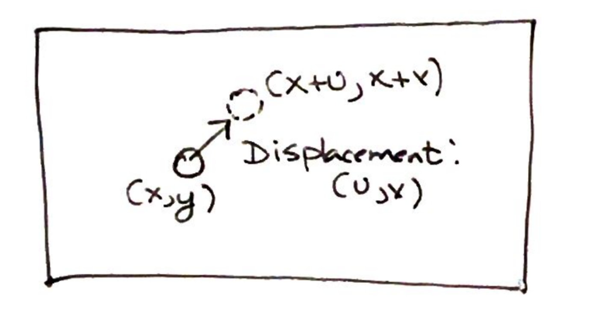

*Notes p. 2 — a point at (x, y) moves by the displacement (u, v) to a new position. The drawing labels the new position "(x+u, x+v)"; it is (x+u, y+v), a slip in the notes.*

A first-order Taylor expansion of the right-hand side gives (notes eq. (2), ≈26:49–27:36)

$$I(x + u, y + v, t + 1) \approx I(x, y, t) + I_x u + I_y v + I_t \tag{2}$$

where $I_x$ and $I_y$ are the partial derivatives of the image intensity along $x$ (the horizontal
direction in the image) and $y$, and $I_t$ is the difference across frames, the derivative with respect
to time (notes p. 2, ≈28:23). The approximation is where the small-motion assumption enters: if the
motion really is small, the first-order expansion is good enough to treat as an equality (notes p. 2,
≈31:29).

Moving $I(x, y, t)$ to the left, the left-hand side is zero by eq. (1), so
$I_x u + I_y v + I_t \approx 0$, which in compact form is (notes p. 2, eq. (3), ≈32:15–33:46)

$$(\nabla_{x,y} I) \cdot [u, v]^T + I_t = 0 \tag{3}$$

where $\nabla I = [I_x, I_y]$ is the image gradient. On the board the lecture then brings $I_t$ to the
other side, $\nabla I \cdot [u, v]^T = -I_t$, and uses that form in the proof below (≈33:46, ≈40:04).

## Estimating the derivatives from images

How would you estimate these derivatives from a real video, with finitely many pixels and a finite frame
rate (≈29:12)? By finite differences (≈29:58–31:29). For $I_t$, look at how much a pixel's intensity
changes from frame $t$ to frame $t + 1$: $I(x, y, t + 1) - I(x, y, t)$, taking the time step to be one
frame (≈29:58, ≈36:08–36:54). For $I_x$, take the intensity of the neighbouring pixel along $x$ minus this
one, or, for a less noisy estimate, average the differences on either side; the same along the vertical
axis gives $I_y$ (≈30:44–31:29). So everything in eq. (3) is known from the video except $(u, v)$
(≈34:33–35:20).

## One equation, two unknowns

Eq. (3) is one scalar equation, at one pixel, in two unknowns, $u$ and $v$ (notes p. 3, ≈34:33,
≈36:54). It does not determine both. In particular, only the motion along the gradient $\nabla I$ can be
identified, not the motion perpendicular to it (notes p. 3, ≈37:39–38:31). This is a fundamental
limitation, not a weakness of the derivation (≈37:39).

The proof (notes p. 3, ≈39:16–41:35). Suppose $[u, v]^T$ satisfies eq. (3), and suppose $[u', v']^T$ is
perpendicular to $\nabla I$:

$$\nabla I \cdot [u', v']^T = 0 \tag{4}$$

Then $[u + u', v + v']^T$ satisfies eq. (3) as well, because the dot product distributes (notes p. 3):

$$\nabla I \cdot [u + u', v + v']^T + I_t = \underbrace{I_t + \nabla I \cdot [u, v]^T}_ {= 0 \text{ by (3)}} + \underbrace{\nabla I \cdot [u', v']^T}_ {= 0 \text{ by (4)}}$$

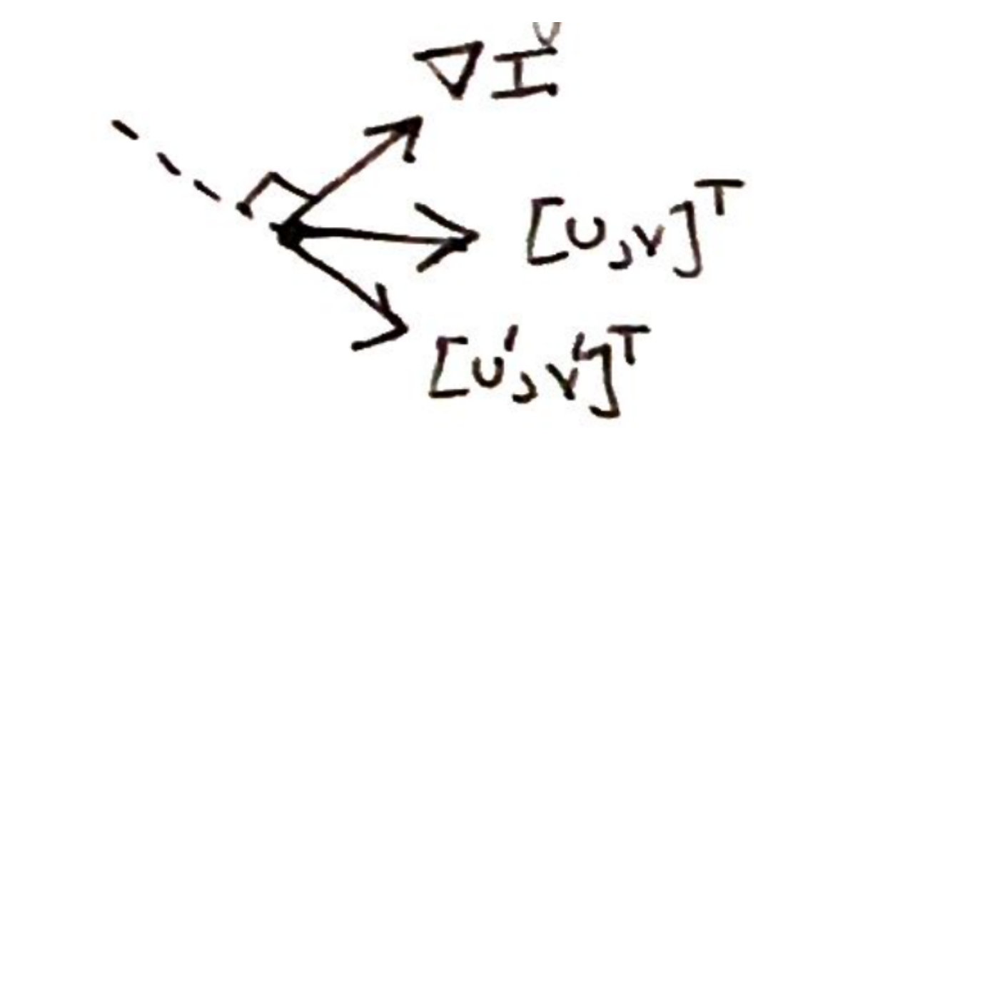

*Notes p. 3 — the gradient ∇I, a flow [u, v] that satisfies the equation, and a vector [u′, v′] at right angles to the gradient (the right-angle mark sits between the gradient and the dashed line along [u′, v′]). Adding any such vector gives another solution.*

So any component of the flow perpendicular to the image gradient is invisible to this equation
(≈41:35). The gradient says how the intensity changes along $x$ and $y$ at a pixel, so it is telling you
about edges; the motion perpendicular to it cannot be recovered without some further assumption about the
world (≈46:59). The analysis is per pixel, and is done for every pixel in the image (≈45:26–46:12).

## The aperture problem

This ambiguity has a name: the **aperture problem** (notes p. 3, ≈41:35). Slide 15, the barber pole
illusion, shows it; it is a video, played in class, and the PDF holds a single frame of it.

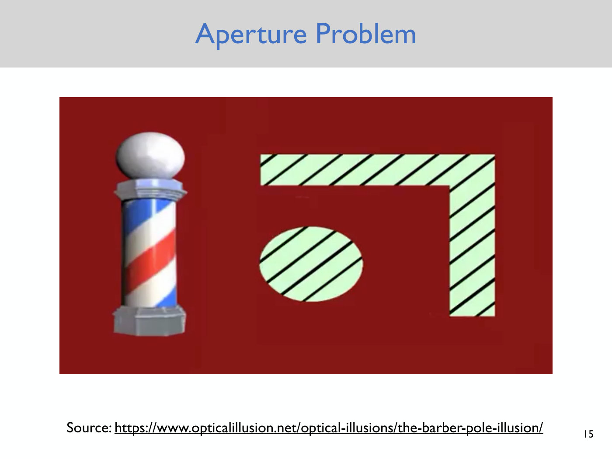

*Slide 15 — one frame of the barber pole illusion, played in class: an L-shaped band and an ellipse, both with diagonal stripes. Seen through the narrow top bar the stripes seem to move left, through the vertical bar up; once the whole picture is open they seem to move up and to the left. [Deck](https://www.dropbox.com/scl/fi/yjkah2nhv83fdbnf6ea5a/Lecture9_slides.pdf?rlkey=d83o8wcmk8oczkogd2tpuogq3&dl=0)*

The class watched the stripes through different parts of an L-shaped band (≈42:21–43:52). Through the
horizontal top bar everyone pointed the same way: the lines seemed to move horizontally to the left.
Through the vertical bar everyone pointed up. Everyone agreed on the oval as well. Then the aperture, the
region through which the stripes are seen, opens up, and once the picture "grays out", in the lecture's
words, most people see the lines in the top bar moving to the top left (≈43:06–43:52). Yet in that small region nothing about the lines'
motion changed (≈44:37). Seen through a small aperture the motion is ambiguous, and the brain resolves the
ambiguity with an extra assumption, a prior, that everyone shares; mathematically, too, another
assumption is needed to get a second equation and solve for both $u$ and $v$ (≈44:37–45:26). Asked
whether changing the area makes it easier to resolve: the component perpendicular to the gradient is truly
unresolvable from these equations; resolving it means assuming something about the world (≈46:12–47:45).

## Lucas-Kanade: spatial coherence

The **Lucas-Kanade optical flow** algorithm (notes p. 4, which dates the work to about 1981) adds one
assumption, **spatial coherence**: a pixel's neighbours move together, that is, have the same $[u, v]$
(notes p. 4, ≈47:45–49:17). It is an assumption about the real world. Where it holds reasonably well the
algorithm gives good estimates; where it does not, the estimates will not correspond to reality
(≈47:45–48:31).

It holds inside an object, whose pixels all move together, which is most of an image. It breaks down at
the boundaries of objects: at an object's edge, the neighbours on the object move and the neighbours in
the background do not. That is something this algorithm has to live with (≈49:17–50:51).

## Twenty-five equations from a window

What spatial coherence buys is more equations (≈50:51). Take a 5-by-5 window centred on the pixel of
interest, and number its pixels $p_1, \dots, p_{25}$ in any fixed order (≈51:37–52:40). Each pixel gives
one copy of eq. (3), and by assumption all 25 share the same $(u, v)$ (notes p. 4, ≈52:40–54:15):

$$\underbrace{\begin{bmatrix} I_x(p_1) & I_y(p_1) \cr I_x(p_2) & I_y(p_2) \cr \vdots & \vdots \cr I_x(p_{25}) & I_y(p_{25}) \end{bmatrix}}_ {\triangleq A} \underbrace{\begin{bmatrix} u \cr v \end{bmatrix}}_ {\triangleq \bar{d}} = - \underbrace{\begin{bmatrix} I_t(p_1) \cr I_t(p_2) \cr \vdots \cr I_t(p_{25}) \end{bmatrix}}_ {\triangleq \bar{b}}$$

Reading out one row gives $I_x(p_1) u + I_y(p_1) v = -I_t(p_1)$, the same equation as before at pixel
$p_1$ (≈54:15). In short, $A \bar{d} = \bar{b}$, with $A$ of size 25 by 2, $\bar{d}$ 2 by 1 and $\bar{b}$
25 by 1; the minus sign is absorbed into $\bar{b}$ (notes p. 4, ≈54:15–55:05).

How big should the window be? There is no general answer. 5 by 5 or 7 by 7 is common; it depends on the
image resolution, a larger window for a full HD image, perhaps a smaller one for a low-resolution image
from a cheap camera on a robot. Try some and see what works (≈55:05–55:51).

## The least-squares solution

The problem has turned around: before, one equation in two unknowns; now 25 equations in two unknowns. The
system is overdetermined (≈55:51), so the class's answer was least squares: find the $\bar{d}^\ast$ that
minimizes $\Vert A\bar{d} - \bar{b}\Vert_ 2^2$, fitting the 25 equations as well as possible (notes p. 4,
≈56:37–57:26). It has a closed form (notes eq. (5)):

$$\bar{d}^\ast = (A^T A)^{-1} A^T \bar{b} \tag{5}$$

The notes add that numpy can solve the least-squares problem too, as in Assignment 1 (notes p. 4). Doing
this at every pixel, with every pixel's own window, gives a $(u, v)$ at each pixel: the optical flow field
(≈58:13).

## When the solution exists

Eq. (5) makes sense only if $A^T A$ is invertible; otherwise the right-hand side is meaningless. Asking
when it is invertible says when the method works and when it does not (notes p. 4, ≈58:13–59:01). Since
$A$ is 25 by 2, $A^T A$ is 2 by 2 (≈59:01):

$$A^T A = \underbrace{\begin{bmatrix} \Sigma I_x I_x & \Sigma I_x I_y \cr \Sigma I_x I_y & \Sigma I_y I_y \end{bmatrix}}_ {2 \times 2}$$

where the sums are over the 25 pixels of the window (notes p. 5, ≈59:01–1:00:42). It is invertible exactly
when its determinant is non-zero (notes p. 5, ≈1:00:42–1:01:28):

$$\det(A^T A) = (\Sigma I_x I_x)(\Sigma I_y I_y) - (\Sigma I_x I_y)^2$$

So: when is it zero? In terms of the image, what would the window around the pixel have to look like
(≈1:01:28–1:02:14)?

## When Lucas-Kanade has trouble: low texture and edges

Slides 16–18 ask the question over a photograph of a campus building.

**Low texture.** The image is very similar throughout the window, so $I_x$ and $I_y$ are nearly zero at
every pixel and the determinant is zero (notes p. 5, ≈1:02:14–1:02:59). This is the case from the start of
the lecture: a drone looking at a blank wall, or a textureless carpet, sees no texture and cannot work out
the flow. Intuitively too, zoomed in on a featureless patch, moving a little shows the same white patch
again, with no way to tell the direction of motion (slide 17, ≈1:02:59–1:04:32).

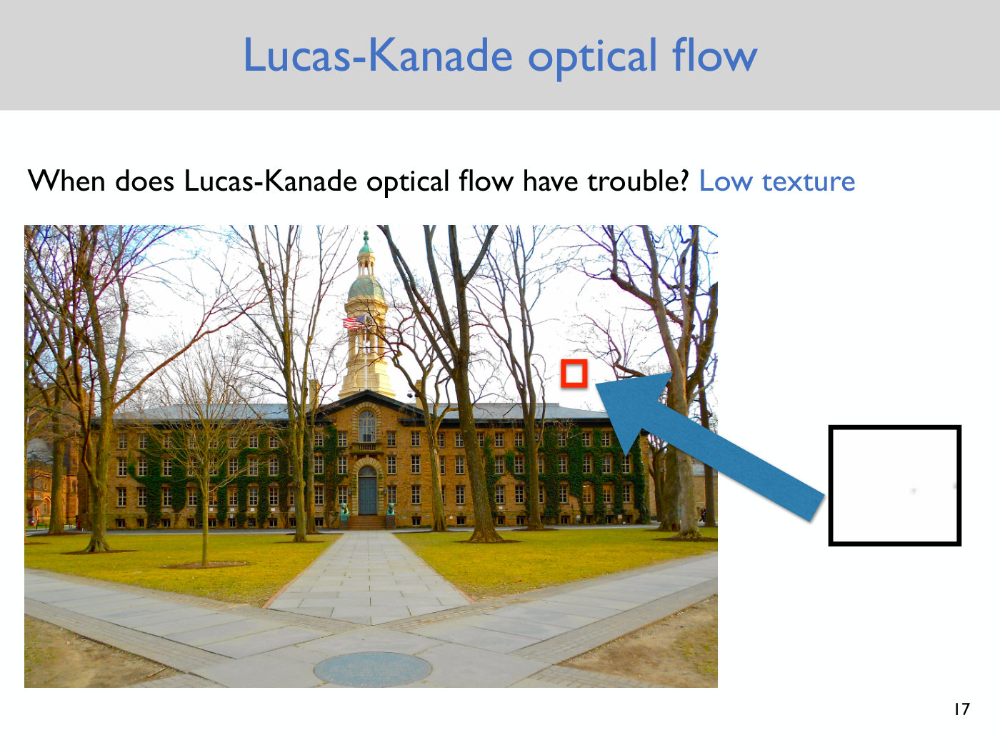

*Slide 17 — low texture: a small window on a patch of sky between the trees, magnified at the right. It is almost uniformly white, so the image gradients in it are nearly zero. [Deck](https://www.dropbox.com/scl/fi/yjkah2nhv83fdbnf6ea5a/Lecture9_slides.pdf?rlkey=d83o8wcmk8oczkogd2tpuogq3&dl=0)*

**Edge.** All the gradients at the different pixels of the window are the same (notes p. 5). A student
named this case; the captions of the answer are garbled, and the lecturer adds that "these two terms end up
being equal to each other": the two terms of the determinant are equal, so it is zero (≈1:02:59–1:03:46).
Substituting one gradient $(I_x, I_y)$ for all 25 pixels into the notes' formula shows it:
$(25 I_x^2)(25 I_y^2) - (25 I_x I_y)^2 = 0$. On slide 18 the window sits on the edge of a tree trunk
against the sky. A drone looking at that piece of branch and moving along it sees the same image at every
time step, so although it is moving relative to the branch, it cannot tell from the images which way
(≈1:04:32–1:05:18).

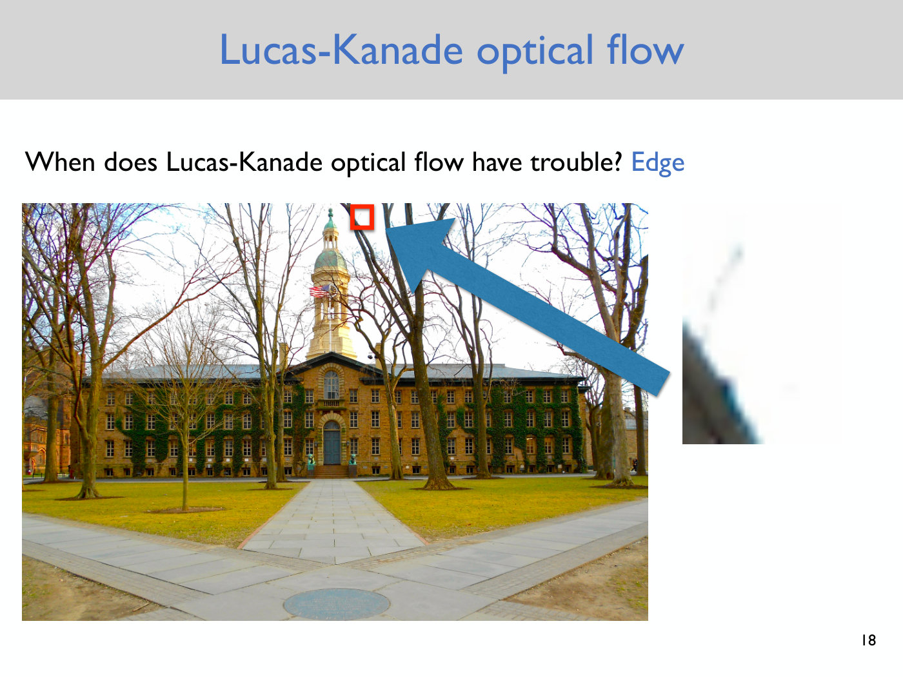

*Slide 18 — an edge: a small window on a tree trunk against the white sky, near the top of the tower, magnified at the right. The intensity changes only across one straight edge, so every gradient in the window points the same way. [Deck](https://www.dropbox.com/scl/fi/yjkah2nhv83fdbnf6ea5a/Lecture9_slides.pdf?rlkey=d83o8wcmk8oczkogd2tpuogq3&dl=0)*

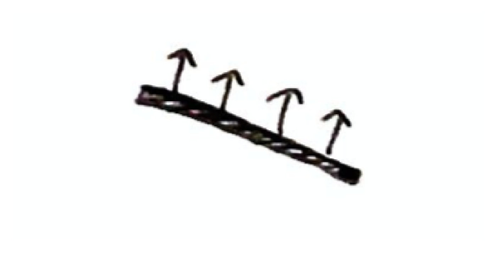

*Notes p. 5 — the edge case: a line with four arrows standing on it, all pointing the same way, the same gradient at every pixel along the edge.*

The method also breaks down whenever its assumptions fail: colour or intensity constancy is violated,
the motion is not small, or spatial coherence does not hold. The notes ask the reader to think about what
this implies for a robot: what should its environment look like (notes p. 5)?

## In practice, and the next assignment

The flow video was shown again (slide 19, a later frame of the same video as slide 5). The jittering, and a
big arrow inconsistent with its neighbours, are the kinds of imperfections and artifacts these estimates
have (≈1:06:04). Better methods exist, and today they are based on machine learning: collect data, perhaps
in simulation, where the true flow is known because the simulator moves the objects, and train a neural
network to predict optical flow; sometimes combined with Lucas-Kanade (≈1:06:04–1:06:49). The point of
going through Lucas-Kanade is to see its assumptions, which hold only partly in reality, and where things
break down. Students implement it in the next assignment and see where the estimates look good and where
they do not (≈1:06:49–1:07:35). Whatever the method, a way of computing optical flow gives a way of
estimating the drone's velocity, which is very useful for state estimation (≈1:07:35).

## Sensing is imperfect

No method gives perfect flow, so the velocity estimated from it is not perfectly accurate, and
integrating it to get the drone's position amplifies the errors (slide 20, which shows slide 6's flow
field again, ≈1:08:22). The next question is how to account for imperfect sensing: if the sensors are not
perfectly accurate, how to correct for that, perhaps over time, by combining measurements from many
sensors, or from the same sensor at different times. That starts in the next lecture (slide 21,
≈1:08:22–1:09:08): see [Lecture 10 — Nondeterministic Filter](10-nondeterministic-filter.md) and
[state estimation](state-estimation.md). The notes end the same way: thinking about optical flow shows how challenging sensing is
and the need to account for imperfect sensing (notes p. 5). See [uncertainty](uncertainty.md).

## Gaps in the record

- **The blackboard is not in the record.** The derivation was written on the board; this page follows the
  notes, whose content matches what is spoken. Where the lecture points at the board ("this dot has moved
  over here", ≈9:21; the window's numbering, ≈52:40) the captions do not say what was drawn.
- **Board and notes differ in small ways.** The lecture calls the first assumption intensity constancy
  (≈22:43); the notes say "Color and Intensity constancy" (p. 1) and "Brightness constancy assumption"
  (p. 2). The board brought $I_t$ to the right-hand side of eq. (3) (≈33:46, ≈40:04). The notes' date for
  Lucas-Kanade (about 1981) and their pointer to numpy and Assignment 1 are not spoken; the lecture instead
  refers back to "our previous optimization problem" (≈57:26).
- **The least-squares solution is garbled in the captions** ("A transpose A inverse multiplied by b, or
  multiplied by A transpose b", ≈57:26), apparently a false start; this page uses notes eq. (5). The
  captions also drop the summation signs from the spoken determinant (≈1:01:28).
- **Motion along an edge.** At ≈1:05:18 the lecture describes the edge failure as motion "perfectly aligned
  with all the image gradients", moving along the branch. By the notes' own derivation (p. 3) the motion
  that cannot be identified is the component perpendicular to the gradient, and the gradient at an edge
  points across it; moving along the branch is that perpendicular motion. The spoken "aligned" is
  presumably with the edge.
- **Garbled passages**: the surname of the researcher in the bird video (≈13:13), a student's answer on
  estimating $I_t$ (≈29:58), two student questions (≈35:20, ≈45:26), a word at ≈41:35 ("go back to the
  map", perhaps the board), the last word of the window-size question (≈55:05), and the student's answer
  naming the edge case (≈1:02:59).
- **Slides 5, 12, 15 and 19 hold single frames** of videos played in class, and slide 11's page holds only
  the link to its video; what the videos showed is from the lecture. Slide 12's frame is black.
- **Printed slips in the notes**: the page-1 header reads "Lecture #18"; "determininat" (p. 5); the p. 2
  drawing labels the displaced point "(x+u, x+v)" for $(x + u, y + v)$. See the
  [notes file](../raw/notes/09-optical-flow.md#printed-slips).
