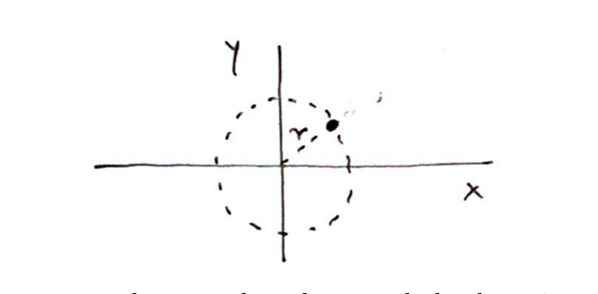
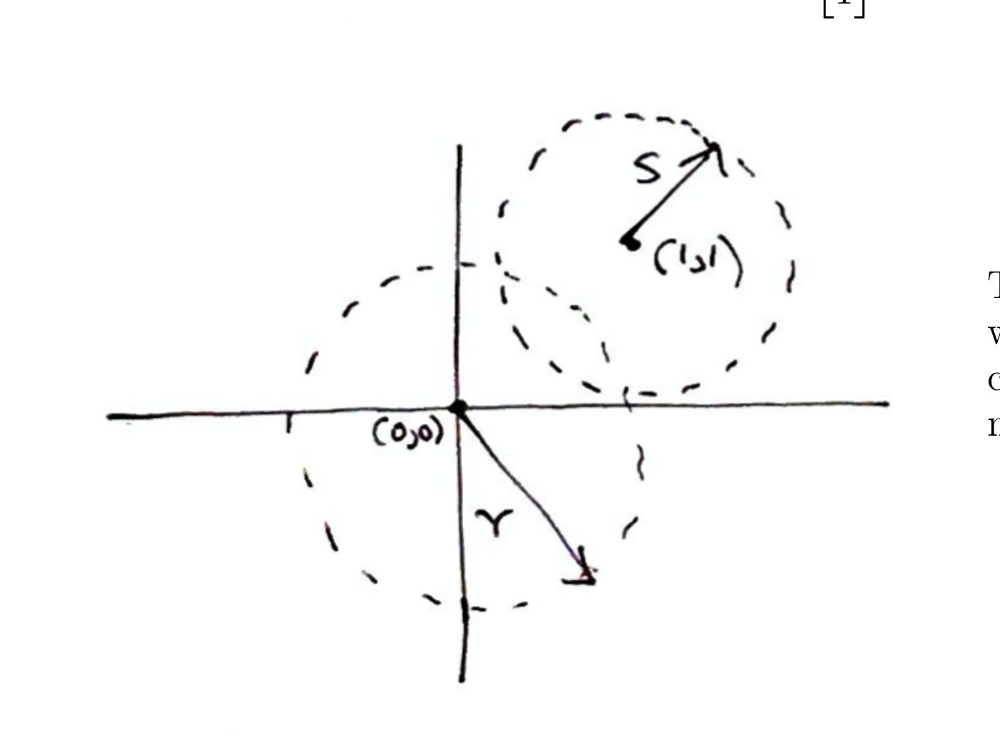
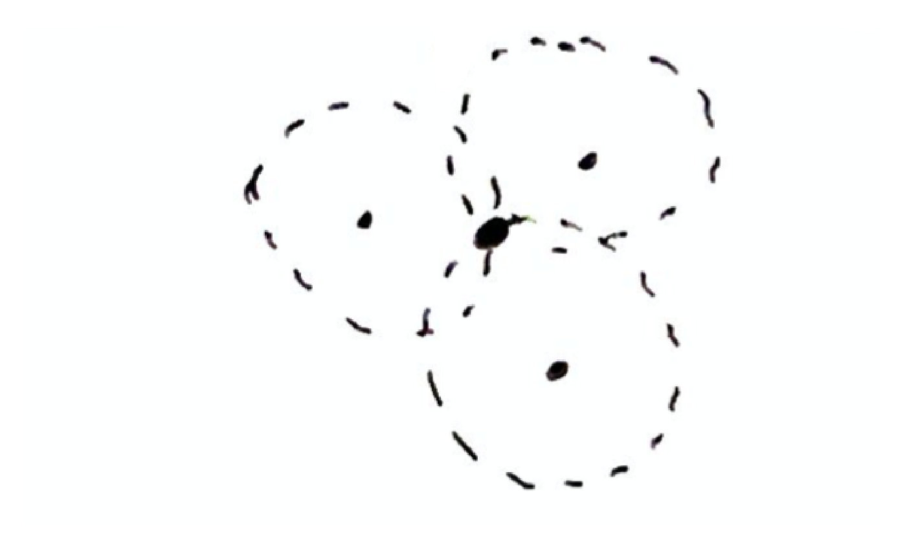
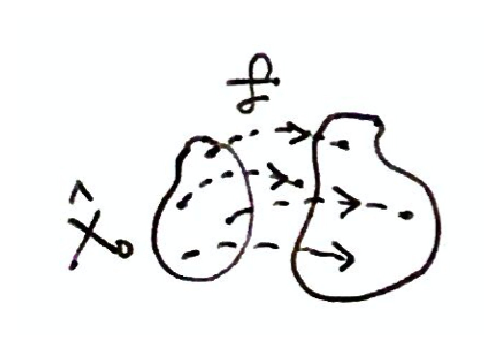
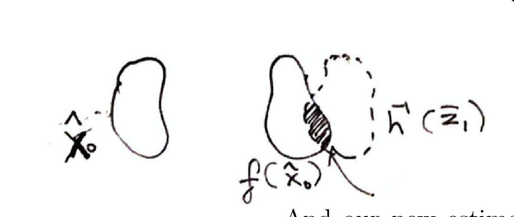
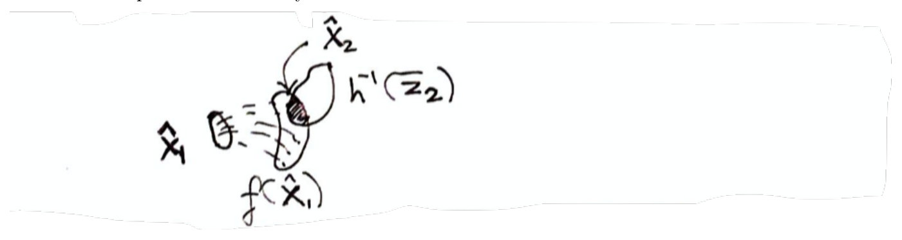
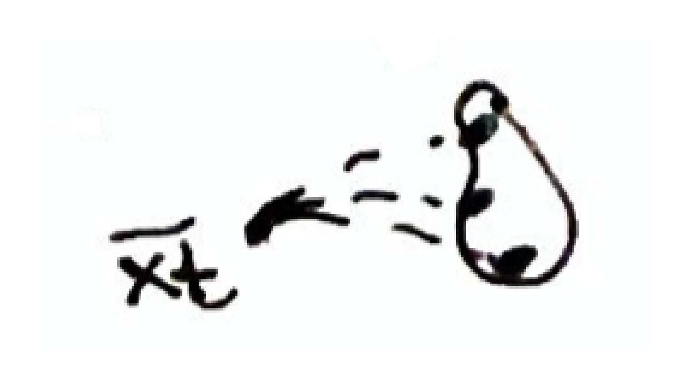
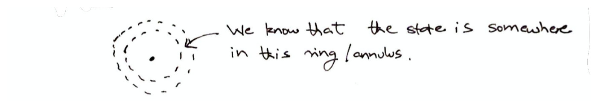
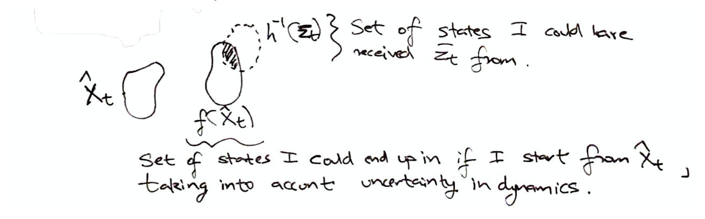

# Lecture 10 — Nondeterministic Filter

Anirudha Majumdar, Princeton ROB 345/549, Fall 2026 ·
[video](https://www.youtube.com/watch?v=T7Uf2u3VVZ8) (65 min) ·
[notes (PDF, Dropbox)](https://www.dropbox.com/scl/fi/ccgwqi9i2wr1fzcc690dd/Lecture10_notes.pdf?rlkey=cffu8ofmveu1jaokpqdl0zhzg&dl=0) ·
[notes as text](../raw/notes/10-nondeterministic-filter.md) ·
[transcript](../raw/transcripts/10-nondeterministic-filter.md)

**What this lecture establishes.** Everything the course did on motion planning and feedback control
assumed that the robot knows its state exactly and knows where the obstacles are. Neither is true, and
this lecture begins the work of dropping the first assumption: how a robot can combine imperfect
information over time into a better estimate of its state. It starts from a point robot that measures its
distance to fixed points. One distance puts it on a circle, two on the intersection of two circles, three
at a single point. In general, a **sensor model** $\bar{z} = h(\bar{x})$ says which measurement each
state produces, and the **preimage** $h^{-1}(\bar{z})$ is the set of all states consistent with the
measurement actually received. Adding discrete-time dynamics gives the **nondeterministic filter**. The
robot keeps a *set* of states it might be in. At each time step it pushes that set through the dynamics
(the dynamics update), computes the preimage of the new measurement (the measurement update), and
intersects the two. The set need not shrink: unstable dynamics with a poor sensor make it grow. The
filter extends to uncertain dynamics and sensors, but it is conservative and hard to compute, so it is
not used directly in practice. It is the conceptual basis for the **Bayes filter** of the
[next lecture](11-bayes-filter.md), which has the same structure with probability distributions in place of
sets.

**Where to find what.** The course posts no slide deck for this lecture: it was given entirely at the
blackboard, which the video does not show. The course's **lecture notes** (6 pages) are its written
record. They print no equation numbers, so they are cited here as "notes p. N". Their nine hand-drawn
pictures have no numbers or captions; they are numbered "drawing 1" to "drawing 9" in order of
appearance and shown below. The notes' "(1)" and "(2)" on page 1 number two goals, not equations. Where
the board and the notes differ, this page follows the notes and gives the board's version with its
timestamp. Timestamps (≈M:SS) point into the video and the
[transcript](../raw/transcripts/10-nondeterministic-filter.md). Where the lecture says "over here" or
"this set", it is pointing at the board, and this page does not guess what was drawn. The topic has its
own page, [state estimation](state-estimation.md).

## Contents

1. [A poll, and the plan for the module](#a-poll-and-the-plan-for-the-module)
2. [The two assumptions planning and control made](#the-two-assumptions-planning-and-control-made)
3. [A point robot with distance sensors](#a-point-robot-with-distance-sensors)
4. [Measurements and the sensor model](#measurements-and-the-sensor-model)
5. [The preimage](#the-preimage)
6. [Adding dynamics in discrete time](#adding-dynamics-in-discrete-time)
7. [Where the robot starts](#where-the-robot-starts)
8. [The dynamics update](#the-dynamics-update)
9. [What about control inputs?](#what-about-control-inputs)
10. [Fusing a measurement: the intersection](#fusing-a-measurement-the-intersection)
11. [The nondeterministic filter](#the-nondeterministic-filter)
12. [Why it is called non-deterministic](#why-it-is-called-non-deterministic)
13. [Does the set always shrink?](#does-the-set-always-shrink)
14. [Uncertainty in the dynamics](#uncertainty-in-the-dynamics)
15. [Uncertainty in the measurements](#uncertainty-in-the-measurements)
16. [Limitations](#limitations)
17. [Next: the Bayes filter](#next-the-bayes-filter)
18. [Gaps in the record](#gaps-in-the-record)

## A poll, and the plan for the module

The lecture opens with a planning question. About 40 or 50% of the class had seen the transformer
architecture, and about 60% said a lecture on it would help. Transformers are "the backbone for all of
modern machine learning", and Majumdar may spend some time on them, enough to make sense of the
robotics material that uses them (≈0:55–1:41). The reason is where the module is going.

The module is on state estimation, localization and mapping, and it began with
[optical flow](09-optical-flow.md), which lets the drone estimate its velocity and, by integrating it, its
position (≈0:10). Lucas-Kanade is an old-school algorithm, worth seeing once to understand how painful it
is to implement and how many edge cases break its assumptions. Later lectures cover localization, mapping
and SLAM (simultaneous localization and mapping), whose modern approaches are all neural-network based,
"all transformer based, essentially", and will return to better ways of computing optical flow
(≈1:41–2:27).

First come some technical fundamentals on **imperfect state estimation**. Whatever algorithm estimates
the state, the estimate will have errors, and what is wanted is a way to aggregate many imperfect
estimates over time into a better one, for the state of the robot and also of its environment
(≈3:13–3:59). The plan: the nondeterministic filter today, "not the most practical approach" but a
conceptual basis for approaches that are; probabilistic methods in the next couple of lectures, used to do
localization and mapping the traditional way; then a lecture or two on SLAM done with machine learning
(≈3:59–5:31). The classical approach is kept because it is still widely used, because it is the conceptual
backbone of the learned methods, and because knowing it shows what assumptions the learned methods make,
when they might break down, and how to debug them (≈4:46–5:31). See the [course map](course-map.md).

## The two assumptions planning and control made

The notes frame the module this way (notes p. 1). The course's motion planning and
[feedback control](feedback-control.md) made two big assumptions: that the robot's sensors let it
**perfectly estimate its state** $\bar{x}(t)$ at any time, and that the robot **knows exactly where all
the obstacles are**, that is, it has a map. Neither is completely valid; Lecture 9 showed that estimating
the state is a non-trivial challenge. The next few lectures develop ways for a robot to (1) estimate its
state from noisy or imperfect sensor measurements and (2) construct a map of its environment, and towards
the end of the module to do both simultaneously. The classic reference is the book *Probabilistic
Robotics*, one of the course's reference textbooks (notes p. 1; see
[course logistics](course-logistics.md)).

## A point robot with distance sensors

Start simple (notes pp. 1–2, ≈5:31–11:49). The robot is a point in the plane, so its state is its position,
$\bar{x} = (x, y)$; velocity is ignored so that everything can be drawn (≈6:19). It has one sensor, which
returns a scalar: its distance $r$ from the origin, as if there were a beacon there (≈6:19–7:05).

What can it conclude from one measurement? A student: only that it is on some circle around the origin.
That is all: a single scalar constraint on the state (notes p. 1, ≈7:05–7:51),

$$\sqrt{x^2 + y^2} = r$$

and nothing narrows it further.

*Notes p. 1, drawing 1 — one distance sensor: every point of the dashed circle of radius r about the origin is at the measured distance, so the robot (the dot) could be anywhere on it.*

Now add a second sensor that measures the distance from the point $(1, 1)$. The robot knows it is on both
circles, so on their intersection. That is still not enough: two circles generically cross at two points,
so one ambiguity remains, though the uncertainty has been reduced (notes p. 2, ≈8:42–10:13). The circles
can touch at a single point, but generically they do not (≈10:13). The notes call the two distances $r$
and $s$ (drawing 2) and write the second point as $\bar{x}_ 0 = (1, 1)$; on the board they are $R_1$ and
$R_2$ (≈8:42–9:27).

*Notes p. 2, drawing 2 — two distance sensors: the circle of radius r about (0,0) and the circle of radius s about (1,1) cross at two points, and the robot is at one of them.*

A third sensor settles it: three circles meet at one point, unless the measurements are inconsistent with
each other, which cannot happen while the sensors are assumed perfect (notes p. 2, ≈10:13–11:49). The
lecture calls this **triangulation**: three distance measurements, $Z = (R_1, R_2, R_3)$ on the board,
uniquely determine the position (≈10:13–11:49).

*Notes p. 2, drawing 3 — three distance sensors: the three circles pass through one common point, the larger dot, which is the robot's position.*

The aim is to abstract from this example to a general algorithm that tells a robot the subset of states it
might be in, given the measurements it receives (≈11:49).

## Measurements and the sensor model

Let $\bar{z}$ be a **measurement**, also called an **observation**: the vector of sensor readings (notes
p. 2). In the three-sensor example, $\bar{z} \in \mathbb{R}^3$, three scalar distances (notes p. 2). On the
board the general measurement lives in $\mathbb{R}^D$, a $D$-dimensional space; a lidar, for instance, gives
a much higher-dimensional observation vector (≈12:37–13:23).

The robot is assumed to have a **model of its sensors**,

$$\bar{z} = h(\bar{x})$$

sometimes called the **sensor mapping** or **sensor function** (notes p. 2). It says what measurement the
sensor will produce from any given state (notes p. 3, ≈13:23–14:13). For now $h$ is assumed known and
perfect, with no error (≈16:34).

The notes ask what $h$ is for the example (notes p. 3). A student: the distance to each of the points
(≈15:01). So $h$ has three components: the distance to the origin, $\sqrt{x^2 + y^2}$; the distance to
$(1, 1)$, $\sqrt{(x-1)^2 + (y-1)^2}$; and the distance to the third point, whose centre the lecture calls
$(x_c, y_c)$ without giving it (≈15:01–15:47). The captions do not give the squares and square root of the
third component; see [Gaps](#gaps-in-the-record). Whatever the robot's position, $h$ gives the exact
measurement it will receive from there (≈15:47).

## The preimage

**Definition** (notes p. 3, ≈17:20–18:52). The **preimage** of the sensor mapping for a measurement
$\bar{z}$ is

$$h^{-1}(\bar{z}) = \lbrace \bar{x} \in \mathcal{X} \mid h(\bar{x}) = \bar{z} \rbrace$$

where $\mathcal{X}$ is the state space. In words, it is "the set of all states $\bar{x} \in \mathcal{X}$ that
are consistent with having received measurement $\bar{z}$" (notes p. 3): the states from any of which the
robot could have received the measurement it actually received (≈18:52–19:38, ≈21:10). It maps a single
observation to a subset of the state space (≈18:52).

For one distance sensor, a student answers, the preimage is the circle: from anywhere on it the robot
could have measured that distance (≈19:38). With two or three sensors the preimage is smaller, and in the
best case it is a **singleton**, a single state, so the state is uniquely identified (notes p. 3,
≈21:55–22:41). Computing preimages is exactly what the example was doing (notes p. 3, ≈21:10–21:55).

The notation looks like an inverse, and it is a warning as much as a name. The function
$h : \mathcal{X} \mapsto \mathcal{Z}$, from states to measurements, is not generally invertible (think of the
cases with one or two distance sensors), so $h^{-1}(\bar{z})$ is not in general the mathematical inverse of
$h$; it is a standard, if potentially confusing, notation. The notes suggest reading it as "h-reverse":
going backwards from observations to the states consistent with them (notes p. 3). When is it the actual
inverse? A student: when the mapping is one-to-one. If every preimage is a singleton, there is exactly one
state $\bar{x}$ with $h(\bar{x}) = \bar{z}$ for each $\bar{z}$, $h$ is invertible, and the preimage is its
inverse (≈19:38–21:10). The notes call this $h$ being ("locally") invertible (notes p. 3).

## Adding dynamics in discrete time

So far everything happens at one instant, and the robot's dynamics have been ignored. Estimation gets more
interesting when observations are aggregated over time (notes p. 3, ≈22:41). For this part of the course
the dynamics are taken in **discrete time**, because it is much simpler, although all of it can be done in
continuous time (≈23:28):

$$\bar{x}_ {t+1} = f(\bar{x}_ t, \bar{u}_ t) \quad \text{or} \quad \bar{x}_ {t+1} = f(\bar{x}_ t)$$

The next state $\bar{x}_ {t+1}$ is a function $f$ of the current state $\bar{x}_ t$ and the control input
$\bar{u}_ t$ (notes p. 3, ≈23:28). The second form drops the control input: there are no control inputs, or
a feedback controller is applied and the closed-loop system is being studied (≈23:28–24:13). The notes
ignore control inputs for now (notes p. 3). Such a model can come from discretizing a continuous-time
model, as in the trajectory-optimization assignment, where continuous dynamics were turned into discrete
ones with an Euler discretization (see [Lecture 6](06-trajectory-optimization.md)), or be obtained in
discrete time from the start (notes p. 3, ≈24:13). See [state and dynamics](state-and-dynamics.md).

## Where the robot starts

Suppose the state at time 0 is known to lie in a set $\hat{X}_ 0 \subseteq \mathcal{X}$ (notes p. 3,
≈24:59–25:49). The set could be the whole state space, which says the robot could be anywhere; or it could
be more precise, such as the room the robot is deployed in (≈25:49–26:35). The goal is to shrink this set,
ideally to the exact state, by combining the knowledge of the dynamics with the sensor observations
received over many time steps (≈26:35–27:21).

## The dynamics update

The first step uses the dynamics. Take each point of the starting set and work out where the dynamics take
it in one step; the set of all those next states is (notes p. 4, ≈27:21–28:53)

$$f(\hat{X}_ 0) \triangleq \lbrace \bar{x} \in \mathcal{X} \mid \exists \bar{x}_ 0 \in \hat{X}_ 0 \text{ s.t. } f(\bar{x}_ 0) = \bar{x} \rbrace$$

the set of states $\bar{x}$ for which some state $\bar{x}_ 0$ of the starting set is carried to $\bar{x}$
by the dynamics; $\exists$ reads "there exists" (≈28:07). Intuitively, it is every state the robot could
end up in if it starts somewhere in $\hat{X}_ 0$: the union of where each starting state goes (≈28:53–29:40).
The notes add that this can be done "at least in principle, computational considerations aside" (notes
p. 3). (The notes also use $\bar{x}_ 0$ for the sensor point $(1, 1)$ on page 2; here it is a state in
$\hat{X}_ 0$.)

*Notes p. 4, drawing 4 — the dynamics update: f carries each point of the starting set (left) to a point of the set on the right, which is f applied to the whole starting set.*

## What about control inputs?

A student asks whether this set is over all controls or one (≈29:40). For simplicity the lecture works with
the closed-loop form: fix a feedback controller and apply it. The general case is "very straightforward":
every such set is conditioned on the control input the robot applied, which involves no uncertainty,
because the robot knows exactly which input it applied (≈29:40–30:26). Asked again, Majumdar confirms that
it is the specific control input applied, not all of them (≈30:26). The notes leave it as an exercise:
"Think about how this works with control inputs" (notes p. 5).

## Fusing a measurement: the intersection

At time $t = 1$ the robot receives a measurement $\bar{z}_ 1$; in general $\bar{z}_ t$ is the measurement at
time $t$ (notes p. 4, ≈31:14–32:09). What is the smallest set consistent with both the dynamics and the
sensor model (≈32:09)? A student proposes computing the preimage of $\bar{z}_ 1$ (≈32:55),

$$h^{-1}(\bar{z}_ 1) = \lbrace \bar{x} \in \mathcal{X} \mid h(\bar{x}) = \bar{z}_ 1 \rbrace$$

the set of states consistent with having received it (notes p. 4). Another asks whether to intersect it
with $f(\hat{X}_ 0)$, and that is the step (≈33:40). Before the measurement the robot knows it is somewhere
in $f(\hat{X}_ 0)$; the measurement says it is somewhere in the preimage; so it is in both
(≈33:40–34:29). The new estimate is (notes p. 4)

$$\hat{X}_ 1 = f(\hat{X}_ 0) \cap h^{-1}(\bar{z}_ 1)$$

which includes the knowledge of the dynamics and the new measurement. The measurement narrows down where
the robot is (≈34:29–35:15).

*Notes p. 4, drawing 5 — one full step: the starting set (left), where the dynamics take it (the pear-shaped set), the preimage of the first measurement (dashed), and their hatched overlap, which is the new estimate X̂₁.*

## The nondeterministic filter

Then repeat (notes p. 4, ≈35:15–36:49). From $\hat{X}_ 1$, compute where the dynamics take it,
$f(\hat{X}_ 1)$; receive $\bar{z}_ 2$ and compute its preimage; intersect to get
$\hat{X}_ 2 = f(\hat{X}_ 1) \cap h^{-1}(\bar{z}_ 2)$. As the robot applies control inputs and receives
measurements, it keeps updating the set of states it knows it must be in (≈36:49–37:35).

*Notes p. 4, drawing 6 — the next step: the estimate X̂₁ is carried forward by the dynamics, intersected with the preimage of the second measurement, and the hatched overlap is X̂₂.*

The general algorithm, the **nondeterministic filter**, does three things at every time step $t$ (notes
p. 4, ≈37:35–39:10):

1. Compute $f(\hat{X}_ {t-1})$, the **dynamics update**: use the dynamics to update where the state could
   be.
2. Compute $h^{-1}(\bar{z}_ t)$, the **measurement update**.
3. Compute $\hat{X}_ t = f(\hat{X}_ {t-1}) \cap h^{-1}(\bar{z}_ t)$, which fuses the information from steps
   1 and 2.

The notes call it the "Non-Deterministic Filter" (notes p. 5). On the board, steps 2 and 3 together are
called the measurement update (≈39:10).

## Why it is called non-deterministic

"Non-deterministic" means the state is not determined perfectly (≈39:58). Sometimes the set has a single
element and the state is uniquely identified, but in general it holds many, and all that can be said is
that the state is somewhere in it. And it is not probabilistic either: no state in the set is weighted as
more likely than another. The filter is "just agnostic": the robot is in there somewhere, and nothing more
can be said (≈39:58–40:43). A student checks that the model is still assumed perfect, with zero sensor
noise; it is, for now, with perfect models of both the sensor and the dynamics (≈40:43).

## Does the set always shrink?

Another student points out that nothing forces the intersection to get smaller over time (≈40:43). Can it
get larger? Students argue first that it cannot: the dynamics update keeps the set about the same size or
shrinks it, and intersecting can only make it smaller (≈41:29–43:02). That would be a nice property: more
observations would never make the robot less confident (≈43:02). Another student suggests a system that
repels states from a point, and that is the counterexample: the property does not hold (≈43:02).

Take an unstable system, say one destabilized by a bad feedback controller, with a one-dimensional state
(≈43:47). The dynamics push states away from each other and from the origin. On the board they are made
concrete as

$$x_{t+1} = \lambda x_t$$

where $x_t$ is the state at time $t$ and $\lambda$ is a positive scalar; starting from either side of the
origin, the next state is further from it (≈47:39–48:30). The captions add "let's say it's larger than 1"
without saying what "it" is (≈48:30); $\lambda \gt 1$ is what makes states move away. If the starting set is
the small interval $\hat{X}_ 0 = [-\epsilon, \epsilon]$ around the origin, the dynamics update gives

$$f(\hat{X}_ 0) = [-\lambda\epsilon, \lambda\epsilon]$$

so even a small uncertainty is amplified by the unstable dynamics (≈48:30–49:17). Now give the robot no
sensor at all: whatever the measurement, its preimage is the whole state space, the intersection changes
nothing, and the estimated set grows at every step (≈46:06–46:52).

A student objects that the dynamics are one-to-one: each state goes to exactly one next state, so where
does extra uncertainty come from (≈46:52–47:39)? The dynamics are indeed deterministic. The
non-determinism comes from not knowing the initial state exactly, and the unstable dynamics propagate and
amplify that initial uncertainty (≈46:52–47:39).

A good sensor counteracts the amplification. With a perfect sensor that gives the exact state, the unstable
dynamics do not matter: the robot can ignore them and rely entirely on the measurement (a perfect distance
sensor from the origin would leave a sign ambiguity) (≈49:17–50:02). So both happen: the estimate can get
more and more certain over time, or, with unstable dynamics, more and more uncertain (≈50:02–50:48). See
[stability](stability.md).

## Uncertainty in the dynamics

The filter so far assumes $f$ and $h$ are known exactly. In reality there is always some error in the
model of the dynamics and in the model of the sensor, and the algorithm can be adapted to account for it.
The lecture sketches how, without the details (notes p. 5, ≈50:48–52:19).

**Uncertainty in the dynamics**: from a given state, the robot may not know precisely which state it will
end up in (notes p. 5). Even if the state at time $t$ is known exactly, the next state could be anywhere in
a set, so $f(\bar{x}_ t)$ is now a subset of the state space rather than a single point (≈52:19–53:04). The
dynamics update then takes, for each state in $\hat{X}_ t$, the set of states it can lead to, and the union
of all of them (≈53:49–54:36).

*Notes p. 5, drawing 7 — uncertain dynamics: from one state x̄ₜ, the next state is not one point but anywhere in a set (the dots inside the teardrop).*

## Uncertainty in the measurements

**Uncertainty in the measurements**: the robot may not know exactly which measurement it will receive from
a given state (notes p. 5). Back to the distance sensor: suppose the measurement $r_t$ can be up to
$\pm\epsilon$ away from the true distance (notes p. 5, ≈55:24–56:58). What is the preimage now? Before, it
was a circle of radius $r_t$. A student: a ring. Now all the robot can say is that it is in a ring, or
annulus, whose width is set by the $\pm\epsilon$; with $\epsilon = 0$ it is the circle again
(≈56:58–57:46).

*Notes p. 5, drawing 8 — an imperfect distance sensor: the handwritten note reads "We know that the state is somewhere in this ring / annulus."*

Models of this kind, which give a set of possible outcomes with no probabilities, are
**non-deterministic models of uncertainty** (notes p. 5), "not deterministic, but also not probabilistic"
(≈52:19–53:04). Extending the filter to them is "relatively straightforward conceptually" (notes p. 5):
the dynamics update accounts for the uncertain dynamics, the measurement update for the uncertain sensor,
and the structure of the algorithm stays the same (≈57:46–58:33). The notes leave writing out the formal
version as an exercise (notes p. 5).

*Notes p. 5, drawing 9 — one step with uncertainty, labelled in words: the set under f is the "Set of states I could end up in if I start from X̂ₜ, taking into account uncertainty in dynamics", the dashed set is the "Set of states I could have received z̄ₜ from", and the hatched overlap is the new estimate.*

## Limitations

The nondeterministic filter is not really used directly in practice (notes p. 6, ≈58:33). The notes list
its problems (notes p. 6), and the lecture discusses two of them.

- **It can be very conservative.** It reasons about worst-case events, because it keeps track of *every*
  state the system could end up in. It never says that one state of the set is the most likely; the
  robot only knows it is somewhere in the set, and depending on the uncertainty in the dynamics and the
  sensor, that set can become very large. A student asks whether the uncertainty can make the estimate
  diverge over time; yes, and this limitation is what leads to the next lecture's techniques
  (≈58:33–59:18). In practice one may want a *probabilistic* model of uncertainty instead (notes p. 6).
- **It is hard to compute.** Representing and computing the sets $f(\hat{X}_ {t-1})$ and
  $h^{-1}(\bar{z}_ t)$ can be computationally challenging (notes p. 6). If $f$ is the full 3D quadrotor's
  dynamics and the starting set is a ball in its 12-dimensional state space, how would the sets even be
  represented (≈59:18–1:00:06)? A student: discretize and enumerate. That works in principle, but
  discretizing a 12-dimensional space is extremely inefficient. The sets could instead be represented as
  polytopes, which allow intersections. The preimage is worse: for anything but the simplest sensor it is
  non-trivial or computationally infeasible. For a camera or a lidar, even imagining how to represent the
  set of environments consistent with one lidar measurement is extremely hard, let alone computing it
  (≈1:00:06–1:00:52).
- **Specifying a nondeterministic model of uncertainty** can itself be challenging in practice (notes
  p. 6).

Despite these drawbacks, the filter "forms a solid conceptual basis for techniques that *are* used in
practice" (notes p. 6). See [uncertainty](uncertainty.md).

## Next: the Bayes filter

The next lecture covers the **Bayes filter**, a probabilistic analog of the nondeterministic filter, and
the reason for going through the nondeterministic filter first is that the two look structurally very
similar (≈1:01:42). The Bayes filter keeps a probability distribution on the state instead of a set
(≈1:01:42–1:03:15). It starts from a distribution on states; updates it through the dynamics, which may
themselves be probabilistic, so errors in the dynamics model are taken into account; and then applies a
measurement update. The intersection of the preimage with the dynamics-update set is replaced by **Bayes
rule**, which plays the role of the preimage (≈1:02:29). In one dimension: a distribution at $t = 0$, some
kind of Gaussian; at $t = 1$ the dynamics move it, for example to the right if the robot is moving right;
then a sensor measurement narrows it down (≈1:03:15–1:04:00).

The notes say the same in one line ("Next Lecture: Probabilistic methods for state estimation") and ask
students to review basic probability, pointing to the quick review in Chapter 2.2 of *Probabilistic
Robotics*: Bayes' rule will be of fundamental importance (notes p. 6). The course site lists the next
lecture as "Bayes filtering"; see [Lecture 11 — Bayes Filter](11-bayes-filter.md).

## Gaps in the record

- **The blackboard is not in the record, and there is no deck.** The derivation was written on the board;
  this page follows the notes, whose content matches what is spoken. Where the lecture points at the board
  (the pictures of the circles, ≈9:27 and ≈11:04; the sets and arrows of the dynamics update, ≈27:21–28:07;
  the 1D sketches, ≈43:47 and ≈1:03:15) the captions do not say what was drawn.
- **The third sensor's formula is incomplete in the captions.** At ≈15:47 the captions give "x minus xc,
  whatever the center is, plus y minus yc" with no squares or square root, which the first two components
  carry; whether they were said is not settled, and the notes do not write $h$ out.
- **"Let's say it's larger than 1"** (≈48:30) does not say whether "it" is $\lambda$ or $x_t$.
- **Board and notes differ in small ways.** The board names the two- and three-sensor distances $R_1$,
  $R_2$, $R_3$ and the measurement space $\mathbb{R}^D$; the notes use $r$ and $s$ (drawing 2) and only the
  example's $\mathbb{R}^3$. The board calls steps 2 and 3 together the measurement update (≈39:10); the
  notes call step 3 "Fuse information from 1. and 2.". The words "triangulation", the 1D unstable example,
  the no-sensor sensor and the Bayes filter preview are spoken only. The notes use $\bar{x}_ 0$ both for the
  second sensor's point (p. 2) and for a state in $\hat{X}_ 0$ (p. 4).
- **Garbled student turns**: the end of the question about control inputs (≈30:26) and a student's answer
  about "pulling forward" the preimage (≈32:55).
- **Drawing 7's arrow**, read as drawn, points from the set of dots back at the state $\bar{x}_ t$; the
  strokes are rough, and the text beside it gives the meaning used here: from $\bar{x}_ t$ the robot may end
  up anywhere in the set.
- **Printed slips in the notes**: the page-1 header reads "Lecture #11"; on page 4 the prose calls the new
  estimate $\hat{x}_ 1$ with a lowercase $x$ where the display and everything else use the set
  $\hat{X}_ 1$, and drawing 5 labels the set $f(\hat{X}_ 0)$ with a lowercase x too; drawing 9 writes
  "accont" for "account". See the [notes file](../raw/notes/10-nondeterministic-filter.md#printed-slips).
