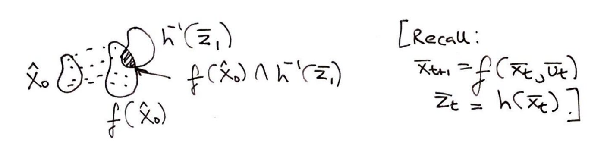
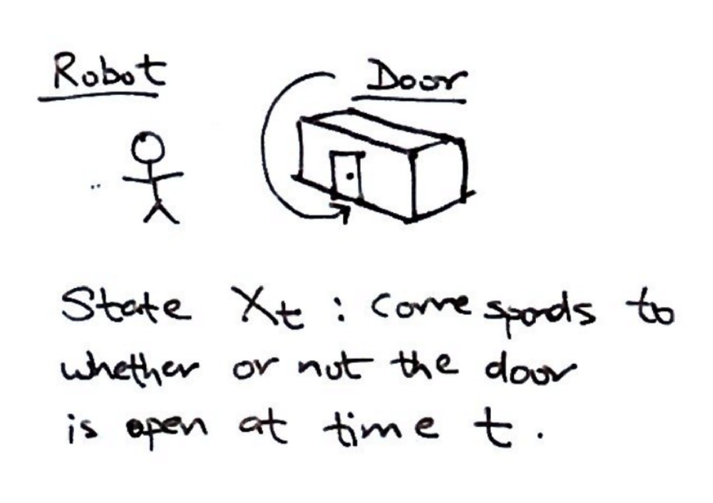

# Lecture 11 — Bayes Filter

Anirudha Majumdar, Princeton ROB 345/549, Fall 2026 ·
[video](https://www.youtube.com/watch?v=mno8-hG7tJc) (77 min) ·
[notes (PDF, Dropbox)](https://www.dropbox.com/scl/fi/tfn61o04v3oxhxmnko2ui/Lecture11.pdf?rlkey=lidlhw6muo5zz4d2ifoxbny50&dl=0) ·
[notes as text](../raw/notes/11-bayes-filter.md) ·
[transcript](../raw/transcripts/11-bayes-filter.md)

**What this lecture establishes.** The nondeterministic filter of the previous lecture keeps a *set* of
states the robot might be in. That is hard to compute, conservative, and leaves the robot with a set when
a controller needs a state. The **Bayes filter** is its probabilistic analog: instead of a set it keeps a
**belief**, a probability distribution over the state, and updates it at every time step in the same two
moves. The **dynamics update** pushes the belief through a probabilistic model of the dynamics, using the
theorem of total probability. The **measurement update** folds in the new sensor reading with **Bayes
rule**, which inverts the sensor model $p(z \mid x)$ into $p(x \mid z)$ the way the preimage inverted the
sensor mapping $h$. The lecture reviews the probability it needs, then works the filter through by hand
on a robot estimating whether a door is open: 0.5 before any measurement, 0.75 after the sensor says
"open", 0.95 after pushing the door, about 0.983 after a second "open" reading. Only then does it write
down the general algorithm. The filter is exact but generally intractable for continuous states. The next
lecture's Kalman filter computes it exactly for linear systems with Gaussian noise, and the particle
filter approximates it in general.

**Where to find what.** The course posts no slide deck for this lecture: it was given at the blackboard,
which the video does not show. The course's **lecture notes** (4 pages) are its written record. They number
five equations, cited here as "notes eq. (N)"; everything else is cited as "notes p. N". The notes'
printed header says "Lecture #12" (a slip). Their two hand-drawn pictures have no numbers or captions; they
are numbered "drawing 1" and "drawing 2" in order of appearance and shown below. Where the board and the
notes differ, this page follows the notes and gives the board's version with its timestamp. Timestamps
(≈M:SS) point into the video and the [transcript](../raw/transcripts/11-bayes-filter.md). Where the lecture
says "over here" or "this term", it is pointing at the board, and this page does not guess what was drawn.
The topic pages are [state estimation](state-estimation.md) and [probability](probability.md).

**Notation.** As in the notes, capital letters are random variables and lowercase letters their values:
$X_ t$ is the state at time $t$, $Z_ t$ the sensor measurement and $U_ t$ the control input (the action).
$p(x)$ is shorthand for $p(X = x)$. The belief is written $\mathrm{bel}$, and the belief after the
dynamics update but before the measurement, the "belief bar", is $\overline{\mathrm{bel}}$. The door's
states and readings are words: $\text{is open}$, $\text{is closed}$, $\text{sense open}$,
$\text{sense closed}$ (the notes print them with an underscore, is_open).

## Contents

1. [From sets to beliefs](#from-sets-to-beliefs)
2. [Probability basics](#probability-basics)
3. [Conditional probability](#conditional-probability)
4. [The theorem of total probability](#the-theorem-of-total-probability)
5. [Bayes rule](#bayes-rule)
6. [The door example: a sensor model](#the-door-example-a-sensor-model)
7. [Where would the sensor model come from?](#where-would-the-sensor-model-come-from)
8. [The prior belief](#the-prior-belief)
9. [The first measurement update](#the-first-measurement-update)
10. [Questions on the update](#questions-on-the-update)
11. [Bayes rule plays the role of the preimage](#bayes-rule-plays-the-role-of-the-preimage)
12. [Adding dynamics: pushing the door](#adding-dynamics-pushing-the-door)
13. [The dynamics update](#the-dynamics-update)
14. [The second measurement update](#the-second-measurement-update)
15. [The Bayes filter](#the-bayes-filter)
16. [Can the belief get worse?](#can-the-belief-get-worse)
17. [Computational cost, and what comes next](#computational-cost-and-what-comes-next)
18. [Gaps in the record](#gaps-in-the-record)

## From sets to beliefs

The lecture opens by recalling the [nondeterministic filter](10-nondeterministic-filter.md#the-nondeterministic-filter)
(≈0:00–2:18). The filter keeps, at each time step, a set of states the robot could be in. It starts from
a set $\hat{X}_ 0$ the robot knows it is in and propagates the set forward with the dynamics, giving
$f(\hat{X}_ 0)$, every state the robot could end up in. It then computes the preimage $h^{-1}(\bar{z}_ 1)$
of the sensor measurement $\bar{z}_ 1$, the set of all states consistent with having received it, and
intersects the two. The intersection is the new estimate, and the steps repeat. The notes put it as three
steps at time $t$ (notes p. 1):

1. compute $f(\hat{X}_ {t-1})$, the dynamics or transition update;
2. compute $h^{-1}(\bar{z}_ t)$, the measurement update;
3. compute $\hat{X}_ t = f(\hat{X}_ {t-1}) \cap h^{-1}(\bar{z}_ t)$, fusing the information from steps 1
   and 2.

*Notes p. 1, drawing 1 — the nondeterministic filter recalled: the starting set (left) is carried by the dynamics to the pear-shaped set, the round set is the preimage of the measurement, and the arrow points at their hatched overlap, the new estimate. The bracket recalls the dynamics, x̄ₜ₊₁ = f(x̄ₜ, ūₜ), and the sensor model, z̄ₜ = h(x̄ₜ). The hand writes the sets' x in lowercase.*

At every time step $\hat{X}_ t$ is the estimate of where the state could be, and it is a set. The notes list
the filter's three problems in practice (notes p. 1): it is computationally challenging to implement; it
can be quite conservative; and it gives a set as the estimate of the state. What should be done with that
set? With an LQR controller $\bar{u} = K\bar{x}$ (see [LQR](lqr.md)), how should the control be computed
from $\hat{X}_ t$? Should the robot pick some representative element of $\hat{X}_ t$, and which one? In the
lecture the emphasis is on computation: how to calculate the preimage, how to even represent the sets, how
to propagate a set through the dynamics. For any meaningfully challenging or practical robotics problem
these steps are intractable (≈2:18). Yet the filter is the conceptual basis of methods that are truly
practical and used extremely widely (≈2:18).

Today's method is the **Bayes filter**. Technically it is "Bayes's filter", but no one says that, and the
lecture calls it the Bayes filter (≈3:06). It is a probabilistic analog of the nondeterministic filter:
instead of sets propagated over time, it maintains probability distributions on the state space, updated
using knowledge of the dynamics and of the sensor measurement process (≈3:06). In the notes' words, instead
of maintaining a set, the robot keeps track of a "belief" over the state, $\mathrm{bel}(\bar{x}_ t)$, a
probability distribution over the state at time $t$ (notes p. 1).

## Probability basics

Before the filter comes a short refresher of the probability it uses, which should be familiar to most of
the class, and a chance to settle the notation (≈3:52). The classic textbook for this and the next couple of
lectures is *Probabilistic Robotics* (Thrun, Burgard and Fox, listed on the course site), whose Chapter 2.2
reviews basic probability (notes p. 1, ≈3:52–4:42).

A capital letter such as $X$ is a **random variable** and a lowercase $x$ an outcome; $p(X = x)$ is the
probability that the random variable $X$ takes on the value $x$ (notes p. 1, ≈4:42–5:28). For a coin toss,
$X$ is the outcome and $x$ is heads or tails. The notes' example is a fair coin,
$p(X = \text{heads}) = p(X = \text{tails}) = 0.5$ (notes p. 1); the board's is a biased coin with
$p(X = \text{heads}) = 0.7$ and $p(X = \text{tails}) = 0.3$ (≈5:28–7:01). To simplify notation one often
writes $p(x)$ for $p(X = x)$, but it is always shorthand for the probability of the random variable taking
that outcome (≈6:14).

**Probabilities sum to one** (notes p. 1, ≈7:01–7:48): over a discrete set of outcomes,

$$\sum_x p(x) = 1,$$

and for a continuous random variable the sum becomes an integral, $\int p(x) dx = 1$, over all the values
the outcome can take (on the board, some set such as a calligraphic $\mathcal{X}$, ≈7:48).

The **joint distribution** of two random variables is $p(x, y) = p(X = x \text{ and } Y = y)$, the
probability that $X$ takes the value $x$ and $Y$ the value $y$ (notes p. 1, ≈8:34). If $X$ and $Y$ are
**independent**, it factorizes into the product of the marginal distributions,

$$p(x, y) = p(x)p(y),$$

which is true only for independent variables (notes p. 1, ≈9:21–10:07). Two coins flipped independently
are the intuition: the joint probability of their outcomes is the product of each outcome's probability
(≈10:07).

## Conditional probability

The **conditional distribution** $p(x \mid y) = p(X = x \mid Y = y)$ is the probability that $X$ takes the
value $x$ given that $Y$ is observed to take the value $y$. It is critical to everything in the lecture
and in the ones after (notes p. 1, ≈10:07–10:53). It is defined as the joint probability divided by the
probability of the condition,

$$p(x \mid y) = \frac{p(x, y)}{p(y)},$$

as long as $p(y) \gt 0$ (notes p. 1, ≈11:39). As a sanity check, if $X$ and $Y$ are independent, then
telling you something about $Y$ should tell you nothing more about $X$, and indeed

$$p(x \mid y) = \frac{p(x, y)}{p(y)} = \frac{p(x)p(y)}{p(y)} = p(x)$$

(notes p. 1, ≈12:26–13:16).

## The theorem of total probability

The **theorem of total probability** gives the distribution of one variable from its conditionals (notes
p. 1, ≈14:01–14:49). In the discrete case,

$$p(x) = \sum_y p(x \mid y)p(y),$$

which on the board is first written as $\sum_y p(x, y)$ and then expanded using the definition of the
conditional (≈14:01). In the continuous case the sum is an integral,
$p(x) = \int p(x \mid y)p(y) dy$ (≈14:49). Here $p(x)$ is called the **marginal distribution** (notes p. 1).
The process is called **marginalization**: given the joint distribution but interested only in $X$, sum out
$Y$ over all its possibilities (≈15:34). The fact can be derived from the earlier results (≈15:34).

## Bayes rule

The most important tool, the one the Bayes filter is named for, is **Bayes rule** ("Very important!", notes
p. 1; ≈16:23):

$$p(x \mid y) = \frac{p(y \mid x)p(x)}{p(y)} = \frac{p(y \mid x)p(x)}{\sum_{x'} p(y \mid x')p(x')} \tag{1}$$

The second form expands the denominator $p(y)$ by the theorem of total probability, summing over every
value $x'$ that $X$ can take (notes eq. (1)). The proof of the first equality takes two lines, starting from
the definition of the conditional applied both ways (notes p. 2, ≈17:09–17:56):

$$p(x \mid y)p(y) = p(x, y) = p(y \mid x)p(x) \tag{2}$$

and so, dividing by $p(y)$,

$$p(x \mid y) = \frac{p(y \mid x)p(x)}{p(y)}. \tag{3}$$

Bayes rule lets you "invert" conditional probabilities: work out $p(x \mid y)$ from $p(y \mid x)$ (notes
p. 2). On the board the rule is written with the letters exchanged, $p(y \mid x) = p(x \mid y)p(y)/p(x)$,
which is the same statement (≈16:23, ≈17:56). In the first lecture's poll most of the class had seen Bayes
rule (≈18:42; see [Lecture 1](01-intro-to-robotics.md)).

## The door example: a sensor model

Rather than state the general algorithm first, the lecture works through an example and then abstracts
from it (≈19:28). It is based on Section 2.4.2 of *Probabilistic Robotics*, modified a little to fit one
lecture (notes p. 2, ≈19:28). A robot (the board's stick figure) is trying to estimate the state of a door:
whether it is open or closed. The whole state of the world is binary (≈19:28–20:13). The robot's sensor,
perhaps a really bad camera, gives imperfect information about the door, and over time the robot
aggregates that information into a probability that the door is open (≈20:13–20:58).

*Notes p. 2, drawing 2 — the door example: the robot (left) and a building whose small door is the thing being estimated; the curved arrow points at the door. The handwriting defines the state: "State Xₜ: corresponds to whether or not the door is open at time t" (the notes write "corre spods").*

The sensor is not perfect; it can be wrong sometimes. Its model gives, for each true state of the door
$X_ t$, the probability of each reading $Z_ t$ (notes p. 2, ≈20:58–22:32):

$$p(Z_ t = \text{sense open} \mid X_ t = \text{is open}) = 0.6$$

$$p(Z_ t = \text{sense closed} \mid X_ t = \text{is open}) = 0.4$$

$$p(Z_ t = \text{sense open} \mid X_ t = \text{is closed}) = 0.2$$

$$p(Z_ t = \text{sense closed} \mid X_ t = \text{is closed}) = 0.8$$

The second number in each pair is fixed by the first: given the true state, the two readings' probabilities
sum to one (≈21:43). $Z_ t$ is the sensor random variable and $X_ t$ the state random variable. Both are
capitals, though capitals are hard to write on the board (≈22:32–23:17).

This is a probabilistic version of the last lecture's sensor model $z = h(x)$, which said exactly which
measurement each state produces; the probabilities allow for errors and imperfections in sensing
(≈23:17–24:05). When the door is closed the sensor is pretty reliable, wrong with probability 0.2; when it
is open it is less reliable, wrong with probability 0.4 (notes p. 2, ≈24:50).

## Where would the sensor model come from?

The Bayes filter takes the sensor model as given, but in practice nobody hands it over. Asked how to get
these probabilities, a student suggests counting: how often the sensor says "open" when the door is open,
divided by the count (≈25:37). That is the idea: some empirical measurement, putting the sensor in front of
many doors, open and closed, with ground truth for whether each was in fact open, and estimating the
probabilities by this kind of Monte Carlo counting. Or you hope the sensor's manufacturer has done the hard
work and given you its error rates (≈25:37). Either way, the filtering techniques assume the probabilities
have been characterized somehow (≈26:24). The notes end on the same question for both models the filter
needs: "Think a little bit about how you might specify/obtain these" (notes p. 4).

## The prior belief

Before any measurement, the robot has a **prior belief** about whether the door is open (notes p. 2,
≈26:24–27:14). Here it is agnostic, with no strong belief either way:

$$p(X_ 1 = \text{is open}) = 0.5, \quad p(X_ 1 = \text{is closed}) = 0.5,$$

where the subscript is time, $t = 1$ (notes p. 2, ≈27:14). The prior could be asymmetric: if you knew doors
in the real world were mostly open, or mostly closed, you might change it; equal values are a simplifying
choice made a priori, before any measurement (≈28:02).

## The first measurement update

At time $t = 1$ the robot senses an open door (notes p. 2, ≈28:51). It should not blindly trust the
sensor and declare itself certain; the sensor model says how far to trust it, so the robot should update its
belief (≈28:51–29:37). Asked how, students propose ideas, which the captions do not catch. One is a running mean, which
may come to something equivalent; another is Bayes rule, "the main trick", the general, formal way
(≈29:37–30:22).

The robot's **belief** that the door is open is defined as the conditional probability that it is open
given the measurement received (notes p. 2, ≈30:22–31:09):

$$\mathrm{bel}(X_ 1 = \text{is open}) \triangleq p(X_ 1 = \text{is open} \mid Z_ 1 = \text{sense open}) \tag{4}$$

where $\triangleq$ means "is defined as". This is what the robot is trying to calculate: given that the
sensor said open, how confident should it now be that the door is in fact open (≈31:09)? Bayes rule inverts
the conditional (notes p. 2, ≈31:56–32:42):

$$\mathrm{bel}(X_ 1 = \text{is open}) = \frac{p(Z_ 1 = \text{sense open} \mid X_ 1 = \text{is open})p(X_ 1 = \text{is open})}{p(Z_ 1 = \text{sense open})} \tag{5}$$

On the board the "is" is dropped to save writing, so the values are just "open" and "closed" (≈31:56–32:42).
The terms are taken one at a time (≈33:31–37:26):

- The second factor of the numerator is the **prior**, the belief before any observation: 0.5 (≈33:31).
- The first is the **sensor model**, the probability that the sensor reports open when the door is open:
  0.6 (≈34:17). So the numerator is

$$\underbrace{p(Z_ 1 = \text{sense open} \mid X_ 1 = \text{is open})}_ {\text{sensor model}} \underbrace{p(X_ 1 = \text{is open})}_ {\text{prior}} = 0.6 \times 0.5$$

(notes p. 2).

- The **denominator**, the unconditional probability that the sensor reports open, is usually the annoying
  one (≈34:17). A student names the tool: the theorem of total probability, or marginalization, summing the
  sensor model times the prior over both possible states of the door (≈35:04–35:50). With two states there
  are two terms; in general there are as many terms as values of $X$ (≈35:50–36:36). Filling in the numbers
  (notes p. 3, ≈36:36):

$$p(Z_ 1 = \text{sense open}) = p(Z_ 1 = \text{sense open} \mid X_ 1 = \text{is open})p(X_ 1 = \text{is open}) + p(Z_ 1 = \text{sense open} \mid X_ 1 = \text{is closed})p(X_ 1 = \text{is closed})$$

$$\phantom{p(Z_ 1 = \text{sense open})} = 0.6 \times 0.5 + 0.2 \times 0.5$$

So (notes p. 3, ≈37:26–38:13)

$$\mathrm{bel}(X_ 1 = \text{is open}) = \frac{0.6 \times 0.5}{0.6 \times 0.5 + 0.2 \times 0.5} = 0.75,$$

and since the door can only be open or closed, $\mathrm{bel}(X_ 1 = \text{is closed}) = 1 - 0.75 = 0.25$
(notes p. 3, ≈38:13). The intuition checks out: the robot started out not knowing, 0.5 either way, received
evidence that the door is open, and is now more confident that it is, 0.75 instead of 0.5 (notes p. 3,
≈38:13–38:58).

## Questions on the update

Several questions follow, and the answers fill in what the belief is.

- **The beliefs sum to one.** In answer to a question the captions do not catch: summed over all possible
  states of the world, the beliefs sum to one. Here
  the state has two values, hence 0.75 and $1 - 0.75 = 0.25$. In general the door could be open, slightly
  open, kind of open and so on to closed, and all those values would have to sum to one (≈38:58–39:44).
- **Where does the update happen?** A student is confused: at $t = 1$ the probability was 0.5, then a
  measurement arrives, so what changes? The update *is* Bayes rule. The belief is defined as the conditional
  probability given the measurement, and Bayes rule computes it from the sensor model, the prior from before
  the measurement, and the denominator, which acts as a normalization built from the same two ingredients
  (≈39:44–41:18).
- **But the prior has not changed?** The process is iterative: at the next time step the current belief
  becomes the prior for the next update. For now, the prior is the belief before the measurement was received,
  or at least incorporated (≈41:18–42:03).
- **What if the prior is certain?** If the robot is absolutely sure the door is open (in the lecture's word, a
  "religious belief"), no amount of evidence will convince it; that is a degenerate update. In practice
  priors are never set to absolute certainty: if you were certain you would not need to do anything, so every
  possibility of the world gets some non-zero probability (≈42:03–42:50).

A last question is about notation: writing just "the belief that the door is open" implies it is given a
certain measurement? Yes: $\mathrm{bel}$ is exactly that conditional probability, a compact notation that
people in the field and the textbook use; anyone who dislikes it can write the conditional out in full
(≈42:50–43:37).

## Bayes rule plays the role of the preimage

It is instructive to compare the role of Bayes rule with the nondeterministic filter (notes p. 3,
≈43:37–45:55). There, the robot started with a set of states, its prior idea of where it could be; received
a measurement; and updated the set through the preimage. The sensor model it assumed was a mapping $h$ from
states to observations: if you knew the state, which observation would the robot receive? What the robot
needs at run time is the opposite, so the preimage inverts the sensor model, giving the set of states
consistent with the observation (≈44:23–45:09). Bayes rule plays the analogous role. The probabilistic
sensor model says, for a known state, how likely each observation is: $p(Z_ t \mid X_ t)$. At run time the
robot does not know the state, it has an observation, and what it really cares about is $p(X_ t \mid Z_ t)$.
Bayes rule does this flip of the conditional, the "inversion", conceptually like computing $h^{-1}(\bar{z}_ t)$
(notes p. 3, ≈45:09–45:55). See [state estimation](state-estimation.md).

## Adding dynamics: pushing the door

So far there is a single step with no dynamics: a prior, one measurement, an updated belief (≈46:42). Now the
robot gets an action (control input), and to keep things simple it is the only one available: **push** the
door (notes p. 3, ≈46:42–47:29). The dynamics are probabilistic, like the sensor model (notes p. 3,
≈47:29–49:05):

$$p(X_ t = \text{is open} \mid X_ {t-1} = \text{is open}, U_ {t-1} = \text{push}) = 1$$

$$p(X_ t = \text{is closed} \mid X_ {t-1} = \text{is open}, U_ {t-1} = \text{push}) = 0$$

$$p(X_ t = \text{is open} \mid X_ {t-1} = \text{is closed}, U_ {t-1} = \text{push}) = 0.8$$

$$p(X_ t = \text{is closed} \mid X_ {t-1} = \text{is closed}, U_ {t-1} = \text{push}) = 0.2$$

The action taken at the previous time step is $U_ {t-1}$ (≈47:29). If the door was already open and the robot
pushes it, it stays open with probability one. If it was closed, the push succeeds in opening it with
probability 0.8 and fails, leaving it closed, with probability 0.2 (≈49:05–49:52). Like the sensor model,
this model is assumed given; getting it in practice is tricky and takes empirical measurement, here putting
the robot in front of many doors and having it push them (≈49:52–50:38).

The notes add a warning about conventions: *Probabilistic Robotics* writes dynamics models as
$p(X_ t \mid X_ {t-1}, U_ t)$, not $p(X_ t \mid X_ {t-1}, U_ {t-1})$. Read the book's $U_ t$ as this
course's $U_ {t-1}$ (notes p. 3).

## The dynamics update

The robot's belief after the first measurement is $\mathrm{bel}(X_ 1 = \text{is open}) = 0.75$ and
$\mathrm{bel}(X_ 1 = \text{is closed}) = 0.25$ (notes p. 3). Still at $t = 1$, it pushes the door. How should
it update its belief after this action, before any new measurement (≈50:38–52:09)? As in the
nondeterministic filter, there are two steps: first take the dynamics into account, then the sensor
measurement (notes p. 3, ≈51:24).

The new quantity gets its own notation, **belief bar**, $\overline{\mathrm{bel}}$: the updated belief after
the action. The robot knows the action it took, since it is its own action, and it knows how the door behaves
under that action; $\overline{\mathrm{bel}}$ is the belief it should then have that the door is open, given
the beliefs it started with (≈52:57–53:44). Intuitively, should pushing make it more or less confident that
the door is open? More, a student says. If the door was open it stays open for certain; if it was closed, as
it is with probability 0.25, the push mostly succeeds. So overall the robot should be more confident; the
question is by exactly how much (≈53:44–55:19). A student notes that the answer depends on the previous state
and the previous action; the action here is given, and the only one is push (≈55:19).

The calculation applies the theorem of total probability: the probability that the door is open at $t = 2$
given each possible previous state and the action, weighted by the belief in that previous state (notes p. 3,
≈56:06–58:27). On the board the weights are first left as empty boxes for the class to fill in; a student
points to the probability of the previous state, and the answer is the belief computed before the action
(≈57:39–58:27). In the notes' **Step 1, "Dynamics / transition update"** (notes p. 3, ≈59:14):

$$\overline{\mathrm{bel}}(X_ 2 = \text{is open}) \triangleq p(X_ 2 = \text{is open} \mid X_ 1 = \text{is open}, U_ 1 = \text{push})\mathrm{bel}(X_ 1 = \text{is open}) + p(X_ 2 = \text{is open} \mid X_ 1 = \text{is closed}, U_ 1 = \text{push})\mathrm{bel}(X_ 1 = \text{is closed})$$

$$\phantom{\overline{\mathrm{bel}}(X_ 2 = \text{is open})} = 1 \times 0.75 + 0.8 \times 0.25 = 0.95$$

and so $\overline{\mathrm{bel}}(X_ 2 = \text{is closed}) = 1 - 0.95 = 0.05$ (notes p. 3). This is the belief
about the state at $t = 2$ *before* making a sensor measurement: the belief propagated from $t = 1$ to the
next time step using knowledge of the system's dynamics (notes p. 3). It matches the intuition: the robot is
good at opening doors, so its confidence that the door is open rises from 0.75 to 0.95 (≈1:00:05).

Is the new belief also conditioned on the earlier measurement? Yes. The filter has the same recursive flavor
as the nondeterministic filter: at every step the robot combines its previous belief (there, the previous
set) with the dynamics, then with a new observation, and every update is conditioned on all the
observations received and the actions taken (≈1:00:05–1:01:37).

## The second measurement update

At $t = 2$ the robot senses an open door again (notes p. 4, ≈1:01:37–1:02:25). **Step 2, "Measurement
update"**, repeats the first measurement update with Bayes rule (notes pp. 3–4, ≈1:02:25–1:03:11):

$$\mathrm{bel}(X_ 2 = \text{is open}) \triangleq p(X_ 2 = \text{is open} \mid Z_ 2 = \text{sense open}) = \frac{p(Z_ 2 = \text{sense open} \mid X_ 2 = \text{is open})p(X_ 2 = \text{is open})}{p(Z_ 2 = \text{sense open})}$$

The sensor model gives 0.6 again (≈1:03:11). What should serve as the prior at this step? A student answers,
and the lecture agrees: the most up-to-date belief, which should always be the prior. Here that is the belief
bar, $\overline{\mathrm{bel}}(X_ 2 = \text{is open}) = 0.95$ (notes p. 4, ≈1:03:57–1:04:43). So the numerator is
$0.6 \times 0.95$. The denominator has exactly the same form as before, by the theorem of total probability,
with the belief bars as the priors (notes p. 4, ≈1:04:43–1:05:36):

$$p(Z_ 2 = \text{sense open}) = 0.6 \times 0.95 + 0.2 \times 0.05$$

and

$$\mathrm{bel}(X_ 2 = \text{is open}) = \frac{0.6 \times 0.95}{0.6 \times 0.95 + 0.2 \times 0.05} \approx 0.983, \quad \mathrm{bel}(X_ 2 = \text{is closed}) = 1 - 0.983 = 0.017$$

(notes p. 4). The robot is getting still more evidence that the door is open, so it becomes still more
confident: from 0.95 to about 0.983 (≈1:06:25).

The whole run, side by side:

| Time | What happened | Belief that the door is open |
| --- | --- | --- |
| $t = 1$, before measuring | prior | 0.5 |
| $t = 1$ | sensor says open (measurement update) | 0.75 |
| $t = 1$ to $t = 2$ | robot pushes (dynamics update, $\overline{\mathrm{bel}}$) | 0.95 |
| $t = 2$ | sensor says open (measurement update) | about 0.983 |

## The Bayes filter

What has been described is the **Bayes filter**, a probabilistic version of the nondeterministic filter
(notes p. 4, ≈1:06:25–1:07:12). At each time step $t$, for every value of the state $X_ t$, it does two
things (notes p. 4, ≈1:07:12–1:09:33):

1. the **dynamics update**,

$$\overline{\mathrm{bel}}(X_ t) = \sum_{X_ {t-1}} p(X_ t \mid X_ {t-1}, U_ {t-1})\mathrm{bel}(X_ {t-1})$$

2. the **measurement update**,

$$\mathrm{bel}(X_ t) = \frac{p(Z_ t \mid X_ t)\overline{\mathrm{bel}}(X_ t)}{p(Z_ t)}$$

The dynamics update is the theorem of total probability, summing over every possible state at the previous
time step; it takes the previous belief and updates it with the dynamics model, which is assumed given, and
with the action, which the robot is always assumed to know exactly (≈1:07:58–1:10:20). The measurement update
receives whatever measurement $z_ t$ arrives at time $t$ and applies Bayes rule with the belief bar as the
prior (≈1:10:20). Each step has its counterpart in the nondeterministic filter: the dynamics update is the
probabilistic analog of propagating the previous set through the dynamics, and the measurement update, which
inverts the sensor model, is like the preimage (≈1:10:20–1:11:05). In the example the sum ran over just two
states, and the measurement update was the Bayes rule calculation; the filter repeats the two steps
recursively, propagating the current belief through the dynamics and folding in each measurement with Bayes
rule, until it hopefully has a confident estimate of the state (≈1:12:37).

The board writes both updates with lowercase letters, $x_ t$ and $z_ t$, and stresses that this is shorthand:
$\mathrm{bel}(x_ t)$ means the belief that the random variable $X_ t$ equals the particular value $x_ t$, open
or closed in the example; writing it out every time would be cumbersome, so everyone uses the shorthand
(≈1:07:12, ≈1:11:05–1:11:51). Two board slips were corrected in class. In the dynamics update the previous
state's term was first written as a probability $p(x_ {t-1})$ and corrected to the belief
$\mathrm{bel}(x_ {t-1})$ (≈1:07:58–1:08:46). In the measurement update the sensor term was written as
$p(x_ t \mid z_ t)$ until a student pointed out that it should be the sensor model $p(z_ t \mid x_ t)$
(≈1:08:46, ≈1:11:51).

To run the filter one needs exactly two things (notes p. 4): a **dynamics model**,
$p(\bar{X}_ t \mid \bar{X}_ {t-1}, \bar{U}_ {t-1})$, and a **measurement model**, $p(\bar{Z}_ t \mid \bar{X}_ t)$
(the notes print the first with $\bar{U}_ t - 1$, a slip). Section 2.4.3 of *Probabilistic Robotics* gives the
complete mathematical justification (notes p. 4).

## Can the belief get worse?

As with the nondeterministic filter (see
[Lecture 10, "Does the set always shrink?"](10-nondeterministic-filter.md#does-the-set-always-shrink)),
the robot need not become more confident over time (≈1:12:37–1:13:24). If the dynamics are unstable and the
sensor is useless, giving no information, a robot that starts out very confident becomes less and less
confident about its state. Still, the Bayes filter is in some sense the best one can do: it incorporates all
the knowledge of the dynamics and of the sensor in the most probabilistically principled way (≈1:13:24). See
[stability](stability.md) and [uncertainty](uncertainty.md).

## Computational cost, and what comes next

The Bayes filter is still computationally intractable in general, because it iterates over all possible states:
the update has to be calculated for every value the state can take (≈1:13:24–1:14:10). In the door example the
state was binary, so the calculations were easy. A state can instead take infinitely many values: the drone's
state space is continuous and 12-dimensional (see [the quadrotor model](quadrotor-model.md)). Then the
summation becomes an integral, and those integrals are typically very hard to calculate (notes p. 4,
≈1:14:10). The filter is tractable when the state space is reasonably sized, or can be discretized into a
reasonable number of values (≈1:14:55).

Some settings allow it to be implemented efficiently, and others need approximations, both the subject of the
next lecture (notes p. 4). If the dynamics are linear with Gaussian noise and the sensor model is linear plus
Gaussian, the Bayes filter can be computed exactly and efficiently, with no approximation: it becomes the
**Kalman filter** (≈1:14:55–1:15:41). Real dynamics are never linear and sensors are never linear and Gaussian,
so the next lecture also covers the **particle filter**, a general approach that implements the Bayes filter
approximately. It works generically, with nonlinear dynamics or an odd sensor model, without strong
assumptions; the quality of its approximation depends on many things, to be discussed (≈1:15:41). The course
site's next lecture is "Kalman filtering and particle filtering"; see the [course map](course-map.md).

## Gaps in the record

- **The blackboard is not in the record, and there is no deck.** The example and the general filter were
  written on the board; this page follows the notes, whose content matches what is spoken. Where the lecture
  points at the board (the stick-figure robot, ≈19:28; the terms of Bayes rule, ≈33:31–34:17; the boxes of the
  dynamics update, ≈56:06–57:39) the captions do not say what was drawn.
- **Board and notes differ in small ways.** The board's coin is biased (0.7 and 0.3), the notes' fair (0.5);
  the board writes Bayes rule with $x$ and $y$ exchanged; the board drops "is" from the door's values and writes
  the general filter in lowercase $x_ t$, $z_ t$, where the notes use capitals. Spoken only: "technically
  Bayes's filter", how to obtain the sensor and dynamics models by counting, the questions on the update (the
  partly open door, the certain prior), the remark that the belief can grow less confident, the drone's
  12-dimensional state, discretization, and the Kalman and particle filter preview beyond the notes' "next
  lecture". In the notes only: the filter's three problems and the LQR question (p. 1), the textbook's
  different dynamics convention (p. 3) and its Section 2.4.3 (p. 4).
- **Student turns** are run together with the lecture in the captions and are partly inaudible; see the
  [transcript](../raw/transcripts/11-bayes-filter.md) for where.
- **Printed slips in the notes**: the page-1 header reads "Lecture #12" and "Insturctor"; the recap's third
  step prints "-=" for a dash; "ff" for "iff" in the independence line; on page 3 the two sentences after Step 1
  call the predicted belief $\mathrm{bel}(X_ 2)$ without its bar, where the step itself and page 4 write
  $\overline{\mathrm{bel}}$; page 4 has a capital $P$ in one denominator, a lowercase $x_ 2$ under the
  underbrace, and the dynamics model with $\bar{U}_ t - 1$ for $\bar{U}_ {t-1}$; drawing 1 labels the sets with a
  lowercase $\hat{x}$; drawing 2 writes "corre spods". The arithmetic has no slip. See the
  [notes file](../raw/notes/11-bayes-filter.md#printed-slips).
