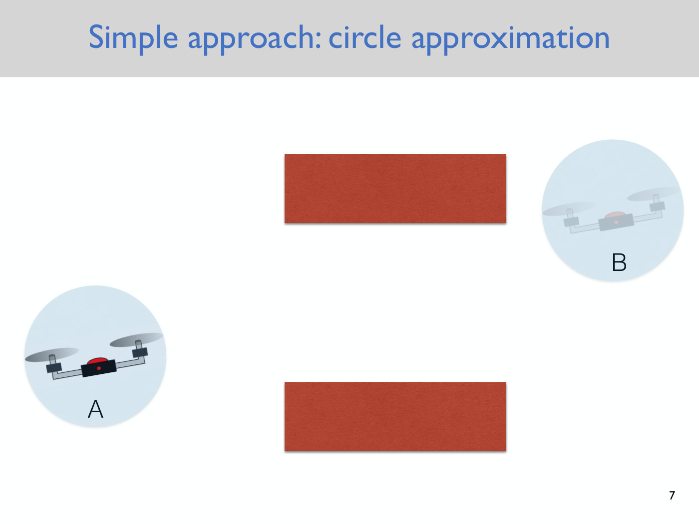
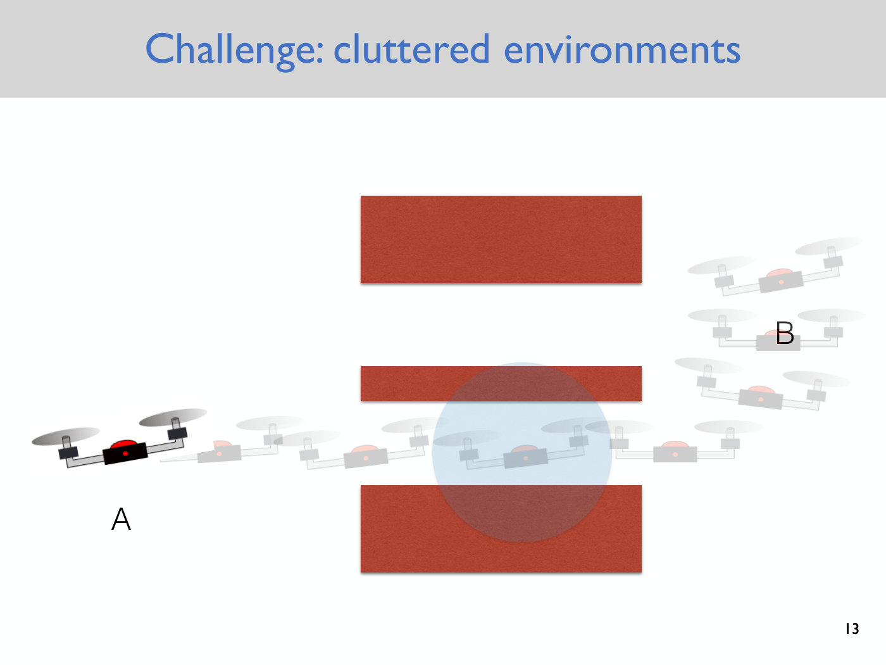

# Configuration space

The configuration space is the setting in which the course states its motion planning problems.
It is introduced in [Lecture 2](02-discrete-motion-planning.md#configuration-space-free-space-and-obstacle-space),
where Majumdar presents it, for the moment, as "a mathematical device that helps us state the
problem formally". He promised that the next lecture would use it "in a deeper way" (≈31:17), and
[Lecture 3](03-rrts.md) does: it is how the course accounts for a robot's real geometry. This page
collects the definitions and examples. Slide numbers and timestamps refer to Lecture 2 unless
stated otherwise.

## Degrees of freedom

The **degrees of freedom (DoFs)** of a system are "the number of independent ways a system can
move" (slide 14). Equivalently, they are the minimal number of coordinates needed to specify the
system's configuration (≈12:26–13:14). The word that does the work is *independent*. A planar
pendulum's mass has an $x$ and a $y$, but the rod constrains $\sqrt{x^2 + y^2}$ to equal its
length, so changing one forces a change in the other, and the pendulum has one degree of freedom
(≈14:52–15:39).

## Configuration space and its examples

The **configuration space** $C$ is the set of possible configurations a system can be in, so each
point of $C$ is one configuration (slide 16, ≈21:53–22:40). The system is usually a robot, but the
idea applies to anything being planned for, such as a protein.

| System | Degrees of freedom | Configuration space $C$ |
| --- | --- | --- |
| a point in $d$-dimensional space | $d$ | $\mathbb{R}^d$ |
| $N$ points in $d$-dimensional space | $N \cdot d$ | $\mathbb{R}^{N \cdot d}$ |
| a planar pendulum | 1 (the angle $\theta$) | $S^1$, the circle |
| a planar quadrotor | 3 ($x$, $y$, $\theta$) | $\mathbb{R}^2 \times S^1$ |
| a planar snake robot with $n$ links and a free base | $n + 2$ | $\mathbb{R}^2$ crossed with $n$ copies of $S^1$ |

The first four rows are on slides 14 and 16. The snake robot was worked out with the class on the
blackboard. It needs two numbers for the position of its base point and one angle for each link,
and a snake with zero links is just a point in the plane (≈15:39–21:53). $S^1$ is the space of a
single angle, running from 0 to $2\pi$ with 0 equal to $2\pi$ (≈22:40–23:31). A student called the
planar quadrotor's space SE2 (≈23:31).

## Free space and obstacle space

**Free space** $C_{free} \subseteq C$ is the set of configurations in which the system is not in
collision with any obstacle (slide 17, ≈25:07–26:39). For the planar quadrotor it is the set of
$(x, y, \theta)$ for which the drone touches nothing. A configuration can leave free space by
rotation alone: tilt the drone far enough and a propeller hits an obstacle.

*Slide 17 — a configuration in free space: the planar quadrotor clear of both obstacles. [Deck](https://www.dropbox.com/scl/fi/pnwucnirlwgviqwaj67hl/Lecture2.pdf?rlkey=6s2et2apw9rtnvr8x2ke243sp&dl=0)*

**Obstacle space** $C_{obs} = C \setminus C_{free}$ is its complement, the configurations in which
the system is in collision (slide 18, ≈26:39).

*Slide 18 — a configuration in obstacle space: moved up and to the left, the quadrotor's propeller overlaps an obstacle. [Deck](https://www.dropbox.com/scl/fi/pnwucnirlwgviqwaj67hl/Lecture2.pdf?rlkey=6s2et2apw9rtnvr8x2ke243sp&dl=0)*

Obstacles look very different in configuration space from how they look in the world. Lecture 2's
video does this for a triangle in the plane, which has the planar quadrotor's three degrees of
freedom. Its configuration space is drawn as a 3D space with orientation on the vertical axis and
the top plane identified with the bottom one. A triangle that moves around a circle while
rotating traces a helix there, and a single obstacle in the plane becomes a complicated solid,
every point of which is a colliding configuration (≈27:26–30:30).

## The geometric motion planning problem

With these definitions, **geometric motion planning** is: find a path in $C_{free}$ from
configuration $q_A$ to configuration $q_B$ (slide 20, ≈30:30). It comes with three assumptions
that the course relaxes later (slide 12, ≈10:07–11:38):

1. **Any path is feasible to follow.** Dynamics are ignored, so any continuous path is assumed
   executable, though a real car cannot move sideways. This is relaxed a few lectures later.
2. **The robot's state is perfectly known.** This is relaxed in the localization and mapping module.
3. **The map of the environment is provided**, as a geometric model such as a point cloud, a
   voxel grid or a neural surface (≈3:13–3:59).

The problem is old and hard. Known as the **piano mover's problem**, it has been studied in
robotics since the 1980s, and was shown to be PSPACE-complete (slide 8). These assumptions
deliberately set aside the [uncertainty](uncertainty.md) that Lecture 1 named as what makes
robotics hard.

## Why plan in configuration space: the robot's geometry

Lecture 2 treated the robot as a point, and
[Lecture 3](03-rrts.md#accounting-for-the-robots-geometry) drops that assumption. The quickest
alternative is to enclose the robot in the smallest circle that contains it and inflate every
obstacle by the circle's radius. That inflation is an operation called the **Minkowski sum**. The
robot is then a point again, and any path among the inflated obstacles is safe for the real robot
in every orientation (Lecture 3, slide 7, ≈3:14–5:35). But the circle is conservative. In a
cluttered environment it can be too big for a gap the real robot fits through, which turns a
feasible problem into an infeasible one (Lecture 3, slide 13, ≈6:21–7:52).

*Slide 7 — the circle approximation: each quadrotor is enclosed in the smallest circle that contains it. [Deck](https://www.dropbox.com/scl/fi/5uv2vt76nqj4b32vr4i37/Lecture3.pdf?rlkey=nx8jjqjlvmgcqqhb8r1p6okzp&dl=0)*

*Slide 13 — where the circle fails: the quadrotor itself fits through the narrow lower gap, but the circle around it overlaps the obstacles above and below. [Deck](https://www.dropbox.com/scl/fi/5uv2vt76nqj4b32vr4i37/Lecture3.pdf?rlkey=nx8jjqjlvmgcqqhb8r1p6okzp&dl=0)*

Configuration space has no such loss. A configuration records the robot's full position and
orientation, so a path in $C_{free}$ is exactly a collision-free motion of the real robot. The
problem is "reduced back to that of finding path for point (in configuration space)" (Lecture 3,
slide 20, ≈10:59–11:46).

The price is dimension. A 3D quadrotor has six degrees of freedom, three for the position of its
centre of mass and three for its orientation, and a typical robot arm has seven (Lecture 3,
≈13:19, ≈14:51). A robot with $d$ degrees of freedom has a $d$-dimensional configuration space.
Cutting each dimension into $B$ bins gives a grid of $B^d$ cells, and even constructing $C_{obs}$
in such a space is intractable (Lecture 3, slide 21, ≈14:51–17:11).

*Slide 21 — the curse of dimensionality: a robot arm with d degrees of freedom, whose discretized configuration space has B to the d cells. [Deck](https://www.dropbox.com/scl/fi/5uv2vt76nqj4b32vr4i37/Lecture3.pdf?rlkey=nx8jjqjlvmgcqqhb8r1p6okzp&dl=0)*

## Two ways to solve it

**Discretize, then search a graph.** Lecture 2 lays a grid over a two-dimensional configuration
space, treats each free cell as a vertex, and searches the resulting graph with BFS, DFS or A\*.
See [graph search](graph-search.md). Some problems are discrete to begin with, like the Rubik's
cube, which has a finite set of states (≈9:21).

**Plan in the continuous space.** The next lecture covers continuous motion planning (≈33:36).
[Lecture 3](03-rrts.md) samples the configuration space at random and grows a tree from the start,
collision-checking one configuration at a time, so it never constructs $C_{obs}$. See
[rapidly exploring randomized trees](rrt.md). Discretization does not scale past about three
dimensions, because the grid grows as $B^d$. The RRT does scale (Lecture 3, ≈16:24, ≈45:13).

## Configuration and state

Configuration space ignores how fast the robot is moving. When [Lecture 4](04-quadrotor-dynamics.md)
brings in the robot's dynamics, the configuration becomes one part of a larger **state**. The planar
quadrotor's state is $\bar{x} = [x, y, \theta, \dot{x}, \dot{y}, \dot{\theta}]^T$. Its first three
entries, $[x, y, \theta]$, are called the **configuration variables**, one per degree of freedom,
and the rest are their time derivatives (Lecture 4 notes, p. 3; Lecture 4, ≈24:17–25:03). A system
with $n$ degrees of freedom therefore has $2n$ states: 6 for the planar quadrotor and 12 for the 3D
quadrotor. See [state and dynamics](state-and-dynamics.md).

## Where it appears

- [Lecture 2 — Discrete Motion Planning](02-discrete-motion-planning.md): degrees of freedom,
  configuration space, free and obstacle space, and the formal planning problem.
- [Lecture 3 — Rapidly Exploring Randomized Trees](03-rrts.md): why the robot's geometry calls
  for configuration space (the circle approximation and where it fails), the curse of
  dimensionality, and planning directly in the continuous space.
- [Lecture 4 — Quadrotor Dynamics](04-quadrotor-dynamics.md): configuration variables as the part
  of the state that gives the configuration, and the 3D quadrotor's six degrees of freedom.
