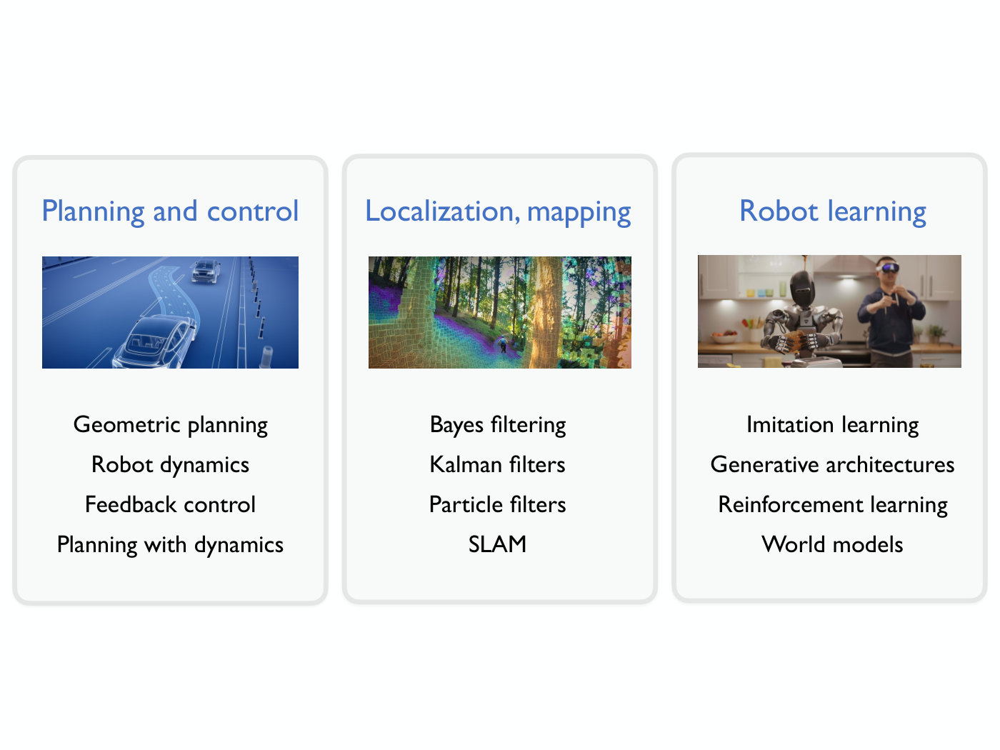

# Course map — ROB 345/549 Introduction to Robotics (Fall 2026)

How the course is organized, lecture by lecture, and which lectures this knowledge base covers.
The schedule is the one on the public course website
(<https://irom-lab.princeton.edu/intro-to-robotics/>), taken on 2026-10-20 and checked again on
2026-10-28. The course was still in progress. On 2026-10-28 lectures 1–9 had videos and slides,
lectures 10 and 11 had videos and notes but no slides, and lectures 12–24 had only a title.

## The three technical areas

In [Lecture 1](01-intro-to-robotics.md) Majumdar groups the technical content into three areas
(slide 33 of that deck, ≈20:56–22:29):

*Slide 33 — the course's three technical areas and their topics: planning and control, localization and mapping, robot learning. [Deck](https://www.dropbox.com/scl/fi/oltefsy9ihq4efgxvtyn9/Lecture1.pdf?rlkey=4kc7a1r2pja5z932phyakcq73&dl=0)*

- **Planning and control**: how a robot decides where to go and how to get there. Geometric
  planning first (the robot as a point or shape moving among obstacles, dynamics ignored), then
  robot dynamics, feedback control, and planning that respects the dynamics.
- **Localization and mapping**: how a robot estimates its own state (position, velocity) and the
  state of the world (where the obstacles are and what they are). Bayes filtering, Kalman
  filters, particle filters, SLAM.
- **Robot learning**: how a robot learns dynamics or behaviour from data. Imitation learning,
  generative architectures (flow matching, diffusion), reinforcement learning, world models.

A fourth, non-technical thread, robotics and jobs, ethics and law, closes the course. Lecture 1
says these broader impacts will also come up throughout (≈7:52–8:38).

He frames all three technical areas as responses to one problem, **uncertainty**. See
[uncertainty](uncertainty.md).

## Lecture schedule

Lecture titles are the course website's. "In KB" links the lecture's wiki page where one
exists.

| # | Lecture | Section | In KB |
| --- | --- | --- | --- |
| 1 | Intro to Robotics | Introduction | [wiki](01-intro-to-robotics.md) |
| 2 | Discrete planning (graph search) | Geometric motion planning | [wiki](02-discrete-motion-planning.md) |
| 3 | Randomized planning (RRTs) | Geometric motion planning | [wiki](03-rrts.md) |
| 4 | Quadrotor dynamics | Planning with dynamics | [wiki](04-quadrotor-dynamics.md) |
| 5 | Differential flatness | Planning with dynamics | [wiki](05-differential-flatness.md) |
| 6 | Trajectory optimization | Planning with dynamics | [wiki](06-trajectory-optimization.md) |
| 7 | Stability, PD control | Feedback control | [wiki](07-stability-and-pd-control.md) |
| 8 | Linear Quadratic Regulator (LQR) | Feedback control | [wiki](08-lqr.md) |
| 9 | Optical flow | State estimation, localization, mapping | [wiki](09-optical-flow.md) |
| 10 | Nondeterministic filter | State estimation, localization, mapping | [wiki](10-nondeterministic-filter.md) |
| 11 | Bayes filtering | State estimation, localization, mapping | posted, not yet in this KB |
| 12 | Kalman filtering and particle filtering | State estimation, localization, mapping | not posted yet |
| 13 | Localization | State estimation, localization, mapping | not posted yet |
| 14 | Mapping | State estimation, localization, mapping | not posted yet |
| 15 | Simultaneous localization and mapping (SLAM) | State estimation, localization, mapping | not posted yet |
| 16 | Imitation learning | Machine learning for robotics | not posted yet |
| 17 | Generative architectures (flow matching, diffusion) | Machine learning for robotics | not posted yet |
| 18 | Exam | — | — |
| 19 | Data augmentation and DAgger | Machine learning for robotics | not posted yet |
| 20 | Vision-language-action models (VLAs) | Machine learning for robotics | not posted yet |
| 21 | Reinforcement learning - I | Machine learning for robotics | not posted yet |
| 22 | Reinforcement learning - II | Machine learning for robotics | not posted yet |
| 23 | World models | Machine learning for robotics | not posted yet |
| 24 | Robotics and jobs, ethics, and laws | Broader topics in robotics | not posted yet |

Slides, notes and assignments for every lecture are linked from [`sources.md`](../sources.md).

## Assignments and the final project

The four assignments posted so far go out with lectures 2, 3, 6 and 8 (see
[`sources.md`](../sources.md)). Each mixes theory, coding and a hardware part done in teams of
four on the [Crazyflie drone](crazyflie.md). The final project trains a vision-based navigation
policy with imitation learning, so the drone can fly through an obstacle course it has not seen
before. Grading and policies are on [course logistics](course-logistics.md).
