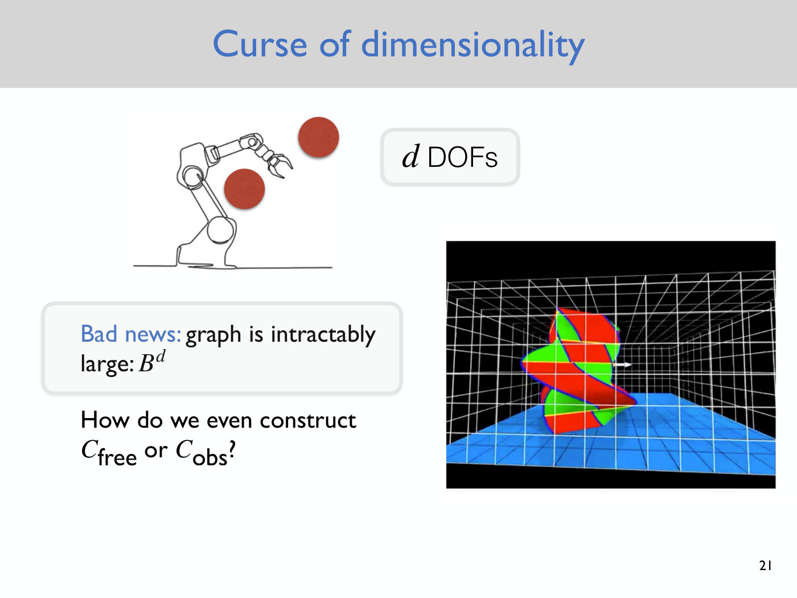
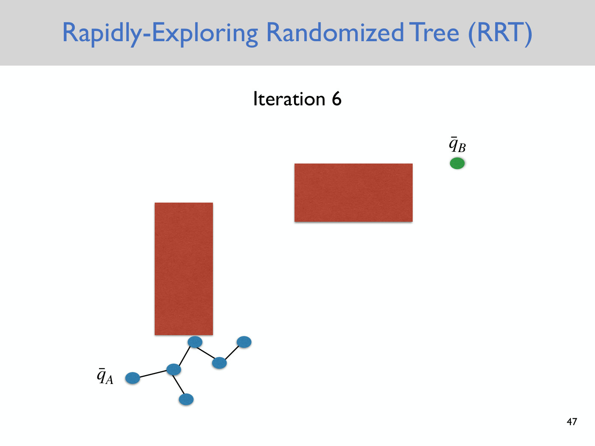
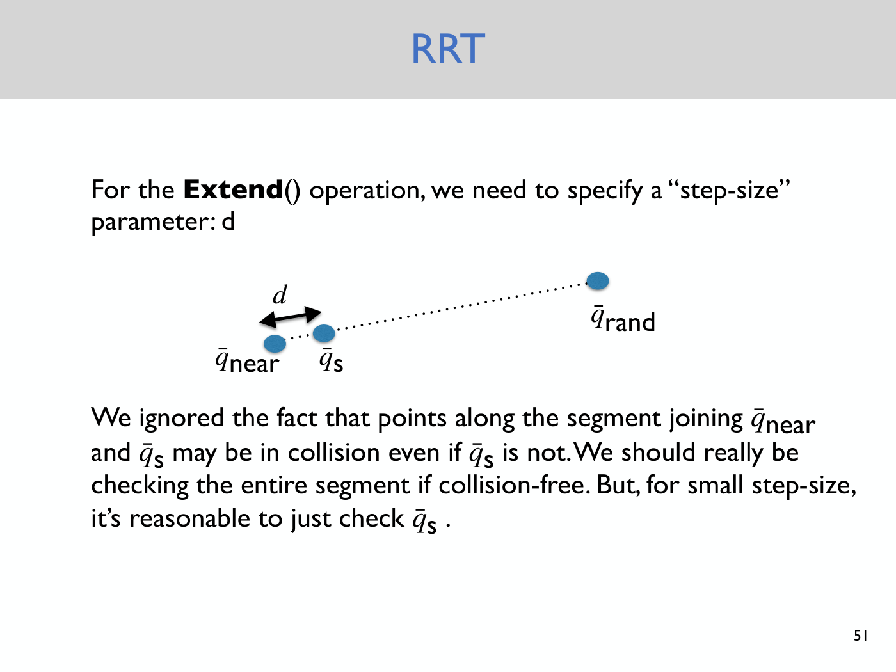

# Rapidly exploring randomized trees (RRTs)

The rapidly exploring randomized tree (RRT) is the course's first randomized motion planner. It
solves the geometric motion planning problem, find a path in the free space $C_{free}$ from
configuration $q_A$ to configuration $q_B$, in configuration spaces too large to discretize. It is
the subject of [Lecture 3](03-rrts.md), which walks the basic algorithm through six iterations.
Slide numbers and timestamps on this page refer to Lecture 3. For the definitions of
configuration space, free space and obstacle space, see [configuration space](configuration-space.md).

## The problem it solves

Accounting for a robot's real geometry means planning in its
[configuration space](configuration-space.md), where the robot is a point again. In principle, one
can discretize that space and run the [graph search](graph-search.md) algorithms of Lecture 2. In
practice there are two obstacles (slide 21, ≈14:51–17:11):

*Slide 21 — the curse of dimensionality: a robot arm with d degrees of freedom, whose discretized configuration space has B to the d cells. [Deck](https://www.dropbox.com/scl/fi/5uv2vt76nqj4b32vr4i37/Lecture3.pdf?rlkey=nx8jjqjlvmgcqqhb8r1p6okzp&dl=0)*

- **The curse of dimensionality.** A robot with $d$ degrees of freedom has a $d$-dimensional
  configuration space. With $B$ bins per dimension, the grid has $B^d$ cells, exponential in the
  dimension. A robot arm typically has seven degrees of freedom, and a humanoid 30 or 40, so
  discretization stops being tractable beyond about three dimensions.
- **The obstacle space cannot be built.** Constructing or even representing $C_{obs}$ in a
  high-dimensional space would mean deciding, for every one of the $B^d$ configurations, whether it
  is in collision.

## Three key ideas

The RRT avoids both problems with three ideas (slides 23 and 24, ≈18:44–21:04):

1. **Work directly in the continuous configuration space**, with no upfront discretization.
2. **Never explicitly construct $C_{obs}$.**
3. **Use efficient collision checking** of individual configurations, with algorithms such as GJK
   (Gilbert, Johnson and Keerthi). These were developed for video games and are extremely fast,
   especially for convex shapes.

Majumdar calls the second idea the key conceptual one behind RRTs, all their variants, and
randomized motion planning in general. The algorithm only ever asks whether the robot, in one
particular configuration, collides with its environment (slide 52, ≈48:17–49:49).

## The algorithm

The tree starts as the single vertex $\bar{q}_ A$, the initial configuration; the slides put a bar
over every configuration. Each iteration then does four things (slide 48):

1. **Sample** a configuration $\bar{q}_ {\text{rand}}$ at random, ignoring the obstacles.
2. **Find the nearest vertex** $\bar{q}_ {\text{near}}$ of the tree to the sample.
3. **Extend** from $\bar{q}_ {\text{near}}$ toward $\bar{q}_ {\text{rand}}$ by a fixed step size
   $d$, giving the new point $\bar{q}_ s$.
4. **Collision-check** $\bar{q}_ s$. If it is in collision, throw it away. Otherwise add it to the
   tree with an edge from $\bar{q}_ {\text{near}}$, and stop if
   $\Vert \bar{q}_ s - \bar{q}_ B \Vert \lt \epsilon$, so that the new point lies within a
   user-chosen distance $\epsilon$ of the goal $\bar{q}_ B$.

The sample and the line to it both ignore the obstacles, and a sample inside an obstacle is no
problem. Only the extended point is checked (≈25:41–27:59, ≈34:17). Branching comes from the
nearest-vertex step: the vertex closest to a new sample need not be the one added last, so the
structure is a tree, a graph with no cycles, rooted at $\bar{q}_ A$ (≈30:19, ≈31:53–32:40). After
six iterations of the lecture's example, one extension has been rejected for landing in an
obstacle, and the tree has branched once (slide 47).

*Slide 47 — after six iterations: one extension was rejected, and the newest vertex branches off the second vertex, the one nearest its sample, instead of extending the chain. [Deck](https://www.dropbox.com/scl/fi/5uv2vt76nqj4b32vr4i37/Lecture3.pdf?rlkey=nx8jjqjlvmgcqqhb8r1p6okzp&dl=0)*

The full algorithm, as printed, is on the [lecture page](03-rrts.md#the-rrt-algorithm), with each
iteration of the example walked through in [the RRT, step by step](03-rrts.md#the-rrt-step-by-step).

**Recovering the path.** Record the parent of each new vertex, which is the
$\bar{q}_ {\text{near}}$ it was extended from. When the algorithm stops, follow parents back from
the last vertex to $\bar{q}_ A$; the absence of cycles guarantees that this ends there (slide 55,
≈55:15–56:00).

## Practical details

- **Checking the segment.** Even if $\bar{q}_ {\text{near}}$ and $\bar{q}_ s$ are both free, points
  between them may not be. The correct check covers the whole segment. In practice people use a
  bisection search along it, or a small step size with slightly inflated obstacles (slide 51,
  ≈45:59–48:17).
- **The goal threshold.** A path ends within $\epsilon$ of the goal, not at it. To reach the goal
  exactly, connect the final point to it, or every so often sample the goal itself and try to
  connect the tree to it. A large $\epsilon$ only moves the hard part of the problem to the last
  step (≈38:08–41:20).
- **Goal bias.** Biasing the sampling toward the goal, in the spirit of A\*'s heuristic, is done
  in practice and can speed the search up (≈31:05, ≈45:59).

*Slide 51 — the Extend step: the new point lies a step d from the nearest vertex toward the sample; checking only that point ignores the segment in between. [Deck](https://www.dropbox.com/scl/fi/5uv2vt76nqj4b32vr4i37/Lecture3.pdf?rlkey=nx8jjqjlvmgcqqhb8r1p6okzp&dl=0)*

## Properties

**Efficient in high dimensions.** Graph search is "basically out of the question" beyond three or
four dimensions, while LaValle's early demonstrations of the RRT planned for humanoid robots in "a few seconds,
maybe, if you have an optimized algorithm" (≈45:13–45:59). The piano in
Lecture 3's video has a six-dimensional configuration space (≈51:22).

**Space-filling.** The tree explores coarsely at first and then ever more finely. It is biased
toward large Voronoi regions, which partition the configuration space by the nearest point of the
tree. In plain English, it is biased toward the regions it has not yet explored (≈41:20–43:39).

**Feasible, not optimal.** The basic RRT returns a feasible path that "can be quite jagged" (slide
55) and may be far from optimal, as the piano and PR2 videos show (≈52:09, ≈57:32).

**Probabilistically complete, not complete.** If a path exists, the probability that the RRT finds
it converges to one as the number of iterations goes to infinity (slide 62). This holds under mild
conditions on the separation between obstacles, and fails only in pathological, non-physical
environments (≈1:06:52–1:08:24). If no path exists, the RRT may run forever, so it is not complete
in the classical sense (slides 60 and 61).

## Variants

- **RRT\*** returns approximately optimal paths (slide 57). It adds a local **rewiring** step,
  updating the tree whenever it finds a more efficient path. It keeps improving after its first
  feasible path, and it is **anytime valid**: once feasible, always feasible, so it can be stopped
  whenever the computation budget runs out (≈57:32–1:02:57). Exploring widely, rather than biasing
  toward the goal, is what lets it find a better path in a different homotopy class
  (≈1:00:37–1:02:11).
- **Bi-directional RRT** is named on slide 57 and not discussed.
- **RRTs with dynamics.** The drone flights from Nick Roy's group use an RRT "with some
  modifications that I'll talk about in a few lectures" to account for the drone's dynamics
  (≈52:57). [Lecture 5](05-differential-flatness.md#planning-with-an-rrt-in-the-flat-output-space)
  names the modification: for a [differentially flat](differential-flatness.md) robot, the RRT is
  built in the flat output space, for a quadrotor $x$, $y$, $z$ and yaw, instead of the
  configuration space. The straight-line extension a dynamic robot cannot follow is then replaced
  by a smooth flat output trajectory, often a polynomial in time, that it can (Lecture 5,
  ≈58:57–1:01:16 and ≈1:06:07–1:06:53).

## RRTs and graph search compared

| | Graph search ([Lecture 2](02-discrete-motion-planning.md)) | RRT (Lecture 3) |
| --- | --- | --- |
| The space | discretized into a grid up front | continuous, explored "as you go" (≈49:49) |
| The obstacles | cells that intersect obstacles are deleted | individual configurations are collision-checked |
| Dimension | intractable beyond about three or four dimensions | efficient in high dimensions |
| Completeness | complete for the discretized problem (slide 61) | probabilistically complete (slide 62) |
| Optimality | A\* is optimal if its heuristic underestimates | none for the basic RRT; RRT\* is approximately optimal |

Graph search need not build $C_{obs}$ either, as a student pointed out in Lecture 3. Majumdar
agreed: some A\* variants also check collisions as they go. What still separates the two is the
grid, which grows exponentially with the dimension (≈49:03–50:36).

## Where it appears

- [Lecture 3 — Rapidly Exploring Randomized Trees](03-rrts.md): the motivation, the algorithm,
  the six-iteration example, its properties, RRT\* and completeness. Implementing the basic RRT is
  part of the assignment posted with it (see [`sources.md`](../sources.md)).
- [Lecture 4 — Quadrotor Dynamics](04-quadrotor-dynamics.md#the-labs-and-the-first-hardware-assignment):
  the first hardware lab runs an RRT on the Crazyflie, planning from a taped start marker to a
  landing box around foam-pole obstacles whose positions students measure by hand. It assumes the
  drone's built-in controller can follow whatever path the RRT returns, so the dynamics are ignored.
- [Lecture 5 — Differential Flatness](05-differential-flatness.md): the extension step under
  dynamics, and the RRT run in the flat output space; the MIT drone video is shown again with that
  explanation.
