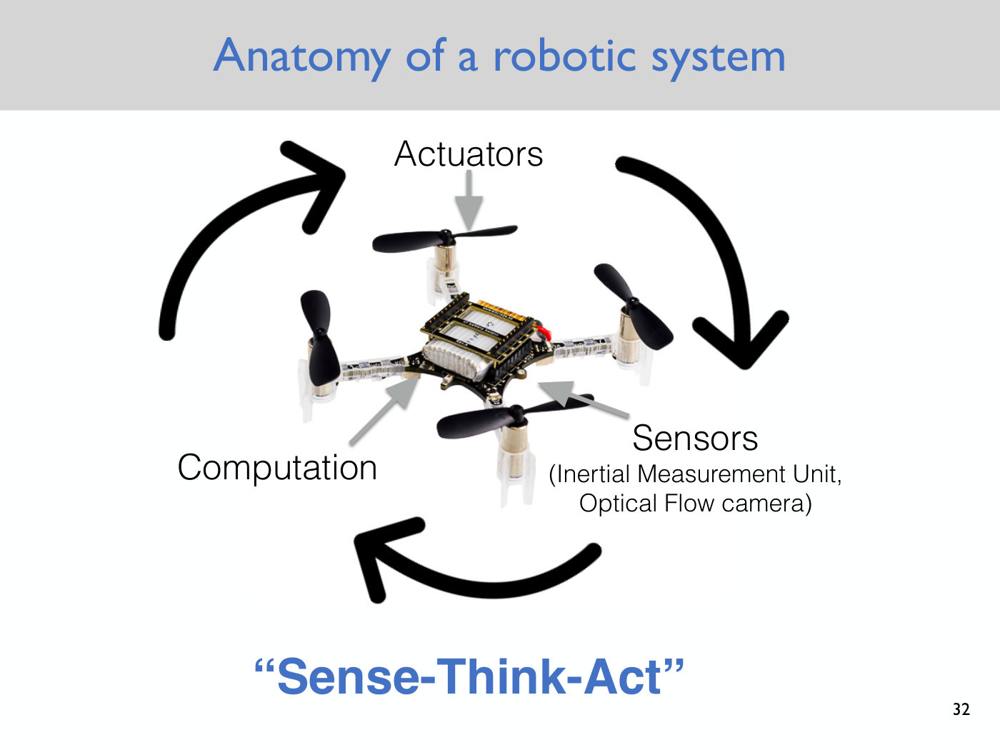
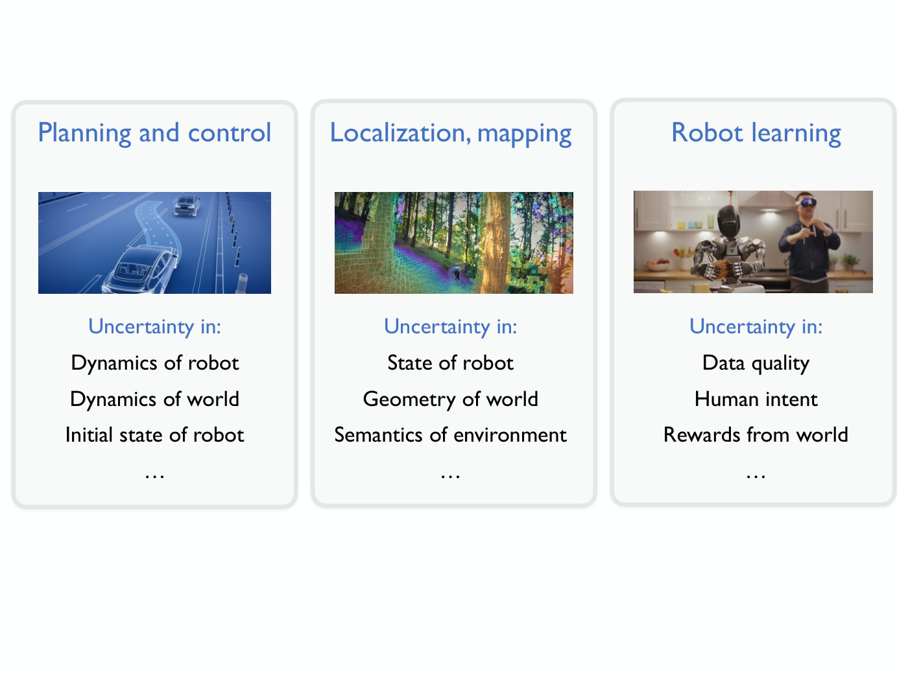

# Sense–think–act: the anatomy of a robotic system

Robotics has no agreed definition of a robot ([Lecture 1](01-intro-to-robotics.md#what-is-a-robot)),
but most roboticists agree on what any robotic system is made of. Majumdar's
summary in Lecture 1 has three components and one loop.

## The three components

**Actuators** are how a robot effects physical change in its environment. On the course's
[Crazyflie drone](crazyflie.md), the actuators are the four motors and their propellers.

**Sensors** are how it measures its own state or the state of the world around it. The drone
carries several:

- an **inertial measurement unit (IMU)**, which gives the drone a sense of its orientation and
  its acceleration;
- a downward-facing **optical flow camera**, which looks for relative motion of the ground
  beneath it. If the camera sees everything moving one way, the drone infers it is moving the
  other way;
- a **height sensor**. Combined with optical flow, it gives a fairly accurate estimate of the
  drone's velocity relative to the ground.

**Computation** takes in sensor measurements, processes them, and decides which actuator
commands to apply. It can be "some hand-engineered system that you've coded up" or "a gigantic
neural network that you've trained using lots of data." The robot's anatomy is the same either
way.

## The loop

These components form a cycle: **sense, think (compute), act**. Repeat it "in a closed feedback
loop": each action changes the robot's state and its surroundings, and the next measurements
reflect that change. Majumdar calls this "the classical sense–think–act cycle" and notes that
most robotic architectures are built this way (Lecture 1, slide 32, ≈18:40–20:56).

*Slide 32 — the sense–think–act loop on the course's Crazyflie: sensors (IMU, optical flow camera) feed computation, which commands the actuators (motors and propellers), clockwise and repeating. [Deck](https://www.dropbox.com/scl/fi/oltefsy9ihq4efgxvtyn9/Lecture1.pdf?rlkey=4kc7a1r2pja5z932phyakcq73&dl=0)*

The loop is also how the IEEE definition of a robot reads. It describes "an autonomous machine
capable of sensing its environment, carrying out computations to make decisions, and performing
actions in the real world". Lecture 1 notes that this definition says something about the
*architecture* a system must have to count as a robot (slide 24, ≈12:30–13:15).

## How the course's topics fit the loop

Lecture 1 describes each of the course's three technical areas (see [course map](course-map.md))
in terms that line up with parts of the loop:

- **Localization and mapping** turns sensor measurements into estimates: "how do we get the
  drone to estimate its own state … and then also the state of the world" (≈21:43).
- **Planning and control** decides and executes actions: planning a collision-free path, then
  making the drone hover or follow a trajectory despite its dynamics (≈20:56–21:43). Lecture 2
  starts the path-planning part with [graph search](graph-search.md) over a discretized
  [configuration space](configuration-space.md).
- **Robot learning** is one way to build the computation itself, learning dynamics or behaviour
  from data instead of hand-engineering it (≈21:43–22:29).

Each stage is also where [uncertainty](uncertainty.md) enters. Lecture 1's list for planning
and control is uncertainty in the dynamics of the robot and the world and in the robot's initial
state. For localization and mapping it is uncertainty in the state of the robot and the state,
geometry and semantics of the world (slide 39).

*Slide 39 — the same three areas, each with the uncertainty it has to handle: dynamics and initial state; robot and world state, geometry, semantics; data quality, human intent, rewards. [Deck](https://www.dropbox.com/scl/fi/oltefsy9ihq4efgxvtyn9/Lecture1.pdf?rlkey=4kc7a1r2pja5z932phyakcq73&dl=0)*

## Lectures

- [Lecture 1 — Introduction to Robotics](01-intro-to-robotics.md#anatomy-of-a-robotic-system-sensethinkact):
  the components, the drone's sensors, and the closed loop.
- [Lecture 8 — The Linear Quadratic Regulator](08-lqr.md#recap-why-feedback-and-the-control-loop):
  the loop as a feedback controller runs it (slide 6). Sense the state $\bar{x}(t)$, compare it with the
  desired state $\bar{x}_ 0$, choose the control input, and repeat, about 500 times a second for a
  hovering quadrotor (≈2:31–3:17).
- [Lecture 9 — Optical Flow](09-optical-flow.md): the drone's optical-flow sensing in depth, as Lecture 1
  promises (≈19:25): how the downward-facing camera's apparent motion, with the drone's height, gives its
  velocity, and why that estimate is imperfect. See [optical flow](optical-flow.md).
- [Lecture 10 — Nondeterministic Filter](10-nondeterministic-filter.md): the sensing side in the
  abstract. A sensor model maps each state to the measurement it produces, and the robot combines its
  measurements with its knowledge of the dynamics, step after step, to narrow down its state. See
  [state estimation](state-estimation.md).
- [Lecture 11 — Bayes Filter](11-bayes-filter.md): the same loop with probabilities. The robot keeps a
  belief over its state, updates it through the dynamics after each action and with Bayes rule after each
  measurement; the action is its own, so it is always assumed to know it (≈1:09:33).
