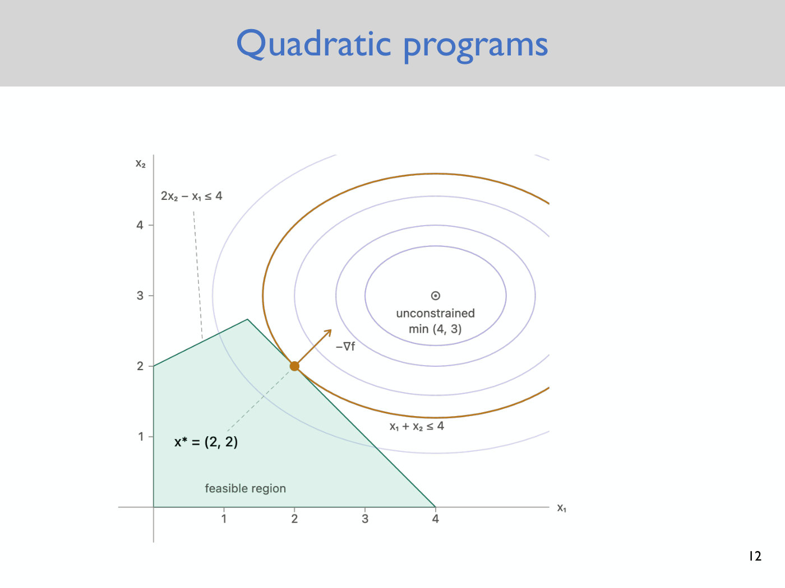

# Trajectory optimization

**Trajectory optimization** finds control inputs that drive a robot from one state to another while
obeying its dynamics. In ROB 345 it is the general answer to planning with dynamics. It is introduced
in [Lecture 6](06-trajectory-optimization.md) as the way to do the [RRT](rrt.md)'s extension step for
a robot that cannot follow straight lines, and it is also called the **boundary value problem**
(Lecture 6, slide 9). This page collects the method: the problem, the linear case solved as a convex
quadratic program, the nonlinear case solved by sequential quadratic programming, and how it is used
inside the RRT. The linearization it relies on has its own page, [linearization](linearization.md).

Notation follows the course. The state is $\bar{x}$ and the control input $\bar{u}$, with dynamics
$\dot{\bar{x}} = f(\bar{x}, \bar{u})$ (see [state and dynamics](state-and-dynamics.md)); a bar marks a
vector. Citations are to Lecture 6: "slide N", "notes eq. (N)" and "notes p. N" for its written
material, and (≈M:SS) for its video.

## The problem it answers

Geometric planners such as the RRT join states with straight segments, and a robot with dynamics often
cannot follow them: a drone cannot translate sideways, and a car cannot slide to a spot beside it
(≈14:53–16:26). [Differential flatness](differential-flatness.md) answers this for some systems, but it
controls only the flat outputs, so for the planar quadrotor it cannot fix the orientation, and many
systems are not flat or not known to be (slide 3, ≈2:28–3:13).

Lecture 6 tries two ways of putting dynamics into the RRT. Growing the tree in state space by
sampling a vertex of the tree and applying a random control input is probabilistically complete, but
it never explores and is useless in practice (slides 5–6, ≈5:33–9:25). The approach that works keeps
the RRT and changes the extension. Instead of a line segment from the nearest vertex
$\bar{x}_ {\text{near}}$ to the new state $\bar{x}_ s$, find control inputs that take the system from
$\bar{x}_ {\text{near}}$ to $\bar{x}_ s$ (slides 7–9, ≈9:25–11:44). That is a trajectory optimization
problem.

## The problem stated

Given a start state and a goal state, find the states and control inputs over a time horizon $T$ that
take the system from one to the other while satisfying the dynamics and any other constraints, and
that are best by some objective (≈45:28–52:28). The horizon $T$ is how long you are willing to wait
for the system to arrive, for instance 5 or 10 seconds (≈48:34).

The objective in the lecture is **control effort**, the summed squared magnitude of the control input:
"be as lazy as possible" (≈48:34–49:24). Other objectives are possible: minimum path length, or
minimum time. Minimum time leads to **bang-bang control**, which switches the input between its
extremes and is not friendly to a physical system, so in practice time, effort and path length
penalties are often thrown together into one objective (≈1:02:36–1:03:21).

## The linear case: a convex quadratic program

When the dynamics are linear, the problem becomes easy (slide 9, ≈16:26). The lecture gets there in
three steps (notes pp. 1–3).

1. **Linearize** the dynamics about a nominal state $\bar{x}_ 0$ and control input $\bar{u}_ 0$, by a
   first-order Taylor expansion (notes eq. (4)): $\dot{\bar{x}} = A(\bar{x} - \bar{x}_ 0) + B(\bar{u} - \bar{u}_ 0)$.
   For the planar quadrotor about hover, $A$ and $B$ are worked out entry by entry on the
   [linearization](linearization.md) page.
2. **Discretize** time with step $\Delta t$ by Euler integration (notes eq. (10), ≈46:14–47:46).
3. **Pose the optimization problem** over the states $\bar{x}[t]$ and inputs $\bar{u}[t]$ at
   $t = 0, \Delta t, 2\Delta t, \ldots, T$ (notes p. 3).

The problem of step 3 is

$$\min_ {\bar{x}[\cdot], \thinspace \bar{u}[\cdot]} \sum_ {t=0}^{T} \Vert \bar{u}[t] \Vert_ 2^2$$

subject to the discretized dynamics

$$\bar{x}[t + \Delta t] = \bar{x}[t] + \Delta t \left[ A(\bar{x}[t] - \bar{x}_ 0) + B(\bar{u}[t] - \bar{u}_ 0) \right], \quad t = 0, \ldots, T - \Delta t,$$

the boundary conditions $\bar{x}[0] = \bar{x}_ {\text{start}}$ and $\bar{x}[T] = \bar{x}_ {\text{goal}}$,
and the state bound $C \bar{x}[t] \le \bar{d}$ for $t = 0, \ldots, T$. The bound keeps the state inside
a **polytope**, a region defined by linear inequalities, one hyperplane per row of $C$ (notes p. 3,
≈53:13). It can stand for the collision-free space around obstacles when that space can be
approximated by a polytope, which is not always possible (≈54:00–54:48).

**Why it is easy.** The objective is convex and quadratic ("it sort of looks like a bowl") and every
constraint is linear in the states and inputs. That makes the problem a **convex quadratic program
(QP)**, for which extremely efficient solvers exist. Problems with thousands of variables solve in
milliseconds, and the planar quadrotor's perhaps in microseconds with a fast implementation
(≈54:48–56:22). The notes name Mosek and Gurobi as solvers, and ORF 363 at Princeton as a course on
optimization (notes p. 3).

**A picture.** Slide 12 shows a QP in two variables: elliptical level sets of the objective, with its
unconstrained minimum at $(4, 3)$, and two linear constraints, $2x_2 - x_1 \le 4$ and
$x_1 + x_2 \le 4$, that leave a feasible region not containing it. The slide marks the
constrained minimum, $x^\ast = (2, 2)$, on the region's edge, where one of the level sets touches it
(≈57:58–1:00:17). In trajectory optimization the same picture is imagined in a space of high dimension
(≈57:58).

*Lecture 6, slide 12 — a convex QP in two variables: the objective's level sets (ellipses) around the unconstrained minimum (4, 3), the green feasible region cut out by two linear constraints, and the constrained minimum x\* = (2, 2) on its edge. [Deck](https://www.dropbox.com/scl/fi/9wnsc9wkmxmvwbugm7rps/Lecture6_slides.pdf?rlkey=9dsf9cbn7sjy9b5m6dieznycs&dl=0)*

## Nonlinear systems: sequential quadratic programming

Real dynamics and constraints are not linear, so the general problem is solved approximately, by
**sequential quadratic programming (SQP)** (slides 13–14, ≈1:00:17–1:04:07). Lecture 6 sketches it
without details:

1. Guess a trajectory, for instance a straight line from start to goal, even though it passes through
   the obstacles.
2. Linearize the dynamics along the current trajectory, and approximate the obstacle constraints as
   linear or relax them.
3. Solve the resulting QP.
4. Increase the penalty for violating the obstacle constraints, re-linearize about the newest
   trajectory, and solve again, until the trajectory hopefully becomes feasible.

The lecture demonstrated this on the planar quadrotor with an interactive demo whose first iteration is
slide 14 (≈1:01:02). Unlike the linear case, SQP has **no guarantee** of finding a collision-free
trajectory, and the more obstacles and the more complicated the environment, the less likely it is to
find one (≈1:04:07).

## Inside the RRT

That weakness is why trajectory optimization is combined with the RRT (≈1:04:07–1:04:52). Each extension asks trajectory optimization only for a short trajectory
from $\bar{x}_ {\text{near}}$ to $\bar{x}_ s$, which can be solved efficiently. Build the RRT, solve
one small optimization problem at every extension, and hopefully the path that results is dynamically
feasible.
Compare the flatness-based alternative, in which the RRT is built in the flat output space (see
[differential flatness](differential-flatness.md#planning-in-the-flat-output-space)).

## Examples

Lecture 6 shows three systems from Majumdar's own work, each video played in class (slides 16–18,
≈1:04:52–1:10:41; see [Lecture 6](06-trajectory-optimization.md#examples-an-acrobot-a-knife-edge-airplane-funnel-libraries)):
an **acrobot**, an underactuated double pendulum swung up to upright on a trajectory found by SQP; a
fixed-wing airplane flying a **knife-edge** maneuver between PVC poles less than a wingspan apart; and
**funnel libraries**, trajectories and the funnels the plane is guaranteed to stay in, precomputed
offline so that only collision checking is left at runtime.

## What it does not cover

A planned trajectory is never followed exactly. The model is imperfect, there may be unmodeled
aerodynamics or a gust of wind, and correcting for that is **feedback control**, the next topic in the
course (≈1:10:41–1:11:27). [Lecture 7](07-stability-and-pd-control.md#where-this-lecture-sits-why-a-plan-is-not-enough)
replays Lecture 6's sequential-QP demo to show it: executed open loop, the plan drifts from numerical
integration error alone, and with the mass changed by 10% it hits an obstacle (Lecture 7, ≈2:29–4:47).
Run fast enough, trajectory optimization can itself provide the feedback, by replanning from the
robot's current state over and over; this is **receding horizon control**, or **model predictive
control** (Lecture 7, ≈10:06–11:40; see [feedback control](feedback-control.md)).

## Lectures

- [Lecture 6 — Trajectory Optimization](06-trajectory-optimization.md): the whole method, from the RRT
  ideas through linearization, the QP, sequential QP and the examples.
- [Lecture 5 — Differential Flatness](05-differential-flatness.md): the flatness-based approach to the
  same problem, whose limits motivate this one.
- [Lecture 3 — RRTs](03-rrts.md): the RRT whose extension step trajectory optimization replaces.
- [Lecture 4 — Quadrotor Dynamics](04-quadrotor-dynamics.md): the planar quadrotor's equations of
  motion that are linearized.
- [Lecture 7 — Stability and PD Control](07-stability-and-pd-control.md): why an optimized plan
  executed open loop drifts, and replanning (model predictive control) as a form of feedback.
